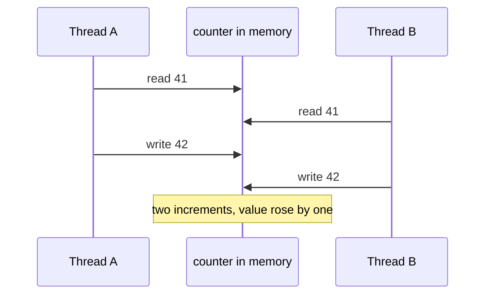
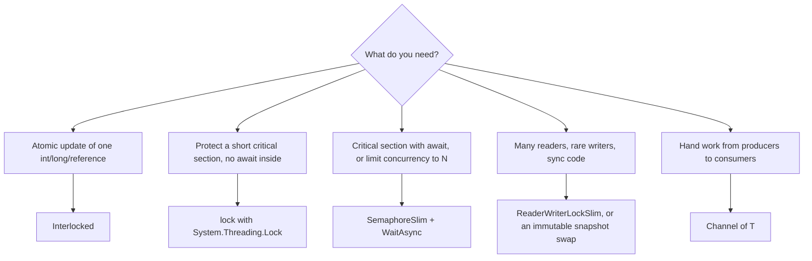

import { Tabs, TabItem, Aside } from '@astrojs/starlight/components';
import QuizBlock from '~/components/QuizBlock.astro';

## Why it matters in interviews

Threading questions separate people who have *used* `async` from people who understand what runs where. Expect *"Thread vs Task?"*, *"why can't you `await` inside a `lock`?"*, *"how do you limit concurrent calls to an API?"*, *"is `ConcurrentDictionary` fully thread-safe?"* and a "find the race condition" code-reading exercise. Senior-leaning loops add deadlocks, `volatile` and producer/consumer with `Channel<T>`.

## Core idea

A **thread** is an OS-scheduled unit of execution with its own stack (1 MB reserved by default on Windows). Creating one is expensive, so .NET keeps a **thread pool**: a set of worker threads that pick work items off queues. A **`Task`** is not a thread. It is a *promise of a result* that may run on a pool thread (`Task.Run`), or may not use a thread at all while waiting for I/O (see [Async/Await](../async-await/)).

| | `Thread` | `ThreadPool.QueueUserWorkItem` | `Task` / `Task.Run` |
|---|---|---|---|
| Cost | Expensive: own stack, OS object | Cheap: reuses pool threads | Cheap: pool + small object |
| Result / exceptions | Manual | Manual, unhandled = crash | `Task<T>` carries result and exceptions |
| Composition | `Join()` only | None | `await`, `WhenAll`, `WhenAny`, continuations, cancellation |
| Use when | Long-lived dedicated work needing custom priority, apartment state, or a named thread | Rarely directly | Default for CPU offload and everything async |

Once the pool is past its minimum thread count, its **hill-climbing** and starvation-detection logic adds threads gradually (on the order of one or two per second), not instantly, when queued work is not draining. That is why **sync-over-async** (`.Result` in request code) causes *thread-pool starvation*: every blocked thread is one fewer to run the continuations that would unblock it.

For long-running CPU loops, `Task.Factory.StartNew(work, TaskCreationOptions.LongRunning)` asks the scheduler for a dedicated thread instead of tying up a pool thread. In ASP.NET Core, prefer a `BackgroundService` for that kind of work.

### Data parallelism: Parallel and PLINQ

- `Parallel.For` / `Parallel.ForEach`: split **CPU-bound** work across cores, blocking the caller until done.
- `Parallel.ForEachAsync` (.NET 6+): run **async I/O** work with a cap (`MaxDegreeOfParallelism`). Ideal for "call this API for 500 items, 8 at a time".
- PLINQ (`.AsParallel()`): parallel LINQ for CPU-heavy queries over in-memory data. Order is not preserved unless you add `.AsOrdered()`.

Do not use `Parallel.ForEach` with async lambdas: it takes an `Action<T>`, so the lambda becomes `async void` and the loop returns before the work completes.

### Race conditions

`counter++` is **read, add, write**: three steps. Two threads can read the same value and both write back value + 1, losing an increment.



Running `Parallel.For(0, 1_000_000, _ => counter++)` on a multi-core machine prints a number below 1,000,000, different on each run. Fixes, from cheapest to most general: `Interlocked.Increment(ref counter)`, a `lock`, or avoiding shared state entirely (each worker computes a local total, then combine).

### Choosing a synchronization primitive



| Primitive | Cross-process? | Async-friendly? | Notes |
|---|---|---|---|
| `lock` / `Monitor` | No | No | Re-entrant for the same thread. Cheap when uncontended (spins briefly, then waits) |
| `System.Threading.Lock` (.NET 9+) | No | No | Dedicated lock type; `lock (myLock)` uses its faster `EnterScope()` path |
| `SemaphoreSlim` | No | Yes, `WaitAsync` | Not re-entrant. Count N = throttle; count 1 = async mutex |
| `Interlocked` | No | n/a | Lock-free atomic ops: `Increment`, `Add`, `Exchange`, `CompareExchange` |
| `ReaderWriterLockSlim` | No | No | Thread-affine, so never hold it across `await` |
| `Mutex` / `Semaphore` | Yes (named) | No | Kernel objects, much slower. "Single instance app" checks |
| `Channel<T>` | No | Yes | Async producer/consumer queue with optional bounded back-pressure |

### How `lock` works

`lock (obj) { ... }` compiles to `Monitor.Enter(obj, ref taken)` plus `try/finally { Monitor.Exit(obj); }`, so the lock is released even when an exception is thrown. Monitor uses a header word on the object (thin lock, inflated to a *sync block* under contention). Since .NET 9 / C# 13, if the expression's static type is `System.Threading.Lock`, the compiler instead calls `Lock.EnterScope()`, which is leaner. If you upcast a `Lock` to `object` the compiler warns (CS9216), because you silently fall back to Monitor.

**You cannot `await` inside `lock`** (compiler error CS1996). Monitor is *thread-affine*: the thread that entered must exit, and after an `await` you may be on a different thread. Use `SemaphoreSlim(1, 1)` with `await WaitAsync()` and `Release()` in `finally`.

### Deadlock

A deadlock needs four conditions at once: mutual exclusion, hold-and-wait, no pre-emption, and a **circular wait**. The practical fix is to break the cycle: always acquire multiple locks in a **fixed global order**, keep critical sections tiny, never call unknown code (events, callbacks, virtual methods) while holding a lock, and use timeouts (`Monitor.TryEnter`, `WaitAsync(timeout)`) where you can recover. The async version of a deadlock is blocking on a task under a single-threaded `SynchronizationContext`.

### Memory model and `volatile`

Compilers, the JIT and CPUs may reorder or cache reads. A classic bug: a worker loops on `while (!_stop)` and, in a Release build, the JIT hoists the read out of the loop so it never sees the update. `volatile` (or `Volatile.Read/Write`) forces each read to really read and adds acquire/release ordering. It does **not** make compound operations atomic: `_count++` on a volatile field is still a race. In application code, prefer a `CancellationToken` over a hand-rolled volatile flag.

### Thread-safety of collections

`List<T>` and `Dictionary<TKey,TValue>` are safe for **concurrent reads only**. Any writer means you need a lock or a concurrent collection: `ConcurrentDictionary`, `ConcurrentQueue`, `ConcurrentBag`, or `Channel<T>`. Immutable and frozen collections (see [Collections & Generics](../collections-generics/)) are inherently safe to share because nobody can mutate them.

Concurrent collections make **each call** atomic, not a sequence of calls. `if (!dict.ContainsKey(k)) dict[k] = v;` is still a race. Use `GetOrAdd`/`AddOrUpdate`. Even then, the `GetOrAdd` value factory can run **more than once** under contention (only one result is stored). If the factory is expensive or has side effects, store `Lazy<T>` values.

## Code

**Async throttling and an async mutex with `SemaphoreSlim`**

```csharp
public sealed class PricingClient(HttpClient http)
{
    private readonly SemaphoreSlim _throttle = new(initialCount: 8); // max 8 calls in flight
    private readonly SemaphoreSlim _tokenLock = new(1, 1);           // async mutex
    private string? _token;

    public async Task<decimal> GetPriceAsync(string sku, CancellationToken ct)
    {
        await _throttle.WaitAsync(ct);
        try
        {
            var token = await GetTokenAsync(ct);
            using var req = new HttpRequestMessage(HttpMethod.Get, $"/prices/{sku}");
            req.Headers.Authorization = new("Bearer", token);
            using var res = await http.SendAsync(req, ct);
            return await res.Content.ReadFromJsonAsync<decimal>(ct);
        }
        finally { _throttle.Release(); }
    }

    private async Task<string> GetTokenAsync(CancellationToken ct)
    {
        if (_token is not null) return _token;
        await _tokenLock.WaitAsync(ct);
        try { return _token ??= await FetchTokenAsync(ct); } // double-checked, only one fetch
        finally { _tokenLock.Release(); }
    }

    private Task<string> FetchTokenAsync(CancellationToken ct) => Task.FromResult("demo-token");
}
```

**`Lock` and `Interlocked`**

```csharp
public sealed class Account
{
    private readonly Lock _gate = new();   // .NET 9+; use a private readonly object on older targets
    private decimal _balance;
    private int _operations;

    public void Deposit(decimal amount)
    {
        lock (_gate) { _balance += amount; } // decimal has no Interlocked overload
        Interlocked.Increment(ref _operations);
    }

    public decimal Balance { get { lock (_gate) return _balance; } }
    public int Operations => Volatile.Read(ref _operations);
}
```

**Producer/consumer with a bounded `Channel<T>`**

```csharp
var channel = Channel.CreateBounded<OrderPlaced>(new BoundedChannelOptions(100)
{
    FullMode = BoundedChannelFullMode.Wait, // producers wait when full: back-pressure
    SingleReader = true
});

// Consumer (typically a BackgroundService)
var consumer = Task.Run(async () =>
{
    await foreach (var evt in channel.Reader.ReadAllAsync(ct))
        await emailSender.SendConfirmationAsync(evt, ct);
});

// Producer (e.g. a controller): returns quickly
await channel.Writer.WriteAsync(new OrderPlaced(orderId), ct);

// Shutdown: no more writes; ReadAllAsync finishes after draining
channel.Writer.Complete();
await consumer;
```

`Channel<T>` replaced most uses of `BlockingCollection<T>`: it never blocks a thread, supports cancellation, and bounded channels give natural back-pressure. Items live in memory only, so use Azure Service Bus (AWS: SQS) when work must survive a restart.

## Interview Q&A

<details>
<summary>What is the difference between a Thread and a Task?</summary>

A `Thread` is an OS thread you create and manage yourself. A `Task` is an abstraction for an asynchronous operation and its result. CPU-bound tasks run on thread-pool threads; I/O-bound tasks use no thread while waiting. Tasks compose (`await`, `WhenAll`), carry exceptions and support cancellation, so they are the default. Use a dedicated `Thread` only for long-lived work that needs special settings.
</details>

<details>
<summary>Why can't you use `await` inside a `lock`? What do you use instead?</summary>

`lock` uses `Monitor`, which is owned by a specific thread and must be released by that same thread. After `await` the continuation may run on another thread, so the compiler forbids it (CS1996). Use `SemaphoreSlim(1, 1)`: `await sem.WaitAsync()` then `try { ... } finally { sem.Release(); }`. Note it is not re-entrant.
</details>

<details>
<summary>Why not `lock (this)` or `lock ("key")`?</summary>

Anyone with a reference to the object (or the same interned string, or the same `Type`) can lock on it too, causing unexpected contention or deadlocks you cannot see from your class. Lock on a **private readonly** field, ideally `System.Threading.Lock` on .NET 9+.
</details>

<details>
<summary>When would you use `Interlocked` instead of `lock`?</summary>

For a single atomic operation on one variable: counters, flags, swapping a reference. It maps to a CPU atomic instruction and never blocks. Once you need to keep two fields consistent, or do read-check-write on more than one value, use a lock. `CompareExchange` in a retry loop builds lock-free updates such as "set max".
</details>

<details>
<summary>Does `volatile` make `count++` thread-safe?</summary>

No. `volatile` guarantees visibility and ordering of individual reads and writes, not atomicity of read-modify-write. `count++` on a volatile field can still lose updates. Use `Interlocked.Increment` or a lock.
</details>

<details>
<summary>Is `ConcurrentDictionary` completely thread-safe?</summary>

Each individual operation is atomic, but a *sequence* of calls is not (check-then-act races remain). `GetOrAdd(key, factory)` may invoke the factory several times concurrently and keep one result. If the factory is expensive or has side effects, store `Lazy<T>` so only one value is materialised. Enumeration is safe but is a moment-in-time view, not a snapshot lock.
</details>

<details>
<summary>How do you call an external API for 1,000 items with at most 10 concurrent requests?</summary>

`Parallel.ForEachAsync(items, new ParallelOptions { MaxDegreeOfParallelism = 10 }, async (item, ct) => ...)`, or a `SemaphoreSlim(10)` around each call with `Task.WhenAll`. Do not use `Parallel.ForEach` with an async lambda (it becomes `async void`) and do not fire 1,000 tasks unthrottled, which can exhaust sockets or trigger rate limits.
</details>

<details>
<summary>How do you prevent deadlocks when you need two locks?</summary>

Acquire them in a consistent global order (for example by account id when transferring between two accounts), keep critical sections short, avoid calling external code while holding a lock, and prefer timeouts (`Monitor.TryEnter`, `WaitAsync(timeout)`) so the code can back off. Better still, design so that one lock or no shared mutable state is needed.
</details>

<details>
<summary>How would you write a thread-safe singleton?</summary>

In DI-based apps, register it as a singleton and let the container handle it. Otherwise use `private static readonly Lazy<T> _instance = new(() => new T());`, which defaults to `ExecutionAndPublication` (thread-safe, one creation). A plain `static readonly` field is also thread-safe because the runtime guarantees the type initialiser runs once. Hand-written double-checked locking is easy to get wrong.
</details>

## Pitfalls

<Aside type="caution" title="Common mistakes">

- **`Parallel.ForEach` with an `async` lambda**: becomes `async void`; the loop finishes before the work does and exceptions crash the process. Use `Parallel.ForEachAsync`.
- **Blocking on tasks in ASP.NET Core** (`.Result`, `.Wait()`) leads to thread-pool starvation under load.
- **Capturing a `for` loop variable** in a thread or task lambda: all closures share one variable, so they may all see the final value. `foreach` creates a fresh variable per iteration.
- **Forgetting `Release()` in `finally`** after `WaitAsync`: one exception permanently reduces the semaphore count.
- **Check-then-act on concurrent collections** (`ContainsKey` then add) instead of `GetOrAdd`/`TryAdd`.
- **Sharing a `DbContext` or `List<T>` across parallel work.** Neither is thread-safe.
- **Holding a lock while calling an event, callback or I/O**: invites deadlocks and kills throughput.

</Aside>

## Related

- [Async/Await Deep Dive](../async-await/)
- [Collections & Generics](../collections-generics/)
- [Background services](../../aspnet/background-services/)
- [Operating systems: processes, threads and deadlock](../../fundamentals/operating-systems/)

## Quick quiz

<QuizBlock section="csharp" topic="threading" />
