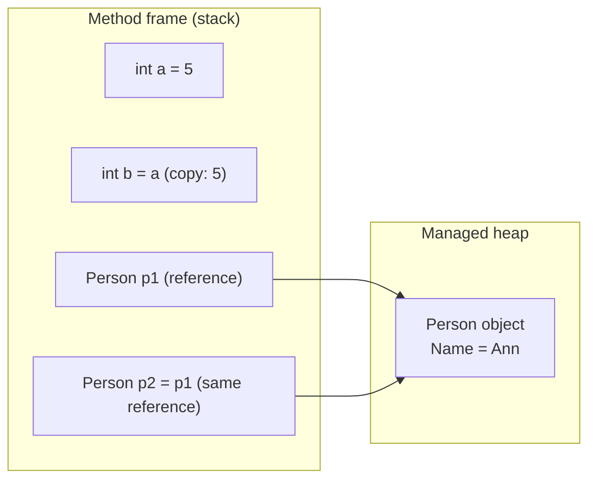

import { Tabs, TabItem, Aside } from '@astrojs/starlight/components';
import QuizBlock from '~/components/QuizBlock.astro';

## Why it matters in interviews

*"Value type vs reference type?"* and *"what is boxing?"* are asked in almost every .NET round. The junior answer is "value types live on the stack". Interviewers at 3-4 years push back on exactly that, then follow up with struct mutation bugs, record equality, and `ref`/`out`/`in`. Getting the nuance right signals you understand the runtime, not just the syntax.

## Core idea

The real difference is **copy semantics**, not location:

- A **value type** variable *contains the data*. Assignment and parameter passing **copy the whole value**. Examples: `int`, `double`, `bool`, `DateTime`, `Guid`, enums, `struct`, `record struct`, tuples (`ValueTuple`).
- A **reference type** variable *contains a reference* (a managed pointer) to an object on the GC heap. Assignment **copies the reference**, so two variables can point at the same object. Examples: `class`, `record`, `string`, arrays, delegates, interfaces (the object behind them).



### Stack vs heap: the nuance

"Value types go on the stack" is only true for **local variables and parameters** in ordinary methods. A value type lives **wherever its container lives**:

| Where the value type is | Where it is stored |
|---|---|
| Local variable / parameter | Stack (or CPU register) |
| Field of a class | Inside that object, on the heap |
| Element of an array (`int[]`) | Inside the array, on the heap |
| Local captured by a lambda, or used across `await` / `yield` | Hoisted into a compiler-generated class, on the heap |
| Boxed (`object o = 42`) | New object on the heap |

And reference types are not always heap-only either: recent JITs (.NET 9/10) can stack-allocate some small objects that provably never escape the method. The safe interview line: *"storage location is an implementation detail; the semantic difference is copy-by-value vs copy-by-reference."*

### Boxing and unboxing

**Boxing** wraps a value type in a heap object so it can be treated as `object` or an interface. **Unboxing** copies the value back out and must use the **exact** type.

```csharp
int n = 42;
object boxed = n;          // box: heap allocation + copy
int back = (int)boxed;     // unbox: type check + copy
long wrong = (long)boxed;  // InvalidCastException: boxed int is not a long
```

Hidden boxing sources: non-generic collections (`ArrayList`, `Hashtable`), calling an interface method on a struct through the interface type, `string.Format`/`params object[]` with value types (interpolated strings avoid most of this since C# 10), and `Enum.HasFlag` in old runtimes. Generics (`List<int>`) removed most boxing; that was one of their main motivations.

### struct vs class

| | `struct` | `class` |
|---|---|---|
| Semantics | Copied on assignment | Reference shared |
| Allocation | Inline in container, no GC header | Separate heap object (header + method table pointer) |
| Inheritance | Cannot inherit (can implement interfaces) | Single inheritance |
| Null | Not nullable unless `T?` (`Nullable<T>`) | Nullable |
| Default equality | Field-by-field (`ValueType.Equals`, may use reflection) | Reference equality |
| Good for | Small (roughly 16 bytes or less), immutable, value-like data: `Money`, `Point`, coordinates | Entities, services, anything with identity or large state |

Make structs **`readonly struct`** when possible. Mutable structs cause surprising bugs because you often mutate a *copy* (a `List<T>` indexer returns a copy, so `list[0].X = 5` doesn't even compile; an array element is a variable, so `arr[0].X = 5` works).

### Records

`record` (a class) and `record struct` give you **value-based equality**, a readable `ToString()`, deconstruction, and non-destructive mutation with `with`.

| | `class` | `record` / `record class` | `record struct` | `readonly record struct` |
|---|---|---|---|---|
| Kind | Reference | Reference | Value | Value |
| `==` compares | Reference | All properties | All fields | All fields |
| Positional properties | n/a | `init`-only | **mutable** (`get; set;`) | `init`-only |
| Typical use | Entities, services | DTOs, events, messages | Small value objects | Immutable value objects |

Records are great for DTOs and domain events. Avoid them for EF Core entities: entities have identity, and value equality confuses change tracking.

### Passing parameters: ref, out, in

| Modifier | Caller must initialize? | Callee must assign? | Callee can modify? | Use |
|---|---|---|---|---|
| (none) | Yes | No | Only its copy | Default |
| `ref` | Yes | No | Yes, caller sees it | Swap, update in place |
| `out` | No | **Yes** | Yes | `TryParse` pattern |
| `in` | Yes | No | **No** (read-only reference) | Pass large structs without copying |
| `ref readonly` (C# 12) | Yes | No | No | Like `in`, but call site must say `ref`/`in` |

Passing a **reference type** without `ref` copies the *reference*: the callee can mutate the object, but reassigning the parameter doesn't affect the caller. With `ref`, reassignment is visible to the caller.

### Nullable value types vs nullable reference types

- `int?` is `Nullable<int>`, a real struct with `HasValue` and `Value`. Boxing a null `int?` gives a **null reference**; boxing a non-null one boxes the underlying `int`.
- `string?` (with `<Nullable>enable</Nullable>`) is **only a compile-time annotation**. At run time `string` and `string?` are the same type. The compiler's flow analysis warns about possible null dereferences. The `!` (null-forgiving) operator silences a warning; it does not check anything.

## Code

```csharp
namespace Billing;

public readonly record struct Money(decimal Amount, string Currency)
{
    public Money Add(Money other) => other.Currency == Currency
        ? this with { Amount = Amount + other.Amount }
        : throw new InvalidOperationException("Currency mismatch");
}

public record OrderPlaced(Guid OrderId, Money Total, DateTimeOffset At);

public static class MoneyDemo
{
    public static void Run()
    {
        var a = new Money(10m, "INR");
        var b = a;                                   // full copy
        Console.WriteLine(a == b);                   // True (value equality)

        var e1 = new OrderPlaced(Guid.Empty, a, DateTimeOffset.UnixEpoch);
        var e2 = e1 with { Total = a.Add(b) };       // new object, e1 unchanged
        Console.WriteLine(e1 == e2);                 // False

        object x = 5, y = 5;
        Console.WriteLine(x == y);                   // False: two boxes, reference comparison
        Console.WriteLine(x.Equals(y));              // True: Int32.Equals compares values

        if (int.TryParse("42", out var parsed)) Console.WriteLine(parsed);
    }
}
```

**Avoiding copies of large structs**

```csharp
public readonly struct Matrix4(double[] cells) { public double this[int i] => cells[i]; }

public static double Trace(in Matrix4 m) => m[0] + m[5] + m[10] + m[15]; // passed by read-only reference
```

## Interview Q&A

<details>
<summary>Are value types always stored on the stack?</summary>

No. Locals and parameters usually are, but a value type field of a class lives inside that object on the heap, array elements live in the array on the heap, and locals captured by lambdas or used across `await` are hoisted to a heap-allocated class. The defining difference is copy semantics.
</details>

<details>
<summary>What is boxing, and why should you care?</summary>

Converting a value type to `object` or an interface allocates a heap object and copies the value in. Unboxing type-checks and copies it back. In hot loops this means allocations and GC pressure. Typical fixes: generics instead of `object`, `List<int>` instead of `ArrayList`, generic constraints (`where T : IComparable<T>`) instead of interface-typed parameters.
</details>

<details>
<summary>When would you choose a struct over a class?</summary>

When the type is small, logically a single value, immutable, and created in large numbers, for example `Money`, a coordinate, or a key in a dictionary. Avoid structs that are large (copying costs), mutable (copy bugs), or frequently boxed. In practice most app types are classes or records; structs show up in performance-sensitive code.
</details>

<details>
<summary>What does a `record` give you over a class?</summary>

Compiler-generated value equality (`Equals`, `GetHashCode`, `==`, `!=`) over all members, `ToString` that prints members, positional syntax with deconstruction, and `with` expressions that clone and change selected properties. It is still a reference type, so it is allocated on the heap and passed by reference.
</details>

<details>
<summary>`ref` vs `out` vs `in`?</summary>

`ref`: caller initializes, callee may read and modify. `out`: caller needn't initialize, callee must assign before returning, used for `TryX` patterns. `in`: read-only by-reference, used to avoid copying large structs; with a non-readonly struct the compiler may make defensive copies when you call members, so pair `in` with `readonly struct`.
</details>

<details>
<summary>If I pass a `List<int>` to a method without `ref` and the method adds an item, does the caller see it?</summary>

Yes. The reference is copied, but both copies point at the same list object. If the method instead does `list = new List<int>()`, the caller does **not** see that, because only the local copy of the reference changed. With `ref`, it would.
</details>

<details>
<summary>Is `string` a value type? It behaves like one.</summary>

No, it is a reference type. It *feels* like a value type because it is **immutable** and overrides `==` to compare contents. `(object)s1 == (object)s2` compares references and can be false for equal strings. See [Strings & Span](../strings-span/).
</details>

<details>
<summary>What do nullable reference types change at run time?</summary>

Nothing. They are annotations plus compiler flow analysis that produce warnings. You still need runtime guards at boundaries (`ArgumentNullException.ThrowIfNull`) because callers can pass null from code that has NRT disabled or uses `!`. Treat warnings as errors in new projects.
</details>

## Pitfalls

<Aside type="caution" title="Common mistakes">
- Claiming **"value types live on the stack, reference types on the heap"** without the nuance.
- **Mutable structs**: modifying a copy returned by a property, a `List<T>` indexer, or a `foreach` variable.
- Unboxing to the wrong type: `(long)(object)42` throws `InvalidCastException`.
- Using `==` on two `object` variables holding boxed values; it compares references.
- Large structs passed by value in hot paths, or `in` with non-readonly structs causing defensive copies.
- Using records as **EF Core entities**, or putting mutable collections inside a record and expecting deep equality (records compare the collection **reference**).
- Overusing `!` to silence nullable warnings instead of fixing the flow.
</Aside>

## Related

- [OOP in C#](../oop-csharp/)
- [Memory, GC & IDisposable](../memory-gc/)
- [Modern C# (9 → 15)](../modern-csharp/)
- [Strings, StringBuilder & Span](../strings-span/)

## Quick quiz

<QuizBlock section="csharp" topic="value-reference-types" />
