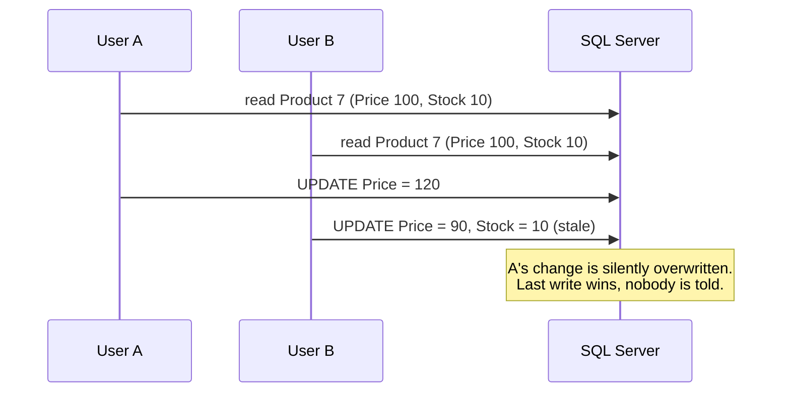
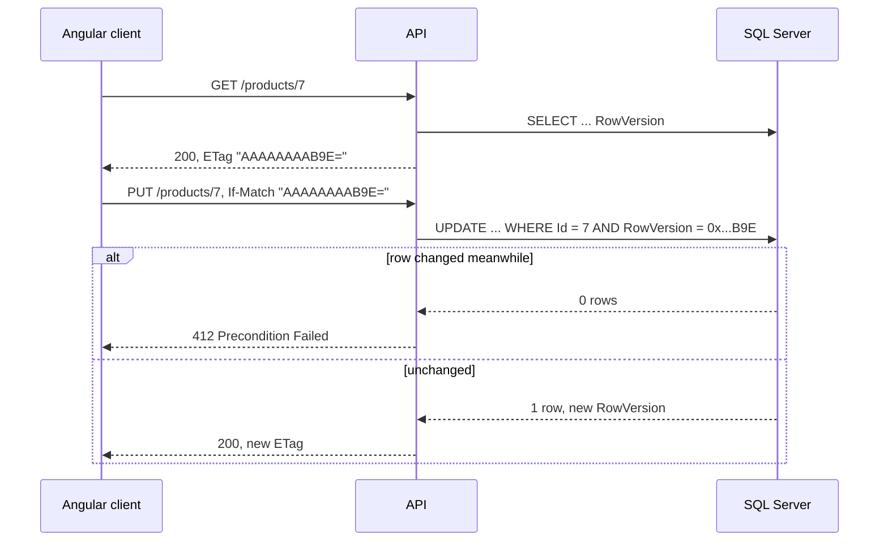

import { Aside } from '@astrojs/starlight/components';
import QuizBlock from '~/components/QuizBlock.astro';

## Why it matters in interviews

*"Two users edit the same record at the same time. What happens?"* is a favourite because the default answer, "the last one wins", is a real bug in most CRUD apps. Interviewers want optimistic concurrency with `rowversion`, how you surface the conflict to the client, and when you would lock instead. Inventory and booking scenarios ("don't oversell the last seat") are the common variants.

## Core idea

### The lost update problem



Without any concurrency control, EF's `UPDATE ... WHERE Id = @id` succeeds for both users. There are two families of fixes:

| | Optimistic | Pessimistic |
|---|---|---|
| Assumption | Conflicts are rare | Conflicts are likely or very expensive |
| Mechanism | Check a version on write; fail if it changed | Lock the row when reading; others wait |
| Holds locks across user think-time? | No | Only within one short transaction (never across HTTP requests) |
| Throughput | High | Lower; risk of blocking and deadlocks |
| EF support | Built in (`rowversion`, concurrency tokens) | Raw SQL with lock hints |
| Typical use | Edit forms, admin screens, most APIs | Stock decrement, seat booking, job queues, sequence generation |

### Optimistic concurrency with rowversion

SQL Server's `rowversion` column is an 8-byte value the database **changes automatically on every update** of the row. Map it with `[Timestamp]` or `IsRowVersion()` and EF does three things:

1. Reads it with the entity and keeps it as the **original value**.
2. Adds it to the `WHERE` clause of every UPDATE and DELETE.
3. Reads the new value back after the write.

```sql
SET NOCOUNT ON;
UPDATE [Orders] SET [Total] = @p0
OUTPUT INSERTED.[RowVersion]
WHERE [Id] = @p1 AND [RowVersion] = @p2;
```

If someone else updated the row in between, the version no longer matches, **zero rows** are affected, and EF throws `DbUpdateConcurrencyException`. Nothing was written, and the `SaveChanges` transaction rolls back.

### Concurrency tokens without rowversion

`[ConcurrencyCheck]` or `IsConcurrencyToken()` puts **any** property into the `WHERE` clause using its original value. Two uses:

- Protect only specific columns (e.g. `Price`), so edits to unrelated columns do not conflict.
- Databases without `rowversion`: an application-managed `Guid Version` that you set to a new value on each save (EF does not change it for you). PostgreSQL's Npgsql provider offers the system `xmin` column for the same purpose.

### Handling the exception

You decide the policy per use case:

| Strategy | What you do | When |
|---|---|---|
| **Tell the user** (most common in APIs) | Return 409 Conflict / 412 Precondition Failed with current values | Edit forms: let a human merge |
| **Store wins** | `entry.Reload()` and drop the user's change | Background sync where the database is authoritative |
| **Client wins** | Copy database values into **original** values, save again | Admin override, intentional |
| **Merge** | Compare current, original and database values per property | Fields owned by different actors |

The three value sets on each `ex.Entries` item are the key to any custom policy: `CurrentValues` (what you tried to save), `OriginalValues` (what you read) and `GetDatabaseValuesAsync()` (what is there now).

### Concurrency in a disconnected API

The context that loaded the row is gone by the time the PUT arrives. So:

1. GET returns the version, as a base64 field in the DTO or as an `ETag` header.
2. Client sends it back (`If-Match` header or body field).
3. Server loads the entity, applies changes, and sets the **original** value of the version to what the client sent. Setting the current value would not work, because EF compares the `WHERE` clause against the original.



### Pessimistic locking

EF has no LINQ operator for lock hints, so you drop to SQL inside a transaction:

```sql
SELECT * FROM Stock WITH (UPDLOCK, ROWLOCK) WHERE Sku = @sku
```

`UPDLOCK` takes an update lock held until the transaction ends: other `UPDLOCK` readers and writers of that row wait, plain readers under read committed are not blocked. Keep the transaction short, never span a user interaction, and take locks in a consistent order to avoid deadlocks. Isolation levels and lock types are covered in [Transactions, Isolation & Locking](../transactions-isolation/).

### Often better than both: an atomic update

For counters and stock, the cleanest fix is a single conditional UPDATE, which the database executes atomically:

```sql
UPDATE Stock SET Available = Available - @qty
WHERE Sku = @sku AND Available >= @qty;   -- 0 rows affected = not enough stock
```

In EF Core that is `ExecuteUpdateAsync` with the condition in `Where`, and you check the returned row count. No read, no lock held across code, no retry loop. Note that `ExecuteUpdate` does **not** apply concurrency tokens automatically; any version check must be in your `Where`.

## Code

```csharp
public sealed class Product
{
    public int Id { get; set; }
    public string Name { get; set; } = "";
    public decimal Price { get; set; }
    [Timestamp] public byte[] RowVersion { get; set; } = [];
}

public sealed record UpdateProduct(string Name, decimal Price);

app.MapPut("/products/{id:int}", async (int id, UpdateProduct body, HttpRequest req,
                                        ShopDb db, CancellationToken ct) =>
{
    if (!req.Headers.TryGetValue("If-Match", out var etag))
        return Results.StatusCode(StatusCodes.Status428PreconditionRequired);

    var product = await db.Products.FindAsync([id], ct);
    if (product is null) return Results.NotFound();

    // Compare against the version the CLIENT saw, not the one we just loaded
    db.Entry(product).Property(p => p.RowVersion).OriginalValue =
        Convert.FromBase64String(etag.ToString().Trim('"'));

    product.Name = body.Name;
    product.Price = body.Price;

    try
    {
        await db.SaveChangesAsync(ct);
        return Results.Ok(new { product.Id, ETag = Convert.ToBase64String(product.RowVersion) });
    }
    catch (DbUpdateConcurrencyException)
    {
        return Results.StatusCode(StatusCodes.Status412PreconditionFailed);
    }
});
```

**Retry loop with "store wins, re-apply" for background jobs**

```csharp
for (var attempt = 1; ; attempt++)
{
    try
    {
        var account = await db.Accounts.SingleAsync(a => a.Id == id, ct);
        account.Points += bonus;                       // re-applied on fresh data each attempt
        await db.SaveChangesAsync(ct);
        break;
    }
    catch (DbUpdateConcurrencyException ex) when (attempt < 3)
    {
        foreach (var entry in ex.Entries) await entry.ReloadAsync(ct); // refresh tracked copy
    }
}
```

## Interview Q&A

<details>
<summary>How does optimistic concurrency work in EF Core with SQL Server?</summary>

Map a `rowversion` column with `[Timestamp]`/`IsRowVersion()`. EF includes the original version in the `WHERE` of UPDATE/DELETE and reads the new version back. If another transaction changed the row, the version differs, zero rows are affected, and EF throws `DbUpdateConcurrencyException`; nothing is saved and you choose how to resolve it.

</details>

<details>
<summary>`[Timestamp]` vs `[ConcurrencyCheck]`?</summary>

`[Timestamp]` maps a database-generated `rowversion` that changes on any update of the row, so any concurrent change conflicts. `[ConcurrencyCheck]` makes an ordinary property part of the `WHERE` using its original value; it detects changes to that property only, and if you use it as a version number your code must change it on every save.

</details>

<details>
<summary>How do you implement optimistic concurrency in a REST API?</summary>

Send the version to the client (ETag header or DTO field). On PUT/PATCH require it back (`If-Match`), load the entity, set the `OriginalValue` of the version property to the client's value, apply changes and save. Map `DbUpdateConcurrencyException` to 412 Precondition Failed (with ETags) or 409 Conflict, ideally returning current values so the UI can show a merge.

</details>

<details>
<summary>Why set `OriginalValue` and not just assign the RowVersion property?</summary>

EF builds the `WHERE` clause from the original value captured when the entity was loaded, which is the current database version. Assigning the property changes the current value only, so the check would compare against the fresh version and never detect the conflict. Setting `OriginalValue` makes EF check against what the client actually saw.

</details>

<details>
<summary>When would you use pessimistic locking instead?</summary>

When conflicts are frequent or a failed retry is expensive: allocating the last units of stock, booking seats, picking jobs from a table queue. Use a short transaction with `SELECT ... WITH (UPDLOCK, ROWLOCK)` (plus `READPAST` for queues). Often an atomic conditional UPDATE is simpler still. Never hold a lock across a user interaction or an HTTP call.

</details>

<details>
<summary>Two requests try to buy the last item. How do you avoid overselling?</summary>

Make the decrement atomic: `UPDATE Stock SET Qty = Qty - 1 WHERE Sku = @sku AND Qty >= 1` (via `ExecuteUpdateAsync`) and treat 0 affected rows as sold out. Alternatives are optimistic concurrency with a retry, or an `UPDLOCK` read in a transaction. Add a `CHECK (Qty >= 0)` constraint as a final safety net.

</details>

<details>
<summary>What do `CurrentValues`, `OriginalValues` and `GetDatabaseValues` mean in the exception handler?</summary>

Current: what this request tried to save. Original: what it read before editing. Database: what is stored now after the other writer. Comparing original vs database shows what the other user changed, and current vs original shows what this user changed, which is enough to auto-merge non-overlapping edits.

</details>

<details>
<summary>Does `ExecuteUpdate` respect concurrency tokens?</summary>

No. It is a set-based statement that bypasses the change tracker, so EF does not add the version to the `WHERE`. If you need the check, include it yourself (`Where(p => p.Id == id && p.RowVersion == version)`) and treat 0 affected rows as a conflict.

</details>

## Pitfalls

<Aside type="caution" title="Common mistakes">

- **No concurrency control at all** on editable entities: silent lost updates.
- **Assigning the client's version to the property** instead of `OriginalValue`: the check never fires.
- **Catching `DbUpdateConcurrencyException` and simply retrying `SaveChanges`** without reloading: it fails again, or with "client wins" logic it overwrites the other user anyway.
- **Pessimistic locks across user think-time** or long transactions: blocking and deadlocks.
- **Read-then-write for counters** (`stock.Qty--; SaveChanges()`) without a token or atomic UPDATE.
- **Forgetting that `ExecuteUpdate` skips tokens.**

</Aside>

## Related

- [Transactions, Bulk Ops & Raw SQL](../transactions-raw-sql/)
- [Transactions, Isolation & Locking](../transactions-isolation/)
- [EF Core Architecture & Change Tracking](../efcore-architecture/)

## Quick quiz

<QuizBlock section="data" topic="concurrency" />
