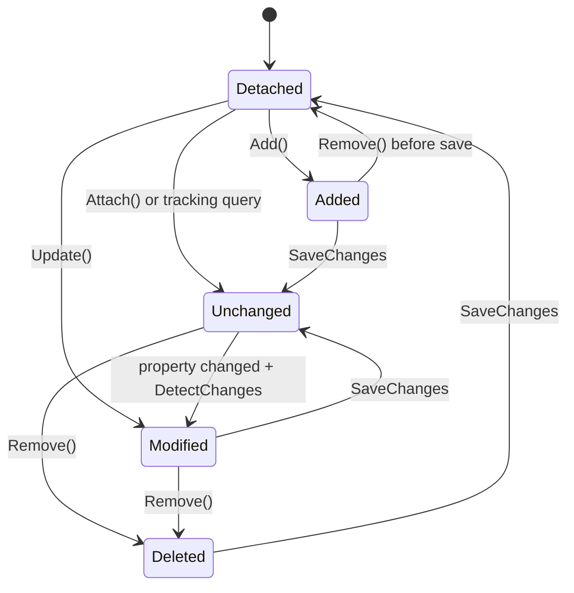
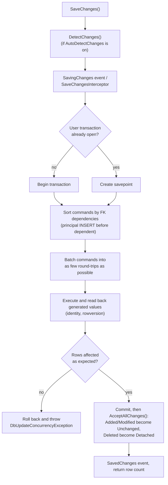

import { Aside } from '@astrojs/starlight/components';
import QuizBlock from '~/components/QuizBlock.astro';

## Why it matters in interviews

Most EF Core questions at the 3-4 year level are really change-tracker questions in disguise: *"why did my update not save?"*, *"why is this list endpoint slow and memory hungry?"*, *"why does my background service throw 'a second operation was started on this context'?"*. If you can explain what `DbContext` holds in memory and what `SaveChanges` does step by step, you can reason your way through almost any EF bug they throw at you.

## Core idea

A `DbContext` is three things at once:

1. **A session with the database.** It owns (or borrows) a `DbConnection` and opens it only while a command runs.
2. **A unit of work.** It records every insert, update and delete you make and writes them in one `SaveChanges` call, inside one transaction.
3. **An identity map.** Within one context, a given primary key maps to exactly one object instance. Query the same customer twice and you get the same reference back.

The component that makes 2 and 3 work is the **change tracker** (`context.ChangeTracker`). Every entity returned by a tracking query, or passed to `Add`/`Attach`/`Update`/`Remove`, gets an **entry** that stores its state, its current values and a snapshot of its **original values**.

### Entity states

| State | Meaning | What `SaveChanges` sends |
|---|---|---|
| `Detached` | Not tracked by this context | Nothing |
| `Added` | New, not in the database yet | `INSERT` |
| `Unchanged` | Loaded and not modified | Nothing |
| `Modified` | Loaded, at least one property changed | `UPDATE` of the changed columns only |
| `Deleted` | Marked for deletion | `DELETE` |



Two subtleties interviewers like:

- `Remove()` on an `Added` entity just **detaches** it. Nothing was ever inserted, so there is nothing to delete.
- `Attach()` and `Update()` walk the whole graph. Related entities with a **store-generated key that is not set** (e.g. `Id == 0`) become `Added`; the rest become `Unchanged` (Attach) or `Modified` (Update).

### How changes are detected

EF Core uses **snapshot change tracking** by default. When an entity becomes tracked, EF copies its property values. `DetectChanges()` later compares current values with the snapshot, flips the state to `Modified` and marks only the changed properties.

`DetectChanges` runs automatically inside `SaveChanges`, `Entry()`, `Entries()` and `DbSet.Local`. Its cost grows with the number of tracked entities, which is why tracking 50,000 rows and saving in a loop gets slow. Options:

- Do not track what you do not modify (`AsNoTracking`, see [Querying](../efcore-querying/)).
- For a large batch import, temporarily set `ChangeTracker.AutoDetectChangesEnabled = false` and call `DetectChanges()` once yourself.
- Notification entities (`INotifyPropertyChanged`) or change-tracking proxies avoid snapshot comparison, at the cost of more ceremony. Rarely worth it in web APIs.

### What SaveChanges does



Points worth saying out loud:

- **Atomic by default.** All statements of one `SaveChanges` succeed or fail together. You only need an explicit transaction when you span **several** `SaveChanges` calls or mix in raw SQL (see [Transactions](../transactions-raw-sql/)).
- **Only changed columns** go into the `UPDATE`.
- **Batching.** On SQL Server, inserting 100 rows is a few batched commands, not 100 round-trips.
- **EF Core does not validate data annotations** like `[Required]` or `[MaxLength]` on save. They shape the schema and the database enforces them. Validate input in the API layer.
- On SQL Server EF reads generated values back with an `OUTPUT` clause. If a table has **triggers**, declare them with `ToTable(t => t.HasTrigger("trg_Audit"))`, otherwise the save fails because SQL Server does not allow a plain `OUTPUT` on tables with triggers.

### DbContext lifetime

`AddDbContext` registers the context as **scoped**: one instance per HTTP request. That fits the unit-of-work idea and keeps the identity map short-lived. The context is **not thread-safe**: running two queries on it at the same time (for example `Task.WhenAll` over two `ToListAsync` calls) throws *"A second operation was started on this context instance before a previous operation completed"*.

Long-lived contexts are a classic bug: the change tracker grows forever, queries hand back stale tracked instances, and memory climbs.

| Registration | Lifetime | Use it for |
|---|---|---|
| `AddDbContext<T>` | Scoped, new instance per request | Normal controllers, minimal APIs, services |
| `AddDbContextPool<T>` | Scoped lease of a **pooled, reset** instance | High-throughput APIs where context setup shows up in profiles |
| `AddDbContextFactory<T>` / `AddPooledDbContextFactory<T>` | Factory is a singleton; **you** create and dispose contexts | `BackgroundService`, Blazor Server, parallel work, one unit of work per message |

### DbContext pooling

Creating a `DbContext` is cheap but not free: EF wires up internal services for each instance (the model itself is built once and cached). With `AddDbContextPool`, disposing a context resets its state (change tracker cleared, options restored) and returns it to a pool, default size 1024, instead of throwing it away.

The catch: a pooled context behaves like a singleton-configured object. `OnConfiguring` must not depend on per-request state, and you cannot inject scoped services (current tenant, current user) through the context constructor. For per-tenant state, set a property on the leased instance from a small scoped wrapper or factory.

### IDbContextFactory

When there is no natural request scope, inject `IDbContextFactory<T>` and create a short-lived context per unit of work. This also solves the **captive dependency** bug: a singleton (and a hosted `BackgroundService` is one) that takes `AppDbContext` in its constructor would keep one context alive for the life of the app. See [Dependency Injection](../../aspnet/dependency-injection/).

## Code

```csharp
// Program.cs
builder.Services.AddDbContextPool<ShopDb>(o =>
    o.UseSqlServer(builder.Configuration.GetConnectionString("Shop"),
        sql => sql.EnableRetryOnFailure()));          // transient-fault retries (Azure SQL)

// A typical request: load tracked, mutate, save. One UPDATE with changed columns only.
public sealed class OrderService(ShopDb db)
{
    public async Task ShipAsync(int orderId, CancellationToken ct)
    {
        var order = await db.Orders.SingleAsync(o => o.Id == orderId, ct); // Unchanged
        order.Status = OrderStatus.Shipped;       // entry still says Unchanged until DetectChanges
        order.ShippedAt = DateTime.UtcNow;
        await db.SaveChangesAsync(ct);            // DetectChanges -> Modified -> UPDATE 2 columns
    }
}
```

**Background worker with a factory (no captive context)**

```csharp
// Registered with builder.Services.AddDbContextFactory<ShopDb>(...)
public sealed class OutboxWorker(IDbContextFactory<ShopDb> factory) : BackgroundService
{
    protected override async Task ExecuteAsync(CancellationToken ct)
    {
        while (!ct.IsCancellationRequested)
        {
            await using (var db = await factory.CreateDbContextAsync(ct)) // fresh tracker per batch
            {
                var batch = await db.OutboxMessages
                    .Where(m => m.ProcessedAt == null)
                    .OrderBy(m => m.Id).Take(50)
                    .ToListAsync(ct);

                foreach (var m in batch) m.ProcessedAt = DateTime.UtcNow;
                await db.SaveChangesAsync(ct);
            }
            await Task.Delay(TimeSpan.FromSeconds(5), ct);
        }
    }
}
```

**Auditing with an interceptor, and inspecting the tracker**

```csharp
public sealed class AuditInterceptor(TimeProvider clock) : SaveChangesInterceptor
{
    public override ValueTask<InterceptionResult<int>> SavingChangesAsync(
        DbContextEventData data, InterceptionResult<int> result, CancellationToken ct = default)
    {
        foreach (var e in data.Context!.ChangeTracker.Entries<IAuditable>())
            if (e.State is EntityState.Added or EntityState.Modified)
                e.Entity.UpdatedAt = clock.GetUtcNow();

        return base.SavingChangesAsync(data, result, ct);
    }
}

// While debugging: every entry, its state, original vs current values
Console.WriteLine(db.ChangeTracker.DebugView.LongView);
```

## Interview Q&A

<details>
<summary>What is the change tracker and how does EF know a property changed?</summary>

It is the part of `DbContext` that keeps an entry per tracked entity with its state, current values and a snapshot of original values. By default EF uses snapshot tracking: `DetectChanges` (called automatically by `SaveChanges`) compares current values with the snapshot and marks changed properties as modified, so the `UPDATE` includes only those columns.

</details>

<details>
<summary>Walk me through what happens when you call `SaveChanges`.</summary>

Detect changes, run interceptors and events, open a transaction (or a savepoint if you already have one), order commands so principals are inserted before dependents, batch them, execute, read back generated keys and rowversions, check affected row counts (throwing `DbUpdateConcurrencyException` on a mismatch), commit, then accept changes so Added/Modified become Unchanged and Deleted become Detached.

</details>

<details>
<summary>What is the difference between `Add`, `Attach` and `Update`?</summary>

`Add` marks the graph Added (INSERT). `Attach` marks it Unchanged, so nothing is written until you change something. `Update` marks it Modified, so **every** column is written. In all three, related entities with an unset generated key become Added. For a disconnected PUT, loading the entity and copying values is usually better than `Update`, because it writes only changed columns and gives you a place to validate.

</details>

<details>
<summary>Why should `DbContext` be scoped and not singleton?</summary>

It is not thread-safe, its change tracker grows with every tracked entity, and tracked instances go stale as other users change data. Scoped gives one unit of work per request. For singletons and background services, use `IDbContextFactory<T>` or `IServiceScopeFactory` to create short-lived contexts.

</details>

<details>
<summary>When would you use DbContext pooling, and what are the catches?</summary>

In high-throughput APIs where profiling shows context construction cost. The catches: instances are reused, so no per-request state in `OnConfiguring` or the constructor, no scoped services injected into the context, and any custom fields you add must be reset. The gain is real but modest; it does nothing for slow queries.

</details>

<details>
<summary>You get "A second operation was started on this context instance". Why?</summary>

Two async operations ran concurrently on one context: typically `Task.WhenAll` over two queries, a missing `await`, or a singleton holding a context that parallel requests share. Fix: await sequentially, or create one context per parallel branch from `IDbContextFactory<T>`.

</details>

<details>
<summary>Does EF Core validate `[Required]` and `[MaxLength]` before saving?</summary>

No. Unlike EF6, EF Core uses them to build the model (NOT NULL, `nvarchar(100)`) but does not validate on `SaveChanges`. The database rejects bad data and EF throws `DbUpdateException`. Validate in the API layer with model validation or FluentValidation.

</details>

<details>
<summary>How would you add automatic `CreatedAt`/`UpdatedAt` auditing?</summary>

Register a `SaveChangesInterceptor` (or override `SaveChangesAsync`). In `SavingChangesAsync`, loop over `ChangeTracker.Entries<IAuditable>()` for Added/Modified entries and set the timestamps. Mention the gap: `ExecuteUpdate`/`ExecuteDelete` and raw SQL bypass the change tracker, so they bypass this hook too.

</details>

## Pitfalls

<Aside type="caution" title="Common mistakes">

- **Singleton or static `DbContext`**: thread-safety exceptions, unbounded tracker growth, stale data.
- **Injecting `DbContext` into a `BackgroundService` constructor**: captive dependency. Use `IDbContextFactory<T>`.
- **`Task.WhenAll` over queries on the same context**: not supported.
- **Tracking read-only data**: snapshot memory and `DetectChanges` cost for nothing. Use `AsNoTracking` or projections.
- **Calling `Update()` on an entity you just loaded**: marks every column modified and writes them all.
- **`SaveChanges` inside a loop**: one transaction and round-trip per item. Save once after the loop.
- **Relying on data annotations for validation**: EF Core does not validate on save.

</Aside>

## Related

- [Querying & the N+1 Problem](../efcore-querying/)
- [Transactions, Bulk Ops & Raw SQL](../transactions-raw-sql/)
- [Repository & Unit of Work with EF](../repository-uow-ef/)
- [Dependency Injection](../../aspnet/dependency-injection/)

## Quick quiz

<QuizBlock section="data" topic="efcore-architecture" />
