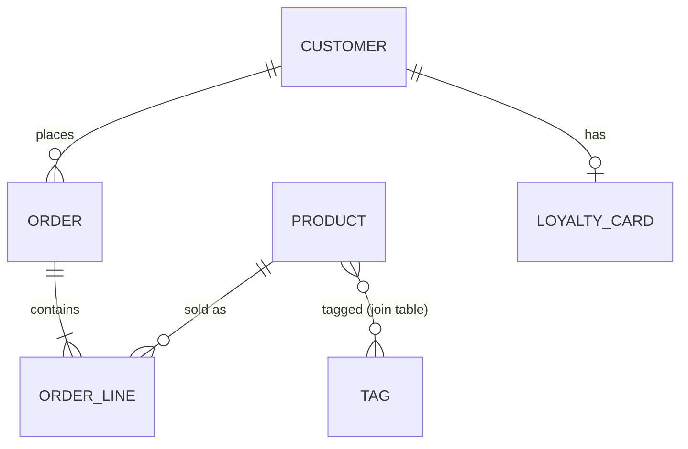

import { Aside } from '@astrojs/starlight/components';
import QuizBlock from '~/components/QuizBlock.astro';

## Why it matters in interviews

Modelling questions show whether you have designed a schema with EF or only consumed one. Expect *"how do you configure a many-to-many with extra columns?"*, *"how did you implement soft delete?"*, *"TPH or TPT, and why?"* and *"what is an owned type?"*. The strong answer always connects the C# model to the **tables, keys and SQL** it produces.

## Core idea

EF Core builds a **model** (entity types, properties, keys, relationships, table mappings) once per context type and caches it. The model comes from three layers, each overriding the previous:

1. **Conventions**: `Id` or `<Type>Id` is the key; integer keys become `IDENTITY`; `CustomerId` next to a `Customer` navigation becomes the FK; non-nullable reference types (with nullable enabled) become `NOT NULL`; `string` maps to `nvarchar(max)`.
2. **Data annotations**: `[Key]`, `[Required]`, `[MaxLength(100)]`, `[Index]`, `[Timestamp]`, `[Table]`.
3. **Fluent API** in `OnModelCreating`: wins over everything and covers what annotations cannot (composite keys, precision, delete behaviour, filters, inheritance strategy, owned/complex types, indexes with filters).

| | Data annotations | Fluent API |
|---|---|---|
| Where | On the entity class | `OnModelCreating` / `IEntityTypeConfiguration<T>` |
| Coverage | Common cases only | Everything |
| Domain purity | Pollutes domain classes with persistence attributes | Keeps entities POCO |
| Also used by ASP.NET validation | Some (`[Required]`, `[MaxLength]`) | No |

Most teams keep one `IEntityTypeConfiguration<T>` per entity and call `modelBuilder.ApplyConfigurationsFromAssembly(...)`.

### Relationships



- **One-to-many**: the FK lives on the many side (`Order.CustomerId`). A non-nullable FK makes the relationship **required**.
- **One-to-one**: one side is the dependent and holds the FK. EF adds a **unique index** on it. You must tell EF which side is dependent when it cannot infer it.
- **Many-to-many**: since EF Core 5, two collection navigations (`Product.Tags`, `Tag.Products`) are enough; EF creates a hidden join table. When the link needs its own data (quantity, `AddedAt`), model the join entity explicitly as two one-to-many relationships, or use `UsingEntity<ProductTag>()`.

**Delete behaviour**: required relationships default to `Cascade`; optional ones default to `ClientSetNull` (EF nulls the FK on tracked dependents, the database FK is `NO ACTION`). SQL Server rejects schemas with **multiple cascade paths** to the same table, so you will sometimes need `OnDelete(DeleteBehavior.Restrict)` or `NoAction`.

### Owned types vs complex types (value objects)

Both map a value object like `Address` or `Money` into the owner's table (`Address_Street`, `Address_City`) instead of a separate table.

| | Owned type (`OwnsOne`/`OwnsMany`) | Complex type (`ComplexProperty`, EF Core 8+) |
|---|---|---|
| Identity | Entity with a hidden key | None; pure value semantics |
| Same instance on two owners | Not allowed | Allowed (copied by value) |
| Collections | `OwnsMany` (separate table or JSON) | Supported when mapped to JSON in EF Core 10 |
| JSON column | `ToJson()` | `ToJson()` (EF Core 10) |
| Recommended for new value objects | Legacy choice | Yes, in EF Core 10 |

### Value conversions and shadow properties

A **value converter** transforms a property on the way in and out: enums stored as strings, strongly typed IDs (`OrderId` record struct to `int`), encrypted strings. Caveat: the database sees only the converted value, so query methods on the CLR type (e.g. `.Contains` on a converted list) may not translate.

A **shadow property** exists in the model and the table but not on the class. FKs without a property are shadow properties automatically. You can add your own (`LastUpdated`, `TenantId`) and query them with `EF.Property<T>(entity, "Name")`.

### Inheritance: TPH, TPT, TPC

| Strategy | Tables | Read a base-type list | Write | Notes |
|---|---|---|---|---|
| **TPH** (default) | One table + `Discriminator` column | Single table scan, fastest | One insert | Subclass columns must be nullable; wide sparse table |
| **TPT** (`UseTptMappingStrategy`) | Base table + one table per subclass | `LEFT JOIN` of every subclass table | Insert into 2+ tables | Clean normalized schema, slowest queries |
| **TPC** (`UseTpcMappingStrategy`, EF Core 7+) | One full table per concrete type | `UNION ALL` over all tables | One insert | Fast for querying one concrete type; keys must be unique across tables, so EF uses a shared sequence instead of `IDENTITY` |

Default to **TPH**. Use TPC when you mostly query concrete types; avoid TPT unless a DBA insists on the normalized shape.

### Global query filters

A filter defined in the model is added to **every** query for that entity type, including via `Include`:

- **Soft delete**: `HasQueryFilter(o => !o.IsDeleted)`.
- **Multi-tenancy**: `HasQueryFilter(o => o.TenantId == _tenantId)`, where `_tenantId` is a field on the context. EF parameterizes it per context instance.

Bypass with `IgnoreQueryFilters()`. Before EF Core 10 an entity could have only one filter, so soft delete and tenant had to be combined with `&&`; EF Core 10 adds **named filters** you can disable one at a time.

## Code

```csharp
public sealed class Order
{
    public int Id { get; set; }
    public int CustomerId { get; set; }                       // FK by convention
    public Customer Customer { get; set; } = null!;
    public OrderStatus Status { get; set; }
    public Address ShipTo { get; set; } = null!;              // complex type
    public bool IsDeleted { get; set; }
    public List<OrderLine> Lines { get; } = [];
}

public sealed record Address(string Street, string City, string PostCode);

internal sealed class OrderConfig : IEntityTypeConfiguration<Order>
{
    public void Configure(EntityTypeBuilder<Order> b)
    {
        b.Property(o => o.Status).HasConversion<string>().HasMaxLength(20); // enum as text
        b.ComplexProperty(o => o.ShipTo);                                  // ShipTo_Street, ShipTo_City...
        b.Property<DateTime>("LastUpdated");                               // shadow property
        b.HasOne(o => o.Customer).WithMany(c => c.Orders)
         .HasForeignKey(o => o.CustomerId)
         .OnDelete(DeleteBehavior.Restrict);                               // no cascade from customer
        b.HasQueryFilter("SoftDelete", o => !o.IsDeleted);                 // named filter (EF Core 10)
        b.HasIndex(o => new { o.CustomerId, o.Status });
    }
}
```

**Many-to-many with a payload, and TPH**

```csharp
public sealed class ProductTag
{
    public int ProductId { get; set; }
    public int TagId { get; set; }
    public DateTime AddedAt { get; set; }
}

protected override void OnModelCreating(ModelBuilder mb)
{
    mb.Entity<Product>()
      .HasMany(p => p.Tags).WithMany(t => t.Products)
      .UsingEntity<ProductTag>(j => j.Property(pt => pt.AddedAt).HasDefaultValueSql("SYSUTCDATETIME()"));

    mb.Entity<Payment>()                                    // TPH by default
      .HasDiscriminator<string>("Kind")
      .HasValue<CardPayment>("card")
      .HasValue<UpiPayment>("upi");

    mb.ApplyConfigurationsFromAssembly(typeof(ShopDb).Assembly);
}
```

**Querying a shadow property and bypassing a filter**

```csharp
var recentlyTouched = await db.Orders
    .Where(o => EF.Property<DateTime>(o, "LastUpdated") > since)
    .ToListAsync(ct);

var includingDeleted = await db.Orders
    .IgnoreQueryFilters(["SoftDelete"])     // EF Core 10; IgnoreQueryFilters() disables all
    .Where(o => o.CustomerId == customerId)
    .ToListAsync(ct);
```

## Interview Q&A

<details>
<summary>Data annotations or Fluent API: which do you use and why?</summary>

Fluent API in `IEntityTypeConfiguration<T>` classes. It covers everything (composite keys, precision, delete behaviour, filters, inheritance), keeps entities free of persistence attributes, and keeps all mapping in one place. Fluent configuration overrides annotations when both exist. Annotations are fine for tiny apps or when the same attribute also drives API validation.

</details>

<details>
<summary>How do you model a many-to-many relationship with extra columns?</summary>

Create a join entity (`Enrollment` with `StudentId`, `CourseId`, `EnrolledOn`) with a composite key, and either model two one-to-many relationships or keep skip navigations and configure `UsingEntity<Enrollment>()`. Plain skip navigations without a join entity only work when the link has no payload.

</details>

<details>
<summary>What is an owned type, and how is it different from a complex type?</summary>

Both map a value object into the owner's table. An owned type is technically an entity with a hidden key, so the same instance cannot be shared between two owners and it carries identity semantics. A complex type (EF Core 8+) has no key and true value semantics. For new value objects in EF Core 10, complex types are the better fit; owned types remain for existing code and some `OwnsMany` scenarios.

</details>

<details>
<summary>Compare TPH, TPT and TPC.</summary>

TPH: one table with a discriminator, fastest reads, nullable subclass columns. TPT: a table per type joined on the key, normalized but every polymorphic query joins all tables. TPC: a full table per concrete type, fast concrete queries, polymorphic queries use `UNION ALL`, and keys must be unique across tables (EF uses a sequence). Default to TPH.

</details>

<details>
<summary>How did you implement soft delete?</summary>

An `IsDeleted` (and often `DeletedAt`) column, a global query filter `!IsDeleted` so every query hides deleted rows, and a `SaveChangesInterceptor` that turns `Deleted` entries into `Modified` with `IsDeleted = true`. Add a filtered unique index (`WHERE IsDeleted = 0`) so a deleted row does not block re-creating the same unique value. Admin and audit screens use `IgnoreQueryFilters`.

</details>

<details>
<summary>What can go wrong with global query filters?</summary>

They are easy to forget: a missing row in a report is often a filter at work. If a required navigation's target is filtered out, an `Include` or inner join can drop the parent row too. Filters run on every query, so the filtered column needs an index. For multi-tenancy the tenant id must come from a field on the context, not a constant, or every tenant sees the first tenant's data.

</details>

<details>
<summary>What are shadow properties and when are they useful?</summary>

Properties in the EF model and table that do not exist on the CLR class. EF creates them for FKs you did not declare. You add them for infrastructure columns you do not want on the domain object (`LastUpdated`, `TenantId`, `CreatedBy`), set them through `Entry(e).Property("X")` and query them with `EF.Property<T>`.

</details>

<details>
<summary>Why does SQL Server complain about "multiple cascade paths"?</summary>

If deleting one row could reach the same table through two cascading FK paths (e.g. `Order` to `Shipment` directly and via `Address`), SQL Server refuses to create the constraint. Configure one of the relationships with `OnDelete(DeleteBehavior.Restrict)` or `NoAction`, and delete those dependents explicitly in code.

</details>

## Pitfalls

<Aside type="caution" title="Common mistakes">

- **`decimal` without precision**: EF warns and defaults to `decimal(18,2)`. Set `HasPrecision` for money and quantities.
- **`string` without max length** becomes `nvarchar(max)`, which cannot be a normal index key column.
- **Nullable reference types off**: every string becomes nullable in the database.
- **Enum stored as int with no conversion**, then someone reorders the enum members and old rows change meaning.
- **Cascade delete everywhere**: one delete removes far more than intended. Prefer `Restrict` for important aggregates.
- **TPT on a hot polymorphic query**: joins to every subclass table on every read.
- **Hard-coding the tenant in a query filter** instead of reading a context field.

</Aside>

## Related

- [EF Core Architecture & Change Tracking](../efcore-architecture/)
- [Migrations & Seeding](../migrations/)
- [Normalization & Keys](../normalization/)
- [Indexes](../indexes/)

## Quick quiz

<QuizBlock section="data" topic="efcore-modelling" />
