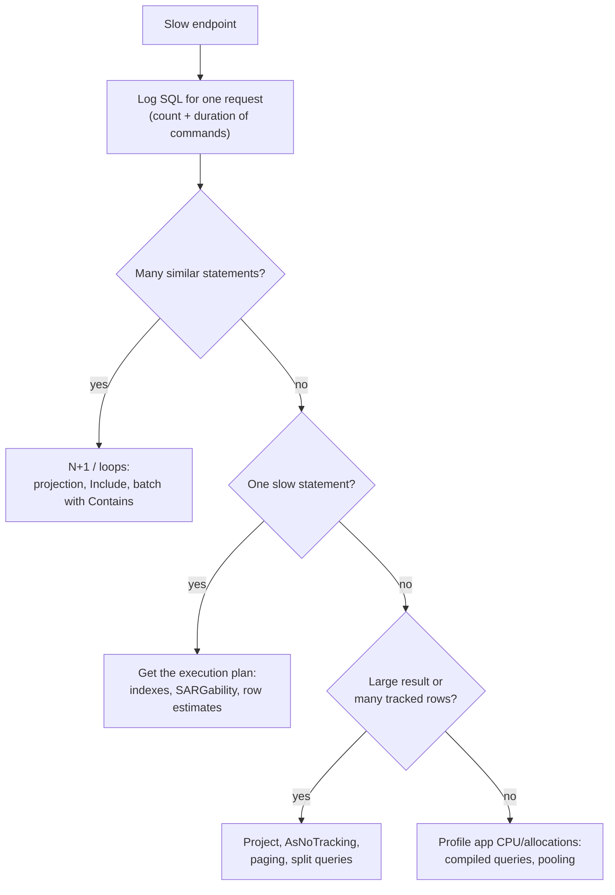

import { Aside } from '@astrojs/starlight/components';
import QuizBlock from '~/components/QuizBlock.astro';

## Why it matters in interviews

*"An endpoint using EF Core is slow. How do you investigate?"* is a standard scenario question, often followed by *"EF or Dapper?"*. A good answer is a **process**: see the SQL, count the round-trips, check the plan, then apply the right fix. Listing every EF feature without a method sounds like you have never debugged it.

## Core idea

Nearly all EF Core performance problems fall into three buckets:

1. **Too many round-trips**: N+1, `SaveChanges` in loops, lazy loading.
2. **Too much data**: no projection, `Include` everything, cartesian explosion, tracking thousands of rows, paging in memory.
3. **Bad SQL for the database**: missing indexes, non-SARGable predicates, implicit conversions, parameter sniffing.

EF's own overhead (query compilation, materialization, change detection) is real but usually the smallest bucket. Measure before optimizing.



### 1. See the SQL

| Technique | How | Notes |
|---|---|---|
| Simple logging | `options.LogTo(Console.WriteLine, LogLevel.Information)` | Quick local debugging |
| `ILogger` category | `"Microsoft.EntityFrameworkCore.Database.Command": "Information"` in appsettings | Shows SQL and duration per command |
| Parameter values | `EnableSensitiveDataLogging()` | **Development only**: logs PII and secrets |
| Without executing | `query.ToQueryString()` | Great in unit tests and code review |
| Find it in production | `query.TagWith("OrderList.GetPage")` | Adds a SQL comment, visible in Query Store and Extended Events |
| Telemetry | OpenTelemetry / Application Insights (AWS: X-Ray) | Dependency calls per request, duration, count |

Then look at the plan in SSMS or Query Store: see [Execution Plans](../execution-plans/).

### 2. Reduce round-trips and data

- **Project** read paths into DTOs; it beats every other read optimization.
- `AsNoTracking` (or a no-tracking default) for read-only queries.
- `AsSplitQuery` when including several collections (see [Querying](../efcore-querying/)); measure, because single queries win for small collections.
- **Page in SQL** (`Skip`/`Take` after `OrderBy`) and prefer **keyset paging** (`Where(o => o.Id > lastId).Take(50)`) for deep pages: `OFFSET 100000` still reads and discards 100,000 rows.
- `Any()` instead of `Count() > 0`; `FindAsync` for primary-key lookups (it checks the change tracker before going to the database).
- Stream big exports with `AsAsyncEnumerable()` instead of buffering a huge list.

### 3. Batching on writes

`SaveChanges` groups statements into batches. On SQL Server, three inserts become one `MERGE ... OUTPUT` command:

```sql
MERGE [Orders] USING (
VALUES (@p0, @p1, @p2, 0),
(@p3, @p4, @p5, 1),
(@p6, @p7, @p8, 2)) AS i ([CustomerId], [PlacedAt], [Total], _Position) ON 1=0
WHEN NOT MATCHED THEN
INSERT ([CustomerId], [PlacedAt], [Total])
VALUES (i.[CustomerId], i.[PlacedAt], i.[Total])
OUTPUT INSERTED.[Id], i._Position;
```

You can tune `MaxBatchSize`, but the defaults are sensible. The real wins are: call `SaveChanges` **once** per unit of work, and use `ExecuteUpdate`/`ExecuteDelete` for set-based changes (see [Transactions & Bulk Ops](../transactions-raw-sql/)).

### 4. Compiled queries

EF caches translated queries keyed by expression shape, but it still has to build the expression tree and compute the cache key on every call. `EF.CompileAsyncQuery` does that work once and returns a delegate:

```csharp
private static readonly Func<ShopDb, int, CancellationToken, Task<Product?>> ProductById =
    EF.CompileAsyncQuery((ShopDb db, int id, CancellationToken ct) =>
        db.Products.AsNoTracking().SingleOrDefault(p => p.Id == id));
```

Worth it only for very hot, simple queries after profiling. They cannot be composed further, and the query shape is fixed.

### 5. Context pooling and startup

`AddDbContextPool` reuses context instances and saves per-request setup cost (details in [Architecture](../efcore-architecture/)). For apps with very large models (hundreds of entities), **compiled models** (`dotnet ef dbcontext optimize`) cut startup time by generating the model as code instead of building it at runtime.

### 6. Indexes in the model

EF only creates indexes on keys and FKs by convention. Declare the rest so migrations create them:

```csharp
b.HasIndex(o => new { o.CustomerId, o.PlacedAt });                // composite, order matters
b.HasIndex(u => u.Email).IsUnique();
b.HasIndex(o => o.Status).HasFilter("[IsDeleted] = 0")            // filtered (SQL Server)
 .IncludeProperties(o => new { o.Total });                         // covering INCLUDE columns
```

Index design itself is in [Indexes](../indexes/).

### 7. Keyless entities

Views, reporting queries and raw SQL results without a key can be mapped with `HasNoKey()` (and `ToView("vw_SalesSummary")`). They are never tracked and cannot be saved. Since EF Core 8, `Database.SqlQuery<T>` handles many of these cases without adding a type to the model.

### EF Core vs Dapper

| | EF Core | Dapper |
|---|---|---|
| What you write | LINQ; SQL generated | SQL by hand |
| Change tracking, unit of work | Yes | No |
| Migrations, relationships, query filters | Yes | No |
| Raw read speed | Close to Dapper for projected no-tracking queries in recent versions | The baseline micro-ORM |
| Control over SQL | Good, with escape hatches (`FromSql`, `SqlQuery`) | Total |
| Risk | Hidden inefficient SQL if you do not look | Hand-written SQL bugs, mapping by convention, refactoring breaks strings |

A common, defensible answer: **EF Core for the write side and most reads; Dapper (or `SqlQuery<T>`) for a few complex, hot reporting queries** where hand-tuned SQL matters. Both can share the same connection and transaction.

## Code

```csharp
builder.Services.AddDbContextPool<ShopDb>(o =>
{
    o.UseSqlServer(cs, sql => sql.EnableRetryOnFailure());
    o.UseQueryTrackingBehavior(QueryTrackingBehavior.NoTracking);   // read-heavy service default
    if (builder.Environment.IsDevelopment())
        o.EnableSensitiveDataLogging().LogTo(Console.WriteLine, LogLevel.Information);
    o.ConfigureWarnings(w => w.Throw(RelationalEventId.MultipleCollectionIncludeWarning));
});

public sealed record OrderRow(int Id, DateTime PlacedAt, decimal Total);

public sealed class OrderReads(ShopDb db)
{
    // Keyset paging: stays fast on page 5,000, unlike OFFSET
    public Task<List<OrderRow>> NextPageAsync(int customerId, int afterId, CancellationToken ct) =>
        db.Orders
          .TagWith("OrderReads.NextPage")
          .Where(o => o.CustomerId == customerId && o.Id > afterId)
          .OrderBy(o => o.Id)
          .Take(50)
          .Select(o => new OrderRow(o.Id, o.PlacedAt, o.Total))
          .ToListAsync(ct);
}
```

**Counting commands in an integration test**

```csharp
public sealed class CommandCounter : DbCommandInterceptor
{
    public int Count;
    public override ValueTask<InterceptionResult<DbDataReader>> ReaderExecutingAsync(
        DbCommand command, CommandEventData data, InterceptionResult<DbDataReader> result,
        CancellationToken ct = default)
    {
        Interlocked.Increment(ref Count);
        return base.ReaderExecutingAsync(command, data, result, ct);
    }
}
// Assert.True(counter.Count <= 2, "endpoint must not regress into N+1");
```

## Interview Q&A

<details>
<summary>An EF Core endpoint is slow. Walk me through your investigation.</summary>

Reproduce with one request and capture the SQL (logging or Application Insights dependencies). If there are many similar statements, it is N+1 or a save loop: fix with projection, `Include` or batching. If one statement is slow, get its plan from Query Store: missing index, scan instead of seek, implicit conversion, bad estimates. If the SQL is fine but the result is huge, project fewer columns, page in SQL, and skip tracking. Only then look at EF overhead: compiled queries, pooling.

</details>

<details>
<summary>What are compiled queries and when do they help?</summary>

`EF.CompileQuery`/`CompileAsyncQuery` translate a LINQ query once and return a delegate, skipping expression-tree building and cache lookup on each call. EF already caches translations, so the gain is small and matters only for very hot, simple queries. Use them after profiling, not by default.

</details>

<details>
<summary>How does EF Core batch inserts on SQL Server?</summary>

`SaveChanges` sends multiple statements per round-trip. Several inserts into the same table become a single `MERGE ... OUTPUT` statement that inserts all rows and returns generated ids with their positions; a single insert is a plain `INSERT ... OUTPUT`. Batch size is configurable with `MaxBatchSize`.

</details>

<details>
<summary>Why is `OFFSET`/`FETCH` paging slow on deep pages, and what is the alternative?</summary>

The server still has to produce and skip all preceding rows, so page 5,000 reads 250,000 rows to return 50. Keyset (seek) paging filters on the last seen key (`WHERE Id > @lastId ORDER BY Id`) and uses an index seek, so every page costs the same. The trade-off: no jumping to an arbitrary page number.

</details>

<details>
<summary>EF Core or Dapper?</summary>

EF Core by default: change tracking, migrations, LINQ safety and productivity, and its read performance for projected no-tracking queries is close to Dapper. Use Dapper or `SqlQuery<T>` for specific complex reports or hot paths where hand-written SQL is clearer or faster. Mixing both in one app is normal.

</details>

<details>
<summary>What is `TagWith` useful for?</summary>

It adds a comment such as `-- OrderReads.NextPage` to the generated SQL. When a DBA finds an expensive query in Query Store or Extended Events, the tag tells you which code produced it. Cheap and very effective in production.

</details>

<details>
<summary>When would you map a keyless entity type?</summary>

For database views, reporting queries or table-valued functions whose results have no primary key. They are read-only and never tracked. Since EF Core 8, `Database.SqlQuery<T>` can often return such shapes without adding a type to the model, so keyless types are mainly for views you query with LINQ.

</details>

<details>
<summary>Is `EnableSensitiveDataLogging` safe to turn on in production?</summary>

No. It writes parameter values (emails, tokens, personal data) to logs, which is a privacy and compliance risk. Use it locally. In production, log SQL without values and rely on tags and telemetry.

</details>

## Pitfalls

<Aside type="caution" title="Common mistakes">

- **Optimizing EF overhead before looking at the SQL and the plan.**
- **`EnableSensitiveDataLogging` in production.**
- **Deep `OFFSET` paging** on large tables.
- **Loading entities to update or delete thousands of rows** instead of `ExecuteUpdate`/`ExecuteDelete`.
- **Missing indexes on columns used in filters and global query filters.**
- **Assuming compiled queries or pooling fix N+1.** They do not.
- **Blanket `AsSplitQuery`** without measuring: more round-trips can be slower for small collections.

</Aside>

## Related

- [Querying & the N+1 Problem](../efcore-querying/)
- [Execution Plans & Query Tuning](../execution-plans/)
- [Indexes](../indexes/)
- [Logging & Observability](../../aspnet/logging-observability/)

## Quick quiz

<QuizBlock section="data" topic="efcore-performance" />
