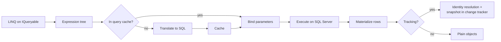
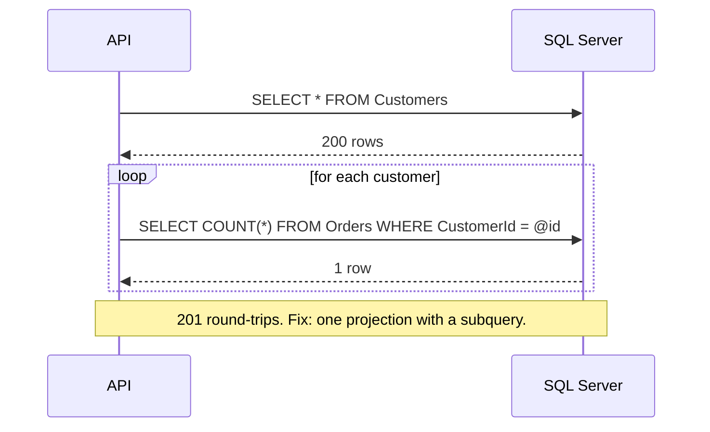

import { Aside } from '@astrojs/starlight/components';
import QuizBlock from '~/components/QuizBlock.astro';

## Why it matters in interviews

"How would you find and fix an N+1 problem?" is probably the single most asked EF Core question. It is usually followed by *"Include or projection?"*, *"what does AsNoTracking do?"* and *"what is a cartesian explosion?"*. Interviewers want to hear you think in **round-trips and rows**, and ideally that you have looked at the SQL EF generated.

## Core idea

### From LINQ to SQL

`db.Orders.Where(...)` returns an `IQueryable<T>`. Nothing runs yet: each operator just adds a node to an **expression tree**. When you enumerate (`ToListAsync`, `FirstAsync`, `CountAsync`, `foreach`), EF:

1. Looks up the expression's shape in its **query cache**; on a miss it translates the tree to SQL and caches the result.
2. Turns captured variables into **SQL parameters** (`@city`), so different values reuse both EF's cache and SQL Server's plan cache. Literal constants are inlined.
3. Executes the command, materializes rows into objects and, for tracking queries, registers them with the change tracker (identity resolution: one instance per key).



Use `query.ToQueryString()` to see the SQL without running it. Logging the SQL is covered in [EF Core Performance](../efcore-performance/).

### Client vs server evaluation

Since EF Core 3.0, EF **throws** if it cannot translate part of a query to SQL, instead of silently pulling the whole table and filtering in memory (EF Core 2.x did that). The one exception is the **final `Select`**: a C# method used in the top-level projection runs on the client after the rows come back, which is fine.

```csharp
// Throws: EF cannot translate a C# method inside Where
db.Customers.Where(c => IsVip(c)).ToList();

// Fine: IsVip runs in memory on rows already filtered by SQL
db.Customers.Where(c => c.City == "Pune").AsEnumerable().Where(IsVip).ToList();
```

The quieter trap is **`IEnumerable` vs `IQueryable`**: a repository method that returns `IEnumerable<Order>` and a caller that adds `.Where(...)` filters in memory after loading every row. See [LINQ](../../csharp/linq/).

### Projections: the best default for reads

Select only what the screen or API needs, straight into a DTO:

```csharp
var rows = await db.Customers
    .Where(c => c.City == city)
    .Select(c => new CustomerSummary(c.Name, c.Orders.Count, c.Orders.Sum(o => o.Total)))
    .ToListAsync(ct);
```

```sql
SELECT [c].[Name], (
    SELECT COUNT(*) FROM [Orders] AS [o] WHERE [c].[Id] = [o].[CustomerId]) AS [OrderCount], (
    SELECT COALESCE(SUM([o0].[Total]), 0.0) FROM [Orders] AS [o0] WHERE [c].[Id] = [o0].[CustomerId]) AS [Total]
FROM [Customers] AS [c]
WHERE [c].[City] = @city
```

One round-trip, only three columns, no tracking (projections to non-entity types are never tracked), and **no `Include` needed**: navigations used inside `Select` are translated to joins or subqueries automatically.

### AsNoTracking and identity resolution

| | Tracking (default) | `AsNoTracking()` | `AsNoTrackingWithIdentityResolution()` |
|---|---|---|---|
| Snapshot in change tracker | Yes | No | No |
| Same key gives same instance | Yes | **No**, duplicates per row | Yes, within that query only |
| Can call `SaveChanges` on results | Yes | No (would need `Attach`/`Update`) | No |
| Use for | Load-modify-save | Read-only lists and details | Read-only graphs where duplicates would bloat memory |

`AsNoTracking` with `Include` of a reference (each order includes its customer) creates a **separate customer object per row**. Identity resolution fixes that without paying for tracking. You can also set `QueryTrackingBehavior.NoTracking` as the context default for read-heavy services.

### Include, ThenInclude and filtered Include

```csharp
var customer = await db.Customers
    .Include(c => c.Orders.Where(o => o.Total > 100))   // filtered include (EF Core 5+)
        .ThenInclude(o => o.Lines)
    .SingleAsync(c => c.Id == id, ct);
```

```sql
SELECT [c].[Id], [c].[Name], ..., [s].[Id], [s].[Total], ..., [s].[Id0], [s].[Sku], [s].[Qty]
FROM [Customers] AS [c]
LEFT JOIN (
    SELECT [o].*, [o0].[Id] AS [Id0], [o0].[OrderId], [o0].[Qty], [o0].[Sku]
    FROM [Orders] AS [o]
    LEFT JOIN [OrderLines] AS [o0] ON [o].[Id] = [o0].[OrderId]
    WHERE [o].[Total] > 100.0
) AS [s] ON [c].[Id] = [s].[CustomerId]
WHERE [c].[Id] = @id
ORDER BY [c].[Id], [s].[Id]
```

(Column lists shortened.) One query, but look at the shape: **every customer column is repeated on every line row**.

### Cartesian explosion and split queries

Include two sibling collections, say `Orders` (50 rows) and `Addresses` (10 rows), and the single-query JOIN returns 50 x 10 = **500 rows** for one customer, each repeating all parent columns. That is a **cartesian explosion**; EF warns about it when it sees multiple collection includes without a configured splitting behaviour.

`AsSplitQuery()` runs one SQL statement per included collection instead:

```sql
-- query 1
SELECT [c].[Id], [c].[Name], ... FROM [Customers] AS [c] WHERE [c].[City] = @city ORDER BY [c].[Id]
-- query 2
SELECT [o].[Id], [o].[CustomerId], [o].[Total], ..., [c].[Id]
FROM [Customers] AS [c]
INNER JOIN [Orders] AS [o] ON [c].[Id] = [o].[CustomerId]
WHERE [c].[City] = @city ORDER BY [c].[Id]
```

| | Single query (default) | Split query |
|---|---|---|
| Round-trips | 1 | 1 + number of included collections |
| Duplicated data | Grows multiplicatively with sibling collections | None |
| Consistency | One statement, one snapshot | Data can change between statements unless you use a snapshot/serializable transaction |
| Paging with `Skip`/`Take` | Fine | Needs a deterministic, unique `OrderBy` |

Set it per query, or globally with `UseSqlServer(..., o => o.UseQuerySplittingBehavior(QuerySplittingBehavior.SplitQuery))` and opt back with `AsSingleQuery()`.

### The N+1 problem

N+1 means **one query for the list, then one more query per item**:

```csharp
var customers = await db.Customers.ToListAsync(ct);                // 1 query
foreach (var c in customers)
{
    var count = await db.Orders.CountAsync(o => o.CustomerId == c.Id, ct); // +1 per customer
}
```

With 200 customers that is 201 round-trips. At 1-2 ms each over a network to Azure SQL (AWS: RDS for SQL Server), a 20 ms endpoint becomes 400 ms, and it gets worse as data grows, which is why it passes code review on a small dev database. The same pattern hides inside **lazy loading** (touching `c.Orders` in the loop, see [Loading Strategies](../loading-strategies/)) and inside **AutoMapper/serializers** walking navigation properties.



**Fixes, in order of preference**: project the aggregate in one query (above), `Include` when you need the full entities, or load the children once with `Where(o => ids.Contains(o.CustomerId))` and stitch them in memory with a lookup.

**How to detect it**: SQL logging showing repeated identical statements, Application Insights (AWS: X-Ray) dependency counts per request, or an integration test that counts commands with an interceptor.

## Code

```csharp
public sealed record OrderListItem(int Id, string CustomerName, decimal Total, int LineCount);

public sealed class OrderQueries(ShopDb db)
{
    // Read path: projection, paging, no tracking needed. One SQL statement.
    public Task<List<OrderListItem>> GetPageAsync(int page, int size, CancellationToken ct) =>
        db.Orders
          .OrderByDescending(o => o.PlacedAt).ThenBy(o => o.Id)        // deterministic order
          .Skip((page - 1) * size).Take(size)
          .Select(o => new OrderListItem(o.Id, o.Customer.Name, o.Total, o.Lines.Count))
          .ToListAsync(ct);

    // Write path: tracked, with the graph you are about to modify.
    public Task<Order> GetForUpdateAsync(int id, CancellationToken ct) =>
        db.Orders.Include(o => o.Lines).SingleAsync(o => o.Id == id, ct);

    // Batch children instead of N+1: 2 queries total regardless of N.
    public async Task<ILookup<int, OrderLine>> LinesForAsync(IReadOnlyList<int> orderIds, CancellationToken ct)
    {
        var lines = await db.OrderLines.AsNoTracking()
            .Where(l => orderIds.Contains(l.OrderId))   // EF Core 10: IN (@ids1, @ids2, ...)
            .ToListAsync(ct);
        return lines.ToLookup(l => l.OrderId);
    }
}
```

## Interview Q&A

<details>
<summary>What is the N+1 problem and how do you fix it in EF Core?</summary>

One query loads N parents, then code issues one query per parent for related data, so N+1 round-trips. It hides in loops, lazy loading and mappers. Fix by projecting what you need in one query (`Select` with navigation access), eager loading with `Include`, or loading all children in one `Contains` query and grouping in memory. Detect it with SQL logs or dependency telemetry showing repeated statements.

</details>

<details>
<summary>Include or projection: which do you prefer for an API endpoint?</summary>

Projection for reads: it selects only the needed columns, never tracks, avoids over-fetching and duplicated parent columns, and does not need `Include`. Use `Include` when you need full entities, typically to modify the graph and call `SaveChanges`.

</details>

<details>
<summary>What does `AsNoTracking` do, and when would you not use it?</summary>

It skips the change tracker: no snapshot, no identity map, less memory and CPU. Results cannot be saved by just calling `SaveChanges`. Do not use it when you are going to modify and save the entities. Be aware that without identity resolution an included reference shared by many rows becomes many separate objects; `AsNoTrackingWithIdentityResolution` fixes that.

</details>

<details>
<summary>What is a cartesian explosion and how do split queries help?</summary>

Including two or more sibling collections in one JOIN multiplies rows (orders x addresses) and repeats parent columns on each. `AsSplitQuery` loads each collection with its own statement, so data volume stays linear. Costs: more round-trips and no single-snapshot consistency unless you wrap the queries in a snapshot or serializable transaction.

</details>

<details>
<summary>What happened to client evaluation in EF Core 3.0?</summary>

EF Core 1-2 silently evaluated untranslatable parts in memory, which could load whole tables. Since 3.0 it throws an `InvalidOperationException` ("could not be translated") unless the untranslatable part is in the final projection. If you really want in-memory work, switch explicitly with `AsEnumerable()` after filtering in SQL.

</details>

<details>
<summary>Why does a repository returning `IEnumerable<T>` hurt performance?</summary>

Further LINQ operators on `IEnumerable` are LINQ to Objects. If the method returns `db.Orders` typed as `IEnumerable`, a caller's `.Where().Take(10)` runs after **all** orders are loaded. Filter inside the query and return a materialized list, or deliberately return `IQueryable` within the data layer.

</details>

<details>
<summary>Does EF parameterize values in LINQ queries?</summary>

Captured variables become parameters, so `Where(c => c.City == city)` produces `@city` and reuses plans. Literal constants in the expression are inlined. `Contains` on a local list becomes `IN (@ids1, @ids2, ...)` in EF Core 10 (earlier versions used `OPENJSON` on SQL Server), so lists of different lengths can still produce several plans.

</details>

<details>
<summary>How would you prove an endpoint has an N+1 problem?</summary>

Turn on `Microsoft.EntityFrameworkCore.Database.Command` logging or watch dependencies in Application Insights for one request: the same `SELECT ... WHERE CustomerId = @p` repeated N times is the signature. In tests, a `DbCommandInterceptor` that counts commands lets you assert "this endpoint runs at most 2 queries".

</details>

## Pitfalls

<Aside type="caution" title="Common mistakes">

- **Queries inside loops**, including hidden ones in mappers and lazy-loaded navigations.
- **`Include` used for reads** that only need three columns. Project instead.
- **`ToList()` too early**, then filtering, sorting or paging in memory.
- **Several sibling collection `Include`s in one query** on large data: cartesian explosion.
- **`Skip`/`Take` without a unique `OrderBy`**: non-deterministic pages, worse with split queries.
- **`AsNoTracking` then `SaveChanges`** and wondering why nothing was saved.
- **`Count() > 0`** instead of `Any()`: count scans; `EXISTS` can stop at the first match.

</Aside>

## Related

- [Eager, Lazy & Explicit Loading](../loading-strategies/)
- [EF Core Performance](../efcore-performance/)
- [LINQ](../../csharp/linq/)
- [Execution Plans & Query Tuning](../execution-plans/)

## Quick quiz

<QuizBlock section="data" topic="efcore-querying" />
