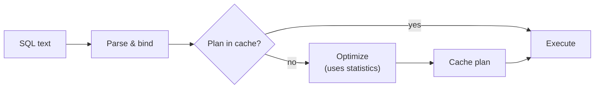
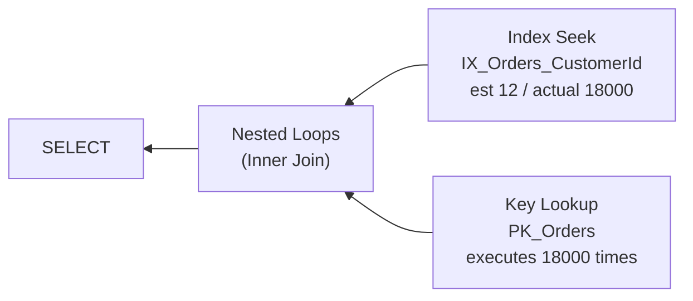

import { Aside } from '@astrojs/starlight/components';
import QuizBlock from '~/components/QuizBlock.astro';

## Why it matters in interviews

*"An API endpoint became slow in production. How do you find and fix the query?"* is a favourite scenario question at 3-4 years. Interviewers want a method: capture the plan, compare estimated and actual rows, spot scans, lookups and conversions, and explain why the optimizer chose that plan. *"Fast in SSMS, slow from the app"* (parameter sniffing) is the classic follow-up.

## Core idea

SQL is declarative. The **query optimizer** turns your statement into a physical **execution plan** by estimating the cost of alternatives. Estimates come from **statistics** (histograms of column values). Plans are **cached** and reused for later executions of the same parameterised statement, which is why one bad estimate can hurt for hours.



### Estimated vs actual plan

| | Estimated plan | Actual plan |
|---|---|---|
| How (SSMS) | Ctrl+L, query not run | Ctrl+M, query runs |
| Shows | estimated rows and costs | estimated **and actual** rows, executions, spills, runtime warnings |
| Use when | query is too slow or dangerous to run | diagnosing a real problem |

The single most useful check: **estimated rows vs actual rows** on each operator. A big mismatch (estimated 1, actual 200,000) means the optimizer chose operators for the wrong data size: stale statistics, a non-SARGable predicate, a table variable, or parameter sniffing.

### Reading a plan

Read **right to left** (data flows from the leaf operators to the `SELECT` on the left), and top to bottom for the inputs of a join. Arrow thickness reflects row count. Operator "cost %" values are **estimates**, even in an actual plan.



That plan tells a story: the estimate was 12 rows so a seek plus lookups looked cheap, but 18,000 rows came back, so the lookup ran 18,000 times. Fix the estimate (statistics, sniffing) or cover the query.

| Operator | Meaning | Watch for |
|---|---|---|
| Index Seek | B-tree navigation to a key/range | good, if row estimate is right |
| Index / Clustered Index Scan, Table Scan | reads all leaf pages | large table + few rows returned |
| Key Lookup / RID Lookup | fetches missing columns per row | high execution count |
| Nested Loops | for each outer row, probe inner | great for small outer input |
| Merge Join | merges two inputs sorted on the join key | needs sorted inputs (may add a Sort) |
| Hash Match | builds a hash table from one input, probes with the other | big unsorted inputs; memory grant, spills |
| Sort | sorts rows | memory grant, spills to tempdb (warning icon) |
| Parallelism | exchange between threads | may hide a missing index on a big scan |

Warning triangles on operators are worth reading: implicit conversions, spills to tempdb, missing join predicates, no statistics.

### SARGability

A predicate is **SARGable** (Search ARGument-able) when SQL Server can use it to seek an index. The rule: **leave the indexed column bare** on one side of the comparison.

| Non-SARGable | SARGable rewrite |
|---|---|
| `WHERE YEAR(OrderDate) = 2026` | `WHERE OrderDate >= '2026-01-01' AND OrderDate < '2027-01-01'` |
| `WHERE CONVERT(date, CreatedAt) = @d` | `WHERE CreatedAt >= @d AND CreatedAt < DATEADD(day, 1, @d)` |
| `WHERE Price * 1.18 > 100` | `WHERE Price > 100 / 1.18` |
| `WHERE LEFT(Name, 3) = 'Ann'` | `WHERE Name LIKE 'Ann%'` |
| `WHERE Name LIKE '%son'` | no simple fix: full-text search, or a reversed computed column |
| `WHERE ISNULL(Status, 'X') = 'X'` | `WHERE Status = 'X' OR Status IS NULL` |
| `WHERE @p IS NULL OR Col = @p` ("catch-all") | `OPTION (RECOMPILE)` or build the SQL dynamically |

(`CAST(datetimeCol AS date)` is a special case that SQL Server can still seek on, but the explicit range is clearer and portable.)

### Implicit conversions

When the two sides of a comparison have different types, SQL Server converts the one with **lower data type precedence**. `NVARCHAR` outranks `VARCHAR`, so comparing a `VARCHAR` column to an `NVARCHAR` parameter converts the **column**, and the plan shows `CONVERT_IMPLICIT` with a warning. Depending on the collation this either forces a scan or degrades the seek to a less efficient range seek.

This is a very common .NET bug: EF Core and ADO.NET send `string` parameters as `NVARCHAR` by default. If the column is `VARCHAR`, configure it so the parameter matches:

```csharp
modelBuilder.Entity<Customer>()
    .Property(c => c.AccountCode)
    .HasColumnType("varchar(20)");   // or .IsUnicode(false).HasMaxLength(20)
```

### Parameter sniffing

On first execution of a stored procedure or parameterised query, the optimizer **sniffs** the actual parameter values and builds a plan for them. The plan is cached and reused for all later values. With skewed data that hurts:

| CustomerId | Orders |
|---|---|
| 7 | 12 |
| 42 (a marketplace account) | 1,800,000 |

If the first call is for customer 7, the cached plan is "seek + key lookups", which is disastrous when reused for customer 42. If the first call is for 42, everyone gets a big scan with a large memory grant.

Fixes, roughly from most targeted to most blunt:

- **`OPTION (RECOMPILE)`** on the statement: fresh plan per execution. Costs CPU, fine for infrequent heavy queries.
- **`OPTIMIZE FOR (@CustomerId = 7)`** or **`OPTIMIZE FOR UNKNOWN`** (use average density instead of the sniffed value).
- **Query Store plan forcing**: pin the known good plan without changing code.
- **Parameter Sensitive Plan optimization** (SQL Server 2022, compatibility level 160): the engine can keep multiple cached plans for one parameterised query, chosen by the parameter value's range.
- Better indexing, so that one plan is good for all values (often the real fix: a covering index removes the lookups).

**"Fast in SSMS, slow in the app"**: SSMS runs with `SET ARITHABORT ON` while ADO.NET connections default to `OFF`. Different SET options mean **different plan cache entries**, so SSMS compiles a fresh plan with your test value while the app reuses the sniffed one. It is usually sniffing, not the network.

### Statistics

Statistics hold a **histogram** (up to 200 steps) on the first column of the statistics object plus density information for column combinations. They are created automatically for index keys and for columns used in predicates (`AUTO_CREATE_STATISTICS`), and refreshed automatically after enough modifications. Since compatibility level 130 the threshold for large tables is dynamic (roughly the square root of 1000 × rows), so big tables update more often than the old 20% rule. Ascending keys (today's orders beyond the last histogram step) and bulk loads still leave statistics stale; `UPDATE STATISTICS dbo.Orders WITH FULLSCAN` after large loads is common in ETL jobs.

### Missing index hints and Query Store

The green "Missing Index" text in a plan is generated from **that one query**. It ignores your existing indexes, write cost and other queries, and lists columns in a simplistic order. Treat it as a clue and design the index yourself (see [Indexes](../indexes/)).

**Query Store** records query text, plans and runtime statistics over time inside the database. It is on by default in Azure SQL Database and for new databases in SQL Server 2022. Use it to answer *"what changed?"*: the Regressed Queries report shows a query whose new plan is slower, and you can force the previous plan with one click or `sp_query_store_force_plan`.

## Code

**Measure, don't guess**:

```sql
SET STATISTICS IO, TIME ON;

SELECT OrderId, OrderDate, Total
FROM dbo.Orders
WHERE CustomerId = 42 AND OrderDate >= '2026-10-01';

-- Messages tab: "Table 'Orders'. Scan count 1, logical reads 15872 ..."
-- After adding IX (CustomerId, OrderDate) INCLUDE (Total): logical reads drop to a few dozen
```

**Top queries by CPU from Query Store**:

```sql
SELECT TOP (10) q.query_id, qt.query_sql_text,
       SUM(rs.count_executions)                     AS Executions,
       SUM(rs.avg_cpu_time * rs.count_executions)   AS TotalCpuMicroseconds
FROM sys.query_store_query q
JOIN sys.query_store_query_text qt ON qt.query_text_id = q.query_text_id
JOIN sys.query_store_plan p       ON p.query_id = q.query_id
JOIN sys.query_store_runtime_stats rs ON rs.plan_id = p.plan_id
GROUP BY q.query_id, qt.query_sql_text
ORDER BY TotalCpuMicroseconds DESC;
```

**A tuning checklist to say out loud in the interview**

1. Reproduce and measure: which query, how often, how slow (App Insights dependency telemetry or Query Store; AWS: CloudWatch / Performance Insights on RDS).
2. Get the **actual** plan and `STATISTICS IO`; focus on logical reads, not elapsed time alone.
3. Compare estimated vs actual rows to find where the estimate breaks.
4. Look for scans on large tables, key lookups with high execution counts, `CONVERT_IMPLICIT`, sorts and spills.
5. Fix the query first (SARGable predicates, fewer columns, no row-by-row UDFs), then indexes, then statistics, then hints.
6. Check parameter sniffing if it is fast for some values and slow for others.
7. Re-measure and watch the write cost of any index you added.

## Interview Q&A

<details>
<summary>How do you troubleshoot a slow query?</summary>

Measure first with `SET STATISTICS IO, TIME ON` and the actual execution plan. Compare estimated vs actual rows, then look for large scans, key lookups executed many times, implicit conversions, sorts or hash spills. Fix the predicate or projection, add or adjust an index, update statistics, and re-measure. Query Store tells you whether the plan changed recently.
</details>

<details>
<summary>What does SARGable mean? Give an example.</summary>

A predicate the engine can use to seek an index. `WHERE YEAR(OrderDate) = 2026` wraps the column in a function, so every row must be evaluated: not SARGable. `WHERE OrderDate >= '2026-01-01' AND OrderDate < '2027-01-01'` leaves the column bare and can seek.
</details>

<details>
<summary>What is parameter sniffing and how do you fix it?</summary>

The plan is compiled for the parameter values of the first execution and reused for others. With skewed data, a plan ideal for a small customer is terrible for a huge one. Fixes: `OPTION (RECOMPILE)`, `OPTIMIZE FOR`, Query Store plan forcing, PSP optimization in SQL Server 2022, or an index that makes one plan good for everyone.
</details>

<details>
<summary>Why is a query fast in SSMS but slow from the application?</summary>

Usually different SET options (SSMS has `ARITHABORT ON`, ADO.NET defaults to `OFF`) give separate plan cache entries. SSMS compiles a plan for your test value while the app reuses a plan sniffed for another value. Other causes: different parameter types (`NVARCHAR` vs `VARCHAR` conversion), or the app processing rows slowly while holding the reader open.
</details>

<details>
<summary>What is an implicit conversion and why does it matter?</summary>

When compared types differ, SQL Server converts the lower-precedence side. If that side is the indexed column (e.g. `VARCHAR` column vs `NVARCHAR` parameter), the plan applies `CONVERT_IMPLICIT` to the column, which can prevent an efficient seek. Match parameter types to column types; in EF Core mark non-Unicode columns with `IsUnicode(false)` or the exact column type.
</details>

<details>
<summary>Nested Loops vs Hash Match vs Merge Join?</summary>

Nested Loops is best when the outer input is small and the inner side has an index to seek. Merge Join is efficient when both inputs are already sorted on the join key. Hash Match handles large unsorted inputs by building a hash table in memory, needs a memory grant and can spill to tempdb. A Nested Loops join with a huge outer input usually means a bad row estimate.
</details>

<details>
<summary>Should you always create the missing index SQL Server suggests?</summary>

No. The suggestion comes from one query, ignores existing indexes that could be extended, ignores write cost, and doesn't consider column order carefully. Consolidate suggestions, check existing indexes, and prefer one well-designed index serving several queries.
</details>

<details>
<summary>What is Query Store used for?</summary>

It persists query plans and runtime statistics in the database, so you can see when a query regressed, which plan it used before, and force the good plan. It also captures top resource consumers over time, survives restarts, and is enabled by default on Azure SQL Database.
</details>

## Pitfalls

<Aside type="caution" title="Common mistakes">

- **Trusting cost percentages** as measured truth: they are estimates even in actual plans.
- **Functions on indexed columns** in `WHERE` and `JOIN` predicates.
- **`NVARCHAR` parameters against `VARCHAR` columns**, the default from .NET string parameters.
- **Clearing the whole plan cache** (`DBCC FREEPROCCACHE`) in production to "fix" one sniffed plan.
- **Sprinkling `NOLOCK` or `RECOMPILE` everywhere** instead of finding the cause.
- **Tuning by elapsed time** on a warm cache only; compare logical reads.

</Aside>

## Related

- [Indexes](../indexes/)
- [Stored procedures, functions & views](../stored-procs-views/)
- [EF Core performance](../efcore-performance/)
- [ASP.NET Core performance & resilience](../../aspnet/performance-resilience/)

## Quick quiz

<QuizBlock section="data" topic="execution-plans" />
