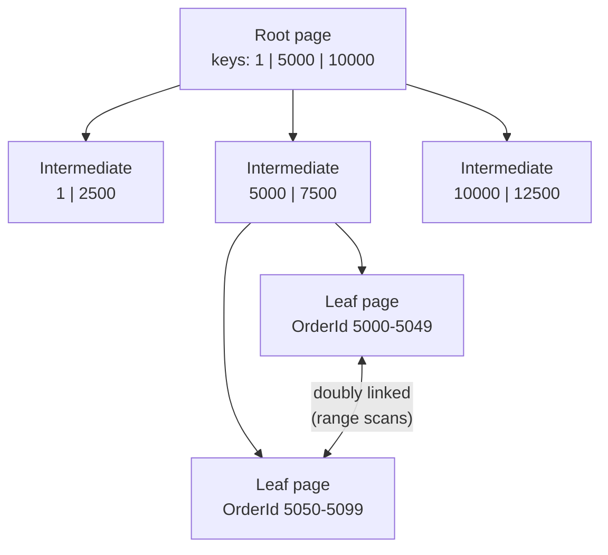

import { Aside } from '@astrojs/starlight/components';
import QuizBlock from '~/components/QuizBlock.astro';

## Why it matters in interviews

*"Clustered vs non-clustered?"* is the most common SQL Server question at every level. At 3-4 years it is followed by *"this query is slow, which index would you add and in which column order?"*, *"what is a key lookup?"* and *"why not index every column?"*. You are expected to reason about the B-tree, not just repeat "indexes make reads faster".

## Core idea

SQL Server stores rows in 8 KB **pages**. An index is a **B+ tree** of pages: a root page, intermediate levels, and a **leaf level** sorted by the index key. Finding a key costs one page read per level (usually 3-4 levels even for millions of rows) instead of reading every page.



### Clustered vs non-clustered

| | Clustered index | Non-clustered index |
|---|---|---|
| Leaf level contains | **the data rows themselves** | index key + **row locator** (+ INCLUDE columns) |
| How many per table | **one** (the table *is* the index) | many |
| Row locator | n/a | clustering key (or a RID if the table is a heap) |
| Default created by | `PRIMARY KEY` (if no clustered index exists yet) | `UNIQUE` constraint, `CREATE INDEX` |
| Good key | narrow, unique, static, ever-increasing (`INT IDENTITY`) | columns you filter, join or sort on |

A table without a clustered index is a **heap**. Every non-clustered index **contains the clustering key**, so a wide clustering key (for example a composite of three `NVARCHAR` columns) makes every other index wider. A random `uniqueidentifier` from `NEWID()` as clustering key inserts into random pages, causing **page splits** and fragmentation; prefer `INT/BIGINT IDENTITY` or `NEWSEQUENTIALID()`.

### Seek, scan and key lookup

Sample `Orders` (imagine 2 million rows), clustered on `OrderId`:

| OrderId | CustomerId | OrderDate | Status | Total |
|---|---|---|---|---|
| 1001 | 42 | 2026-10-01 | Shipped | 120.00 |
| 1002 | 7 | 2026-10-01 | Open | 80.00 |
| 1003 | 42 | 2026-10-03 | Open | 45.50 |

```sql
CREATE INDEX IX_Orders_CustomerId ON dbo.Orders (CustomerId);

SELECT OrderId, OrderDate, Total
FROM dbo.Orders
WHERE CustomerId = 42;
```

1. **Index seek** on `IX_Orders_CustomerId` navigates the B-tree to `CustomerId = 42` and reads the matching leaf rows. They contain `CustomerId` and `OrderId` (the clustering key) only.
2. `OrderDate` and `Total` are missing, so for **each** row SQL Server does a **key lookup**: a seek into the clustered index using `OrderId`. The plan shows a Nested Loops join between the seek and the lookups.

Key lookups are fine for a handful of rows. For thousands they become random I/O, and past a "tipping point" the optimizer gives up on the index and **scans** the clustered index instead.

| Operation | What it does | Cost profile |
|---|---|---|
| Index **seek** | navigates the tree to a key or range start | proportional to rows returned |
| Index **scan** | reads the whole leaf level (or all of a range) | proportional to table size |
| **Key lookup** (RID lookup on a heap) | fetches missing columns per row from the clustered index | one random seek per row |

A scan is not automatically bad: for a small table, or a query returning most rows, it is the cheapest plan.

### Covering indexes and INCLUDE

An index **covers** a query when it contains every column the query needs, so no lookup is required.

```sql
CREATE INDEX IX_Orders_CustomerId_OrderDate
ON dbo.Orders (CustomerId, OrderDate)       -- key: used for seek + sort
INCLUDE (Total, Status);                    -- leaf only: carried along, not sorted
```

- **Key columns** are stored at every level of the tree, in order, so they support seeks, range predicates and `ORDER BY`.
- **INCLUDE columns** are stored only at the leaf level. They cannot drive a seek, but they make the index cover the query without widening the upper levels.
- Don't include half the table "just in case": every included column is duplicated storage and write cost.

### Composite column order

An index on `(CustomerId, OrderDate)` is sorted by `CustomerId` first and then by `OrderDate` within each customer, like a phone book sorted by last name, then first name.

| Query predicate | Can seek on `(CustomerId, OrderDate)`? |
|---|---|
| `CustomerId = 42` | Yes (leading column) |
| `CustomerId = 42 AND OrderDate >= '2026-10-01'` | Yes, on both columns |
| `CustomerId = 42 ORDER BY OrderDate` | Yes, and no sort operator needed |
| `OrderDate >= '2026-10-01'` only | **No** seek: leading column missing, so at best a scan of this index |
| `CustomerId IN (7, 42) AND OrderDate >= ...` | Yes, one seek range per value |

Rule of thumb: **equality columns first, then the range or sort column**. Selectivity of the leading column matters less than whether your queries actually filter on it.

### Filtered and unique indexes

```sql
-- Unique when present, but many rows may have NULL
CREATE UNIQUE INDEX UX_Users_Email ON dbo.Users (Email) WHERE Email IS NOT NULL;

-- Small index for the hot subset only
CREATE INDEX IX_Orders_Open ON dbo.Orders (OrderDate) WHERE Status = 'Open';
```

- A **unique** index (or `UNIQUE` constraint, which creates one) guarantees no duplicate keys and gives the optimizer useful information. In SQL Server a unique index allows **only one NULL**, which is why the filtered version is the standard fix for optional unique columns.
- A **filtered** index is smaller and cheaper to maintain. The catch: the optimizer can only use it when it can prove the query's predicate falls inside the filter. A parameterised `WHERE Status = @status` usually can't use `IX_Orders_Open`, because the cached plan must work for any value.

### The cost of indexes

Every `INSERT` and `DELETE` must update every non-clustered index, and every `UPDATE` must update each index containing a modified column. More indexes also mean more locks, more log, larger backups and more choices for the optimizer. A write-heavy table with 15 indexes is a common production problem.

**Fragmentation**: inserts into the middle of a full page cause a **page split** (half the rows move to a new page), leaving pages half-empty and out of physical order. Check with `sys.dm_db_index_physical_stats`. `ALTER INDEX ... REORGANIZE` compacts leaf pages in place and is always online; `ALTER INDEX ... REBUILD` recreates the index (online only with `ONLINE = ON`, available in Enterprise edition and Azure SQL) and also refreshes its statistics. The traditional rule of thumb (reorganize at 5-30%, rebuild above 30%) is a starting point, not a law: on SSD storage, out-of-date statistics usually hurt far more than fragmentation. `FILLFACTOR` leaves free space in leaf pages to reduce splits, at the cost of more pages to read.

## Code

**EF Core: declare indexes in the model** (SQL Server provider):

```csharp
public class OrderConfiguration : IEntityTypeConfiguration<Order>
{
    public void Configure(EntityTypeBuilder<Order> b)
    {
        b.HasIndex(o => new { o.CustomerId, o.OrderDate })
         .IncludeProperties(o => new { o.Total, o.Status });

        b.HasIndex(o => o.ExternalRef)
         .IsUnique()
         .HasFilter("[ExternalRef] IS NOT NULL");
    }
}
```

EF Core creates an index for every foreign key by convention. SQL Server itself does **not** index foreign keys automatically, so hand-written schemas often miss them, which makes joins and cascading deletes slow.

**Find unused and missing indexes** (treat both as hints, not orders):

```sql
-- Indexes that are written but rarely read (counters reset on restart)
SELECT OBJECT_NAME(s.object_id) AS TableName, i.name AS IndexName,
       s.user_seeks, s.user_scans, s.user_lookups, s.user_updates
FROM sys.dm_db_index_usage_stats s
JOIN sys.indexes i ON i.object_id = s.object_id AND i.index_id = s.index_id
WHERE s.database_id = DB_ID() AND i.type_desc = 'NONCLUSTERED'
ORDER BY s.user_updates DESC;
```

For analytics over many rows, consider a **columnstore** index: data is stored per column, heavily compressed and processed in batch mode, which is much faster for aggregations but not for single-row lookups.

## Interview Q&A

<details>
<summary>What is the difference between a clustered and a non-clustered index?</summary>

The clustered index defines how the table's rows are stored: its leaf pages are the data, sorted by the key, so there can be only one. A non-clustered index is a separate B-tree whose leaf rows contain the key plus a pointer (the clustering key, or a RID on a heap) back to the data. A table can have many non-clustered indexes.
</details>

<details>
<summary>Does a primary key always mean a clustered index?</summary>

By default yes: `PRIMARY KEY` creates a unique clustered index if the table doesn't already have one. But they are separate concepts. You can declare `PRIMARY KEY NONCLUSTERED` and cluster on another column, for example a GUID primary key with a clustered index on an identity or date column.
</details>

<details>
<summary>What is a key lookup and how do you remove it?</summary>

When a non-clustered index finds the rows but lacks some selected columns, SQL Server fetches them from the clustered index row by row. Remove it by making the index covering (add the columns as `INCLUDE`), or by selecting fewer columns (project to a DTO instead of `SELECT *`).
</details>

<details>
<summary>How do you choose the column order of a composite index?</summary>

Put columns used with equality first, then the column used for a range or `ORDER BY`. The index is only seekable on a leading prefix of its key, so an index on `(A, B)` helps `WHERE A = 1` and `WHERE A = 1 AND B > 5`, but not `WHERE B > 5` alone. Design from the actual queries.
</details>

<details>
<summary>Why not index every column?</summary>

Each index slows down inserts, deletes and updates of its columns, takes storage and memory, adds locking and log volume, and lengthens maintenance. Single-column indexes on everything rarely help multi-column predicates anyway. Index for the important queries and drop unused indexes.
</details>

<details>
<summary>Is an index scan always bad?</summary>

No. If the query needs most of the table, or the table is small, a scan with sequential reads is cheaper than many seeks plus lookups. A scan is a problem when the query returns few rows from a large table, which usually means a missing index or a non-SARGable predicate.
</details>

<details>
<summary>Why is a random GUID a bad clustered key?</summary>

New values land on random pages, so inserts cause page splits, fragmentation and a cache full of half-empty pages. The 16-byte key is also copied into every non-clustered index. Use an identity or sequential GUID for the clustered key; a random GUID can still be the public identifier with a non-clustered unique index.
</details>

<details>
<summary>What is the difference between a unique constraint and a unique index?</summary>

Functionally almost none: a `UNIQUE` constraint is enforced by a unique index created for it. A constraint documents a business rule in the schema (and shows up in constraint metadata); a unique index gives more options (filters, `INCLUDE` columns). A foreign key can reference either. Both allow only one NULL unless you use a filtered unique index.
</details>

## Pitfalls

<Aside type="caution" title="Common mistakes">

- **Wrong column order** in a composite index: the query filters on the second column only and can't seek.
- **`SELECT *`** defeating a covering index and causing thousands of key lookups.
- **Applying missing-index suggestions blindly**: they ignore existing indexes and write cost, and often duplicate each other.
- **Forgetting foreign key indexes** in hand-written schemas.
- **Wide or random clustering keys** (composite strings, `NEWID()`), which bloat every other index.
- **Rebuilding everything nightly** while statistics stay stale on the tables that matter.

</Aside>

## Related

- [Execution plans & query tuning](../execution-plans/)
- [EF Core performance](../efcore-performance/)
- [Normalization & keys](../normalization/)
- [DBMS theory](../../fundamentals/dbms-theory/)

## Quick quiz

<QuizBlock section="data" topic="indexes" />
