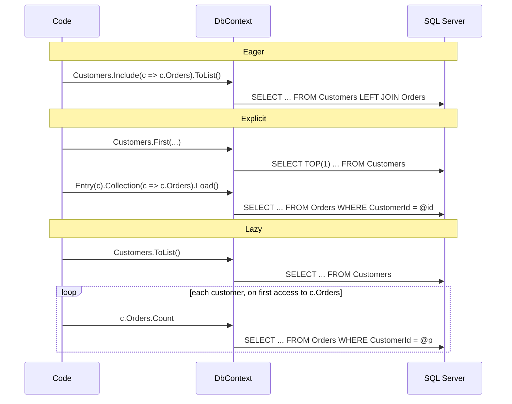
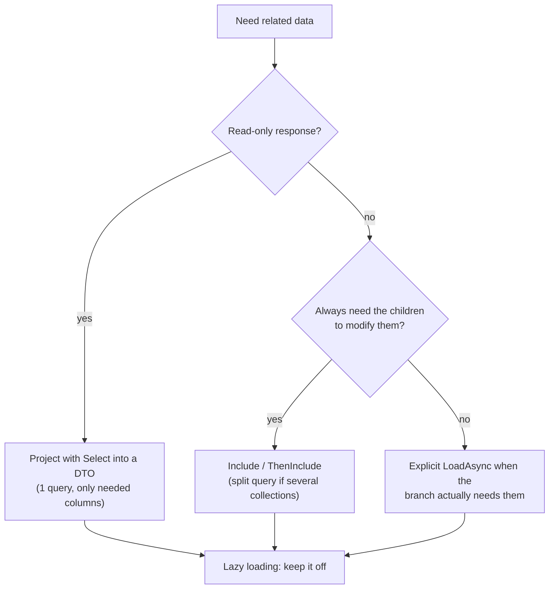

import { Aside } from '@astrojs/starlight/components';
import QuizBlock from '~/components/QuizBlock.astro';

## Why it matters in interviews

"Explain eager, lazy and explicit loading" is a warm-up question in almost every .NET loop. The definitions are easy; what separates a 3-4 year answer is knowing **what SQL each one sends**, why lazy loading is usually **switched off in APIs**, and what you actually use instead (projection).

## Core idea

Navigation properties (`order.Customer`, `customer.Orders`) are **not loaded automatically**. A plain `db.Customers.ToListAsync()` gives you customers with an empty `Orders` collection. You choose how and when related data arrives:

| Strategy | How you ask for it | When SQL runs | Round-trips for 1 customer + orders | Typical use |
|---|---|---|---|---|
| **Eager** | `Include` / `ThenInclude` in the query | With the main query | 1 (or 1 per collection with split queries) | You know up front you need the graph |
| **Explicit** | `db.Entry(x).Collection(...).LoadAsync()` | When you call `Load` | 2 | Load related data conditionally, or filter/count it |
| **Lazy** | Just touch the navigation (`c.Orders`) | Silently, on first access | 2, and **N+1** inside loops | Desktop apps with long-lived contexts; avoid in APIs |
| **Projection** (not a loading mode, but the usual answer) | `Select` into a DTO | With the main query | 1 | Read endpoints |



### Eager loading

```csharp
var customers = await db.Customers
    .Where(c => c.City == city)
    .Include(c => c.Orders)
    .ToListAsync(ct);
```

```sql
SELECT [c].[Id], [c].[City], [c].[Name], [o].[Id], [o].[CustomerId], [o].[PlacedAt], [o].[Total]
FROM [Customers] AS [c]
LEFT JOIN [Orders] AS [o] ON [c].[Id] = [o].[CustomerId]
WHERE [c].[City] = @city
ORDER BY [c].[Id]
```

A `LEFT JOIN` so customers without orders still come back, and `ORDER BY` the key so EF can group child rows under each parent as it streams them. With multiple collections consider `AsSplitQuery()` (see [Querying](../efcore-querying/)).

### Explicit loading

```csharp
var customer = await db.Customers.SingleAsync(c => c.Id == id, ct);

if (includeOrders)
    await db.Entry(customer).Collection(c => c.Orders).LoadAsync(ct);   // SELECT ... WHERE CustomerId = @id

await db.Entry(order).Reference(o => o.Customer).LoadAsync(ct);         // single navigation

// Query() gives an IQueryable over the navigation: filter or aggregate without loading everything
var bigOrders = await db.Entry(customer).Collection(c => c.Orders)
    .Query().Where(o => o.Total > 1000).CountAsync(ct);
```

Explicit loading is fully async, and the extra round-trip is visible in the code, which is its main advantage over lazy loading. `Query()` is the underrated part: it lets you count or filter a navigation in SQL without materializing it.

### Lazy loading

Two ways to enable it:

1. **Proxies**: install `Microsoft.EntityFrameworkCore.Proxies`, call `UseLazyLoadingProxies()`, and make entity classes non-sealed with **`virtual`** navigation properties. EF creates runtime subclasses that intercept the getter.
2. **`ILazyLoader` injection**: the entity takes an `ILazyLoader` (or a delegate) in a constructor and calls it in the navigation getter. No proxies, but EF types leak into your domain classes.

What happens when you touch `customer.Orders` on a proxy: EF checks whether that navigation is already loaded; if not, it runs `SELECT ... FROM Orders WHERE CustomerId = @p` **synchronously** and fills the collection.

Why most teams turn it off in Web APIs:

- **Hidden N+1**: a loop over 100 customers that reads `c.Orders` runs 101 queries, and nothing in the code looks like a query.
- **Synchronous I/O**: lazy loads cannot be awaited, so they block a thread-pool thread during the round-trip.
- **Serialization surprises**: `System.Text.Json` walking an entity graph triggers loads property by property, possibly half the database, or hits a reference cycle.
- **Disposed context**: touching an unloaded navigation after the context is disposed throws by default, which typically shows up once the entity has left the request scope.

### Choosing for an API



## Code

```csharp
// Lazy loading setup (shown so you can recognise it; usually avoided in APIs)
builder.Services.AddDbContext<ShopDb>(o => o
    .UseSqlServer(cs)
    .UseLazyLoadingProxies());

public class Customer                                   // not sealed: proxy subclasses it
{
    public int Id { get; set; }
    public string Name { get; set; } = "";
    public virtual ICollection<Order> Orders { get; set; } = [];   // virtual: proxy overrides it
}

// Read endpoint: projection, no Include, no lazy loading
app.MapGet("/customers/{id:int}", async (int id, ShopDb db, CancellationToken ct) =>
    await db.Customers
        .Where(c => c.Id == id)
        .Select(c => new CustomerDetail(
            c.Name,
            c.Orders.OrderByDescending(o => o.PlacedAt).Take(5)
                    .Select(o => new OrderBrief(o.Id, o.Total)).ToList()))
        .SingleOrDefaultAsync(ct)
    is { } dto ? Results.Ok(dto) : Results.NotFound());
```

The projection above is one SQL statement: EF uses `ROW_NUMBER() OVER (PARTITION BY CustomerId ORDER BY PlacedAt DESC)` in a subquery to take the latest five orders per customer.

## Interview Q&A

<details>
<summary>Explain eager, explicit and lazy loading in one minute.</summary>

Eager: you ask for related data in the query with `Include`, and it comes back in the same SQL (a JOIN) or in split queries. Explicit: you load a navigation later on demand with `Entry(x).Collection(...).LoadAsync()`, which is a separate visible query. Lazy: the navigation loads itself the first time you access it, through proxies or `ILazyLoader`, which is convenient but hides queries and causes N+1.

</details>

<details>
<summary>Why is lazy loading considered dangerous in Web APIs?</summary>

It hides database round-trips behind property access, so loops and serializers produce N+1 queries; the loads are synchronous and block threads; serializing an entity can pull a large graph or loop on cycles; and accessing a navigation after the context is disposed throws. APIs should know exactly what they load, so use projections or `Include`.

</details>

<details>
<summary>What do you need for lazy loading with proxies?</summary>

The `Microsoft.EntityFrameworkCore.Proxies` package, `UseLazyLoadingProxies()` on the options, entity classes that are public and not sealed, and `virtual` navigation properties. Entities must be created by EF (queries, or `CreateProxy`) to get the lazy behaviour; `new Customer()` is a plain object.

</details>

<details>
<summary>When is explicit loading the right choice?</summary>

When whether you need the related data depends on runtime logic (load lines only if the order is editable), or when you need a filtered or aggregated view of a navigation without loading it (`Collection(...).Query().CountAsync()`). The extra round-trip is explicit, async and reviewable.

</details>

<details>
<summary>Does `Include` always produce a JOIN?</summary>

In single-query mode, yes: a `LEFT JOIN` for collections and optional references, an `INNER JOIN` for required references, ordered by keys. With `AsSplitQuery()` (or a global split setting) each collection becomes its own `SELECT` joined back to the parent filter, so N collections means N+1 statements, not N+1 per row.

</details>

<details>
<summary>You serialize an entity with lazy loading on and the response is huge or fails. What happened?</summary>

The serializer touched each navigation, which triggered lazy loads, which exposed more navigations: customer to orders to customer again, and so on. You either get a cycle error or a massive payload and dozens of queries. Fix: never serialize entities from an API; project to DTOs.

</details>

<details>
<summary>Can you use `Include` together with `Select`?</summary>

You can write it, but when the query ends in a projection to a non-entity type, EF ignores the `Include` (navigations used inside the `Select` are loaded through the projection itself). `Include` only matters when you return entity instances.

</details>

## Pitfalls

<Aside type="caution" title="Common mistakes">

- **Enabling lazy loading "for convenience"** in an API, then discovering N+1 in production telemetry.
- **Returning entities from controllers** so the serializer walks navigations.
- **Forgetting `virtual`** (proxies silently cannot lazy-load) or sealing the class.
- **`Collection(...).LoadAsync()` just to count**: use `.Query().CountAsync()` instead of loading every row.
- **`Include` chains for a read endpoint** that needs five fields. Project instead.
- **Assuming an empty collection means no data**: it may simply not be loaded.

</Aside>

## Related

- [Querying & the N+1 Problem](../efcore-querying/)
- [EF Core Performance](../efcore-performance/)
- [EF Core Architecture & Change Tracking](../efcore-architecture/)

## Quick quiz

<QuizBlock section="data" topic="loading-strategies" />
