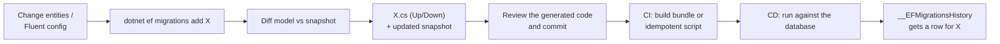
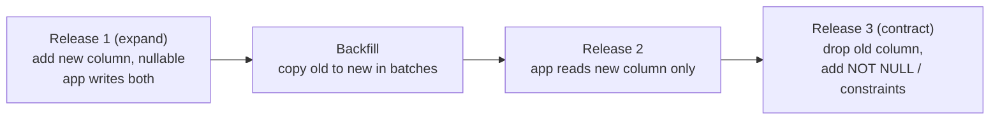

import { Aside } from '@astrojs/starlight/components';
import QuizBlock from '~/components/QuizBlock.astro';

## Why it matters in interviews

Interviewers ask about migrations to see whether you have shipped database changes to production, not just run `Update-Database` on your laptop. Typical prompts: *"how do you deploy migrations in CI/CD?"*, *"two developers added migrations on different branches, now what?"*, *"how do you rename a column without downtime?"*.

## Core idea

A migration is a C# class describing how to move the schema **from one model version to the next**. EF finds the differences by comparing your current model with the **model snapshot** checked into the repo.

| File | Purpose |
|---|---|
| `20261102093000_AddOrderStatus.cs` | `Up()` applies the change, `Down()` reverts it, using `MigrationBuilder` operations |
| `20261102093000_AddOrderStatus.Designer.cs` | The model as it was at that migration (metadata) |
| `ShopDbModelSnapshot.cs` | The **latest** model; the next `migrations add` diffs against this |
| `__EFMigrationsHistory` table | In the database: one row per applied migration id |



### Everyday commands

| CLI (`dotnet ef`) | Package Manager Console | What it does |
|---|---|---|
| `migrations add AddOrderStatus` | `Add-Migration AddOrderStatus` | Scaffold a migration from model changes |
| `database update` | `Update-Database` | Apply pending migrations to the configured database |
| `database update AddCustomers` | `Update-Database AddCustomers` | Migrate up **or down** to a specific migration |
| `migrations remove` | `Remove-Migration` | Delete the last migration and restore the snapshot (only if not applied anywhere that matters) |
| `migrations script --idempotent` | `Script-Migration -Idempotent` | Generate a SQL script that checks history before each step |
| `migrations bundle` | `Bundle-Migration` | Build a self-contained executable that applies migrations |
| `migrations has-pending-model-changes` | n/a | Fail CI if someone changed the model but forgot a migration (EF Core 8+) |

Once a migration has reached a shared environment, **never edit or remove it**. Add a new migration that fixes or reverts the change.

### Applying migrations in production

| Option | How | Pros | Cons |
|---|---|---|---|
| **Idempotent SQL script** | Generated in CI, reviewed, run by the pipeline or a DBA | Full visibility, works with DBA approval processes | Script handling and SQL tooling in the pipeline |
| **Migration bundle** | `efbundle` executable built in CI, run as a pipeline step with the connection string | Single artifact, no SDK or source needed on the agent, transactional per migration | Less human-readable than a script |
| **`Database.MigrateAsync()` at startup** | App migrates itself on boot | Simple for dev/demo/single instance | App needs DDL permissions; several instances start together; a failed migration means a failed deploy loop |

Most teams use a bundle or idempotent script as a **separate pipeline step before the app deploys** (Azure DevOps or GitHub Actions to Azure SQL; AWS: CodePipeline to RDS). Keep `MigrateAsync` for local development and integration tests. EF Core 9 added a database lock around `Migrate` to protect against concurrent runs, but the permission and failure-mode arguments still apply.

### Seeding data

| Approach | Use for | Notes |
|---|---|---|
| `HasData` in `OnModelCreating` | Static reference data (countries, statuses) | Becomes `InsertData`/`UpdateData` in migrations; you must specify keys; no navigations, only FK values |
| `UseSeeding` / `UseAsyncSeeding` (EF Core 9+) | Dev/test data, data that depends on runtime logic | Runs on `Migrate()` and `EnsureCreated()`; write it to be idempotent |
| `migrationBuilder.Sql(...)` inside a migration | One-off data fixes that belong to a schema change | Backfills, splitting a column |

### Team merge conflicts

Two branches each add a migration. Both edit `ShopDbModelSnapshot.cs`, so git shows a conflict there. Migrations themselves are ordered by their timestamp id, and EF applies any that are missing from history. The safe fix:

1. Merge the other branch first (take their migration and snapshot).
2. `dotnet ef migrations remove` your unapplied migration (or restore the snapshot manually).
3. `dotnet ef migrations add` again so your migration is generated on top of theirs with a correct snapshot.

If both changes are independent and the snapshot merges cleanly, it can work as is, but always run `has-pending-model-changes` and a fresh database build in CI to prove it.

### Zero-downtime changes: expand and contract

During a rolling deploy, the **old** and **new** app versions run against the **same** database for a while. A destructive change (rename, drop, make NOT NULL) breaks the old version. Split it:



Also watch out for:

- **Renames**: EF can generate `DropColumn` + `AddColumn` (data loss) when it cannot tell a rename from a remove-and-add. Check the generated code; use `RenameColumn` explicitly, and still apply expand/contract if old code reads the column.
- **Large tables**: adding an index or a NOT NULL column with a default can lock or rewrite a big table. Use `ONLINE = ON` index builds where your Azure SQL tier supports them, or run such steps in a maintenance window.
- **Transactions**: each migration runs in a transaction by default; some operations (for example memory-optimized tables or full-text) cannot, and need `suppressTransaction: true` on `migrationBuilder.Sql`.

## Code

```csharp
public partial class SplitCustomerName : Migration
{
    protected override void Up(MigrationBuilder mb)
    {
        mb.AddColumn<string>("FirstName", "Customers", maxLength: 100, nullable: true);
        mb.AddColumn<string>("LastName", "Customers", maxLength: 100, nullable: true);

        // Backfill: hand-written SQL inside the generated migration
        mb.Sql("""
            UPDATE Customers
            SET FirstName = LEFT(Name, CHARINDEX(' ', Name + ' ') - 1),
                LastName  = LTRIM(SUBSTRING(Name, CHARINDEX(' ', Name + ' ') + 1, 200))
            """);
        // Name is dropped in a LATER migration (contract), after all readers moved.
    }

    protected override void Down(MigrationBuilder mb)
    {
        mb.DropColumn("FirstName", "Customers");
        mb.DropColumn("LastName", "Customers");
    }
}
```

**Seeding reference data and dev data**

```csharp
modelBuilder.Entity<OrderStatusLookup>().HasData(
    new OrderStatusLookup { Id = 1, Name = "Placed" },
    new OrderStatusLookup { Id = 2, Name = "Shipped" });

builder.Services.AddDbContext<ShopDb>(o => o
    .UseSqlServer(cs)
    .UseAsyncSeeding(async (ctx, _, ct) =>
    {
        if (!await ctx.Set<Customer>().AnyAsync(ct))          // idempotent
        {
            ctx.Set<Customer>().Add(new Customer { Name = "Demo Customer" });
            await ctx.SaveChangesAsync(ct);
        }
    }));
```

**Pipeline steps (bundle)**

```bash
# CI: fail if the model changed without a migration, then build the bundle
dotnet ef migrations has-pending-model-changes --project src/Shop.Data --startup-project src/Shop.Api
dotnet ef migrations bundle --project src/Shop.Data --startup-project src/Shop.Api \
  --configuration Release --self-contained -r linux-x64 -o artifacts/efbundle

# CD: run before deploying the new app version
./efbundle --connection "$SHOP_DB_CONNECTION"
```

## Interview Q&A

<details>
<summary>How does EF Core know which migrations to apply?</summary>

Each applied migration id is stored in `__EFMigrationsHistory`. `database update`, `Migrate()`, bundles and idempotent scripts compare the migrations in the assembly with that table and apply the missing ones in id (timestamp) order. Migrations themselves were generated by diffing the model against the snapshot file.

</details>

<details>
<summary>How do you apply migrations in production?</summary>

From the pipeline, as a step before the app deploys: either an idempotent SQL script (reviewable, DBA-friendly) or a migration bundle executable. I avoid `Migrate()` at app startup in production because the app would need DDL rights, multiple instances race on boot, and a failed migration becomes a crash loop. Always back up or use point-in-time restore before risky changes.

</details>

<details>
<summary>What does "idempotent script" mean here?</summary>

`migrations script --idempotent` wraps each migration in `IF NOT EXISTS (SELECT * FROM __EFMigrationsHistory WHERE MigrationId = '...')`, so the same script can run against databases at different versions (dev, test, prod) and only applies what is missing.

</details>

<details>
<summary>Two developers added migrations on separate branches. How do you resolve it?</summary>

The conflict appears in the model snapshot. Merge the other branch first, remove my unapplied migration, then re-add it so it is generated against the merged snapshot. If both were already applied somewhere, keep both and add a small migration to reconcile. CI should check `has-pending-model-changes` and build a database from scratch.

</details>

<details>
<summary>How would you rename a column without downtime?</summary>

Expand and contract: add the new column, deploy code that writes both and reads the old, backfill in batches, deploy code that reads the new column, then drop the old column in a later release. A direct `RenameColumn` is atomic in SQL but breaks the old app version still running during a rolling or slot-swap deploy.

</details>

<details>
<summary>`HasData` vs `UseSeeding`: when do you use which?</summary>

`HasData` is for static reference data that is part of the schema: it is tracked in migrations, needs explicit keys and generates insert/update/delete operations when you change it. `UseSeeding`/`UseAsyncSeeding` (EF Core 9) runs arbitrary code when the database is migrated or created, which suits test and demo data or anything computed at runtime. It must be idempotent.

</details>

<details>
<summary>A migration was already applied to production and turned out wrong. Do you remove it?</summary>

No. Removing or editing an applied migration desynchronizes code, snapshot and history table across environments. Add a new forward migration that corrects the schema. `Down()` methods are useful for local rollbacks but are rarely run in production; restores or forward fixes are safer.

</details>

## Pitfalls

<Aside type="caution" title="Common mistakes">

- **Not reading the generated migration**: renames turned into drop + add lose data.
- **Editing or deleting migrations** that already ran in a shared environment.
- **`Migrate()` at startup** in a scaled-out production app.
- **Adding a required column to a populated table** without thinking about existing rows: EF fills in `defaultValue: ""` or `0`, which is valid SQL but meaningless data. Choose a real default or backfill.
- **Breaking changes in one release** during rolling deployments. Use expand/contract.
- **Seeding with `HasData` and generated keys**: keys must be explicit and stable.
- **Forgetting the snapshot in a merge**, so the next `migrations add` produces strange diffs.

</Aside>

## Related

- [Modelling & Relationships](../efcore-modelling/)
- [Transactions, Bulk Ops & Raw SQL](../transactions-raw-sql/)
- [Indexes](../indexes/)

## Quick quiz

<QuizBlock section="data" topic="migrations" />
