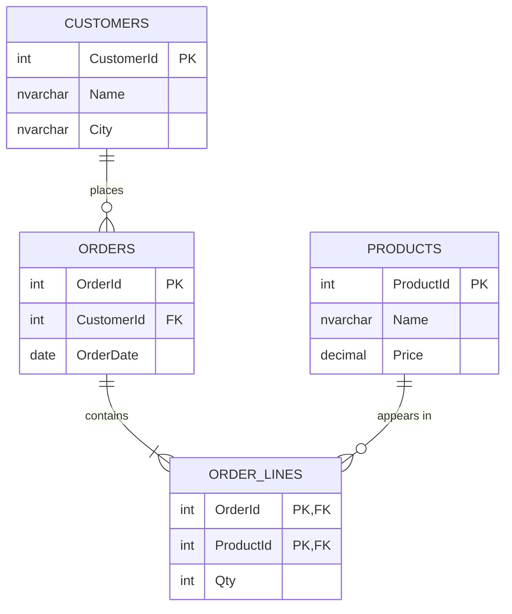

import { Aside } from '@astrojs/starlight/components';
import QuizBlock from '~/components/QuizBlock.astro';

## Why it matters in interviews

*"Explain 1NF, 2NF and 3NF"* is a standard question, especially at service companies and in DBMS rounds. At 3-4 years you are expected to go further: normalise a messy table on the whiteboard, choose between surrogate and natural keys, and explain **when you would deliberately denormalise** (reporting tables, read models, caching) and what that costs.

## Core idea

Normalization organises columns into tables so that **each fact is stored once**. Duplicated facts cause **anomalies**:

| Anomaly | Example in a single "orders spreadsheet" table |
|---|---|
| Update | Asha moves from Pune to Mumbai; you must update every one of her order rows, and missing one leaves inconsistent data |
| Insert | you can't record a new product until someone orders it |
| Delete | deleting the only order for a product also deletes the product's name and price |

Each normal form removes one kind of bad dependency. A **functional dependency** `A → B` means "knowing A determines B" (CustomerId → CustomerName).

### Worked example

Start with an unnormalised order sheet:

| OrderId | OrderDate | CustomerId | CustomerName | City | Items |
|---|---|---|---|---|---|
| 1 | 2026-10-01 | C1 | Asha | Pune | P1 Pen ×2, P2 Notebook ×1 |
| 2 | 2026-10-02 | C2 | Ravi | Delhi | P1 Pen ×5 |
| 3 | 2026-10-03 | C1 | Asha | Pune | P2 Notebook ×3 |

**1NF: atomic values, no repeating groups.** `Items` holds a list, so split it into one row per order line. The key becomes `(OrderId, ProductId)`.

| OrderId | ProductId | ProductName | Qty | OrderDate | CustomerId | CustomerName | City |
|---|---|---|---|---|---|---|---|
| 1 | P1 | Pen | 2 | 2026-10-01 | C1 | Asha | Pune |
| 1 | P2 | Notebook | 1 | 2026-10-01 | C1 | Asha | Pune |
| 2 | P1 | Pen | 5 | 2026-10-02 | C2 | Ravi | Delhi |
| 3 | P2 | Notebook | 3 | 2026-10-03 | C1 | Asha | Pune |

**2NF: 1NF + no partial dependency on part of a composite key.** `ProductName` depends only on `ProductId`; `OrderDate` and the customer columns depend only on `OrderId`. Only `Qty` depends on the whole key. Split:

- `OrderLines (OrderId, ProductId, Qty)`
- `Products (ProductId, ProductName)`
- `Orders (OrderId, OrderDate, CustomerId, CustomerName, City)`

(A table whose key is a single column is automatically in 2NF if it is in 1NF.)

**3NF: 2NF + no transitive dependency** (non-key column depending on another non-key column). In `Orders`, `OrderId → CustomerId → CustomerName, City`. Move the customer facts out:

- `Orders (OrderId, OrderDate, CustomerId)`
- `Customers (CustomerId, CustomerName, City)`

Now Asha's city lives in exactly one row. The usual summary: *every non-key column depends on the key, the whole key, and nothing but the key.*

**BCNF (Boyce-Codd): every determinant must be a candidate key.** It only differs from 3NF in rare cases with overlapping candidate keys. Classic example: `Enrolment (Student, Course, Instructor)`, where each instructor teaches exactly one course. Key: `(Student, Course)`. But `Instructor → Course`, and `Instructor` is not a key, so the table is in 3NF (Course is part of a key) but not BCNF. Decompose into `(Student, Instructor)` and `(Instructor, Course)`. The trade-off: the rule "a student has one instructor per course" can no longer be enforced by a single key constraint.

4NF and 5NF deal with multi-valued and join dependencies and rarely come up in interviews beyond knowing they exist.

### The resulting model



`ORDER_LINES` is also how you model **many-to-many**: a junction table with a foreign key to each side, usually with a composite primary key on both.

### Keys

| Key | Definition | Example |
|---|---|---|
| Super key | any set of columns that uniquely identifies a row | `(CustomerId, Name)` |
| Candidate key | a *minimal* super key | `CustomerId`, `Email` |
| Primary key | the candidate key you choose; unique and NOT NULL, one per table | `CustomerId` |
| Alternate key | a candidate key not chosen as primary; enforce with `UNIQUE` | `Email` |
| Composite key | a key of two or more columns | `(OrderId, ProductId)` |
| Foreign key | column(s) referencing a primary or unique key in another table | `Orders.CustomerId` |
| Natural key | a key with business meaning | PAN, ISBN, email |
| Surrogate key | a meaningless generated value | `INT IDENTITY`, `uniqueidentifier`, `SEQUENCE` |

**Surrogate vs natural**: natural keys change (people change email; "unique" codes get reused), can be wide, and leak into every foreign key. Most systems use a narrow surrogate primary key (`INT/BIGINT IDENTITY`) **plus a `UNIQUE` constraint on the natural key**, so you get stable joins and still enforce the business rule.

### Constraints

| Constraint | Enforces |
|---|---|
| `NOT NULL` | value required |
| `PRIMARY KEY` | unique + not null; clustered index by default |
| `UNIQUE` | no duplicates; SQL Server allows **one** NULL (use a filtered unique index for "unique when present") |
| `FOREIGN KEY` | referential integrity; optional `ON DELETE/UPDATE CASCADE`, `SET NULL`, `SET DEFAULT` |
| `CHECK` | row-level rule, e.g. `Qty > 0` |
| `DEFAULT` | value used when none is supplied |

Constraints are your last line of defence: application validation can be bypassed by another service, a script or a bug. Trusted constraints (`WITH CHECK`) also help the optimizer, for example to skip a join it can prove unnecessary.

### Denormalization

Normalised schemas are ideal for **OLTP writes**: small rows, no anomalies, cheap updates. Reads may need many joins. Denormalization stores redundant data on purpose to make reads cheaper:

| Technique | Example | Cost |
|---|---|---|
| Copy a column | `Orders.CustomerName` for invoice display | must sync, or treat as a historical snapshot (often desirable: invoice shows name at time of order) |
| Stored aggregates | `Customers.OrderCount` | update on each order, risk of drift; an indexed view keeps it exact |
| Reporting / star schema | fact and dimension tables in a data warehouse | ETL pipeline, latency |
| Read models (CQRS) | a JSON document per order for the API | eventual consistency |
| Cache | Azure Cache for Redis (AWS: ElastiCache) | invalidation |

Rule: **normalise first, denormalise for a measured read problem**, and keep one source of truth.

## Code

```sql
CREATE TABLE dbo.Customers (
    CustomerId INT IDENTITY(1,1) CONSTRAINT PK_Customers PRIMARY KEY,
    Email      NVARCHAR(256) NOT NULL CONSTRAINT UQ_Customers_Email UNIQUE,  -- alternate key
    Name       NVARCHAR(100) NOT NULL,
    City       NVARCHAR(100) NULL
);

CREATE TABLE dbo.Orders (
    OrderId    INT IDENTITY(1,1) CONSTRAINT PK_Orders PRIMARY KEY,
    CustomerId INT NOT NULL CONSTRAINT FK_Orders_Customers REFERENCES dbo.Customers (CustomerId),
    OrderDate  DATE NOT NULL CONSTRAINT DF_Orders_OrderDate DEFAULT (CAST(SYSUTCDATETIME() AS date))
);
CREATE INDEX IX_Orders_CustomerId ON dbo.Orders (CustomerId);  -- FKs are NOT indexed automatically

CREATE TABLE dbo.OrderLines (
    OrderId   INT NOT NULL REFERENCES dbo.Orders (OrderId) ON DELETE CASCADE,
    ProductId INT NOT NULL REFERENCES dbo.Products (ProductId),
    Qty       INT NOT NULL CONSTRAINT CK_OrderLines_Qty CHECK (Qty > 0),
    UnitPrice DECIMAL(10,2) NOT NULL,      -- price at time of order: intentional copy
    CONSTRAINT PK_OrderLines PRIMARY KEY (OrderId, ProductId)  -- composite key
);
```

`UnitPrice` on the order line looks like duplication of `Products.Price`, but it isn't a normalization violation: it is a **different fact** (the price agreed for this order), which must not change when the catalogue price changes.

## Interview Q&A

<details>
<summary>Explain 1NF, 2NF and 3NF in one line each.</summary>

1NF: atomic column values and no repeating groups. 2NF: 1NF and every non-key column depends on the whole composite key, not part of it. 3NF: 2NF and no non-key column depends on another non-key column (no transitive dependencies).
</details>

<details>
<summary>What problem does normalization solve?</summary>

Redundancy and the update, insert and delete anomalies that come with it. When a fact is stored once, it can't become inconsistent, and you can insert or delete one kind of entity without side effects on another.
</details>

<details>
<summary>What is the difference between 3NF and BCNF?</summary>

3NF allows a dependency `X → Y` where X is not a key if Y is part of some candidate key. BCNF doesn't: every determinant must be a candidate key. They differ only when a table has overlapping composite candidate keys, and achieving BCNF may lose the ability to enforce some dependencies with a single constraint.
</details>

<details>
<summary>Surrogate key or natural key?</summary>

Surrogate keys are small, stable and meaningless, so they make joins and foreign keys cheap and never need cascading updates. Natural keys carry meaning and avoid an extra unique index but can change or be wide. The common answer: surrogate primary key plus a unique constraint on the natural key.
</details>

<details>
<summary>Primary key vs unique key?</summary>

Both enforce uniqueness and both are backed by a unique index. A table has one primary key, its columns can't be NULL, and it is clustered by default. A table can have many unique constraints, and in SQL Server each allows a single NULL.
</details>

<details>
<summary>When would you denormalize?</summary>

When measured read performance or simplicity matters more than write cost, for example dashboards, search/read models, or historical snapshots like the customer's address on an invoice. Keep a single source of truth and a clear mechanism (trigger, indexed view, event handler, ETL) to keep the copy correct.
</details>

<details>
<summary>How do you model a many-to-many relationship?</summary>

With a junction table holding foreign keys to both tables, usually with a composite primary key on the pair (e.g. `StudentCourses (StudentId, CourseId)`). Extra attributes of the relationship, like enrolment date, go on the junction table. EF Core can map it implicitly or as an explicit entity.
</details>

## Pitfalls

<Aside type="caution" title="Common mistakes">

- **Comma-separated lists in a column** (`Tags = 'a,b,c'`): violates 1NF, can't be indexed or joined properly.
- **Missing foreign keys** "for performance": orphaned rows appear and the optimizer loses information.
- **Natural keys that change** used as primary keys and copied into many child tables.
- **Forgetting indexes on FK columns**: slow joins and slow cascading deletes.
- **Over-normalising lookup data** (a table for every two-value status) when a `CHECK` constraint would do.

</Aside>

## Related

- [Indexes](../indexes/)
- [EF Core modelling & relationships](../efcore-modelling/)
- [SQL vs NoSQL](../sql-vs-nosql/)
- [DBMS theory](../../fundamentals/dbms-theory/)

## Quick quiz

<QuizBlock section="data" topic="normalization" />
