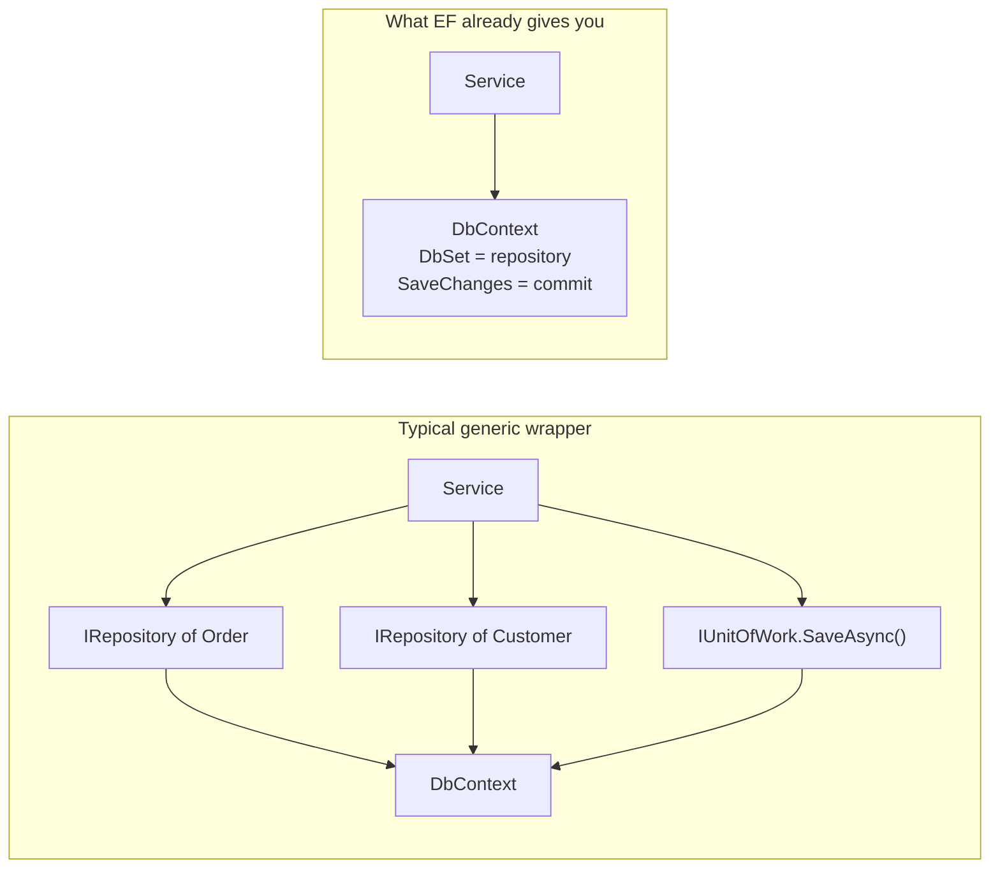

import { Aside } from '@astrojs/starlight/components';
import QuizBlock from '~/components/QuizBlock.astro';

## Why it matters in interviews

*"Do you use the repository pattern with EF Core? Why?"* is an opinion question with a right **kind** of answer: one that shows you know the trade-offs, not one that repeats a template. Many teams you will join have a generic `IRepository<T>` plus `IUnitOfWork` from an older codebase; the interviewer wants to know whether you understand what it costs and when it pays off.

## Core idea

### DbContext already is a repository and a unit of work

Microsoft's own documentation describes it this way:

- `DbSet<T>` behaves like a **repository**: a collection-like interface for querying and adding entities.
- `DbContext` is a **unit of work**: it tracks changes across all those sets and commits them atomically with `SaveChanges`.

So wrapping EF in a generic repository plus a `UnitOfWork` class often means re-implementing EF with fewer features.



### Generic repository: pros and cons

| Pros | Cons |
|---|---|
| A seam to mock in unit tests | Leaky: return `IQueryable<T>` and callers write EF queries anyway; return `IEnumerable<T>`/lists and you lose composition (filtering, paging, projection) |
| Consistent CRUD API across entities | Hides EF features: `Include`, `AsNoTracking`, projections, `ExecuteUpdate`, split queries. Each one becomes a new parameter or method |
| Can centralize cross-cutting rules (tenant filter, soft delete) | Global query filters and interceptors already do that |
| Familiar to many teams | `GetAll()` methods invite loading whole tables; `Update(entity)` writes every column |
| Could swap ORM "one day" | That day rarely comes, and the abstraction leaks EF semantics (tracking, lazy loading) anyway |

### When a repository does pay off

- **Aggregate-specific repositories in DDD.** An `IOrderRepository` with `GetForCheckoutAsync(id)` and `Add(order)` expresses the domain's needs, always loads the aggregate whole (with its `Include`s) and hides persistence from the domain layer. This is not a generic CRUD wrapper.
- **Clean/Onion architecture** where the application layer must not reference EF Core. The interfaces live in the core project, implementations in infrastructure. See [Architecture Styles](../../patterns/architecture-styles/).
- **Reusable, named queries** that would otherwise be copy-pasted across handlers.

On the read side many teams skip repositories completely and let query handlers use the `DbContext` (or Dapper) directly with projections: a light form of CQRS.

### Specification pattern

A specification is an object that captures **query criteria plus loading instructions** (filters, includes, ordering, paging) so a single generic repository method can run many named queries without leaking `IQueryable`. Libraries such as Ardalis.Specification implement it.

- **Pros**: named, testable, reusable query objects (`ActiveOrdersForCustomerSpec`); avoids method explosion on repositories.
- **Cons**: another abstraction to learn; complex projections and EF-specific features still need escape hatches.

### Testing strategies

| Approach | Fidelity | Speed | Verdict |
|---|---|---|---|
| Mock `DbSet<T>` / `DbContext` | Very low: LINQ to Objects, not SQL | Fast | Avoid; brittle and tests nothing real |
| EF Core **InMemory** provider | Low: no relational behaviour, no transactions, case-sensitive string compare, no raw SQL | Fast | Microsoft discourages it for testing |
| **SQLite in-memory** | Medium: relational, real SQL, but a different dialect | Fast | OK for simple logic; diverges on SQL Server-specific features |
| **Real SQL Server** via Testcontainers or a test database | High: same engine, same SQL | Slower (seconds to start) | Best for data-access and integration tests; reset with Respawn or transactions |
| Mock **your own repository interface** | n/a (EF not involved) | Fast | Good for unit testing business logic above the data layer |

A practical split: unit-test domain and application logic against **repository interfaces or in-memory fakes**, and integration-test the EF code (queries, mappings, migrations) against **real SQL Server** in a container. See [Integration Testing in .NET](../../testing-devops/dotnet-integration-testing/).

## Code

**Aggregate-specific repository (the useful kind)**

```csharp
// Core layer: no EF reference
public interface IOrderRepository
{
    Task<Order?> GetForCheckoutAsync(int id, CancellationToken ct);
    void Add(Order order);
}

public interface IUnitOfWork
{
    Task<int> SaveChangesAsync(CancellationToken ct = default);
}

// Infrastructure layer
public sealed class OrderRepository(ShopDb db) : IOrderRepository
{
    public Task<Order?> GetForCheckoutAsync(int id, CancellationToken ct) =>
        db.Orders
          .Include(o => o.Lines)                   // aggregate always loaded whole
          .Include(o => o.Payments)
          .AsSplitQuery()
          .SingleOrDefaultAsync(o => o.Id == id, ct);

    public void Add(Order order) => db.Orders.Add(order);
}

// ShopDb itself implements IUnitOfWork: SaveChangesAsync already matches the signature
public sealed class ShopDb(DbContextOptions<ShopDb> options) : DbContext(options), IUnitOfWork
{
    public DbSet<Order> Orders => Set<Order>();
}

// Registration: both resolve to the same scoped ShopDb instance
builder.Services.AddScoped<IUnitOfWork>(sp => sp.GetRequiredService<ShopDb>());
builder.Services.AddScoped<IOrderRepository, OrderRepository>();
```

**A minimal specification**

```csharp
public abstract class Specification<T>
{
    public Expression<Func<T, bool>>? Criteria { get; protected init; }
    public List<Expression<Func<T, object>>> Includes { get; } = [];
}

public sealed class OpenOrdersForCustomer : Specification<Order>
{
    public OpenOrdersForCustomer(int customerId)
    {
        Criteria = o => o.CustomerId == customerId && o.Status == OrderStatus.Open;
        Includes.Add(o => o.Lines);
    }
}

public static class SpecificationEvaluator
{
    public static IQueryable<T> Apply<T>(this IQueryable<T> query, Specification<T> spec) where T : class
    {
        if (spec.Criteria is not null) query = query.Where(spec.Criteria);
        return spec.Includes.Aggregate(query, (q, include) => q.Include(include));
    }
}

// Usage: await db.Orders.Apply(new OpenOrdersForCustomer(42)).ToListAsync(ct);
```

## Interview Q&A

<details>
<summary>Is `DbContext` already a unit of work? Do you need a repository on top?</summary>

Yes: `DbContext` tracks changes and commits them atomically, and each `DbSet` is effectively a repository. A generic repository over it usually adds ceremony and hides EF features. I add repositories when they carry meaning: aggregate-specific repositories in a DDD/Clean Architecture codebase, or to keep EF out of the domain/application layer.

</details>

<details>
<summary>What is wrong with `IRepository<T>` exposing `IQueryable<T>`?</summary>

The abstraction leaks: callers write EF-specific LINQ, need EF's `Include`/`ToListAsync` extension methods, and can trigger untranslatable queries or N+1 from any layer. You cannot mock it meaningfully, because tests run LINQ to Objects instead of SQL. If it returns lists instead, you lose server-side composition and end up with dozens of special-purpose methods.

</details>

<details>
<summary>How would you implement unit of work across several repositories?</summary>

Make all repositories depend on the same scoped `DbContext` and expose a single `SaveChangesAsync` through an `IUnitOfWork` interface that the context itself implements. One request, one context, one commit. For operations needing several `SaveChanges` calls, wrap them in an explicit transaction.

</details>

<details>
<summary>What is the specification pattern and why use it with EF?</summary>

An object that bundles a query's criteria, includes, ordering and paging under a name, evaluated by a single generic method into an `IQueryable`. It keeps repositories small, makes queries reusable and unit-testable (the criteria expression can be tested in memory), and avoids exposing raw `IQueryable` outside the data layer.

</details>

<details>
<summary>How do you test code that uses EF Core?</summary>

Business logic: unit tests with the repository/unit-of-work interfaces mocked or faked. Data access: integration tests against a real SQL Server in Testcontainers (or a dedicated test database), resetting state with Respawn or rolled-back transactions. I avoid the InMemory provider because it is not relational: it has no transactions or real SQL, and constraints and string comparison behave differently, so tests pass while production fails.

</details>

<details>
<summary>Your new team uses a generic repository everywhere. What do you do?</summary>

Follow the codebase's convention for consistency, but add escape hatches where it hurts: projection methods or a read-side query service that uses the context directly, `ExecuteUpdate` for bulk work, and specifications instead of new methods per query. Propose changes with evidence (an N+1 or a slow `GetAll()` in production telemetry), not on principle.

</details>

## Pitfalls

<Aside type="caution" title="Common mistakes">

- **`GetAll()` returning a list**, then filtering in memory.
- **A `SaveChanges` inside every repository method**: breaks the unit of work; partial commits on failure.
- **Each repository creating its own `DbContext`**: changes span contexts and cannot commit atomically.
- **Mocking `DbSet<T>`** and believing the queries are tested.
- **Testing with the InMemory provider** and missing constraint, transaction or translation errors.
- **`Update(entity)` in the generic repository** writing every column on every save.

</Aside>

## Related

- [EF Core Architecture & Change Tracking](../efcore-architecture/)
- [Enterprise Patterns](../../patterns/enterprise-patterns/)
- [Architecture Styles](../../patterns/architecture-styles/)
- [Integration Testing in .NET](../../testing-devops/dotnet-integration-testing/)

## Quick quiz

<QuizBlock section="data" topic="repository-uow-ef" />
