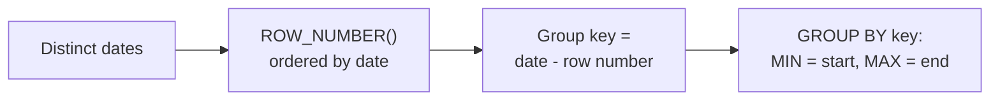

import { Aside } from '@astrojs/starlight/components';
import QuizBlock from '~/components/QuizBlock.astro';

## Why it matters in interviews

The live SQL round reuses a small set of problems. If you can write these eight from memory, explain the trade-offs between solutions, and handle the edge cases (ties, NULLs, "what if N is larger than the number of rows?"), you will pass most SQL screens. Always say your assumptions out loud: *"by second highest I mean the second distinct salary"*.

## Core idea

Most problems reduce to four tools: **self joins**, **window functions** (`ROW_NUMBER`, `DENSE_RANK`, `LAG`, `SUM OVER`), **aggregation with `HAVING`**, and **recursive CTEs**. Problems 1, 2, 6 and 7 share this table:

**Employees**

| Id | Name | DeptId | Salary | ManagerId |
|---|---|---|---|---|
| 1 | Asha | 10 | 90000 | NULL |
| 2 | Ravi | 10 | 70000 | 1 |
| 3 | Kiran | 20 | 70000 | 1 |
| 4 | Meera | 20 | 85000 | 3 |
| 5 | Dev | 10 | 60000 | 2 |
| 6 | Sam | 20 | 50000 | 4 |

Distinct salaries, highest first: 90000, 85000, 70000, 60000, 50000.

## Code

### 1. Nth highest salary (3 ways)

Find the 3rd highest distinct salary. Expected: **70000** (Ravi and Kiran tie).

```sql
DECLARE @N INT = 3;

-- A. DENSE_RANK: handles ties, easy to extend to "per department"
SELECT DISTINCT Salary
FROM (SELECT Salary, DENSE_RANK() OVER (ORDER BY Salary DESC) AS rnk
      FROM Employees) r
WHERE rnk = @N;

-- B. OFFSET/FETCH over distinct salaries
SELECT DISTINCT Salary
FROM Employees
ORDER BY Salary DESC
OFFSET @N - 1 ROWS FETCH NEXT 1 ROW ONLY;

-- C. Correlated subquery: exactly N-1 distinct salaries are higher
SELECT DISTINCT e1.Salary
FROM Employees e1
WHERE @N - 1 = (SELECT COUNT(DISTINCT e2.Salary)
                FROM Employees e2 WHERE e2.Salary > e1.Salary);
```

All three return one row: `70000`. For 70000, the distinct salaries above it are 90000 and 85000, so the count is 2 = N-1. Notes:

- `RANK` instead of `DENSE_RANK` would be wrong with ties: ranks here are 1, 2, 3, 3, 5, 6, so `rnk = 4` returns nothing.
- `ROW_NUMBER` would pick one of the tied rows and ignore the tie entirely.
- Solution C is O(n²) but works on any SQL dialect; mention it, prefer A or B.
- If N exceeds the number of distinct salaries, all three return **no row**. To return NULL instead, wrap it: `SELECT (SELECT ... ) AS NthSalary`.
- The classic "second highest" one-liner: `SELECT MAX(Salary) FROM Employees WHERE Salary < (SELECT MAX(Salary) FROM Employees)` returns 85000.

### 2. Employees earning more than their manager

```sql
SELECT e.Name AS Employee, e.Salary, m.Name AS Manager, m.Salary AS ManagerSalary
FROM Employees e
JOIN Employees m ON m.Id = e.ManagerId     -- self join; INNER drops Asha (no manager)
WHERE e.Salary > m.Salary;
```

| Employee | Salary | Manager | ManagerSalary |
|---|---|---|---|
| Meera | 85000 | Kiran | 70000 |

Check each pair: Ravi 70k vs Asha 90k, Kiran 70k vs Asha 90k, Dev 60k vs Ravi 70k, Sam 50k vs Meera 85k all fail; only Meera beats Kiran.

### 3. Find and delete duplicates

**Customers**

| Id | Email | Name |
|---|---|---|
| 1 | a@x.com | Asha |
| 2 | r@x.com | Ravi |
| 3 | a@x.com | Asha K |
| 4 | a@x.com | Asha |
| 5 | r@x.com | Ravi |

```sql
-- Find: which emails are duplicated and how often
SELECT Email, COUNT(*) AS Cnt
FROM Customers
GROUP BY Email
HAVING COUNT(*) > 1;
```

| Email | Cnt |
|---|---|
| a@x.com | 3 |
| r@x.com | 2 |

```sql
-- Delete: keep the lowest Id per email (way 1: ROW_NUMBER + deletable CTE)
WITH d AS (
    SELECT Id, ROW_NUMBER() OVER (PARTITION BY Email ORDER BY Id) AS rn
    FROM Customers
)
DELETE FROM d WHERE rn > 1;           -- deletes Ids 3, 4, 5

-- Way 2: delete rows for which an older duplicate exists
DELETE c
FROM Customers c
WHERE EXISTS (SELECT 1 FROM Customers c2 WHERE c2.Email = c.Email AND c2.Id < c.Id);
```

Both leave Ids 1 and 2. "Duplicate" must be defined by the business key (`Email` here), not by every column. Afterwards, add a `UNIQUE` constraint so it can't happen again. On a big table, delete in batches (`DELETE TOP (5000) ...` in a loop) to avoid lock escalation and log growth.

### 4. Running totals

**Transactions**

| AccountId | TxnDate | Amount |
|---|---|---|
| A | 2026-10-01 | 100 |
| A | 2026-10-02 | -30 |
| A | 2026-10-05 | 50 |
| B | 2026-10-01 | 200 |
| B | 2026-10-03 | -50 |

```sql
-- Way 1: window aggregate (SQL Server 2012+), one pass
SELECT AccountId, TxnDate, Amount,
       SUM(Amount) OVER (PARTITION BY AccountId ORDER BY TxnDate
                         ROWS UNBOUNDED PRECEDING) AS Balance
FROM Transactions;

-- Way 2: correlated subquery, O(n^2): only for very old versions
SELECT t.AccountId, t.TxnDate, t.Amount,
       (SELECT SUM(t2.Amount) FROM Transactions t2
        WHERE t2.AccountId = t.AccountId AND t2.TxnDate <= t.TxnDate) AS Balance
FROM Transactions t;
```

| AccountId | TxnDate | Amount | Balance |
|---|---|---|---|
| A | 2026-10-01 | 100 | 100 |
| A | 2026-10-02 | -30 | 70 |
| A | 2026-10-05 | 50 | 120 |
| B | 2026-10-01 | 200 | 200 |
| B | 2026-10-03 | -50 | 150 |

Say why `ROWS` is explicit: the default `RANGE` frame gives rows with the same date the same total and is slower (see [Window functions](../window-functions/)). If two transactions can share a date, add a unique tie-breaker such as `TxnId` to the `ORDER BY`.

### 5. Gaps and islands (consecutive login days)

**Logins** for one user (one row per distinct date):

| LoginDate |
|---|
| 2026-10-01 |
| 2026-10-02 |
| 2026-10-03 |
| 2026-10-05 |
| 2026-10-06 |
| 2026-10-09 |

The trick: in a run of consecutive dates, the date and `ROW_NUMBER` both increase by 1, so **date minus row number is constant** within an island.



| LoginDate | rn | grp = LoginDate - rn days |
|---|---|---|
| 2026-10-01 | 1 | 2026-09-30 |
| 2026-10-02 | 2 | 2026-09-30 |
| 2026-10-03 | 3 | 2026-09-30 |
| 2026-10-05 | 4 | 2026-10-01 |
| 2026-10-06 | 5 | 2026-10-01 |
| 2026-10-09 | 6 | 2026-10-03 |

```sql
WITH d AS (
    SELECT UserId, LoginDate,
           DATEADD(day, -ROW_NUMBER() OVER (PARTITION BY UserId ORDER BY LoginDate), LoginDate) AS grp
    FROM (SELECT DISTINCT UserId, LoginDate FROM Logins) x    -- duplicates would break the trick
)
SELECT UserId, MIN(LoginDate) AS StreakStart, MAX(LoginDate) AS StreakEnd, COUNT(*) AS Days
FROM d
GROUP BY UserId, grp
ORDER BY UserId, StreakStart;
```

| StreakStart | StreakEnd | Days |
|---|---|---|
| 2026-10-01 | 2026-10-03 | 3 |
| 2026-10-05 | 2026-10-06 | 2 |
| 2026-10-09 | 2026-10-09 | 1 |

**Gaps** (missing ranges) are easier with `LEAD`:

```sql
SELECT DATEADD(day, 1, LoginDate) AS GapStart, DATEADD(day, -1, NextDate) AS GapEnd
FROM (SELECT LoginDate, LEAD(LoginDate) OVER (ORDER BY LoginDate) AS NextDate
      FROM Logins WHERE UserId = @UserId) t
WHERE DATEDIFF(day, LoginDate, NextDate) > 1;
-- 2026-10-04 to 2026-10-04, and 2026-10-07 to 2026-10-08
```

The same pattern solves "consecutive seat numbers", "longest winning streak" and "merge overlapping status periods".

### 6. Top N per group

Top 2 earners per department.

```sql
-- Way 1: rank in a CTE, filter outside
WITH r AS (
    SELECT DeptId, Name, Salary,
           DENSE_RANK() OVER (PARTITION BY DeptId ORDER BY Salary DESC) AS rnk
    FROM Employees
)
SELECT DeptId, Name, Salary FROM r WHERE rnk <= 2 ORDER BY DeptId, Salary DESC;

-- Way 2: CROSS APPLY + TOP, efficient with an index on (DeptId, Salary DESC)
SELECT d.DeptId, t.Name, t.Salary
FROM (SELECT DISTINCT DeptId FROM Employees) d
CROSS APPLY (SELECT TOP (2) e.Name, e.Salary FROM Employees e
             WHERE e.DeptId = d.DeptId ORDER BY e.Salary DESC) t;
```

| DeptId | Name | Salary |
|---|---|---|
| 10 | Asha | 90000 |
| 10 | Ravi | 70000 |
| 20 | Meera | 85000 |
| 20 | Kiran | 70000 |

Clarify ties with the interviewer: `DENSE_RANK` returns more than N rows when salaries tie, `ROW_NUMBER` (or `TOP` without `WITH TIES`) returns exactly N. In a real system, Way 2 with a `Departments` table as the outer input is often fastest: one small seek per department.

### 7. Hierarchical query (org chart)

```sql
WITH Org AS (
    SELECT Id, Name, ManagerId, 0 AS Lvl,
           CAST(Name AS NVARCHAR(4000)) AS Path
    FROM Employees WHERE ManagerId IS NULL
    UNION ALL
    SELECT e.Id, e.Name, e.ManagerId, o.Lvl + 1,
           CAST(o.Path + N' > ' + e.Name AS NVARCHAR(4000))   -- types must match the anchor
    FROM Employees e
    JOIN Org o ON e.ManagerId = o.Id
)
SELECT Lvl, Path FROM Org ORDER BY Path;
```

| Lvl | Path |
|---|---|
| 0 | Asha |
| 1 | Asha > Kiran |
| 2 | Asha > Kiran > Meera |
| 3 | Asha > Kiran > Meera > Sam |
| 1 | Asha > Ravi |
| 2 | Asha > Ravi > Dev |

To walk **up** (all managers above Sam), anchor on `Id = 6` and join `o.ManagerId = e.Id`. Recursion stops at 100 levels by default (`OPTION (MAXRECURSION n)`), which also protects you from cycles in bad data. SQL Server's `hierarchyid` type is an alternative for deep, read-heavy trees.

### 8. Pivot rows into columns

**Sales**

| Region | Quarter | Amount |
|---|---|---|
| North | Q1 | 100 |
| North | Q2 | 150 |
| South | Q1 | 80 |
| South | Q2 | 120 |
| North | Q1 | 50 |

```sql
-- Way 1: conditional aggregation (portable, easy to add totals)
SELECT Region,
       SUM(CASE WHEN Quarter = 'Q1' THEN Amount ELSE 0 END) AS Q1,
       SUM(CASE WHEN Quarter = 'Q2' THEN Amount ELSE 0 END) AS Q2
FROM Sales
GROUP BY Region
ORDER BY Region;

-- Way 2: PIVOT operator
SELECT Region, [Q1], [Q2]
FROM (SELECT Region, Quarter, Amount FROM Sales) s
PIVOT (SUM(Amount) FOR Quarter IN ([Q1], [Q2])) p
ORDER BY Region;
```

| Region | Q1 | Q2 |
|---|---|---|
| North | 150 | 150 |
| South | 80 | 120 |

`PIVOT` implicitly groups by every source column not used in the pivot, so always feed it a derived table with only the needed columns (an extra `Id` column would produce one row per sale). Column values must be known in advance; for dynamic columns build the list with `STRING_AGG(QUOTENAME(Quarter), ',')` and run it with `sp_executesql`. With conditional aggregation, a missing combination shows 0; with `PIVOT` it shows NULL.

## Interview Q&A

<details>
<summary>How do you find the second highest salary if there are ties?</summary>

Use `DENSE_RANK() OVER (ORDER BY Salary DESC)` and filter `rnk = 2`, or `SELECT DISTINCT Salary ... ORDER BY Salary DESC OFFSET 1 ROWS FETCH NEXT 1 ROW ONLY`. Both work on distinct values, so tied top earners don't push the answer down. Clarify whether "second highest" means distinct value or second row.
</details>

<details>
<summary>How do you delete duplicates but keep one row?</summary>

Number rows within each duplicate group with `ROW_NUMBER() OVER (PARTITION BY <business key> ORDER BY <keeper rule>)` in a CTE and `DELETE` where the number is greater than 1. Alternatively delete rows for which `EXISTS` an older row with the same key. Then add a unique constraint so duplicates can't return.
</details>

<details>
<summary>What is the gaps and islands problem and the standard trick?</summary>

Grouping consecutive values (dates, numbers) into ranges. Subtract `ROW_NUMBER()` from the value: within a consecutive run the difference is constant, so group by it and take MIN and MAX. Values must be distinct first. Gaps between islands are found with `LEAD` and a difference greater than one.
</details>

<details>
<summary>Top N per group: ROW_NUMBER, RANK or DENSE_RANK?</summary>

`ROW_NUMBER` for exactly N rows per group (ties broken by a tie-breaker), `DENSE_RANK` to include everyone in the top N salary levels, and `RANK` for "top N positions" competition-style. Mention `CROSS APPLY (SELECT TOP (N) ...)` as an efficient alternative when an index on (group, sort column) exists.
</details>

<details>
<summary>How would you write a running total without window functions?</summary>

A correlated subquery summing all earlier rows, or a self join with `t2.Date <= t1.Date` and `GROUP BY`. Both are O(n²) and get slow quickly. On SQL Server 2012 and later, `SUM() OVER (... ROWS UNBOUNDED PRECEDING)` computes it in one pass.
</details>

<details>
<summary>How do you query a hierarchy of unknown depth?</summary>

A recursive CTE: an anchor member selecting the root(s), `UNION ALL`, and a recursive member joining the table to the CTE on the parent key. Track the level and a path for ordering, and set `MAXRECURSION` deliberately. For very deep or read-heavy trees, consider `hierarchyid` or a closure table.
</details>

## Pitfalls

<Aside type="caution" title="Common mistakes">

- **`RANK` or `ROW_NUMBER` for nth highest** when ties exist; use `DENSE_RANK` or `DISTINCT`.
- **Nesting `MAX(...) < (SELECT MAX ...)` for N greater than 2**: unreadable and error-prone; switch to `DENSE_RANK` or `OFFSET`.
- **Gaps and islands on non-distinct dates**: duplicate dates break the "date minus row number" key.
- **`PIVOT` over a source with extra columns**, which silently multiplies output rows.
- **Recursive CTE path columns without `CAST`**: anchor and recursive member types must match exactly.
- **Not stating assumptions** (ties, NULL salaries, N larger than row count) before coding.

</Aside>

## Related

- [Window functions](../window-functions/)
- [SQL joins & core queries](../sql-joins-queries/)
- [Indexes](../indexes/)
- [C# coding round](../../dsa/csharp-coding-round/)

## Quick quiz

<QuizBlock section="data" topic="sql-interview-problems" />
