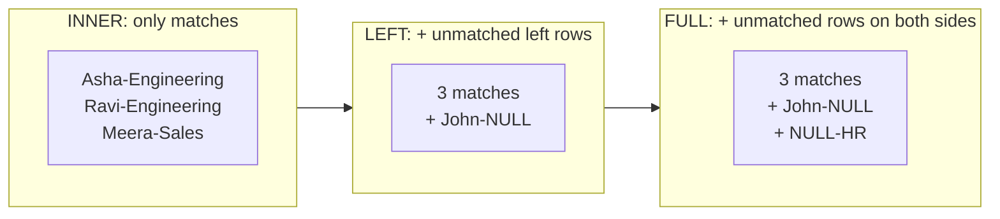

import { Tabs, TabItem, Aside } from '@astrojs/starlight/components';
import QuizBlock from '~/components/QuizBlock.astro';

## Why it matters in interviews

Nearly every .NET loop has a live SQL round: *"list departments with more than two employees"*, *"what is the difference between WHERE and HAVING?"*, *"why does NOT IN return nothing here?"*. At 3-4 years the interviewer expects you to predict row counts, explain NULL behaviour and know why a query is evaluated in a given order, not just recite join names.

## Core idea

A query describes **sets**. Joins combine rows from two sets by a predicate, `GROUP BY` collapses rows into groups, and set operators (`UNION`, `INTERSECT`, `EXCEPT`) stack results vertically. Everything below uses these two tables.

**Employees**

| EmpId | Name | DeptId | Salary | ManagerId |
|---|---|---|---|---|
| 1 | Asha | 10 | 90000 | NULL |
| 2 | Ravi | 10 | 70000 | 1 |
| 3 | Meera | 20 | 80000 | 1 |
| 4 | John | NULL | 50000 | 2 |

**Departments**

| DeptId | DeptName |
|---|---|
| 10 | Engineering |
| 20 | Sales |
| 30 | HR |

### Join types

| Join | Keeps | Rows here | Unmatched side filled with |
|---|---|---|---|
| `INNER JOIN` | only matching pairs | 3 (Asha, Ravi, Meera) | n/a |
| `LEFT JOIN` | all left rows + matches | 4 (adds John with NULL dept) | NULLs on the right |
| `RIGHT JOIN` | all right rows + matches | 4 (adds HR with NULL employee) | NULLs on the left |
| `FULL OUTER JOIN` | everything from both | 5 (John and HR both appear) | NULLs on either side |
| `CROSS JOIN` | every combination | 4 × 3 = 12 | n/a |
| Self join | a table joined to itself (aliases) | e.g. employee + manager | depends on join type |

(Employees on the left, Departments on the right, joined on `DeptId`.)



`NULL = NULL` is **unknown**, not true, so John (DeptId NULL) never matches anything in an equality join.

### The LEFT JOIN that silently becomes an INNER JOIN

```sql
-- Intent: all departments, with employees earning > 60000 if any
SELECT d.DeptName, e.Name
FROM Departments d
LEFT JOIN Employees e ON e.DeptId = d.DeptId
WHERE e.Salary > 60000;          -- removes HR (its e.Salary is NULL)

-- Correct: put the right-table filter in ON
SELECT d.DeptName, e.Name
FROM Departments d
LEFT JOIN Employees e ON e.DeptId = d.DeptId AND e.Salary > 60000;
```

Result of the corrected query:

| DeptName | Name |
|---|---|
| Engineering | Asha |
| Engineering | Ravi |
| Sales | Meera |
| HR | NULL |

The first query returns only the first three rows. `ON` decides which rows *match*; `WHERE` filters the *joined result*. For an inner join the two placements are equivalent, for outer joins they are not.

### Logical query processing order

SQL is written `SELECT ... FROM ... WHERE` but logically evaluated in a different order. This explains most "why can't I use my alias here?" errors.


- A column alias defined in `SELECT` **cannot** be used in `WHERE`, `GROUP BY` or `HAVING` (they run earlier), but **can** be used in `ORDER BY`.
- Aggregates can't appear in `WHERE` because groups don't exist yet. That is the whole reason `HAVING` exists.
- Window functions are computed in the `SELECT` step, so they can't be used in `WHERE` either.
- This is the *logical* order. The optimizer may physically execute it differently (push predicates down, reorder joins) as long as the result is the same.

### GROUP BY, WHERE vs HAVING

```sql
SELECT DeptId, COUNT(*) AS Headcount, AVG(Salary) AS AvgSalary
FROM Employees
WHERE Salary > 40000          -- filters ROWS before grouping
GROUP BY DeptId
HAVING COUNT(*) >= 1          -- filters GROUPS after aggregation
ORDER BY DeptId;
```

| DeptId | Headcount | AvgSalary |
|---|---|---|
| NULL | 1 | 50000 |
| 10 | 2 | 80000 |
| 20 | 1 | 80000 |

NULLs form **one group** in `GROUP BY` and sort first in ascending order in SQL Server. Every non-aggregated column in `SELECT` must appear in `GROUP BY`. `COUNT(*)` counts rows (4), `COUNT(DeptId)` skips NULLs (3), and `COUNT(DISTINCT DeptId)` returns 2.

### Subqueries vs joins, EXISTS vs IN

A **correlated subquery** references the outer row; a non-correlated one can be evaluated independently. The optimizer often turns `IN`/`EXISTS` into a semi join, so performance is usually similar. The real difference is **NULL semantics** with `NOT IN`:

```sql
-- Departments with no employees. Expected: HR
SELECT DeptName FROM Departments
WHERE DeptId NOT IN (SELECT DeptId FROM Employees);   -- returns 0 rows!

SELECT d.DeptName FROM Departments d
WHERE NOT EXISTS (SELECT 1 FROM Employees e WHERE e.DeptId = d.DeptId); -- HR
```

The subquery returns `(10, 10, 20, NULL)`. For HR, `30 NOT IN (10, 20, NULL)` expands to `30 <> 10 AND 30 <> 20 AND 30 <> NULL`; the last term is UNKNOWN, so the predicate is never TRUE. **Prefer `NOT EXISTS`** (or `LEFT JOIN ... WHERE right.key IS NULL`) for anti-joins.

| | `IN` | `EXISTS` | `JOIN` |
|---|---|---|---|
| Returns columns from the other table | No | No | Yes |
| Duplicates outer rows on many matches | No | No | **Yes** (one row per match) |
| NULL in subquery result | harmless for `IN`, **breaks `NOT IN`** | safe | safe |

### UNION vs UNION ALL, INTERSECT, EXCEPT

- `UNION` removes duplicates (an extra sort or hash step). `UNION ALL` keeps everything and is cheaper. Use `UNION ALL` unless you need de-duplication.
- `INTERSECT` returns distinct rows present in both inputs; `EXCEPT` returns distinct rows of the first input that are not in the second.
- Columns are matched **by position**, not by name; the first query supplies the column names. Set operators treat two NULLs as equal when comparing rows, unlike `=`.

### CTEs, recursive CTEs and CASE

A CTE (`WITH name AS (...)`) is a named subquery scoped to one statement. It improves readability and lets you reference the same derived set more than once, but in SQL Server it is **not materialised**: each reference is expanded inline like a view.

```sql
-- Recursive CTE: the whole reporting tree under Asha
WITH OrgChart AS (
    SELECT EmpId, Name, ManagerId, 0 AS Lvl
    FROM Employees WHERE ManagerId IS NULL          -- anchor member
    UNION ALL
    SELECT e.EmpId, e.Name, e.ManagerId, o.Lvl + 1
    FROM Employees e
    JOIN OrgChart o ON e.ManagerId = o.EmpId        -- recursive member
)
SELECT Name, Lvl,
       CASE WHEN Lvl = 0 THEN 'CEO'
            WHEN Lvl = 1 THEN 'Manager'
            ELSE 'Staff' END AS Band
FROM OrgChart
ORDER BY Lvl, Name
OPTION (MAXRECURSION 100);   -- 100 is the default; 0 = unlimited
```

| Name | Lvl | Band |
|---|---|---|
| Asha | 0 | CEO |
| Meera | 1 | Manager |
| Ravi | 1 | Manager |
| John | 2 | Staff |

The anchor runs once, then the recursive member runs repeatedly against the rows produced by the previous iteration until it returns no rows. A cycle in the data (A manages B, B manages A) keeps recursing until the limit is hit, and the statement fails with an error.

`CASE` is an **expression**, not a control-flow statement: use it in `SELECT`, `ORDER BY`, `GROUP BY`, inside aggregates (`SUM(CASE WHEN ... THEN 1 ELSE 0 END)` for conditional counts) and in `UPDATE ... SET`.

## Code

**Self join: employee with manager name**

```sql
SELECT e.Name AS Employee, m.Name AS Manager
FROM Employees e
LEFT JOIN Employees m ON m.EmpId = e.ManagerId;   -- LEFT keeps Asha (no manager)
```

| Employee | Manager |
|---|---|
| Asha | NULL |
| Ravi | Asha |
| Meera | Asha |
| John | Ravi |

**Conditional aggregation (one pass instead of three queries)**

```sql
SELECT COUNT(*)                                         AS Total,       -- 4
       SUM(CASE WHEN Salary >= 80000 THEN 1 ELSE 0 END) AS HighEarners, -- 2
       SUM(CASE WHEN DeptId IS NULL THEN 1 ELSE 0 END)  AS Unassigned   -- 1
FROM Employees;
```

**The same anti-join in EF Core**, which translates to `NOT EXISTS`:

```csharp
var emptyDepts = await db.Departments
    .Where(d => !db.Employees.Any(e => e.DeptId == d.DeptId))
    .Select(d => d.DeptName)
    .ToListAsync(ct);
```

## Interview Q&A

<details>
<summary>What is the difference between WHERE and HAVING?</summary>

`WHERE` filters individual rows before grouping and cannot use aggregates. `HAVING` filters groups after `GROUP BY` and can use aggregates like `COUNT(*) > 2`. Put non-aggregate filters in `WHERE` so fewer rows reach the grouping step.
</details>

<details>
<summary>Why can't I use a SELECT alias in WHERE?</summary>

Because logically `WHERE` is evaluated before `SELECT`, so the alias doesn't exist yet. `ORDER BY` runs after `SELECT`, so the alias works there. Workarounds: repeat the expression, wrap the query in a CTE or derived table, or use `CROSS APPLY (SELECT ... AS alias)`.
</details>

<details>
<summary>Why does NOT IN return no rows when the subquery contains a NULL?</summary>

`x NOT IN (a, b, NULL)` means `x <> a AND x <> b AND x <> NULL`. Comparing with NULL yields UNKNOWN, so the predicate is never TRUE. Use `NOT EXISTS`, which only checks whether a matching row exists and is NULL-safe.
</details>

<details>
<summary>EXISTS vs IN: which is faster?</summary>

In modern SQL Server they usually compile to the same semi-join plan, so performance is similar. `EXISTS` reads naturally for correlated checks and can stop at the first match. The meaningful difference is `NOT IN` vs `NOT EXISTS` when NULLs are possible, not speed.
</details>

<details>
<summary>A LEFT JOIN returns the same rows as an INNER JOIN. Why?</summary>

Usually a filter on the right table sits in `WHERE` (e.g. `WHERE o.Status = 'Open'`). Unmatched rows have NULL there, the predicate is UNKNOWN, and they are removed. Move the condition into the `ON` clause.
</details>

<details>
<summary>When does a join return more rows than the left table has?</summary>

When the join key is not unique on the right side: each left row repeats once per match (one-to-many). This causes the classic "totals are doubled" bug when you join orders to order lines and then `SUM` the order total. Aggregate before joining, or use `EXISTS` when you only need a filter.
</details>

<details>
<summary>Is a CTE faster than a subquery or a temp table?</summary>

A non-recursive CTE is a named inline view: SQL Server expands it like a derived table, so it performs the same as the equivalent subquery, and referencing it twice can evaluate it twice. If you need the result materialised once, indexed, or with statistics, use a temp table.
</details>

<details>
<summary>UNION vs UNION ALL?</summary>

`UNION` removes duplicate rows across both inputs, which costs a sort or hash. `UNION ALL` just appends. Use `UNION ALL` whenever duplicates are impossible or acceptable; it is a common, easy performance win.
</details>

## Pitfalls

<Aside type="caution" title="Common mistakes">

- **`NOT IN` against a nullable column**: returns nothing as soon as one NULL appears.
- **Right-table filters in `WHERE`** of a `LEFT JOIN`, turning it into an inner join.
- **Joining one-to-many, then summing** a parent-level amount, which inflates totals.
- **`= NULL` instead of `IS NULL`**: always UNKNOWN, matches nothing.
- **Relying on row order without `ORDER BY`**: a CTE, view or clustered index does not guarantee output order.
- **`SELECT DISTINCT` to hide a bad join** instead of fixing the join condition.

</Aside>

## Related

- [Window functions](../window-functions/)
- [Classic SQL interview problems](../sql-interview-problems/)
- [Execution plans & query tuning](../execution-plans/)
- [EF Core querying & N+1](../efcore-querying/)

## Quick quiz

<QuizBlock section="data" topic="sql-joins-queries" />
