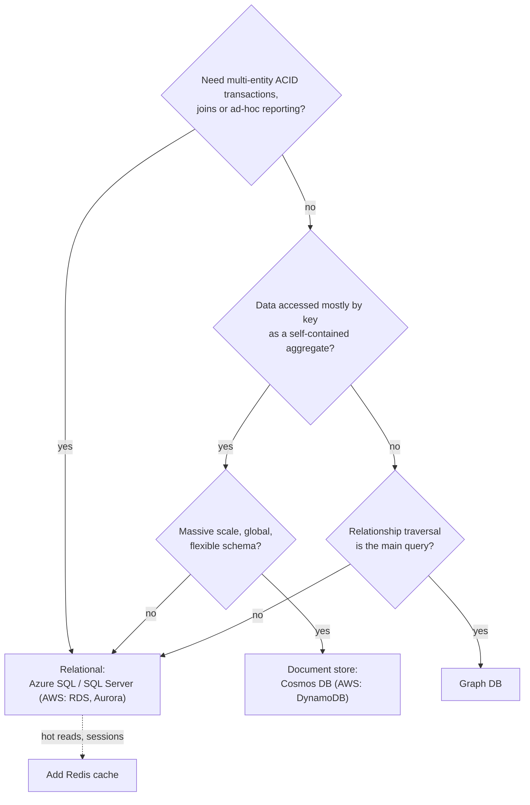

import { Aside } from '@astrojs/starlight/components';
import QuizBlock from '~/components/QuizBlock.astro';

## Why it matters in interviews

*"SQL or NoSQL for this system, and why?"* shows up in every system design round and in many backend interviews. The weak answer is "NoSQL scales, SQL doesn't". The 3-4 year answer talks about **access patterns, consistency needs, schema flexibility and operational cost**, and names concrete services: Azure SQL, Cosmos DB, Azure Cache for Redis (AWS: RDS, DynamoDB, ElastiCache).

## Core idea

Relational databases model data as normalised tables and let you ask **any question later** with joins and ad-hoc SQL, with strong ACID transactions. NoSQL databases give up some of that generality in exchange for a data model that matches one access pattern very well and **scales out horizontally** by partitioning data across many machines.

| | Relational (SQL Server, Azure SQL, PostgreSQL) | NoSQL (Cosmos DB, MongoDB, DynamoDB, Redis, Cassandra) |
|---|---|---|
| Data model | tables, rows, fixed schema | documents, key-value, wide-column, graph |
| Schema | enforced on write (schema-on-write) | flexible, often enforced by the application |
| Relationships | foreign keys and joins | embedding or denormalised copies; joins limited or absent |
| Transactions | multi-row, multi-table ACID | usually per item or per partition; some support multi-document transactions |
| Scaling | mainly vertical; read replicas; sharding is hard | horizontal partitioning built in |
| Query flexibility | high: any query, add an index later | high only for the queries you designed the keys for |
| Consistency | strong by default | often tunable (strong to eventual) |

### The four NoSQL families

| Family | Model | Strengths | Examples (Azure first, AWS in brackets) |
|---|---|---|---|
| **Document** | JSON documents with nested objects and arrays | aggregates read in one call, flexible schema | Cosmos DB for NoSQL, Cosmos DB for MongoDB, MongoDB Atlas (AWS: DynamoDB, DocumentDB) |
| **Key-value** | opaque value looked up by key | sub-millisecond reads, caching, sessions, counters | Azure Cache for Redis / Azure Managed Redis (AWS: ElastiCache, MemoryDB), Cosmos DB for Table |
| **Wide-column** | rows with many dynamic columns, partitioned by key | huge write throughput, time-series, IoT | Apache Cassandra, Azure Managed Instance for Apache Cassandra (AWS: Keyspaces) |
| **Graph** | nodes and edges with properties | many-hop relationship queries (friends of friends, fraud rings) | Cosmos DB for Apache Gremlin, Neo4j (AWS: Neptune) |

### Modelling: design for the query, not the entity

The same order, relational and as a document:

**Orders** (plus a `Customers` row for 42, Asha)

| OrderId | CustomerId | Status |
|---|---|---|
| 1001 | 42 | Open |

**OrderLines**

| OrderId | Sku | Qty | UnitPrice |
|---|---|---|---|
| 1001 | PEN-01 | 2 | 10.00 |
| 1001 | NB-07 | 1 | 45.50 |

Reading the order means joining three tables. In a document store the same aggregate is one item:

```json
{
  "id": "1001",
  "customerId": "42",
  "status": "Open",
  "customerName": "Asha",
  "lines": [
    { "sku": "PEN-01", "qty": 2, "unitPrice": 10.0 },
    { "sku": "NB-07", "qty": 1, "unitPrice": 45.5 }
  ]
}
```

- **Embed** data that is read together and owned by the parent (order lines in an order). One read returns the whole aggregate; no join.
- **Reference** data that is large, unbounded or shared and changes independently (a product catalogue).
- **Denormalise** small, rarely changing fields (`customerName`) and accept that you must update copies, often via the change feed.
- Pick the **partition key** from the main access pattern. Queries that include it hit one partition; queries that don't fan out to all partitions and cost more.

### Cosmos DB in one minute (AWS: DynamoDB)

- **Partition key**: every item lives in a logical partition (max 20 GB). Choose a key with high cardinality and even traffic (`customerId`, `tenantId`), not `status` or `country`.
- **Request Units (RU/s)**: a normalised cost per operation. A point read of a 1 KB item by id and partition key costs about 1 RU; cross-partition queries and writes cost more. You provision RU/s (manual or autoscale) or use serverless.
- **Five consistency levels**: Strong, Bounded Staleness, **Session** (default: you read your own writes), Consistent Prefix, Eventual. Weaker levels give lower latency and cost.
- **Global distribution**: add regions with a click; multi-region writes are available.
- **Change feed**: an ordered log of changes per partition, used to update read models, caches and search indexes.
- Item size limit 2 MB (DynamoDB: 400 KB). DynamoDB uses a partition key plus optional sort key, with global and local secondary indexes, and on-demand or provisioned capacity.

### When to pick which



Default to relational for line-of-business systems: orders, billing, inventory, HR. Most .NET apps fit comfortably in Azure SQL, which also stores semi-structured data as JSON (`OPENJSON`, `JSON_VALUE`, and a native `json` type in newer versions). Choose NoSQL when you have a **specific reason**: very high write volume, global low latency, unpredictable schema per item (product attributes, IoT payloads), or a simple key-based access pattern at scale.

### Polyglot persistence

Large systems use several stores, each for what it does best:

| Need | Store |
|---|---|
| Orders, payments, inventory (ACID) | Azure SQL (AWS: RDS) |
| Product catalogue with varied attributes | Cosmos DB (AWS: DynamoDB) |
| Sessions, cache, rate-limit counters, leaderboards | Redis |
| Full-text search and facets | Azure AI Search (AWS: OpenSearch) |
| Files, images | Blob Storage (AWS: S3) |

The cost: more technologies to operate, and data must be synchronised between stores (events, outbox, change feed) with **eventual consistency** between them.

## Code

**Cosmos DB .NET SDK: point read vs query**

```csharp
var container = cosmosClient.GetContainer("shop", "orders");

// Point read: id + partition key, the cheapest operation (~1 RU for 1 KB)
ItemResponse<Order> read = await container.ReadItemAsync<Order>(
    id: "1001", partitionKey: new PartitionKey("42"), cancellationToken: ct);
logger.LogInformation("Charge: {RU} RU", read.RequestCharge);

// Single-partition query: parameterised, scoped to one customer's partition
var query = new QueryDefinition("SELECT * FROM o WHERE o.status = @status")
    .WithParameter("@status", "Open");
using var it = container.GetItemQueryIterator<Order>(query,
    requestOptions: new QueryRequestOptions { PartitionKey = new PartitionKey("42") });
while (it.HasMoreResults)
    foreach (var order in await it.ReadNextAsync(ct))
        Console.WriteLine(order.Id);
```

**Redis cache-aside with StackExchange.Redis**

```csharp
var db = redis.GetDatabase();
var cached = await db.StringGetAsync($"product:{id}");
if (cached.HasValue) return JsonSerializer.Deserialize<ProductDto>(cached!)!;

var product = await sql.GetProductAsync(id, ct);              // source of truth
await db.StringSetAsync($"product:{id}", JsonSerializer.Serialize(product),
                        TimeSpan.FromMinutes(10));             // TTL bounds staleness
return product;
```

EF Core also has a Cosmos DB provider, but the modelling rules above still apply: you design aggregates and partition keys, not normalised tables.

## Interview Q&A

<details>
<summary>When would you choose NoSQL over SQL?</summary>

When the access pattern is simple and key-based at large scale, when you need global low-latency distribution, when the schema varies per item, or for very high write throughput. If you need joins, ad-hoc reporting or multi-entity transactions, stay relational. Many systems use both.
</details>

<details>
<summary>Is NoSQL schema-less?</summary>

Not really: the schema moves from the database into the application ("schema-on-read"). You still need versioning and migration strategies for documents, such as a `schemaVersion` field and code that upgrades old shapes on read.
</details>

<details>
<summary>How do you choose a partition key in Cosmos DB or DynamoDB?</summary>

Pick a property with high cardinality and evenly spread traffic that appears in most queries, such as `customerId` or `tenantId`. Avoid low-cardinality or time-based keys that create hot partitions. Queries that include the key stay in one partition; others fan out and cost more RUs.
</details>

<details>
<summary>What are Cosmos DB's consistency levels?</summary>

Strong, Bounded Staleness, Session, Consistent Prefix and Eventual. Session is the default and guarantees read-your-own-writes within a client session. Stronger levels increase latency and RU cost, and Strong limits some multi-region configurations.
</details>

<details>
<summary>Embed or reference in a document database?</summary>

Embed data that is owned by the parent, read together and bounded in size, such as order lines. Reference data that is shared, large, unbounded (comments on a popular post) or updated independently. Denormalise small fields for read speed and update copies through the change feed.
</details>

<details>
<summary>Can't SQL Server handle JSON? Why use a document database at all?</summary>

SQL Server and Azure SQL can store and query JSON, which is often enough for a few flexible attributes. A document database adds horizontal partitioning, global distribution, per-item flexible schema at scale and predictable single-digit-millisecond key reads. The decision is about scale and access patterns more than about JSON support.
</details>

<details>
<summary>What is polyglot persistence and what does it cost?</summary>

Using different databases for different needs in one system, e.g. Azure SQL for orders, Redis for caching and Cosmos DB for a catalogue. It optimises each workload but adds operational complexity, more skills to maintain, and the need to keep stores in sync with events or the outbox pattern, accepting eventual consistency between them.
</details>

## Pitfalls

<Aside type="caution" title="Common mistakes">

- **Choosing NoSQL "because it scales"** for a modest relational workload, then rebuilding joins in application code.
- **Normalising documents like tables**, causing many round-trips per page.
- **A bad partition key** (`status`, date) that creates hot partitions and RU throttling (HTTP 429).
- **Unbounded arrays inside one document** (all comments of a post) that hit item size limits.
- **Treating Redis as the source of truth** without persistence and a rebuild strategy.
- **Ignoring consistency levels**, then being surprised by stale reads from another region.

</Aside>

## Related

- [Normalization & keys](../normalization/)
- [Databases at scale](../../system-design/databases-at-scale/)
- [Caching at scale](../../system-design/caching/)
- [Data in microservices](../../microservices/data-management/)

## Quick quiz

<QuizBlock section="data" topic="sql-vs-nosql" />
