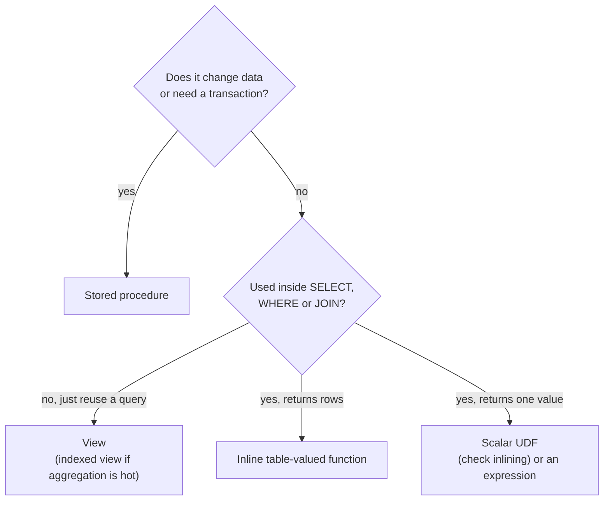

import { Aside } from '@astrojs/starlight/components';
import QuizBlock from '~/components/QuizBlock.astro';

## Why it matters in interviews

Service companies with large SQL Server estates ask *"stored procedure vs function?"*, *"temp table vs table variable?"* and *"have you written triggers, and what went wrong?"*. Product companies ask the opposite angle: *"why would you put logic in procs instead of EF Core?"*. Both want trade-offs, not a list of syntax.

## Core idea

These are all **named, server-side objects** that package SQL. They differ in what they may do (side effects), where they can be used (inside a `SELECT` or only with `EXEC`), and how the optimizer sees them.

### Procedure vs function

| | Stored procedure | User-defined function |
|---|---|---|
| Called with | `EXEC dbo.Proc @p = 1` | inside a query: `SELECT dbo.Fn(x)`, `FROM dbo.Tvf(@p)` |
| Modify data (`INSERT`/`UPDATE`/`DELETE` on tables) | Yes | **No** (only its own table variables) |
| Transactions, `TRY/CATCH`, dynamic SQL, temp tables | Yes | No |
| Return | 0..n result sets, `OUTPUT` params, an int return code | exactly one scalar value or one table |
| Use in `WHERE` / `JOIN` | No | Yes |
| Call the other | can call functions | cannot call procedures |



### Three kinds of function, three performance profiles

| Kind | Body | How the optimizer sees it |
|---|---|---|
| **Scalar UDF** | `RETURNS INT ... BEGIN ... RETURN END` | historically executed **once per row**, hidden from the plan cost, and blocked parallelism. SQL Server 2019+ can **inline** many scalar UDFs (compatibility level 150) if they meet the inlining requirements. |
| **Inline TVF** (iTVF) | `RETURNS TABLE AS RETURN (SELECT ...)` | expanded into the calling query like a **parameterised view**: full statistics, seeks, parallelism. Usually the fastest option. |
| **Multi-statement TVF** | `RETURNS @t TABLE (...) AS BEGIN ... END` | fills a table variable; the optimizer guesses a fixed row count (100 rows since SQL Server 2014's estimator). SQL Server 2017+ can use **interleaved execution** to get the real count, but iTVFs are still preferred. |

```sql
-- Inline TVF: behaves like a view with a parameter
CREATE OR ALTER FUNCTION dbo.OrdersForCustomer (@CustomerId INT)
RETURNS TABLE
AS RETURN
    SELECT OrderId, OrderDate, Total
    FROM dbo.Orders
    WHERE CustomerId = @CustomerId;
GO
SELECT c.Name, o.OrderId, o.Total
FROM dbo.Customers c
CROSS APPLY dbo.OrdersForCustomer(c.CustomerId) o;   -- like an inner join per customer
```

With `Customers (1 Asha, 2 Ravi)` and Asha having orders 1001 (120.00) and 1003 (45.50), Ravi none:

| Name | OrderId | Total |
|---|---|---|
| Asha | 1001 | 120.00 |
| Asha | 1003 | 45.50 |

`CROSS APPLY` drops Ravi (like an inner join). `OUTER APPLY` would keep him with NULLs (like a left join).

### Views and indexed views

A **view** is a stored `SELECT`. It does not store data; the optimizer expands its definition into each query, so a plain view is never faster than the query it contains. Views are for **abstraction and security**: grant `SELECT` on the view, not on the base tables, and hide columns like salaries. Views over a single table can be updatable; `WITH CHECK OPTION` stops updates that would make a row disappear from the view.

An **indexed view** (materialised view) **does** store data: you create a unique clustered index on a view declared `WITH SCHEMABINDING`. SQL Server maintains it on every write to the base tables, so it speeds up expensive aggregations at the cost of slower writes.

```sql
CREATE VIEW dbo.vCustomerSales WITH SCHEMABINDING AS
SELECT CustomerId, COUNT_BIG(*) AS OrderCount, SUM(Total) AS TotalSales
FROM dbo.Orders                                  -- two-part names required; Total is NOT NULL
GROUP BY CustomerId;                             -- COUNT_BIG(*) required with GROUP BY
GO
CREATE UNIQUE CLUSTERED INDEX IX_vCustomerSales ON dbo.vCustomerSales (CustomerId);
```

Restrictions are many (no outer joins, no `TOP`, deterministic expressions only, `SUM` over a nullable expression is not allowed, and so on). Enterprise edition and Azure SQL can match indexed views automatically; on other editions query the view with `WITH (NOEXPAND)`.

### Triggers

A DML trigger runs automatically **inside the same transaction** as the `INSERT`/`UPDATE`/`DELETE` that fired it. `AFTER` triggers run after the change; `INSTEAD OF` triggers replace it (commonly used to make complex views writable). The trigger sees the changed rows in the `inserted` and `deleted` pseudo-tables.

```sql
CREATE OR ALTER TRIGGER trg_Orders_Audit ON dbo.Orders
AFTER UPDATE
AS
BEGIN
    SET NOCOUNT ON;
    INSERT dbo.OrderAudit (OrderId, OldStatus, NewStatus, ChangedAt)
    SELECT d.OrderId, d.Status, i.Status, SYSUTCDATETIME()
    FROM inserted i
    JOIN deleted d ON d.OrderId = i.OrderId     -- set-based: handles 1 or 10,000 rows
    WHERE i.Status <> d.Status;
END;
```

A trigger fires **once per statement**, not once per row. Code like `SELECT @id = OrderId FROM inserted` silently handles only one row of a multi-row update: a classic bug.

**When not to use triggers**: business rules that application developers can't see, cascades of triggers firing triggers, and anything slow (they extend every write transaction and its locks). Good uses: audit columns, enforcing a rule constraints can't express. For full row history, **temporal tables** (`SYSTEM_VERSIONING = ON`) are simpler than audit triggers.

### Temp table vs table variable vs CTE

| | `#temp` table | `@table` variable | CTE |
|---|---|---|---|
| Stored in | tempdb | tempdb (not "memory only") | not stored, expanded inline |
| Column statistics | **Yes** | No | n/a |
| Row estimate | from statistics | fixed guess of 1 row before SQL Server 2019; 2019+ (compat 150) uses the actual count at first compile | from base tables |
| Indexes | any, add after creation | inline `PRIMARY KEY`, `UNIQUE`, `INDEX` in the declaration | n/a |
| Scope | session / procedure, **visible to procs it calls** | current batch or procedure only | one statement |
| Affected by `ROLLBACK` | Yes | **No** (data survives rollback) | n/a |
| Parallel inserts | Yes | modifications run serially | n/a |
| Use for | large intermediate results, reused many times | small sets, table-valued parameters, logging that must survive a rollback | readability, recursion |

## Code

**Error handling inside a procedure**

```sql
CREATE OR ALTER PROCEDURE dbo.PlaceOrder @CustomerId INT, @ProductId INT, @Qty INT
AS
BEGIN
    SET NOCOUNT ON;           -- no "n rows affected" messages to the client
    SET XACT_ABORT ON;
    BEGIN TRY
        BEGIN TRAN;
        UPDATE dbo.Stock SET Qty = Qty - @Qty
        WHERE ProductId = @ProductId AND Qty >= @Qty;
        IF @@ROWCOUNT = 0
            THROW 50010, 'Out of stock', 1;

        INSERT dbo.Orders (CustomerId, ProductId, Qty, OrderDate)
        VALUES (@CustomerId, @ProductId, @Qty, SYSUTCDATETIME());
        COMMIT;
    END TRY
    BEGIN CATCH
        IF XACT_STATE() <> 0 ROLLBACK;
        INSERT dbo.ErrorLog (Number, Message, Line)
        VALUES (ERROR_NUMBER(), ERROR_MESSAGE(), ERROR_LINE());
        THROW;                -- rethrow so the caller sees the original error
    END CATCH
END;
```

`THROW` (SQL Server 2012+) re-raises the original error number and message and stops the batch; prefer it over the older `RAISERROR`. `TRY/CATCH` does not catch compile errors (such as a missing table in the same scope) or informational messages with severity 10 or lower.

**Dynamic SQL: parameterise with sp_executesql**

```sql
DECLARE @sql NVARCHAR(MAX) = N'SELECT OrderId, Total FROM dbo.Orders WHERE Status = @status';
EXEC sp_executesql @sql, N'@status VARCHAR(20)', @status = @Status;  -- safe, plan reused
-- Never: EXEC('... WHERE Status = ''' + @Status + '''')  -> SQL injection
```

Only identifiers (table or column names chosen at runtime) need concatenation; wrap them with `QUOTENAME()` and validate against a whitelist.

**Calling a procedure from EF Core**

```csharp
var orders = await db.Orders
    .FromSql($"EXEC dbo.GetOrdersForCustomer @CustomerId = {customerId}")
    .AsNoTracking()
    .ToListAsync(ct);   // interpolated values become DbParameters, not string concatenation
```

## Interview Q&A

<details>
<summary>What is the difference between a stored procedure and a function?</summary>

A procedure is executed with `EXEC`, can modify data, manage transactions, use `TRY/CATCH` and return multiple result sets. A function is used inside queries, must return a scalar or a table, and cannot have side effects on database tables. Use a function to reuse a calculation or a parameterised query in `SELECT`; use a procedure for operations.
</details>

<details>
<summary>Why are scalar UDFs considered slow?</summary>

Before SQL Server 2019 they ran once per row in a separate context, their cost was hidden from the plan, and their presence made the whole query run serially. SQL Server 2019 can inline eligible scalar UDFs into the query. Otherwise rewrite them as inline table-valued functions used with `CROSS APPLY`.
</details>

<details>
<summary>Inline vs multi-statement table-valued function?</summary>

An inline TVF is a single `SELECT` that the optimizer expands into the calling query, so it gets accurate estimates and indexes. A multi-statement TVF fills a table variable step by step, and the optimizer sees it as a black box with a guessed row count. Prefer inline unless you truly need procedural steps.
</details>

<details>
<summary>Does a view improve performance?</summary>

A normal view doesn't: it is expanded into the query like a macro. An indexed view stores and maintains its result, so it can speed up heavy aggregations or joins, but it adds cost to every insert, update and delete on the base tables and has many restrictions.
</details>

<details>
<summary>Temp table or table variable?</summary>

Temp tables have statistics and can be indexed freely, so they suit larger intermediate results that later queries join or filter. Table variables have no statistics, aren't affected by rollback, and are scoped to the batch; they suit small sets and table-valued parameters. Both live in tempdb.
</details>

<details>
<summary>What are the risks of triggers?</summary>

They are invisible to people reading application code, run inside the caller's transaction (extending locks), and are often written for a single row while statements can affect many. Nested or recursive triggers make behaviour hard to reason about. Use them sparingly, for audit or integrity rules that constraints can't express, and always write them set-based.
</details>

<details>
<summary>Stored procedures or EF Core LINQ?</summary>

Procedures give DBA-tunable SQL, a security boundary (grant `EXECUTE` only) and one round-trip for multi-step logic. LINQ gives compile-time checking, easier refactoring, unit testing and logic in one codebase. Parameterised LINQ queries are plan-cached just like procedures. A common balance: EF Core for CRUD, procedures or raw SQL for heavy reporting and set-based batch operations.
</details>

## Pitfalls

<Aside type="caution" title="Common mistakes">

- **Triggers that assume one row** in `inserted`.
- **Scalar UDFs in `WHERE` clauses** over large tables on older compatibility levels.
- **Concatenating parameters into dynamic SQL** instead of `sp_executesql` with parameters.
- **Table variables with thousands of rows** joined to large tables on older versions: 1-row estimate, bad plan.
- **Assuming a view is cached** or "pre-computed" when it is not indexed.
- **Swallowing errors in `CATCH`** without `THROW`, so the app thinks the call succeeded.

</Aside>

## Related

- [Transactions, bulk ops & raw SQL in EF Core](../transactions-raw-sql/)
- [Transactions, isolation & locking](../transactions-isolation/)
- [Execution plans & query tuning](../execution-plans/)
- [SQL injection and other web attacks](../../security/web-attacks/)

## Quick quiz

<QuizBlock section="data" topic="stored-procs-views" />
