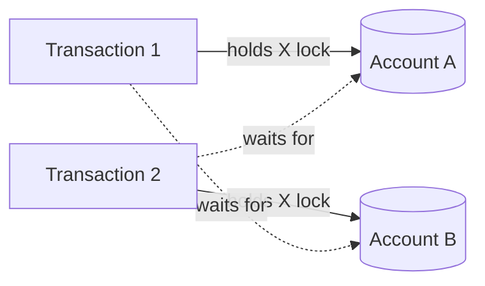

import { Aside } from '@astrojs/starlight/components';
import QuizBlock from '~/components/QuizBlock.astro';

## Why it matters in interviews

*"Explain ACID"*, *"what are the isolation levels and which anomalies does each prevent?"* and *"how do you handle deadlocks?"* appear in almost every backend loop. At 3-4 years, interviewers also probe production judgement: *"your team puts `WITH (NOLOCK)` everywhere, is that OK?"* or *"two users book the last seat at the same time, what happens?"*.

## Core idea

A **transaction** is a unit of work that either fully happens or doesn't happen at all.

| ACID | Meaning | How SQL Server provides it |
|---|---|---|
| **Atomicity** | all statements succeed or all are undone | transaction log, rollback |
| **Consistency** | constraints hold before and after | PK/FK/CHECK constraints, triggers |
| **Isolation** | concurrent transactions don't see each other's half-done work | locks or row versions, per isolation level |
| **Durability** | committed data survives a crash | write-ahead log hardened to disk on commit |

### Read anomalies

| Anomaly | What happens |
|---|---|
| **Dirty read** | T1 reads a row T2 changed but hasn't committed; T2 rolls back, so T1 used data that never existed |
| **Non-repeatable read** | T1 reads a row twice and gets different values because T2 updated and committed it in between |
| **Phantom read** | T1 runs the same range query twice and gets new rows because T2 inserted into the range |
| **Lost update** | T1 and T2 both read a value, both write `value + 1`; one increment disappears |

Example of a non-repeatable read under the default `READ COMMITTED`:

| Time | Session 1 | Session 2 |
|---|---|---|
| t1 | `BEGIN TRAN; SELECT Balance FROM Accounts WHERE Id = 1;` → 500 | |
| t2 | | `UPDATE Accounts SET Balance = 300 WHERE Id = 1;` (auto-commit) |
| t3 | `SELECT Balance FROM Accounts WHERE Id = 1;` → **300** | |
| t4 | `COMMIT;` | |

Under `REPEATABLE READ`, session 1 would hold its shared lock until commit, so session 2's update would **wait** until t4 and session 1 would read 500 both times.

### Isolation levels vs anomalies

| Level | Dirty read | Non-repeatable read | Phantom | How it works |
|---|---|---|---|---|
| `READ UNCOMMITTED` | possible | possible | possible | no shared locks on reads (same as `NOLOCK`) |
| `READ COMMITTED` (default, locking) | prevented | possible | possible | shared lock held only while reading each row |
| `READ COMMITTED` with **RCSI** | prevented | possible | possible | reads the last committed version **as of statement start**; readers don't block writers |
| `REPEATABLE READ` | prevented | prevented | possible | shared locks held until the transaction ends |
| `SNAPSHOT` | prevented | prevented | prevented | reads committed versions **as of transaction start**; update conflicts raise error 3960 |
| `SERIALIZABLE` | prevented | prevented | prevented | key-range locks on the ranges read, held to the end |

Higher isolation means fewer anomalies but more blocking (locking levels) or more tempdb version store usage (versioning levels). Note that `SNAPSHOT` is not the same as `SERIALIZABLE`: it allows **write skew** (two transactions each read a constraint like "at least one doctor on call", each update a different row, and both commit).

### Locks

| Mode | Taken by | Compatible with |
|---|---|---|
| Shared (S) | reads | S, U |
| Update (U) | the read phase of an `UPDATE`, or `WITH (UPDLOCK)` | S only (not another U), prevents the classic conversion deadlock |
| Exclusive (X) | `INSERT`/`UPDATE`/`DELETE` | nothing |
| Intent (IS, IX, SIX) | on page/table, announcing locks below | lets the engine check table-level conflicts cheaply |
| Schema (Sch-S, Sch-M) | Sch-S for queries, Sch-M for DDL like `ALTER TABLE` | Sch-M blocks everything |

Locks are taken at **row/key**, **page** or **table** level. X locks are always held until the transaction ends, at every isolation level. **Lock escalation**: when one statement holds roughly 5,000 locks on a single table (or lock memory runs high), SQL Server tries to replace them with one table lock (or a partition lock if configured). That is why a large `DELETE` or `UPDATE` can suddenly block the whole table; batch it in chunks of a few thousand rows.

### Row versioning: RCSI and SNAPSHOT

With versioning, writers keep the previous committed version of a row in a version store (tempdb, or the persistent version store when Accelerated Database Recovery is on). Readers read that version instead of waiting for the writer's X lock. **Readers don't block writers and writers don't block readers**; writers still block writers.

| | RCSI (`READ_COMMITTED_SNAPSHOT ON`) | SNAPSHOT (`ALLOW_SNAPSHOT_ISOLATION ON` + `SET TRANSACTION ISOLATION LEVEL SNAPSHOT`) |
|---|---|---|
| Consistent as of | each **statement** | the whole **transaction** |
| Code change needed | none, changes default `READ COMMITTED` behaviour | yes, opt in per session/transaction |
| Update conflicts | no error: a writer waits for the other writer's lock, then updates the latest committed row | error 3960, transaction must retry |
| Default | **on** in Azure SQL Database; off in SQL Server | off |

### Deadlocks

A deadlock is a cycle: each transaction holds a lock the other needs.



SQL Server's lock monitor detects the cycle (it checks every few seconds, more often once deadlocks are found), picks a **victim** (lowest `DEADLOCK_PRIORITY`, then the cheapest to roll back), rolls it back and raises **error 1205** to that client. The other transaction proceeds. Deadlock graphs are captured automatically by the built-in `system_health` Extended Events session.

How to prevent them:

- **Access objects in the same order** in every code path (always Account with the lower Id first).
- **Keep transactions short**: no user interaction or HTTP calls inside a transaction.
- **Index the predicates** of `UPDATE`/`DELETE` so they lock a few rows instead of scanning and locking many.
- For read-then-update, take **`UPDLOCK`** on the read so two sessions can't both hold S and then both try to convert to X.
- Use **RCSI** so readers stop participating in deadlocks with writers.
- And still **retry on 1205** in the application, because deadlocks can't be eliminated completely.

### NOLOCK myths

`WITH (NOLOCK)` = `READ UNCOMMITTED` for that table. It is often added "for performance", but:

- It **reads uncommitted data** that may be rolled back.
- During page splits an allocation-order scan can **read the same row twice or skip rows**, so totals can be wrong even if nothing is rolled back.
- It can fail with error 601 ("could not continue scan with NOLOCK due to data movement").
- It still takes a **Sch-S** lock, so it is blocked by schema changes. It is not "no locks".

If readers blocking writers is the real problem, enable **RCSI**: you get non-blocking reads of committed data.

## Code

**Safe money transfer: XACT_ABORT, consistent order, TRY/CATCH**

```sql
CREATE OR ALTER PROCEDURE dbo.TransferFunds @From INT, @To INT, @Amount DECIMAL(18,2)
AS
BEGIN
    SET NOCOUNT ON;
    SET XACT_ABORT ON;   -- any error (or client timeout) rolls back the whole transaction
    BEGIN TRY
        BEGIN TRAN;
        -- lock both rows up front, before changing either of them
        SELECT Id FROM dbo.Accounts WITH (UPDLOCK, HOLDLOCK)
        WHERE Id IN (@From, @To) ORDER BY Id;

        UPDATE dbo.Accounts SET Balance = Balance - @Amount
        WHERE Id = @From AND Balance >= @Amount;
        IF @@ROWCOUNT = 0 THROW 50001, 'Insufficient funds', 1;

        UPDATE dbo.Accounts SET Balance = Balance + @Amount WHERE Id = @To;
        COMMIT;
    END TRY
    BEGIN CATCH
        IF @@TRANCOUNT > 0 ROLLBACK;
        THROW;   -- re-raise the original error to the caller
    END CATCH
END;
```

**Nested transactions are an illusion**: `BEGIN TRAN` inside another only increments `@@TRANCOUNT`. An inner `COMMIT` just decrements it; nothing is durable until the outermost `COMMIT`. A `ROLLBACK` anywhere rolls back **everything** and sets `@@TRANCOUNT` to 0. Use `SAVE TRANSACTION name` for partial rollback.

**From .NET**, EF Core's `SaveChanges` already wraps its batch in a transaction. For explicit control and deadlock retries:

```csharp
var strategy = db.Database.CreateExecutionStrategy();   // EnableRetryOnFailure()
await strategy.ExecuteAsync(async () =>
{
    await using var tx = await db.Database.BeginTransactionAsync(IsolationLevel.ReadCommitted, ct);
    // ... reads and writes ...
    await db.SaveChangesAsync(ct);
    await tx.CommitAsync(ct);
});
```

## Interview Q&A

<details>
<summary>What is the default isolation level in SQL Server, and in Azure SQL Database?</summary>

`READ COMMITTED` in both. In SQL Server it uses locking by default. Azure SQL Database enables `READ_COMMITTED_SNAPSHOT` by default, so the same level reads row versions and readers don't block writers. This matters when moving an app between the two.
</details>

<details>
<summary>What is the difference between RCSI and SNAPSHOT isolation?</summary>

Both read committed row versions instead of waiting on locks. RCSI gives each **statement** a consistent view and is transparent to code. SNAPSHOT gives the whole **transaction** one consistent view as of its start, must be requested explicitly, and fails with an update conflict (3960) if another transaction modified a row it tries to update.
</details>

<details>
<summary>How does SERIALIZABLE prevent phantoms?</summary>

It takes key-range locks on the index ranges the query read and holds them until the transaction ends, so no other transaction can insert a row into that range. Without a suitable index, the range lock may cover much more (even the whole table), causing heavy blocking.
</details>

<details>
<summary>What is a deadlock and how does SQL Server resolve it?</summary>

Two or more transactions each wait for a lock held by another, forming a cycle. The lock monitor detects it, chooses a victim by deadlock priority and rollback cost, rolls the victim back and returns error 1205. The application should retry the victim transaction.
</details>

<details>
<summary>How do you prevent deadlocks?</summary>

Access tables and rows in a consistent order, keep transactions short, index the columns used to find rows to update, use `UPDLOCK` when reading a row you will update, consider RCSI, and batch large modifications. Then retry on 1205 because rare deadlocks are normal under load.
</details>

<details>
<summary>Is NOLOCK a good way to fix blocking?</summary>

Rarely. It returns uncommitted data and can skip or double-count rows during page splits, so results can be wrong. If readers are being blocked by writers, enable RCSI to get non-blocking reads of committed data. Fix long transactions and missing indexes that cause the blocking.
</details>

<details>
<summary>What is lock escalation?</summary>

When a statement acquires too many fine-grained locks on one table (around 5,000) SQL Server converts them into a single table (or partition) lock to save memory. It can block all other users of the table. Avoid it by batching large updates and deletes and by having indexes so fewer rows are touched.
</details>

<details>
<summary>Why use SET XACT_ABORT ON?</summary>

Without it, some runtime errors abort only the statement and the transaction stays open; and when the client times out, the batch is cancelled but the transaction can remain open with its locks. With `XACT_ABORT ON`, an error rolls back the whole transaction, which is what you almost always want inside procedures that use explicit transactions.
</details>

## Pitfalls

<Aside type="caution" title="Common mistakes">

- **`NOLOCK` everywhere** as a performance fix: wrong results, not just "slightly stale" data.
- **Long transactions** that include HTTP calls, emails or user think-time, holding locks for seconds.
- **Assuming nested `COMMIT` commits**: only the outermost one does.
- **Read-then-update without `UPDLOCK`** (check stock, then decrement), causing lost updates or conversion deadlocks.
- **No retry for error 1205** or snapshot conflicts (3960) in the data access layer.
- **Huge single-statement deletes** that escalate to a table lock and fill the log.

</Aside>

## Related

- [Concurrency control in EF Core](../concurrency/)
- [Transactions, bulk ops & raw SQL](../transactions-raw-sql/)
- [Indexes](../indexes/)
- [Operating systems: deadlock conditions](../../fundamentals/operating-systems/)

## Quick quiz

<QuizBlock section="data" topic="transactions-isolation" />
