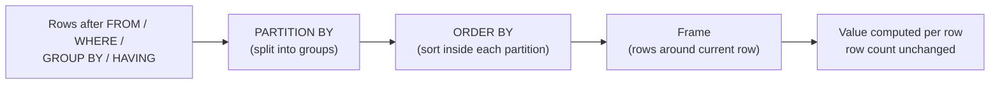

import { Aside } from '@astrojs/starlight/components';
import QuizBlock from '~/components/QuizBlock.astro';

## Why it matters in interviews

Window functions solve half of the "classic" SQL problems in one line: top N per group, nth highest salary, running totals, month-over-month change, de-duplication. Interviewers ask *"ROW_NUMBER vs RANK vs DENSE_RANK?"* and then hand you a table with ties and ask for the output. Knowing the default frame trap is what separates a 3-4 year answer from a fresher's.

## Core idea

A window function computes a value **for every row** using a set of related rows (the *window*), **without collapsing rows** the way `GROUP BY` does.

```sql
function(...) OVER (
    [PARTITION BY cols]      -- split rows into independent groups
    [ORDER BY cols]          -- order inside each partition
    [ROWS | RANGE frame]     -- which rows around the current row to include
)
```



Because window functions are evaluated in the `SELECT` phase, you **cannot** use them in `WHERE`, `GROUP BY` or `HAVING`. Wrap the query in a CTE or derived table and filter outside.

Families:

| Family | Functions | Needs ORDER BY? |
|---|---|---|
| Ranking | `ROW_NUMBER`, `RANK`, `DENSE_RANK`, `NTILE` | Yes |
| Offset | `LAG`, `LEAD`, `FIRST_VALUE`, `LAST_VALUE` | Yes (`FIRST_VALUE`/`LAST_VALUE` depend on the frame) |
| Aggregate | `SUM`, `AVG`, `COUNT`, `MIN`, `MAX` with `OVER` | Optional (adds a running frame) |
| Distribution | `PERCENT_RANK`, `CUME_DIST`, `PERCENTILE_CONT`, `PERCENTILE_DISC` | Yes |

### Ranking with ties

Sample `Employees`:

| Name | Dept | Salary |
|---|---|---|
| Asha | Eng | 90000 |
| Ravi | Eng | 70000 |
| Kiran | Eng | 70000 |
| Dev | Eng | 60000 |
| Meera | Sales | 80000 |
| Sam | Sales | 75000 |

```sql
SELECT Name, Dept, Salary,
       ROW_NUMBER() OVER (PARTITION BY Dept ORDER BY Salary DESC, Name) AS RowNum,
       RANK()       OVER (PARTITION BY Dept ORDER BY Salary DESC)       AS Rnk,
       DENSE_RANK() OVER (PARTITION BY Dept ORDER BY Salary DESC)       AS DenseRnk,
       SUM(Salary)  OVER (PARTITION BY Dept)                            AS DeptTotal
FROM Employees
ORDER BY Dept, Salary DESC, Name;
```

| Name | Dept | Salary | RowNum | Rnk | DenseRnk | DeptTotal |
|---|---|---|---|---|---|---|
| Asha | Eng | 90000 | 1 | 1 | 1 | 290000 |
| Kiran | Eng | 70000 | 2 | 2 | 2 | 290000 |
| Ravi | Eng | 70000 | 3 | 2 | 2 | 290000 |
| Dev | Eng | 60000 | 4 | **4** | **3** | 290000 |
| Meera | Sales | 80000 | 1 | 1 | 1 | 155000 |
| Sam | Sales | 75000 | 2 | 2 | 2 | 155000 |

| Function | Ties get | After a tie | Use for |
|---|---|---|---|
| `ROW_NUMBER` | different numbers (arbitrary unless you add a tie-breaker) | continues 1, 2, 3, 4 | de-duplication, paging, "exactly one row per group" |
| `RANK` | same number | **skips** (1, 2, 2, 4) | competition ranking |
| `DENSE_RANK` | same number | **no gap** (1, 2, 2, 3) | "nth highest distinct value" |
| `NTILE(n)` | bucket number 1..n | larger buckets first | quartiles, splitting work into batches |

`ROW_NUMBER` with ties is **non-deterministic**: without `Name` as a tie-breaker, Kiran and Ravi could swap between executions. Always add a unique column at the end of the `ORDER BY` when the result must be stable (paging!).

`NTILE(2) OVER (ORDER BY Salary DESC)` over all six rows gives 1, 1, 1, 2, 2, 2. With seven rows it gives four 1s and three 2s: when rows don't divide evenly, the earlier buckets get the extra row.

`SUM(Salary) OVER (PARTITION BY Dept)` has no `ORDER BY`, so the window is the **whole partition**: every row sees its department total. That makes "percentage of department" a one-liner: `Salary * 100.0 / SUM(Salary) OVER (PARTITION BY Dept)`.

### LAG and LEAD

`MonthlySales`:

| Month | Amount |
|---|---|
| 2026-01 | 100 |
| 2026-02 | 150 |
| 2026-03 | 120 |
| 2026-04 | 200 |

```sql
SELECT Month, Amount,
       LAG(Amount)     OVER (ORDER BY Month)          AS PrevAmount,
       Amount - LAG(Amount) OVER (ORDER BY Month)     AS Change,
       LEAD(Amount, 1, 0) OVER (ORDER BY Month)       AS NextOrZero,
       SUM(Amount) OVER (ORDER BY Month
                         ROWS UNBOUNDED PRECEDING)    AS RunningTotal,
       AVG(Amount * 1.0) OVER (ORDER BY Month
                         ROWS BETWEEN 2 PRECEDING AND CURRENT ROW) AS MovingAvg3
FROM MonthlySales;
```

| Month | Amount | PrevAmount | Change | NextOrZero | RunningTotal | MovingAvg3 |
|---|---|---|---|---|---|---|
| 2026-01 | 100 | NULL | NULL | 150 | 100 | 100.00 |
| 2026-02 | 150 | 100 | 50 | 120 | 250 | 125.00 |
| 2026-03 | 120 | 150 | -30 | 200 | 370 | 123.33 |
| 2026-04 | 200 | 120 | 80 | 0 | 570 | 156.67 |

(MovingAvg3 rounded to two decimals for display.) `LAG(col, offset, default)` looks back `offset` rows (default 1) and returns `default` (NULL if omitted) when there is no such row. Before window functions this needed a self join on `Month = previous month`, which is slower and breaks on gaps.

### Frames: ROWS vs RANGE, and the default trap

When you write `ORDER BY` inside `OVER` for an aggregate **without** a frame, SQL Server uses the default frame `RANGE BETWEEN UNBOUNDED PRECEDING AND CURRENT ROW`. `RANGE` treats all rows with the **same ORDER BY value as peers**, so they share one running total:

| Day | Amount | `SUM` default (RANGE) | `SUM ... ROWS UNBOUNDED PRECEDING` |
|---|---|---|---|
| 1 | 10 | 10 | 10 |
| 2 | 20 | **60** | 30 |
| 2 | 30 | **60** | 60 |
| 3 | 40 | 100 | 100 |

(With `ROWS`, the order of the two day-2 rows is arbitrary, so add a tie-breaker.) Two more reasons to write `ROWS` explicitly:

- **Performance**: in row-mode plans, the `RANGE` default uses an on-disk worktable for the window spool, while `ROWS` frames can use a faster in-memory one. Check `SET STATISTICS IO` and you will see worktable reads with `RANGE`.
- **`LAST_VALUE` surprise**: with the default frame the window ends at the current row, so `LAST_VALUE(x) OVER (ORDER BY d)` returns the **current** row's value. Use `ROWS BETWEEN UNBOUNDED PRECEDING AND UNBOUNDED FOLLOWING`, or flip the sort and use `FIRST_VALUE`.

SQL Server only supports `UNBOUNDED` and `CURRENT ROW` as `RANGE` boundaries; numeric offsets like `2 PRECEDING` work only with `ROWS`.

## Code

**Top 2 earners per department** (the most asked window query):

```sql
WITH Ranked AS (
    SELECT Name, Dept, Salary,
           DENSE_RANK() OVER (PARTITION BY Dept ORDER BY Salary DESC) AS rnk
    FROM Employees
)
SELECT Name, Dept, Salary
FROM Ranked
WHERE rnk <= 2;          -- filter OUTSIDE: window functions aren't allowed in WHERE
```

Returns Asha, Kiran, Ravi (Eng, two salary levels, one of them tied) and Meera, Sam (Sales). Swap to `ROW_NUMBER` for exactly two rows per department.

**De-duplicate, keeping the latest row per email**

```sql
WITH d AS (
    SELECT *, ROW_NUMBER() OVER (PARTITION BY Email ORDER BY CreatedAt DESC, Id DESC) AS rn
    FROM Customers
)
DELETE FROM d WHERE rn > 1;   -- deleting through a CTE deletes from Customers
```

**OFFSET paging with the total count in one round-trip**

```sql
SELECT Id, Name, COUNT(*) OVER () AS TotalRows
FROM Products
ORDER BY Name, Id
OFFSET @Skip ROWS FETCH NEXT @Take ROWS ONLY;
```

`COUNT(*) OVER ()` is computed before `OFFSET/FETCH`, so every row carries the full count. It is convenient for grids, but it forces the engine to count every qualifying row; on very large tables a separate count or keyset paging is cheaper.

SQL Server 2022 (compatibility level 160) also adds a named `WINDOW` clause so a repeated `OVER` definition can be written once: `... OVER w FROM T WINDOW w AS (PARTITION BY Dept ORDER BY Salary DESC)`.

## Interview Q&A

<details>
<summary>What is the difference between ROW_NUMBER, RANK and DENSE_RANK?</summary>

All number rows within a partition by the `ORDER BY`. `ROW_NUMBER` always gives unique sequential numbers (ties broken arbitrarily). `RANK` gives ties the same rank and then skips (1, 2, 2, 4). `DENSE_RANK` gives ties the same rank without gaps (1, 2, 2, 3). Use `DENSE_RANK` for "nth highest distinct salary" and `ROW_NUMBER` for de-duplication or exactly-N-per-group.
</details>

<details>
<summary>How is a window function different from GROUP BY?</summary>

`GROUP BY` collapses each group into one row, so you lose row-level detail. A window aggregate keeps every row and attaches the group-level value to each one, so you can show a salary next to the department average in the same row.
</details>

<details>
<summary>Why can't I filter on ROW_NUMBER in WHERE?</summary>

Window functions are evaluated in the `SELECT` phase, after `WHERE`, `GROUP BY` and `HAVING`. Compute the number in a CTE or derived table and filter in the outer query.
</details>

<details>
<summary>What is the default window frame and why does it matter?</summary>

With `ORDER BY` and no explicit frame, aggregates use `RANGE BETWEEN UNBOUNDED PRECEDING AND CURRENT ROW`. Rows with equal sort keys are peers and get the same running total, and `LAST_VALUE` returns the current row. It is also typically slower than `ROWS` in row-mode execution. Specify `ROWS` explicitly for running totals.
</details>

<details>
<summary>How do you calculate month-over-month growth?</summary>

`Amount - LAG(Amount) OVER (ORDER BY Month)` for the absolute change, and divide by `NULLIF(LAG(Amount) OVER (ORDER BY Month), 0)` for a percentage. Use `PARTITION BY ProductId` to do it per product. The first month returns NULL because there is no previous row.
</details>

<details>
<summary>How would you remove duplicate rows but keep one?</summary>

Number the rows with `ROW_NUMBER() OVER (PARTITION BY <duplicate key> ORDER BY <which one to keep>)` in a CTE, then `DELETE FROM cte WHERE rn > 1`. SQL Server deletes from the underlying table because the CTE references one base table.
</details>

<details>
<summary>Can EF Core generate window functions?</summary>

Not from general LINQ: there is no `OVER` translation for arbitrary queries in EF Core. Common approaches are a raw SQL query mapped to a DTO (`SqlQuery<T>` / `FromSql`), a view mapped as a keyless entity, or Dapper for reporting queries. Some third-party extensions add window function support.
</details>

## Pitfalls

<Aside type="caution" title="Common mistakes">

- **No tie-breaker in `ROW_NUMBER`**: results change between runs and paging skips or repeats rows.
- **Relying on the default `RANGE` frame** for running totals: duplicate sort keys share a total and performance suffers.
- **`LAST_VALUE` without an explicit frame** returns the current row.
- **Filtering a window function in `WHERE`**: not allowed; use a CTE.
- **`RANK` for "nth highest"** when ties exist: the rank number n may not exist at all. Use `DENSE_RANK`.
- **Integer averages**: `AVG` over an `INT` column returns an `INT`. Multiply by `1.0` or cast to decimal.

</Aside>

## Related

- [SQL joins & core queries](../sql-joins-queries/)
- [Classic SQL interview problems](../sql-interview-problems/)
- [Execution plans & query tuning](../execution-plans/)
- [Transactions, bulk ops & raw SQL in EF Core](../transactions-raw-sql/)

## Quick quiz

<QuizBlock section="data" topic="window-functions" />
