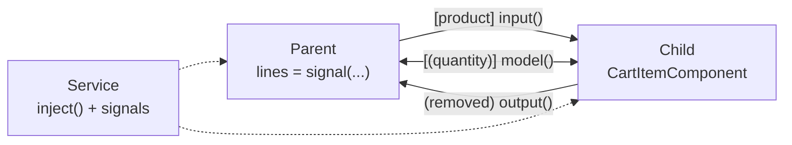

import { Aside } from '@astrojs/starlight/components';
import QuizBlock from '~/components/QuizBlock.astro';

## Why it matters in interviews

For full-stack .NET + Angular roles, one round is often "build this small feature in StackBlitz in 30-45 minutes". The task is simple on purpose; the interviewer watches **how** you build it: standalone components, signals for state, `inject()`, the new control flow, OnPush, correct RxJS operators, typed forms, and clean parent-child communication. Old-style code (NgModules, `*ngIf`, constructor injection everywhere, manual `subscribe` without cleanup) still works but signals that you have not kept up since Angular 16.

## Core idea

The modern defaults to show in every task (Angular v21/v22):

| Concern | Write this | Instead of |
|---|---|---|
| Component type | standalone (the default since v19, no flag needed) | NgModule declarations |
| Local state | `signal()`, `computed()` | mutable fields + manual change detection |
| Inputs / outputs | `input()`, `input.required()`, `output()`, `model()` | `@Input()`, `@Output() EventEmitter` |
| DI | `inject(Service)` in a field | constructor parameters |
| Templates | `@if`, `@for (...; track id)`, `@switch`, `@defer` | `*ngIf`, `*ngFor`, `trackBy` functions |
| Change detection | `ChangeDetectionStrategy.OnPush` (new apps are zoneless by default since v21) | Default + zone.js |
| Host listeners | `host: { '(click)': 'onClick()' }` metadata | `@HostListener` / `@HostBinding` |
| RxJS to template | `toSignal()` or the `async` pipe | `subscribe()` + a field + forgetting to unsubscribe |

A suggested order when the clock starts: model the data (interface), write the state as signals, write the template, then handle edge cases (empty list, loading, errors). Say each decision out loud.



## 1. Todo list / CRUD with signals

**Task:** add, toggle, rename, delete and filter todos, with a remaining count.

```ts
import { ChangeDetectionStrategy, Component, computed, signal } from '@angular/core';

export interface Todo { id: number; title: string; done: boolean; }
type Filter = 'all' | 'active' | 'done';

@Component({
  selector: 'app-todo-list',
  changeDetection: ChangeDetectionStrategy.OnPush,
  template: `
    <input #box placeholder="What needs doing?" (keyup.enter)="add(box.value); box.value = ''" />
    <nav>
      @for (f of filters; track f) {
        <button [class.active]="filter() === f" (click)="filter.set(f)">{{ f }}</button>
      }
    </nav>
    <ul>
      @for (todo of visible(); track todo.id) {
        <li>
          <input type="checkbox" [checked]="todo.done" (change)="toggle(todo.id)" />
          @if (editingId() === todo.id) {
            <input #edit [value]="todo.title" (keyup.enter)="rename(todo.id, edit.value)" (blur)="editingId.set(null)" />
          } @else {
            <span [class.done]="todo.done" (dblclick)="editingId.set(todo.id)">{{ todo.title }}</span>
          }
          <button (click)="remove(todo.id)" aria-label="Delete">✕</button>
        </li>
      } @empty {
        <li>Nothing here.</li>
      }
    </ul>
    <p>{{ remaining() }} item(s) left</p>
  `,
})
export class TodoListComponent {
  readonly filters: Filter[] = ['all', 'active', 'done'];
  readonly todos = signal<Todo[]>([]);
  readonly filter = signal<Filter>('all');
  readonly editingId = signal<number | null>(null);
  private nextId = 1;

  readonly visible = computed(() => {
    const f = this.filter();
    return this.todos().filter((t) => f === 'all' || (f === 'done') === t.done);
  });
  readonly remaining = computed(() => this.todos().filter((t) => !t.done).length);

  add(title: string) {
    const trimmed = title.trim();
    if (!trimmed) return;
    this.todos.update((list) => [...list, { id: this.nextId++, title: trimmed, done: false }]);
  }
  toggle(id: number) {
    this.todos.update((list) => list.map((t) => (t.id === id ? { ...t, done: !t.done } : t)));
  }
  rename(id: number, title: string) {
    const trimmed = title.trim();
    if (trimmed) this.todos.update((list) => list.map((t) => (t.id === id ? { ...t, title: trimmed } : t)));
    this.editingId.set(null);
  }
  remove(id: number) {
    this.todos.update((list) => list.filter((t) => t.id !== id));
  }
}
```

**Talking points**
- **Immutable updates** (`update` returning a new array, spreading the changed item). Signals compare with `Object.is`, so mutating the array in place and calling `set` with the same reference would not notify anyone.
- `visible` and `remaining` are `computed`: derived, memoised, and recalculated only when `todos` or `filter` change. Never store derived state in a second writable signal.
- `track todo.id` lets Angular reuse DOM nodes when the list changes; tracking by `$index` would re-render wrong rows after a delete.
- Next step if asked: move the signals into a `TodoStore` service (`providedIn: 'root'`) so other components share it, and persist with an `effect()` that writes to `localStorage`, or swap in an HTTP API.

## 2. Debounced search with RxJS `switchMap`

**Task:** a search box that calls an API as the user types, without flooding the server and without showing stale results.

```ts
import { ChangeDetectionStrategy, Component, inject, Injectable, signal } from '@angular/core';
import { HttpClient } from '@angular/common/http';
import { toSignal } from '@angular/core/rxjs-interop';
import { FormControl, ReactiveFormsModule } from '@angular/forms';
import { Observable, catchError, debounceTime, distinctUntilChanged, finalize, map, of, switchMap, tap } from 'rxjs';

export interface User { id: number; name: string; }

@Injectable({ providedIn: 'root' })
export class UserSearchService {
  private readonly http = inject(HttpClient);
  search(term: string): Observable<User[]> {
    return this.http.get<User[]>('/api/users', { params: { q: term } });
  }
}

@Component({
  selector: 'app-user-search',
  imports: [ReactiveFormsModule],
  changeDetection: ChangeDetectionStrategy.OnPush,
  template: `
    <input [formControl]="query" placeholder="Search users (2+ letters)" />
    @if (loading()) { <p>Searching…</p> }
    @if (error(); as message) { <p class="error">{{ message }}</p> }
    <ul>
      @for (user of results(); track user.id) {
        <li>{{ user.name }}</li>
      } @empty {
        @if (term().length >= 2 && !loading() && !error()) { <li>No matches.</li> }
      }
    </ul>
  `,
})
export class UserSearchComponent {
  private readonly api = inject(UserSearchService);
  readonly query = new FormControl('', { nonNullable: true });
  readonly term = signal('');
  readonly loading = signal(false);
  readonly error = signal<string | null>(null);

  readonly results = toSignal(
    this.query.valueChanges.pipe(
      debounceTime(300),                       // wait until typing pauses
      map((v) => v.trim()),
      distinctUntilChanged(),                  // "abc" -> "abcd" -> "abc" within 300 ms: no call
      tap((t) => { this.term.set(t); this.error.set(null); }),
      switchMap((t) => {                       // cancels the previous in-flight request
        if (t.length < 2) return of([] as User[]);
        this.loading.set(true);
        return this.api.search(t).pipe(
          catchError(() => { this.error.set('Search failed, try again.'); return of([] as User[]); }),
          finalize(() => this.loading.set(false)),
        );
      }),
    ),
    { initialValue: [] as User[] },
  );
}
```

`HttpClient` needs `provideHttpClient()` in `app.config.ts` (add `withFetch()` for SSR).

**Talking points**
- **`switchMap` vs the others:** `switchMap` unsubscribes from the previous request (HttpClient aborts it), so a slow response for "an" cannot overwrite the result for "angular". `mergeMap` would let responses race; `concatMap` would queue them; `exhaustMap` would ignore new terms while one is in flight (right for a "Save" button, wrong for search).
- **`catchError` inside the `switchMap`**, on the inner observable. Put it on the outer pipe and the first HTTP error completes the whole stream, so the search box silently stops working.
- `toSignal` subscribes and unsubscribes with the component's lifetime, so no `takeUntilDestroyed` or `ngOnDestroy` is needed.
- Signal-first alternative: keep the term in a signal, debounce it, and load results with a resource (`rxResource` or `httpResource`; check their stability status in your Angular version) keyed on the term. Mention it, but the RxJS version is what most interviewers expect.

## 3. Custom pipe

**Task:** a `truncate` pipe that shortens text to a limit, preferably on a word boundary, with an ellipsis.

```ts
import { Pipe, PipeTransform } from '@angular/core';

@Pipe({ name: 'truncate' })              // standalone and pure by default
export class TruncatePipe implements PipeTransform {
  transform(value: string | null | undefined, limit = 50, wholeWords = true, ellipsis = '…'): string {
    if (!value) return '';
    if (value.length <= limit) return value;
    let cut = value.slice(0, limit);
    if (wholeWords) {
      const lastSpace = cut.lastIndexOf(' ');
      if (lastSpace > 0) cut = cut.slice(0, lastSpace);
    }
    return cut.trimEnd() + ellipsis;
  }
}
```

Usage (add `TruncatePipe` to the component's `imports`): `{{ post.body | truncate: 120 }}` or `{{ title | truncate: 20 : false }}`.

```ts
import { describe, expect, it } from 'vitest';
import { TruncatePipe } from './truncate.pipe';

describe('TruncatePipe', () => {
  const pipe = new TruncatePipe();
  it('returns short text unchanged', () => expect(pipe.transform('hello', 10)).toBe('hello'));
  it('cuts on a word boundary', () => expect(pipe.transform('the quick brown fox', 12)).toBe('the quick…'));
  it('can cut mid-word', () => expect(pipe.transform('the quick brown fox', 12, false)).toBe('the quick br…'));
  it('handles null', () => expect(pipe.transform(null)).toBe(''));
});
```

**Talking points**
- A **pure** pipe (the default) runs only when its input reference or arguments change, so it is as cheap as a `computed`. An **impure** pipe (`pure: false`) runs on every change detection cycle; avoid it for filtering or sorting lists, and use a `computed` instead.
- Accepting `null | undefined` makes the pipe safe with optional data and with the `async` pipe, which emits `null` first.
- Pipes are pure functions, so the unit test needs no `TestBed` at all. Vitest is the default test runner for new projects since v21.
- Built-in pipes worth naming: `date`, `currency`, `number`, `percent`, `json`, `keyvalue`, `async`, `slice`, `titlecase`.

## 4. Custom attribute directives

**Task:** (a) highlight an element on hover with a configurable colour; (b) emit an event when the user clicks outside an element (closing a dropdown).

```ts
import { Directive, ElementRef, inject, input, output, signal } from '@angular/core';

@Directive({
  selector: '[appHighlight]',
  host: {
    '(mouseenter)': 'hovered.set(true)',
    '(mouseleave)': 'hovered.set(false)',
    '[style.backgroundColor]': 'hovered() ? appHighlight() || defaultColor() : null',
  },
})
export class HighlightDirective {
  readonly appHighlight = input('');          // <p appHighlight="khaki">
  readonly defaultColor = input('yellow');    // <p appHighlight defaultColor="pink">
  readonly hovered = signal(false);
}

@Directive({
  selector: '[appClickOutside]',
  host: { '(document:click)': 'onDocumentClick($event)' },
})
export class ClickOutsideDirective {
  private readonly el = inject<ElementRef<HTMLElement>>(ElementRef);
  readonly appClickOutside = output<void>();  // <div (appClickOutside)="close()">

  onDocumentClick(event: MouseEvent) {
    if (!this.el.nativeElement.contains(event.target as Node)) {
      this.appClickOutside.emit();
    }
  }
}
```

**Talking points**
- The `host` metadata is the recommended replacement for `@HostListener` / `@HostBinding`: bindings are type-checked against the class and live in one place.
- Naming the input after the selector (`appHighlight`) lets you write `appHighlight="khaki"` in one attribute.
- Prefer binding to `style` / `class` over touching `nativeElement.style` directly; it works with SSR and keeps Angular in control. Use `Renderer2` only when you need imperative DOM changes.
- A `document:click` listener on every instance can add up in long lists; for many instances, share one listener in a service.
- Structural directives (`*appIf`) are rarer in interviews now that `@if` / `@for` exist, but be ready to explain `TemplateRef` + `ViewContainerRef`.

## 5. Reactive form with custom validators

**Task:** a registration form with email, password (must be strong) and confirm-password (must match), showing errors only after the user has touched a field.

```ts
import { AbstractControl, ValidationErrors, ValidatorFn } from '@angular/forms';

// Field validator: 8+ chars, at least one upper-case letter and one digit.
export function strongPassword(): ValidatorFn {
  return (control: AbstractControl): ValidationErrors | null => {
    const v: string = control.value ?? '';
    if (!v) return null;                       // let Validators.required handle empty
    const missing = { length: v.length < 8, upper: !/[A-Z]/.test(v), digit: !/\d/.test(v) };
    return Object.values(missing).some(Boolean) ? { strongPassword: missing } : null;
  };
}

// Group (cross-field) validator: attach to the FormGroup, not to a control.
export const passwordsMatch: ValidatorFn = (group: AbstractControl): ValidationErrors | null => {
  const pw = group.get('password')?.value;
  const confirm = group.get('confirm')?.value;
  return pw && confirm && pw !== confirm ? { passwordsMismatch: true } : null;
};
```

```ts
import { ChangeDetectionStrategy, Component, inject, output } from '@angular/core';
import { NonNullableFormBuilder, ReactiveFormsModule, Validators } from '@angular/forms';
import { passwordsMatch, strongPassword } from './validators';

@Component({
  selector: 'app-register',
  imports: [ReactiveFormsModule],
  changeDetection: ChangeDetectionStrategy.OnPush,
  template: `
    <form [formGroup]="form" (ngSubmit)="submit()">
      <label>Email <input formControlName="email" type="email" /></label>
      @if (form.controls.email.touched && form.controls.email.errors; as e) {
        @if (e['required']) { <small>Email is required.</small> }
        @if (e['email']) { <small>Enter a valid email.</small> }
      }
      <label>Password <input formControlName="password" type="password" /></label>
      @if (form.controls.password.touched && form.controls.password.errors?.['strongPassword']; as pw) {
        <small>Needs: @if (pw.length) { 8+ characters; } @if (pw.upper) { an upper-case letter; } @if (pw.digit) { a digit. }</small>
      }
      <label>Confirm <input formControlName="confirm" type="password" /></label>
      @if (form.controls.confirm.touched && form.hasError('passwordsMismatch')) {
        <small>Passwords do not match.</small>
      }
      <button type="submit">Register</button>
    </form>
  `,
})
export class RegisterComponent {
  private readonly fb = inject(NonNullableFormBuilder);
  readonly registered = output<{ email: string; password: string }>();

  readonly form = this.fb.group(
    {
      email: ['', [Validators.required, Validators.email]],
      password: ['', [Validators.required, strongPassword()]],
      confirm: ['', Validators.required],
    },
    { validators: passwordsMatch },
  );

  submit() {
    if (this.form.invalid) {
      this.form.markAllAsTouched();            // reveal every error at once
      return;
    }
    const { email, password } = this.form.getRawValue();   // fully typed strings
    this.registered.emit({ email, password });
    this.form.reset();
  }
}
```

**Talking points**
- A `ValidatorFn` returns `null` when valid and an **error object** when invalid; the object's keys are what the template checks. Returning details (`{ length, upper, digit }`) lets the UI list exactly what is missing.
- Cross-field rules belong on the **group**; a validator on `confirm` alone would not re-run when `password` changes.
- `NonNullableFormBuilder` gives **typed forms** where `reset()` returns to the initial values instead of `null`, and `getRawValue()` is typed as strings.
- The submit button stays enabled on purpose: clicking it on an invalid form calls `markAllAsTouched()` so the user sees why. A permanently disabled button with no explanation is worse UX.
- Follow-ups: an **async validator** (`AsyncValidatorFn` returning an observable, e.g. "username taken", with `updateOn: 'blur'` to limit calls), and **Signal Forms** (experimental in v21, stable in v22) as the signal-based alternative to reactive forms.

## 6. Parent-child communication with `input()`, `output()` and `model()`

**Task:** a cart (parent) renders cart items (child). The child shows the product, lets the user change quantity, and can ask to be removed. The parent shows the total.

```ts
import { ChangeDetectionStrategy, Component, computed, input, model, output } from '@angular/core';
import { CurrencyPipe } from '@angular/common';

export interface Product { id: number; name: string; price: number; }

@Component({
  selector: 'app-cart-item',
  imports: [CurrencyPipe],
  changeDetection: ChangeDetectionStrategy.OnPush,
  template: `
    <h3>{{ product().name }} ({{ product().price | currency }})</h3>
    <button (click)="quantity.set(quantity() - 1)" [disabled]="quantity() <= 1">-</button>
    <span>{{ quantity() }}</span>
    <button (click)="quantity.set(quantity() + 1)">+</button>
    <p>Line total: {{ lineTotal() | currency }}</p>
    <button (click)="removed.emit(product().id)">Remove</button>
  `,
})
export class CartItemComponent {
  readonly product = input.required<Product>();   // parent -> child, read-only in the child
  readonly quantity = model(1);                     // two-way: child can write it back
  readonly removed = output<number>();              // child -> parent event
  readonly lineTotal = computed(() => this.product().price * this.quantity());
}
```

```ts
import { ChangeDetectionStrategy, Component, computed, signal } from '@angular/core';
import { CurrencyPipe } from '@angular/common';
import { CartItemComponent, Product } from './cart-item.component';

interface CartLine { product: Product; qty: number; }

@Component({
  selector: 'app-cart',
  imports: [CartItemComponent, CurrencyPipe],
  changeDetection: ChangeDetectionStrategy.OnPush,
  template: `
    @for (line of lines(); track line.product.id) {
      <app-cart-item
        [product]="line.product"
        [quantity]="line.qty"
        (quantityChange)="setQty(line.product.id, $event)"
        (removed)="remove($event)" />
    } @empty {
      <p>Your cart is empty.</p>
    }
    <strong>Total: {{ total() | currency }}</strong>
  `,
})
export class CartComponent {
  readonly lines = signal<CartLine[]>([
    { product: { id: 1, name: 'Keyboard', price: 49 }, qty: 1 },
    { product: { id: 2, name: 'Mouse', price: 19 }, qty: 2 },
  ]);
  readonly total = computed(() => this.lines().reduce((sum, l) => sum + l.product.price * l.qty, 0));

  setQty(id: number, qty: number) {
    this.lines.update((lines) => lines.map((l) => (l.product.id === id ? { ...l, qty } : l)));
  }
  remove(id: number) {
    this.lines.update((lines) => lines.filter((l) => l.product.id !== id));
  }
}
```

**Talking points**
- `model()` creates an input **plus** an output named `quantityChange`. `[(quantity)]="qty"` (banana-in-a-box) is sugar for `[quantity]="qty" (quantityChange)="qty = $event"`, and works directly with a parent `signal`: `[(quantity)]="qtySignal"`. Here the parent uses the expanded form because each quantity lives inside an immutable array.
- `input()` signals are **read-only** in the child (no `.set`). If the child needs to change a value, that is a `model()` or an `output()`, which keeps data flow explicit.
- `input.required` fails at compile time if the parent forgets the binding, unlike an `@Input()` that is silently `undefined`.
- When components are not parent and child (siblings, distant routes), share state through an injectable service holding signals instead of chaining outputs up and inputs down.
- Other options to mention: `viewChild()` / `contentChild()` signal queries for the parent to call child methods, and content projection with `<ng-content>`.

## Interview Q&A

<details>
<summary>Why use `computed()` instead of updating a second signal inside the click handler?</summary>

`computed` is derived state: it is always consistent with its sources, it is lazy and memoised, and you cannot forget to update it on one of several code paths. Writing derived values manually leads to bugs when a new mutation path is added. Use `effect()` only for side effects (logging, `localStorage`, imperative DOM APIs), not to copy one signal into another.
</details>

<details>
<summary>When should a component still use RxJS rather than signals?</summary>

For **events over time**: debouncing input, cancelling HTTP calls (`switchMap`), combining streams, websockets, retries. Signals hold a current **value** and are ideal for state and templates. The two meet through `toSignal()` and `toObservable()` from `@angular/core/rxjs-interop`, which is exactly what the search task does.
</details>

<details>
<summary>What does OnPush actually change, and why does it matter with signals?</summary>

An OnPush component is checked only when an input reference changes, an event fires in its template, the `async` pipe emits, or a signal read in its template changes. Mutating an object in place does not trigger it. With signals Angular knows exactly which views read which signals, which is what makes zoneless change detection (the default for new apps since v21) possible.
</details>

<details>
<summary>How do you avoid memory leaks from subscriptions in components?</summary>

Prefer not to subscribe manually: use `toSignal()` or the `async` pipe, which clean up automatically. When you must subscribe (e.g. to fire a side effect), pipe through `takeUntilDestroyed()` (inside an injection context, or pass a `DestroyRef`). HttpClient observables complete on their own, but `valueChanges`, router events and interval timers do not.
</details>

<details>
<summary>Template-driven or reactive forms for a live-coding task?</summary>

Reactive forms for anything with validation logic: the model is defined in TypeScript, it is typed, easy to unit test and supports cross-field and async validators cleanly. Template-driven forms (`ngModel`) are fine for a one-field filter box. Mention Signal Forms as the upcoming signal-native API, and say which one your team uses today.
</details>

<details>
<summary>Why is `track` required in `@for`, and what should you track by?</summary>

`track` tells Angular how to identify items between renders so it can move, insert or remove only the changed DOM nodes. Track by a stable unique id (`track item.id`). Tracking by `$index` breaks state such as focus or input values when items are removed or reordered, and tracking by the object identity re-creates every row when an API returns new objects.
</details>

<details>
<summary>The interviewer asks you to add loading and error states to the search. What changes?</summary>

Set `loading` before the request and clear it in `finalize` so it resets on success, error and cancellation. Catch errors **inside** the `switchMap` and map them to an error signal plus an empty result. Clear the error when a new term arrives. In the template, show loading, error and "no matches" as mutually exclusive states so the user never sees "No matches" while a request is still running.
</details>

## Pitfalls

<Aside type="caution" title="Common mistakes">
- Mutating arrays or objects held in signals (`todos().push(...)`) instead of `update` with a new reference.
- `catchError` on the outer search pipe, which kills the stream after the first failed request.
- `mergeMap` for typeahead search (out-of-order results).
- Manual `subscribe()` in components without `takeUntilDestroyed`, or nested subscribes.
- Tracking `@for` by `$index` for editable or reorderable lists.
- Putting cross-field validation on a single control.
- Using an impure pipe to filter a list on every change detection cycle.
- Writing NgModules, `*ngIf` and `@Input()` decorators in a "modern Angular" round without saying why.
</Aside>

## Related

- [Signals](../../angular/signals/)
- [RxJS operators](../../angular/rxjs-operators/)
- [Forms](../../angular/forms/)
- [Directives & pipes](../../angular/directives-pipes/)

## Quick quiz

<QuizBlock section="dsa" topic="angular-live-coding" />
