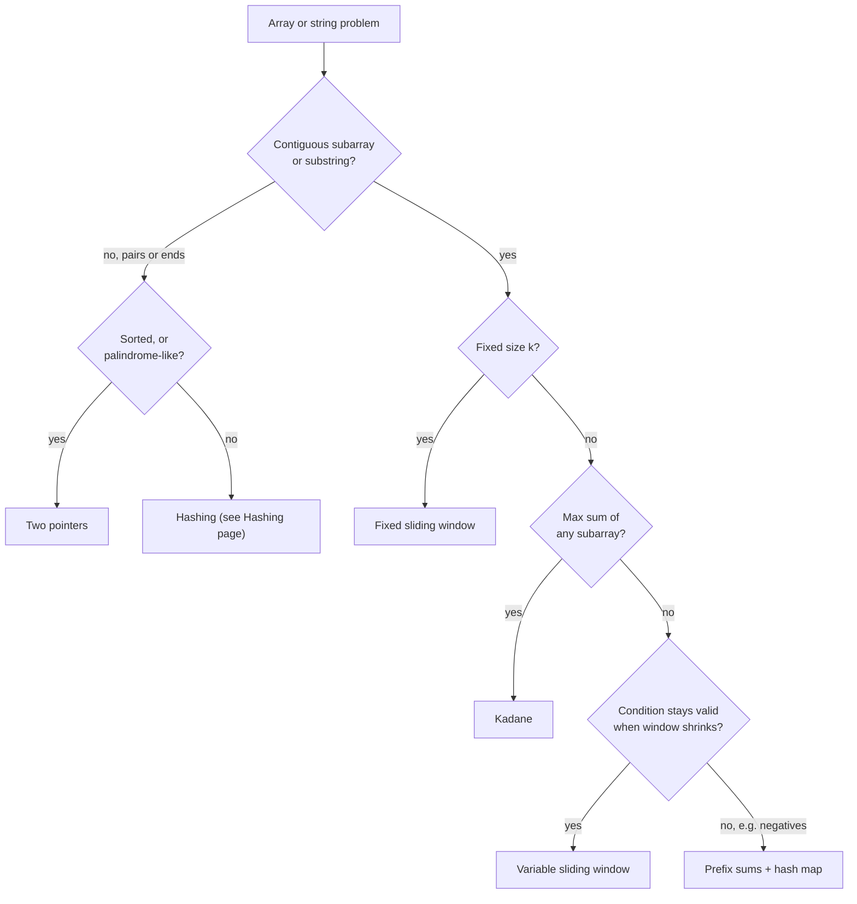

import { Tabs, TabItem, Aside } from '@astrojs/starlight/components';
import QuizBlock from '~/components/QuizBlock.astro';

## Why it matters in interviews

Arrays and strings are the most common first question in a coding round, at both product and service companies. Most of them are an O(n²) brute force that a known pattern turns into **one O(n) pass**: *"longest substring without repeating characters"*, *"container with most water"*, *"maximum subarray"*. The interviewer wants to see you name the pattern, explain why it is correct, and handle empty input and off-by-one boundaries.

## Core idea

Four patterns cover most array and string questions. Each replaces a nested loop with pointers or running totals that only move forward.

| Pattern | Recognise it when you see | Brute force → pattern |
|---|---|---|
| **Two pointers (converging)** | sorted array, pair/triplet, palindrome, "from both ends" | O(n²) → O(n) |
| **Fixed sliding window** | "subarray / substring of size k" | O(n·k) → O(n) |
| **Variable sliding window** | "longest / shortest **contiguous** part that satisfies X" | O(n²) → O(n) |
| **Prefix sums** | many range-sum queries, "sum of subarray i..j" | O(n) per query → O(1) |
| **Kadane** | maximum (or minimum) sum of a contiguous subarray | O(n²) → O(n) |



### Two pointers

Put `left` at 0 and `right` at the end. At each step, a comparison tells you which pointer **cannot be part of a better answer**, so you move it inward. Each pointer moves at most n times, so the loop is O(n).

### Sliding window

A window is the range `[left, right]`. The **variable window template** is: expand `right` one step, then shrink `left` while the window is valid (or invalid, depending on the question), updating the answer as you go.

```csharp
// Template: Minimum Size Subarray Sum (positive numbers only)
public int MinSubArrayLen(int target, int[] nums)
{
    int left = 0, sum = 0, best = int.MaxValue;
    for (int right = 0; right < nums.Length; right++)
    {
        sum += nums[right];                  // 1. expand
        while (sum >= target)                // 2. shrink while valid
        {
            best = Math.Min(best, right - left + 1);
            sum -= nums[left++];
        }
    }
    return best == int.MaxValue ? 0 : best;
}
```

The inner `while` looks like a nested loop, but `left` only moves forward and never passes `right`, so across the whole run it moves at most n times: **O(n) total**. This needs the condition to be monotonic: with only positive numbers, shrinking a window always lowers its sum. With negatives that breaks, and you switch to prefix sums ([Subarray Sum Equals K](../hashing/)).

### Prefix sums

Store `prefix[i] = nums[0] + ... + nums[i-1]`. Then the sum of `nums[l..r]` is `prefix[r + 1] - prefix[l]` in O(1). The extra leading 0 removes the special case for `l = 0`.

```csharp
// Range Sum Query - Immutable
public class NumArray
{
    private readonly int[] _prefix;  // _prefix[i] = sum of nums[0..i-1]

    public NumArray(int[] nums)
    {
        _prefix = new int[nums.Length + 1];
        for (int i = 0; i < nums.Length; i++) _prefix[i + 1] = _prefix[i] + nums[i];
    }

    public int SumRange(int left, int right) => _prefix[right + 1] - _prefix[left];
}
```

## Worked problems

### 1. Valid Palindrome (two pointers)

**Problem:** [Valid Palindrome](https://leetcode.com/problems/valid-palindrome/). Return true if the string reads the same both ways, considering only letters and digits and ignoring case. `"A man, a plan, a canal: Panama"` is true.

**Approach:** converge from both ends, skip characters that are not alphanumeric, compare the rest case-insensitively. No need to build a cleaned copy.

```csharp
public bool IsPalindrome(string s)
{
    int left = 0, right = s.Length - 1;
    while (left < right)
    {
        if (!char.IsLetterOrDigit(s[left])) { left++; continue; }
        if (!char.IsLetterOrDigit(s[right])) { right--; continue; }
        if (char.ToLowerInvariant(s[left]) != char.ToLowerInvariant(s[right]))
            return false;
        left++;
        right--;
    }
    return true;
}
```

**Complexity:** O(n) time, O(1) space.

**Edge cases:** empty string or only punctuation (true), single character, mixed case, digits (`"0P"` is false).

### 2. Container With Most Water (two pointers)

**Problem:** [Container With Most Water](https://leetcode.com/problems/container-with-most-water/). Given wall heights, pick two walls that hold the most water: `min(h[l], h[r]) * (r - l)`.

**Approach:** start with the widest container. The area is limited by the **shorter** wall. Moving the taller wall inward can never help (width shrinks, height is still capped by the shorter wall), so always move the shorter one.

<Tabs syncKey="lang">
  <TabItem label="C#">
```csharp
public int MaxArea(int[] height)
{
    int left = 0, right = height.Length - 1, best = 0;
    while (left < right)
    {
        int area = Math.Min(height[left], height[right]) * (right - left);
        best = Math.Max(best, area);
        if (height[left] < height[right]) left++;  // shorter wall limits the area
        else right--;
    }
    return best;
}
```
  </TabItem>
  <TabItem label="TypeScript">
```ts
function maxArea(height: number[]): number {
  let left = 0;
  let right = height.length - 1;
  let best = 0;
  while (left < right) {
    const area = Math.min(height[left], height[right]) * (right - left);
    best = Math.max(best, area);
    if (height[left] < height[right]) left++;
    else right--;
  }
  return best;
}
```
  </TabItem>
</Tabs>

**Complexity:** O(n) time, O(1) space.

**Edge cases:** two walls (one comparison), equal heights (moving either is fine), all zeros (0).

### 3. Maximum Average Subarray I (fixed window)

**Problem:** [Maximum Average Subarray I](https://leetcode.com/problems/maximum-average-subarray-i/). Find the maximum average of any contiguous subarray of length k.

**Approach:** sum the first k elements, then slide: add the element entering on the right and subtract the one leaving on the left. Each slide is O(1) instead of re-summing k elements.

```csharp
public double FindMaxAverage(int[] nums, int k)
{
    int windowSum = 0;
    for (int i = 0; i < k; i++) windowSum += nums[i];

    int best = windowSum;
    for (int i = k; i < nums.Length; i++)
    {
        windowSum += nums[i] - nums[i - k];  // add entering, drop leaving
        best = Math.Max(best, windowSum);
    }
    return (double)best / k;
}
```

**Complexity:** O(n) time, O(1) space.

**Edge cases:** k equals the array length (one window), all negative numbers (initialise `best` from the first window, not 0), integer division (cast before dividing).

### 4. Longest Substring Without Repeating Characters (variable window)

**Problem:** [Longest Substring Without Repeating Characters](https://leetcode.com/problems/longest-substring-without-repeating-characters/). `"abcabcbb"` gives 3 (`"abc"`).

**Approach:** keep a window with no duplicates. Remember the last index of each character. When `s[right]` was already seen **inside** the window, jump `left` just past its previous position.

| right | char | last seen | left | window | best |
|---|---|---|---|---|---|
| 0 | a | - | 0 | a | 1 |
| 1 | b | - | 0 | ab | 2 |
| 2 | c | - | 0 | abc | 3 |
| 3 | a | 0 | 1 | bca | 3 |
| 4 | b | 1 | 2 | cab | 3 |
| 5 | c | 2 | 3 | abc | 3 |
| 6 | b | 4 | 5 | cb | 3 |
| 7 | b | 6 | 7 | b | 3 |

<Tabs syncKey="lang">
  <TabItem label="C#">
```csharp
public int LengthOfLongestSubstring(string s)
{
    var lastSeen = new Dictionary<char, int>();
    int left = 0, best = 0;
    for (int right = 0; right < s.Length; right++)
    {
        char c = s[right];
        if (lastSeen.TryGetValue(c, out int prev) && prev >= left)
            left = prev + 1;                 // jump past the earlier copy
        lastSeen[c] = right;
        best = Math.Max(best, right - left + 1);
    }
    return best;
}
```
  </TabItem>
  <TabItem label="TypeScript">
```ts
function lengthOfLongestSubstring(s: string): number {
  const lastSeen = new Map<string, number>();
  let left = 0;
  let best = 0;
  for (let right = 0; right < s.length; right++) {
    const prev = lastSeen.get(s[right]);
    if (prev !== undefined && prev >= left) left = prev + 1;
    lastSeen.set(s[right], right);
    best = Math.max(best, right - left + 1);
  }
  return best;
}
```
  </TabItem>
</Tabs>

**Complexity:** O(n) time, O(min(n, alphabet)) space.

**Edge cases:** empty string (0), all the same character (1), the `prev >= left` check (in `"abba"`, the second `a` was seen at index 0, which is already outside the window, so `left` must not move back).

### 5. Product of Array Except Self (prefix and suffix)

**Problem:** [Product of Array Except Self](https://leetcode.com/problems/product-of-array-except-self/). Return `answer[i]` = product of all elements except `nums[i]`, in O(n) and **without division**.

**Approach:** the answer is (product of everything left of i) × (product of everything right of i). Fill prefix products into the output array, then sweep from the right with a running suffix product.

```csharp
public int[] ProductExceptSelf(int[] nums)
{
    int n = nums.Length;
    var result = new int[n];
    result[0] = 1;
    for (int i = 1; i < n; i++)
        result[i] = result[i - 1] * nums[i - 1];  // product of nums[0..i-1]

    int suffix = 1;
    for (int i = n - 1; i >= 0; i--)
    {
        result[i] *= suffix;                      // times product of nums[i+1..]
        suffix *= nums[i];
    }
    return result;
}
```

**Complexity:** O(n) time, O(1) extra space (the output array is not counted).

**Edge cases:** one zero (only that index is non-zero), two zeros (all zeros), negative numbers. The division approach breaks on zeros, which is why the problem forbids it.

### 6. Maximum Subarray (Kadane)

**Problem:** [Maximum Subarray](https://leetcode.com/problems/maximum-subarray/). Find the contiguous subarray with the largest sum. `[-2,1,-3,4,-1,2,1,-5,4]` gives 6 (`[4,-1,2,1]`).

**Approach:** at each index, the best subarray **ending here** either extends the previous one or starts fresh: `current = max(nums[i], current + nums[i])`. A negative running sum only drags the future down, so you drop it.

<Tabs syncKey="lang">
  <TabItem label="C#">
```csharp
public int MaxSubArray(int[] nums)
{
    int current = nums[0], best = nums[0];
    for (int i = 1; i < nums.Length; i++)
    {
        current = Math.Max(nums[i], current + nums[i]);  // extend or restart
        best = Math.Max(best, current);
    }
    return best;
}
```
  </TabItem>
  <TabItem label="TypeScript">
```ts
function maxSubArray(nums: number[]): number {
  let current = nums[0];
  let best = nums[0];
  for (let i = 1; i < nums.length; i++) {
    current = Math.max(nums[i], current + nums[i]);
    best = Math.max(best, current);
  }
  return best;
}
```
  </TabItem>
</Tabs>

**Complexity:** O(n) time, O(1) space. Kadane is the simplest example of [dynamic programming](../dynamic-programming/): the state is "best sum ending at i".

**Edge cases:** all negative numbers (answer is the largest single element, so initialise with `nums[0]`, not 0), single element.

## Interview Q&A

<details>
<summary>Why is the sliding window O(n) when it has a nested while loop?</summary>

Count pointer moves, not loop nesting. `right` moves n times in total and `left` only moves forward and never passes `right`, so it also moves at most n times across the whole run. Total work is at most 2n steps, which is O(n).
</details>

<details>
<summary>When does the variable sliding window not work?</summary>

When shrinking the window does not move the condition in a predictable direction. "Shortest subarray with sum ≥ k" works with positive numbers, but with negatives, removing an element can increase the sum. Use prefix sums with a hash map (or a monotonic deque for the shortest variant) instead.
</details>

<details>
<summary>How do you prove the two-pointer move in Container With Most Water is safe?</summary>

Suppose `height[left] < height[right]`. Any container using `left` with a pointer further in is narrower and still capped at `height[left]`, so it cannot beat the current area. Discarding `left` loses nothing, which is why moving the shorter wall is safe.
</details>

<details>
<summary>Two pointers or hash map for Two Sum?</summary>

If the array is sorted (or you can sort it and only need values, not original indices), two pointers give O(n) time and O(1) space. If it is unsorted and you need indices, a hash map gives O(n) time with O(n) space. Sorting first costs O(n log n) and loses the original indices.
</details>

<details>
<summary>How would you handle Unicode or case sensitivity in string problems?</summary>

Ask first. For ASCII-only input, an `int[128]` count array is faster than a dictionary. For case-insensitive comparison use `char.ToLowerInvariant`, not culture-specific `ToLower`. Characters outside the BMP (emoji) use two UTF-16 `char`s in C# and JS, so "length" may not equal the number of visible characters.
</details>

<details>
<summary>What does Kadane return if every number is negative?</summary>

The largest single element, as long as you initialise `current` and `best` with `nums[0]`. Initialising `best = 0` returns 0, which corresponds to an empty subarray and is wrong when the problem requires at least one element.
</details>

<details>
<summary>Why add a leading zero to the prefix sum array?</summary>

With `prefix[0] = 0`, the sum of `nums[l..r]` is always `prefix[r + 1] - prefix[l]`, including `l = 0`. Without it you need a special case for ranges that start at index 0, which is a common off-by-one source.
</details>

## Pitfalls

<Aside type="caution" title="Common mistakes">

- **Off-by-one window length**: the size of `[left, right]` is `right - left + 1`.
- **Initialising "best" to 0** for maximum problems with negative numbers. Use the first element or `int.MinValue`.
- **Moving `left` backwards** in the longest-substring problem (missing the `prev >= left` check).
- **Applying a sliding window to negative numbers** where the condition is not monotonic.
- **Integer overflow** in sums and products. Use `long` when values can reach about 10⁹.
- **Building strings with `+=`** inside the loop, which silently makes the solution O(n²).

</Aside>

## Related

- [Big-O & Complexity Analysis](../big-o/)
- [Hashing Patterns](../hashing/)
- [Binary Search](../binary-search/)
- [Curated Problem List](../problem-list/)

## Quick quiz

<QuizBlock section="dsa" topic="arrays-strings" />
