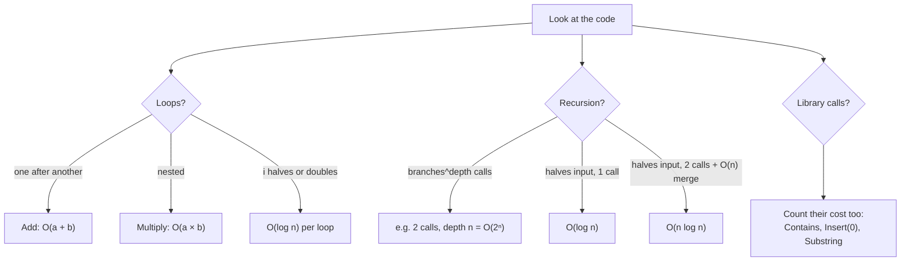
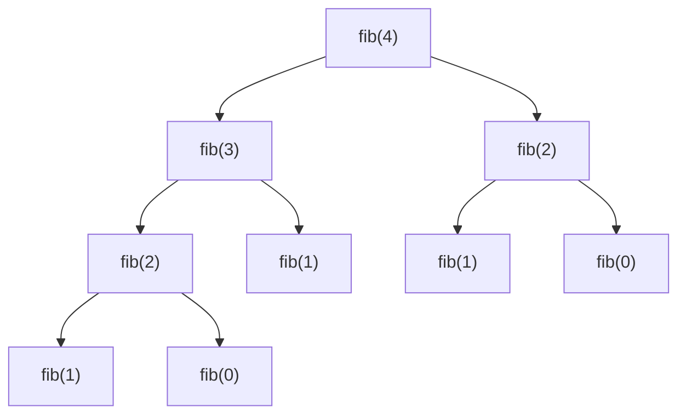

import { Tabs, TabItem, Aside } from '@astrojs/starlight/components';
import QuizBlock from '~/components/QuizBlock.astro';

## Why it matters in interviews

Every coding round ends with *"what is the time and space complexity?"*. A correct solution with a wrong complexity answer reads as a guess. Interviewers also use Big-O to steer you: *"can you do better than O(n²)?"* is a hint that a hash map, two pointers or sorting is expected. At 3-4 years you are also expected to know what common .NET collection operations cost, because hidden O(n) calls inside loops are a classic production bug.

## Core idea

Big-O describes **how the running time (or memory) grows as the input grows**, ignoring constants and lower-order terms. `3n² + 10n + 7` is O(n²) because for large n the `n²` term dominates everything else.

- **O** is an upper bound, and in interviews it means "worst case" unless you say otherwise.
- Drop constants: O(2n) is O(n). Drop smaller terms: O(n² + n) is O(n²).
- Different inputs get different letters: looping over `a` then `b` is O(a + b), nesting them is O(a · b). Do not collapse them into n.

### Common classes

| Big-O | Name | Typical example | ~ops for n = 10⁶ |
|---|---|---|---|
| O(1) | Constant | Array index, `Dictionary` lookup | 1 |
| O(log n) | Logarithmic | Binary search, balanced tree lookup | 20 |
| O(n) | Linear | Single pass, two pointers, sliding window | 10⁶ |
| O(n log n) | Linearithmic | Merge sort, `Array.Sort`, heap of n items | 2·10⁷ |
| O(n²) | Quadratic | Nested loops over the same array | 10¹² (too slow) |
| O(2ⁿ) | Exponential | All subsets, naive recursive Fibonacci | impossible |
| O(n!) | Factorial | All permutations | impossible |

### Reading the constraints

The input size in the problem statement tells you which complexity the interviewer expects. A rough budget is **about 10⁸ simple operations per second**.

| Constraint | Target complexity | Usual pattern |
|---|---|---|
| n ≤ 10 | O(n!) | Permutations, brute force |
| n ≤ 20 | O(2ⁿ) | Subsets, backtracking |
| n ≤ 500 | O(n³) | Triple loop, small DP |
| n ≤ 5,000 | O(n²) | Nested loops, 2D DP |
| n ≤ 10⁶ | O(n log n) or O(n) | Sorting, hashing, two pointers |
| n ≥ 10⁹ | O(log n) or O(1) | Binary search, maths |

### How to analyse code



**Recursion.** Total work = number of calls × work per call. The number of calls is roughly `branches^depth`. The extra **space** is the maximum depth of the call stack, not the total number of calls.

| Recurrence | Example | Complexity |
|---|---|---|
| T(n) = T(n/2) + O(1) | Binary search | O(log n) |
| T(n) = T(n-1) + O(1) | Recursive sum of an array | O(n) |
| T(n) = 2T(n/2) + O(n) | Merge sort | O(n log n) |
| T(n) = 2T(n-1) + O(1) | Naive Fibonacci, subsets | O(2ⁿ) |

**Amortised cost.** `List<T>.Add` is O(1) **amortised**. When the backing array is full, the list allocates one twice as large and copies everything (O(n)), but doubling means those copies add up to less than 2n across n adds, so the average per add is constant. The same applies to `StringBuilder`, `Dictionary` resizing and `Stack<T>.Push`.

**Space complexity** counts extra memory you allocate: new arrays, hash maps, the recursion stack. The input itself is usually not counted. A solution that sorts in place uses O(1) extra space (or O(log n) for the quicksort stack); copying into a `HashSet<int>` is O(n).

### .NET collection costs

| Collection | Fast operations | Slow operations |
|---|---|---|
| `T[]`, `List<T>` | index O(1), `Add` amortised O(1), `RemoveAt(last)` O(1) | `Contains`/`IndexOf` O(n), `Insert(0)`/`RemoveAt(0)` O(n) |
| `Dictionary<K,V>`, `HashSet<T>` | add/lookup/remove O(1) average | worst case O(n) with bad hashes |
| `SortedDictionary<K,V>`, `SortedSet<T>` | add/lookup/remove O(log n), ordered iteration | |
| `SortedList<K,V>` | lookup O(log n) | insert/remove O(n) (array shifting) |
| `Stack<T>`, `Queue<T>` | push/pop, enqueue/dequeue O(1) | `Contains` O(n) |
| `LinkedList<T>` | add/remove with a node reference O(1) | find O(n), no indexer |
| `PriorityQueue<E,P>` | `Peek` O(1), enqueue/dequeue O(log n) | no `Contains`, no decrease-key |
| `string` | `Length`, index O(1) | `+` in a loop O(n²) total, `Substring` O(k) and allocates |

## Worked problems

Each problem below is a snippet you are asked to analyse, which is exactly how complexity questions are phrased in interviews.

### 1. Dependent nested loop

**Problem:** what is the complexity of counting pairs that sum to zero?

```csharp
public int CountZeroPairs(int[] a)
{
    int count = 0;
    for (int i = 0; i < a.Length; i++)
        for (int j = i + 1; j < a.Length; j++)
            if (a[i] + a[j] == 0) count++;
    return count;
}
```

**Approach:** the inner loop runs n-1, n-2, ..., 1, 0 times. The sum is n(n-1)/2, which is still quadratic once you drop the constant ½.

**Complexity:** O(n²) time, O(1) space. Starting `j` at `i + 1` halves the work but does not change the class. A hash map brings it down to O(n), see [Hashing](../hashing/).

**Edge cases:** empty array or single element (inner loop never runs, returns 0).

### 2. Halving and doubling loops

**Problem:** analyse both methods.

```csharp
public int CountHalvings(int n)
{
    int steps = 0;
    while (n > 1) { n /= 2; steps++; }
    return steps;                      // floor(log2 n)
}

public int DoublingInner(int n)
{
    int ops = 0;
    for (int i = 0; i < n; i++)        // n times
        for (int j = 1; j < n; j *= 2) // log n times
            ops++;
    return ops;
}
```

**Approach:** whenever the loop variable is multiplied or divided by a constant each step, the loop runs O(log n) times. `CountHalvings(1024)` returns 10. In `DoublingInner` the outer loop is n and the inner is log n, and they nest, so they multiply.

**Complexity:** `CountHalvings` is O(log n); `DoublingInner` is O(n log n). Both use O(1) space.

**Edge cases:** n ≤ 1 makes both return 0 immediately.

### 3. Recursion: naive vs memoised Fibonacci

**Problem:** [Fibonacci Number](https://leetcode.com/problems/fibonacci-number/). Compare the naive and memoised versions.

<Tabs syncKey="lang">
  <TabItem label="C#">
```csharp
public int FibNaive(int n) =>
    n < 2 ? n : FibNaive(n - 1) + FibNaive(n - 2);

public int FibMemo(int n, Dictionary<int, int>? memo = null)
{
    memo ??= new Dictionary<int, int>();
    if (n < 2) return n;
    if (memo.TryGetValue(n, out int cached)) return cached;
    return memo[n] = FibMemo(n - 1, memo) + FibMemo(n - 2, memo);
}
```
  </TabItem>
  <TabItem label="TypeScript">
```ts
function fibNaive(n: number): number {
  return n < 2 ? n : fibNaive(n - 1) + fibNaive(n - 2);
}

function fibMemo(n: number, memo = new Map<number, number>()): number {
  if (n < 2) return n;
  const cached = memo.get(n);
  if (cached !== undefined) return cached;
  const result = fibMemo(n - 1, memo) + fibMemo(n - 2, memo);
  memo.set(n, result);
  return result;
}
```
  </TabItem>
</Tabs>

**Approach:** draw the call tree. The naive version recomputes the same sub-problems again and again:



Two branches per call and depth n gives roughly 2ⁿ calls. With the memo, each `n` is computed once, so there are only O(n) distinct calls.

**Complexity:** naive O(2ⁿ) time (more precisely about 1.6ⁿ), O(n) stack space. Memoised O(n) time and O(n) space (memo plus stack). This is the bridge to [Dynamic Programming](../dynamic-programming/).

**Edge cases:** n = 0 and n = 1 are the base cases. Large n overflows `int` (fib(47) does), so use `long` if the problem allows big n.

### 4. Hidden cost inside a loop

**Problem:** [Intersection of Two Arrays](https://leetcode.com/problems/intersection-of-two-arrays/). A first attempt calls `List.Contains` inside a loop. What is its complexity, and how do you fix it?

<Tabs syncKey="lang">
  <TabItem label="C#">
```csharp
// Slow: Contains is O(m) and runs n times => O(n * m)
public int[] IntersectionSlow(int[] a, int[] b)
{
    var bList = b.ToList();
    var result = new List<int>();
    foreach (int x in a)
        if (bList.Contains(x) && !result.Contains(x)) result.Add(x);
    return result.ToArray();
}

// Fast: HashSet lookups are O(1) average => O(n + m)
public int[] Intersection(int[] a, int[] b)
{
    var setB = new HashSet<int>(b);
    var result = new HashSet<int>();
    foreach (int x in a)
        if (setB.Contains(x)) result.Add(x);
    return result.ToArray();
}
```
  </TabItem>
  <TabItem label="TypeScript">
```ts
function intersection(a: number[], b: number[]): number[] {
  const setB = new Set(b);
  const result = new Set<number>();
  for (const x of a) {
    if (setB.has(x)) result.add(x);
  }
  return [...result];
}
```
  </TabItem>
</Tabs>

**Approach:** a single line can hide a loop. `List.Contains`, `Array.IndexOf`, LINQ `Any`/`Count` and JavaScript `includes` all scan the whole collection.

**Complexity:** slow version O(n · m) time. Fast version O(n + m) time and O(n + m) space. Use two letters because the arrays have different sizes.

**Edge cases:** empty arrays, duplicates in either input (the result set removes them).

### 5. Amortised O(1): `List<T>.Add`

**Problem:** if `Add` sometimes copies the whole array, why is it called O(1)?

```csharp
// Returns each distinct Capacity seen while adding n items.
public List<int> CapacityGrowth(int n)
{
    var list = new List<int>();
    var capacities = new List<int>();
    for (int i = 0; i < n; i++)
    {
        list.Add(i);
        if (capacities.Count == 0 || capacities[^1] != list.Capacity)
            capacities.Add(list.Capacity);
    }
    return capacities;                 // n = 17 gives [4, 8, 16, 32]
}
```

**Approach:** copies happen at sizes 4, 8, 16, ..., n. Their total is 4 + 8 + ... + n < 2n, so n adds cost O(n) overall, which is O(1) per add **on average**. One unlucky `Add` is O(n); that is the difference between amortised and worst case.

**Complexity:** O(n) total for n adds. If you know the size up front, `new List<int>(n)` avoids every resize.

### 6. String building

**Problem:** what is wrong with building a string with `+=` in a loop?

```csharp
public string JoinSlow(string[] words)
{
    string s = "";
    foreach (var w in words) s += w;   // copies the whole string each time
    return s;
}

public string JoinFast(string[] words)
{
    var sb = new StringBuilder();
    foreach (var w in words) sb.Append(w);
    return sb.ToString();
}
```

**Approach:** strings are immutable in .NET (and JavaScript), so each `+=` allocates a new string and copies everything so far. Total copying is 1 + 2 + ... + n characters, which is O(n²). `StringBuilder` appends into a growing buffer with amortised O(1) per character.

**Complexity:** `JoinSlow` O(n²) in total characters, `JoinFast` O(n). In TypeScript the idiom is pushing to an array and calling `join('')`.

## Interview Q&A

<details>
<summary>What is the difference between Big-O, Big-Theta and Big-Omega?</summary>

Big-O is an upper bound, Big-Omega (Ω) a lower bound, and Big-Theta (Θ) a tight bound (both). Linear search is O(n) and Ω(1) (the item can be first). In interviews "Big-O" is used loosely to mean the tight worst-case bound, and that is fine to answer.
</details>

<details>
<summary>Why do we drop constants? Isn't 2n slower than n?</summary>

It is, but Big-O describes growth rate, not exact time. Constants depend on hardware, language and compiler. When comparing O(n) vs O(n²), the class difference dominates for large inputs. Mention constants only when comparing two solutions of the same class, e.g. one pass vs three passes.
</details>

<details>
<summary>What is the space complexity of a recursive function?</summary>

At least the maximum recursion depth, because each active call keeps a stack frame. Recursive binary search is O(log n) space; recursive DFS on a skewed tree is O(n) space. The iterative version of binary search is O(1). Deep recursion in C# can throw `StackOverflowException`, which cannot be caught.
</details>

<details>
<summary>What does "amortised O(1)" mean?</summary>

The average cost per operation over a long sequence is constant, even if a single operation is occasionally expensive. `List<T>.Add`, `Dictionary` inserts and `StringBuilder.Append` all resize by doubling, so the rare O(n) copy is spread across many cheap operations.
</details>

<details>
<summary>Is `Dictionary` lookup really O(1)?</summary>

On average, yes, assuming a good hash function spreads keys across buckets. In the worst case (many keys with the same hash) a lookup degrades to O(n). For custom key types, override `GetHashCode` and `Equals` consistently, or use a record, which does it for you.
</details>

<details>
<summary>Your solution sorts the array first. What is the overall complexity?</summary>

Sorting costs O(n log n), so the total is O(n log n) plus whatever follows. If the rest is an O(n) two-pointer scan, the total is O(n log n). Mention the space too: `Array.Sort` is in place but uses O(log n) stack for its introsort.
</details>

<details>
<summary>How do you analyse a loop where the inner loop's length varies?</summary>

Sum the iterations. If the inner loop runs i times for i = 1..n, the total is n(n+1)/2, which is O(n²). If the inner pointer never moves backwards across the whole outer loop (sliding window), the total is O(n) even though the code looks nested.
</details>

## Pitfalls

<Aside type="caution" title="Common mistakes">

- **Collapsing two inputs into n**: two nested loops over arrays of size n and m are O(n · m), not O(n²).
- **Ignoring library costs**: `List.Contains`, `IndexOf`, `Insert(0)`, `Substring` and LINQ `Count()` inside a loop add a hidden factor of n.
- **Forgetting recursion stack space** when saying "O(1) space".
- **Calling a sliding window O(n²)** because it has a nested `while`. Count how far each pointer moves in total.
- **Saying `HashSet` is always O(1)**: it is average case; worst case is O(n).
- **String concatenation in loops** in C# or JavaScript, which is O(n²) in total length.

</Aside>

## Related

- [Arrays & Strings Patterns](../arrays-strings/)
- [Hashing Patterns](../hashing/)
- [Sorting](../sorting/)
- [Collections & Generics](../../csharp/collections-generics/)

## Quick quiz

<QuizBlock section="dsa" topic="big-o" />
