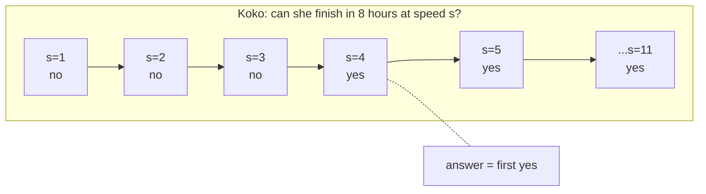

import { Tabs, TabItem, Aside } from '@astrojs/starlight/components';
import QuizBlock from '~/components/QuizBlock.astro';

## Why it matters in interviews

Binary search looks trivial, yet most people get the boundaries wrong under pressure: infinite loops, missing the last element, or overflow in `(lo + hi) / 2`. Interviewers like it because one idea covers many questions: *"search in a rotated sorted array"*, *"first and last position"*, and the less obvious **search on the answer** problems like *"minimum speed to eat all bananas in h hours"*. When the input is sorted, or n is up to 10⁹, O(log n) is what they expect.

## Core idea

Binary search works whenever you can ask a yes/no question about the middle of the search space and **discard half of it** based on the answer. It needs a **monotonic** property: once the answer to "is `x` big enough?" becomes yes, it stays yes for all larger `x`.

Each step halves the search space, so n elements need about log₂ n steps: 20 steps for a million, 30 for a billion.

### Template 1: find an exact value

Search the closed range `[lo, hi]`; stop when it is empty (`lo > hi`).

Trace for `nums = [-1, 0, 3, 5, 9, 12]`, `target = 2` (not present):

| lo | hi | mid | nums[mid] | action |
|---|---|---|---|---|
| 0 | 5 | 2 | 3 | 3 > 2, so `hi = 1` |
| 0 | 1 | 0 | -1 | -1 < 2, so `lo = 1` |
| 1 | 1 | 1 | 0 | 0 < 2, so `lo = 2` |
| 2 | 1 | | | `lo > hi`: return -1 |

### Template 2: find the first position where a condition becomes true

Many problems are really *"find the boundary"* in a sequence like `false false false true true`. Search the half-open range `[lo, hi)` with `while (lo < hi)`; when `mid` satisfies the condition it **might be the answer**, so keep it with `hi = mid` instead of `hi = mid - 1`. The loop ends with `lo == hi` at the first true position.



| Recognise it when | Search space | Condition |
|---|---|---|
| sorted array, find a value | indices | `nums[mid]` vs target |
| first / last occurrence, insert position | indices | `nums[mid] >= target` |
| rotated sorted array | indices | which half is sorted |
| "minimum capacity / speed / time such that..." | the **answer values** | `feasible(mid)` |
| "maximum X such that..." | the answer values | flip: last true |

## Worked problems

### 1. Binary Search (classic)

**Problem:** [Binary Search](https://leetcode.com/problems/binary-search/). Return the index of `target` in a sorted array of distinct integers, or -1.

<Tabs syncKey="lang">
  <TabItem label="C#">
```csharp
public int Search(int[] nums, int target)
{
    int lo = 0, hi = nums.Length - 1;
    while (lo <= hi)                          // [lo, hi] is not empty
    {
        int mid = lo + (hi - lo) / 2;         // no overflow, unlike (lo + hi) / 2
        if (nums[mid] == target) return mid;
        if (nums[mid] < target) lo = mid + 1; // target is to the right
        else hi = mid - 1;                    // target is to the left
    }
    return -1;
}
```
  </TabItem>
  <TabItem label="TypeScript">
```ts
function search(nums: number[], target: number): number {
  let lo = 0;
  let hi = nums.length - 1;
  while (lo <= hi) {
    const mid = lo + Math.floor((hi - lo) / 2);
    if (nums[mid] === target) return mid;
    if (nums[mid] < target) lo = mid + 1;
    else hi = mid - 1;
  }
  return -1;
}
```
  </TabItem>
</Tabs>

**Complexity:** O(log n) time, O(1) space.

**Edge cases:** empty array (`hi = -1`, loop never runs), one element, target smaller than all or larger than all. In C#, `Array.BinarySearch` returns the bitwise complement of the insertion point (a negative number) when not found.

### 2. Find First and Last Position (lower bound)

**Problem:** [Find First and Last Position of Element in Sorted Array](https://leetcode.com/problems/find-first-and-last-position-of-element-in-sorted-array/). `[5,7,7,8,8,10]`, target 8 gives `[3,4]`.

**Approach:** stopping at any match is not enough with duplicates. Use **lower bound** (first index with `nums[i] >= target`, template 2). The first position is `LowerBound(target)`; the last is `LowerBound(target + 1) - 1`.

```csharp
public int[] SearchRange(int[] nums, int target)
{
    int first = LowerBound(nums, target);
    if (first == nums.Length || nums[first] != target) return [-1, -1];
    int last = LowerBound(nums, target + 1) - 1;
    return [first, last];
}

// First index i with nums[i] >= target, or nums.Length if there is none.
private int LowerBound(int[] nums, int target)
{
    int lo = 0, hi = nums.Length;             // hi is exclusive
    while (lo < hi)
    {
        int mid = lo + (hi - lo) / 2;
        if (nums[mid] < target) lo = mid + 1;
        else hi = mid;                        // mid may be the answer: keep it
    }
    return lo;
}
```

**Complexity:** two binary searches, O(log n) time, O(1) space. Scanning outwards from a match is O(n) when the whole array is the target.

**Edge cases:** target absent (lower bound lands on a different value or past the end), empty array, all elements equal to target, `target = int.MaxValue` (`target + 1` overflows; write an `UpperBound` with `nums[mid] <= target` instead).

### 3. Search in Rotated Sorted Array

**Problem:** [Search in Rotated Sorted Array](https://leetcode.com/problems/search-in-rotated-sorted-array/). A sorted array of distinct values was rotated, e.g. `[4,5,6,7,0,1,2]`. Find `target` in O(log n).

**Approach:** split at `mid`; **at least one half is always sorted**. If `nums[lo] <= nums[mid]` the left half is sorted, and you can check whether the target lies inside its range. If it does, search there; otherwise search the other half.

<Tabs syncKey="lang">
  <TabItem label="C#">
```csharp
public int SearchRotated(int[] nums, int target)
{
    int lo = 0, hi = nums.Length - 1;
    while (lo <= hi)
    {
        int mid = lo + (hi - lo) / 2;
        if (nums[mid] == target) return mid;
        if (nums[lo] <= nums[mid])                   // left half is sorted
        {
            if (nums[lo] <= target && target < nums[mid]) hi = mid - 1;
            else lo = mid + 1;
        }
        else                                         // right half is sorted
        {
            if (nums[mid] < target && target <= nums[hi]) lo = mid + 1;
            else hi = mid - 1;
        }
    }
    return -1;
}
```
  </TabItem>
  <TabItem label="TypeScript">
```ts
function searchRotated(nums: number[], target: number): number {
  let lo = 0;
  let hi = nums.length - 1;
  while (lo <= hi) {
    const mid = lo + Math.floor((hi - lo) / 2);
    if (nums[mid] === target) return mid;
    if (nums[lo] <= nums[mid]) {
      if (nums[lo] <= target && target < nums[mid]) hi = mid - 1;
      else lo = mid + 1;
    } else {
      if (nums[mid] < target && target <= nums[hi]) lo = mid + 1;
      else hi = mid - 1;
    }
  }
  return -1;
}
```
  </TabItem>
</Tabs>

**Complexity:** O(log n) time, O(1) space.

**Edge cases:** not rotated at all, rotated by one, two elements (`<=` in `nums[lo] <= nums[mid]` matters when `lo == mid`). With duplicates ([version II](https://leetcode.com/problems/search-in-rotated-sorted-array-ii/)), `nums[lo] == nums[mid]` gives no information; shrink with `lo++`, and the worst case becomes O(n).

### 4. Find Minimum in Rotated Sorted Array

**Problem:** [Find Minimum in Rotated Sorted Array](https://leetcode.com/problems/find-minimum-in-rotated-sorted-array/). `[3,4,5,1,2]` gives 1.

**Approach:** compare `mid` with `hi`. If `nums[mid] > nums[hi]`, the drop (and the minimum) is to the right of `mid`. Otherwise `mid` itself may be the minimum, so keep it: template 2.

```csharp
public int FindMin(int[] nums)
{
    int lo = 0, hi = nums.Length - 1;
    while (lo < hi)
    {
        int mid = lo + (hi - lo) / 2;
        if (nums[mid] > nums[hi]) lo = mid + 1;  // minimum is right of mid
        else hi = mid;                           // mid could be the minimum
    }
    return nums[lo];
}
```

**Complexity:** O(log n) time, O(1) space.

**Edge cases:** no rotation (returns `nums[0]`), one element. Compare with `nums[hi]`, not `nums[lo]`: comparing with `lo` cannot tell "not rotated" from "rotated".

### 5. Koko Eating Bananas (search on the answer)

**Problem:** [Koko Eating Bananas](https://leetcode.com/problems/koko-eating-bananas/). Piles of bananas, h hours. Each hour Koko eats up to `k` bananas from one pile. Find the minimum integer `k` to finish in time. `piles = [3,6,7,11]`, `h = 8` gives 4.

**Approach:** you are not searching the array; you are searching **speeds** from 1 to `max(piles)`. Faster is always at least as good, so `canFinish(speed)` is monotonic: false, false, ..., true, true. Find the first true.

<Tabs syncKey="lang">
  <TabItem label="C#">
```csharp
public int MinEatingSpeed(int[] piles, int h)
{
    int lo = 1, hi = piles.Max();                 // the answer is in [1, max]
    while (lo < hi)
    {
        int speed = lo + (hi - lo) / 2;
        if (CanFinish(piles, h, speed)) hi = speed;  // works: try slower
        else lo = speed + 1;                         // too slow: go faster
    }
    return lo;
}

private bool CanFinish(int[] piles, int h, int speed)
{
    long hours = 0;
    foreach (int p in piles) hours += ((long)p + speed - 1) / speed; // ceil(p / speed)
    return hours <= h;
}
```
  </TabItem>
  <TabItem label="TypeScript">
```ts
function minEatingSpeed(piles: number[], h: number): number {
  const canFinish = (speed: number): boolean =>
    piles.reduce((hours, p) => hours + Math.ceil(p / speed), 0) <= h;

  let lo = 1;
  let hi = Math.max(...piles);
  while (lo < hi) {
    const speed = lo + Math.floor((hi - lo) / 2);
    if (canFinish(speed)) hi = speed;
    else lo = speed + 1;
  }
  return lo;
}
```
  </TabItem>
</Tabs>

**Complexity:** O(n log m) time where m = largest pile, O(1) space.

**Edge cases:** `h == piles.Length` (answer is the max pile), one pile, huge piles (sum hours in a `long`). `Math.max(...piles)` in TS can hit the argument limit for very large arrays; use a loop there.

### 6. Capacity To Ship Packages Within D Days

**Problem:** [Capacity To Ship Packages Within D Days](https://leetcode.com/problems/capacity-to-ship-packages-within-d-days/). Packages must ship **in order**. Find the minimum ship capacity to ship everything within `days`.

**Approach:** same shape as Koko. The capacity must be at least the heaviest package (or it never ships) and at most the total weight (all in one day). Greedily count days for a given capacity, and binary search for the smallest capacity that fits.

```csharp
public int ShipWithinDays(int[] weights, int days)
{
    int lo = weights.Max(), hi = weights.Sum();  // [heaviest, everything at once]
    while (lo < hi)
    {
        int capacity = lo + (hi - lo) / 2;
        if (DaysNeeded(weights, capacity) <= days) hi = capacity;
        else lo = capacity + 1;
    }
    return lo;
}

private int DaysNeeded(int[] weights, int capacity)
{
    int needed = 1, load = 0;
    foreach (int w in weights)
    {
        if (load + w > capacity) { needed++; load = 0; }  // start a new day
        load += w;
    }
    return needed;
}
```

**Complexity:** O(n log S) time where S = sum of weights, O(1) space.

**Edge cases:** `days = 1` (answer is the sum), `days >= weights.Length` (answer is the max), setting `lo = 1` instead of the max weight makes `DaysNeeded` wrong for capacities smaller than a package. The same template solves "split array largest sum" and "minimum days to make bouquets".

## Interview Q&A

<details>
<summary>Why `lo + (hi - lo) / 2` instead of `(lo + hi) / 2`?</summary>

`lo + hi` can overflow `int` when both are large (above about 1.07 billion each), producing a negative `mid` and an `IndexOutOfRangeException`. `lo + (hi - lo) / 2` gives the same value without overflow. In JavaScript numbers do not overflow at that size, but you need `Math.floor`.
</details>

<details>
<summary>When do you use `while (lo <= hi)` and when `while (lo < hi)`?</summary>

Use `lo <= hi` with `hi = mid - 1` / `lo = mid + 1` when looking for an exact match that you return inside the loop. Use `lo < hi` with `hi = mid` when looking for a boundary (first true), where `mid` might be the answer and must stay in range. Mixing them (`lo <= hi` with `hi = mid`) causes an infinite loop.
</details>

<details>
<summary>How do you know a problem can use "binary search on the answer"?</summary>

Look for "minimum X such that..." or "maximum X such that...", a bounded range of possible answers, and a check `feasible(x)` that is monotonic (if x works, every larger x also works). If you can write `feasible` in O(n), the solution is O(n log range).
</details>

<details>
<summary>How would you handle duplicates when searching for a target?</summary>

The classic template returns *some* index of the target. For the first occurrence use lower bound; for the last, upper bound minus one. The count of occurrences is `upperBound - lowerBound`. In a rotated array, duplicates can make both halves look sorted, forcing a linear fallback.
</details>

<details>
<summary>Why is binary search O(log n)?</summary>

Each iteration halves the remaining range: n, n/2, n/4, ... until 1. The number of halvings is log₂ n. For 10⁹ elements that is about 30 iterations, which is why binary search is the answer when n is huge.
</details>

<details>
<summary>What does `Array.BinarySearch` / `List<T>.BinarySearch` return when the item is missing?</summary>

A negative number: the bitwise complement (`~index`) of the index where the item would be inserted. `~result` gives the insertion point, which is the lower bound. The array must be sorted with the same comparer, otherwise the result is undefined.
</details>

<details>
<summary>Can you binary search on a linked list?</summary>

Not efficiently. Finding the middle node takes O(n), so the total is O(n), no better than a linear scan. Binary search needs O(1) random access. Sorted structures with O(log n) search on linked nodes are balanced trees or skip lists.
</details>

## Pitfalls

<Aside type="caution" title="Common mistakes">

- **Infinite loop**: `while (lo < hi)` with `lo = mid` (when `hi = lo + 1`, `mid == lo` forever). Use `lo = mid + 1`, or round `mid` up.
- **Overflow** in `(lo + hi) / 2` for large indices or answer ranges.
- **Wrong initial `hi`**: `nums.Length - 1` for the closed template, `nums.Length` for lower bound (the answer can be "after the end").
- **Wrong bounds on the answer space**, e.g. ship capacity starting at 1 instead of the heaviest package.
- **Applying binary search to unsorted data**, or to a predicate that is not monotonic.
- **Integer division** when computing hours or days: use ceiling division and `long` sums.

</Aside>

## Related

- [Arrays & Strings Patterns](../arrays-strings/)
- [Sorting](../sorting/)
- [Trees & BST](../trees-bst/)
- [Big-O & Complexity Analysis](../big-o/)

## Quick quiz

<QuizBlock section="dsa" topic="binary-search" />
