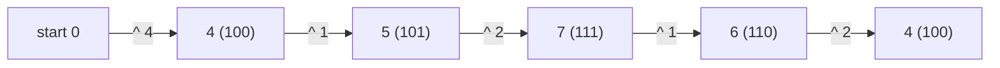

import { Tabs, TabItem, Aside } from '@astrojs/starlight/components';
import QuizBlock from '~/components/QuizBlock.astro';

## Why it matters in interviews

Bit problems are rare as the main question at 3-4 years, but they appear as **warm-ups** (single number, power of two) and as **follow-ups** ("can you do it in O(1) space?"). For a .NET developer the practical side matters more: `[Flags]` enums for permissions and options, `HasFlag`, and knowing that `int` is 32-bit two's complement. A few tricks cover nearly everything.

## Core idea

Integers are stored in binary. In **two's complement** (used by C# `int`/`long` and by JavaScript's bitwise operators), the top bit is the sign and `-x == ~x + 1`.

| Operator | C# | TypeScript | Example (5 = `101`, 3 = `011`) |
|---|---|---|---|
| AND | `a & b` | `a & b` | `5 & 3 = 1` (`001`) |
| OR | `a \| b` | `a \| b` | `5 \| 3 = 7` (`111`) |
| XOR | `a ^ b` | `a ^ b` | `5 ^ 3 = 6` (`110`) |
| NOT | `~a` | `~a` | `~5 = -6` |
| Left shift | `a << n` | `a << n` | multiply by 2^n |
| Arithmetic right shift | `a >> n` | `a >> n` | `-8 >> 1 = -4` (keeps sign) |
| Logical right shift | `a >>> n` (C# 11+) or shift a `uint` | `a >>> n` | `-8 >>> 1 = 2147483644` |

### The tricks worth memorising

| Goal | Expression | Why |
|---|---|---|
| Is bit i set? | `(x & (1 << i)) != 0` | mask isolates bit i |
| Set / clear / toggle bit i | `x \| (1 << i)`, `x & ~(1 << i)`, `x ^ (1 << i)` | |
| Clear the lowest set bit | `x & (x - 1)` | `x - 1` flips the lowest 1 and the 0s below it |
| Isolate the lowest set bit | `x & -x` | two's complement |
| Power of two? | `x > 0 && (x & (x - 1)) == 0` | a power of two has exactly one 1 bit |
| Even or odd | `(x & 1) == 0` | last bit |
| Cancel pairs | `a ^ a == 0`, `a ^ 0 == a` | XOR is commutative and associative |

### How to recognise the pattern

- *"Every element appears twice except one"*, *"find the missing number"*: **XOR** cancels pairs.
- *"O(1) extra space"* where a `HashSet` would be the obvious answer: think XOR or sum tricks.
- *"Count 1 bits"*, *"power of two / four"*: `n & (n - 1)`.
- *"All subsets"* of a small set (n ≤ 20): a **bitmask** from 0 to 2^n - 1, bit i = "item i included".
- Several boolean options stored together: a **flags enum**.

XOR trace for Single Number on `[4, 1, 2, 1, 2]`:



The pairs of 1 and 2 cancel out, whatever their order, and 4 is left.

## Worked problems

### 1. Single Number

[LeetCode 136](https://leetcode.com/problems/single-number/): every element appears twice except one. O(n) time, O(1) space.

**Approach.** XOR everything. Pairs become 0, and `0 ^ x = x`. A `HashSet` also works but uses O(n) space, which is exactly what the follow-up forbids.

<Tabs syncKey="lang">
  <TabItem label="C#">
```csharp
public static int SingleNumber(int[] nums)
{
    int result = 0;
    foreach (var n in nums) result ^= n;   // pairs cancel: a ^ a = 0, a ^ 0 = a
    return result;
}
```
  </TabItem>
  <TabItem label="TypeScript">
```ts
function singleNumber(nums: number[]): number {
  return nums.reduce((acc, n) => acc ^ n, 0);
}
```
  </TabItem>
</Tabs>

**Complexity:** O(n) time, O(1) space.
**Edge cases:** a single element; negative numbers (XOR works on the two's complement bits, so fine). If elements appear **three** times except one ([LeetCode 137](https://leetcode.com/problems/single-number-ii/)), XOR alone fails; count each bit position mod 3.

### 2. Number of 1 Bits and Counting Bits

[LeetCode 191](https://leetcode.com/problems/number-of-1-bits/): count set bits in one number. [LeetCode 338](https://leetcode.com/problems/counting-bits/): return the count for every number 0..n in O(n).

**Approach.** For one number, `n &= n - 1` removes the lowest set bit, so the loop runs once per **set** bit, not 32 times. For 0..n, reuse earlier answers: `i >> 1` is i without its last bit, so `bits[i] = bits[i >> 1] + (i & 1)`. That is a tiny DP.

<Tabs syncKey="lang">
  <TabItem label="C#">
```csharp
public static int HammingWeight(uint n)
{
    int count = 0;
    while (n != 0)
    {
        n &= n - 1;                        // clears the lowest set bit
        count++;
    }
    return count;
}

public static int[] CountBits(int n)
{
    var bits = new int[n + 1];
    for (int i = 1; i <= n; i++)
        bits[i] = bits[i >> 1] + (i & 1);  // i / 2 has the same bits, minus the last one
    return bits;
}
```
  </TabItem>
  <TabItem label="TypeScript">
```ts
function hammingWeight(n: number): number {
  let count = 0;
  while (n !== 0) {
    count += n & 1;
    n >>>= 1; // unsigned shift: >> would loop forever on negatives
  }
  return count;
}

function countBits(n: number): number[] {
  const bits = new Array<number>(n + 1).fill(0);
  for (let i = 1; i <= n; i++) bits[i] = bits[i >> 1] + (i & 1);
  return bits;
}
```
  </TabItem>
</Tabs>

**Complexity:** `HammingWeight` O(number of set bits) ≤ O(32); `CountBits` O(n). In production .NET code use `BitOperations.PopCount(x)` (or `int.PopCount` on .NET 7+), which compiles to a single CPU instruction.
**Edge cases:** 0; `uint.MaxValue` (32); negative input in TypeScript, where `>>` keeps the sign bit and the loop never ends, hence `>>>`.

### 3. Power of Two

[LeetCode 231](https://leetcode.com/problems/power-of-two/): is n a power of two?

**Approach.** A power of two has exactly one set bit (`1000`). Subtracting 1 turns it into all ones below (`0111`), so the AND is 0. The `n > 0` check is essential: 0 would pass the AND test, and `int.MinValue` (`1000...0`) is a single set bit but negative.

<Tabs syncKey="lang">
  <TabItem label="C#">
```csharp
public static bool IsPowerOfTwo(int n) => n > 0 && (n & (n - 1)) == 0;
```
  </TabItem>
  <TabItem label="TypeScript">
```ts
const isPowerOfTwo = (n: number): boolean => n > 0 && (n & (n - 1)) === 0;
```
  </TabItem>
</Tabs>

**Complexity:** O(1).
**Edge cases:** 0, 1 (2^0, true), negatives, `int.MinValue`. .NET also has `BitOperations.IsPow2`.

### 4. Missing Number

[LeetCode 268](https://leetcode.com/problems/missing-number/): `nums` holds n distinct numbers from 0..n; find the missing one.

**Approach.** XOR every index 0..n with every value. Each present number meets its own index and cancels; the missing one has no partner. (The sum formula `n(n+1)/2 - sum` also works but can overflow for big n; XOR cannot.)

```csharp
public static int MissingNumber(int[] nums)
{
    int xor = nums.Length;                 // include n itself
    for (int i = 0; i < nums.Length; i++)
        xor ^= i ^ nums[i];                // every present number cancels its index
    return xor;
}
```

**Complexity:** O(n) time, O(1) space.
**Edge cases:** missing 0 (`[1]` returns 0), missing n (`[0, 1]` returns 2).

### 5. Subsets with a bitmask

[LeetCode 78](https://leetcode.com/problems/subsets/): return all subsets of distinct numbers.

**Approach.** n items have 2^n subsets, and the numbers 0 to 2^n - 1 written in binary are exactly every on/off combination. For each mask, include `nums[i]` when bit i is set. This is the iterative alternative to backtracking and is handy when n is small (≤ 20).

```csharp
// All subsets via bitmask: bit i of mask says whether nums[i] is in the subset.
public static List<List<int>> Subsets(int[] nums)
{
    var result = new List<List<int>>();
    for (int mask = 0; mask < (1 << nums.Length); mask++)
    {
        var subset = new List<int>();
        for (int i = 0; i < nums.Length; i++)
            if ((mask & (1 << i)) != 0) subset.Add(nums[i]);
        result.Add(subset);
    }
    return result;
}
```

**Complexity:** O(n · 2^n) time and output size.
**Edge cases:** empty input returns `[[]]` (one empty subset). `1 << 31` is negative and in C# `1 << 32` is **1** (the shift count is masked to 5 bits for `int`), so this approach only works for small n.

### 6. Flags enums in real .NET code

Not a LeetCode problem, but the place you actually use bits at work: permissions, feature options, `FileAttributes`, `BindingFlags`, `RegexOptions`. Give each member its own bit and combine with `|`.

```csharp
[Flags]
public enum Permissions
{
    None = 0,
    Read = 1 << 0,     // 1
    Write = 1 << 1,    // 2
    Delete = 1 << 2,   // 4
    Admin = 1 << 3,    // 8
    ReadWrite = Read | Write,
}

public static string Run()
{
    var p = Permissions.Read;
    p |= Permissions.Write;                         // set a bit
    bool canWrite = (p & Permissions.Write) != 0;   // test a bit
    bool canRead = p.HasFlag(Permissions.Read);     // same, more readable
    p &= ~Permissions.Write;                        // clear a bit
    p ^= Permissions.Delete;                        // toggle a bit
    return $"{canWrite} {canRead} {p} {(int)p}";    // True True Read, Delete 5
}
```

**Talking points:** `[Flags]` changes `ToString()` to print combinations (`"Read, Delete"`); without it you would see `5`. `None = 0` must exist and `HasFlag(None)` is always true. Store the underlying `int` in the database (EF Core maps enums to int by default), and add a test so nobody gives two members the same bit. `HasFlag` was slow (boxing) before .NET Core 2.1; it is now a JIT intrinsic.

## Interview Q&A

<details>
<summary>Why does `n & (n - 1)` clear the lowest set bit?</summary>

Subtracting 1 flips the lowest 1 bit to 0 and every 0 below it to 1, leaving the higher bits unchanged. ANDing with the original keeps the higher bits and zeroes everything from the lowest 1 down. For `12 = 1100`: `11 = 1011`, and `1100 & 1011 = 1000`.
</details>

<details>
<summary>What is the difference between `>>` and `>>>`?</summary>

`>>` is an arithmetic shift: it copies the sign bit in, so negative numbers stay negative (`-8 >> 1 = -4`). `>>>` is a logical shift: it fills with zeros (`-8 >>> 1 = 2147483644`). JavaScript has had both forever; C# added `>>>` in C# 11. Before that, C# developers cast to `uint` to get a logical shift.
</details>

<details>
<summary>How do bitwise operators behave on JavaScript numbers?</summary>

JS numbers are 64-bit floats, but bitwise operators convert their operands to **32-bit signed integers** first and return a 32-bit result. So `1 << 31` is `-2147483648`, `2 ** 32 | 0` is `0`, and bit tricks on values above 2^31 silently break. Use `BigInt` (`1n << 40n`) for larger values.
</details>

<details>
<summary>Why must a `[Flags]` enum use powers of two?</summary>

Each member needs its **own bit** so combinations are unambiguous. With `Read = 1, Write = 2, Delete = 3`, the value 3 would mean both "Delete" and "Read | Write". Using `1 << n` makes the intent explicit and avoids typos.
</details>

<details>
<summary>How would you swap two integers without a temporary variable, and should you?</summary>

`a ^= b; b ^= a; a ^= b;` works (and breaks if a and b are the same memory location, zeroing it). In modern C# write `(a, b) = (b, a)`: it is clearer and the JIT produces equally good code. Mention the XOR trick as trivia, then say you wouldn't ship it.
</details>

<details>
<summary>What does `checked` have to do with bit manipulation?</summary>

Shifts never throw, even in a `checked` context: `1 << 31` gives `int.MinValue` and `1 << 32` gives 1 because the shift count is masked (`& 31` for `int`, `& 63` for `long`). Arithmetic like `x + 1` does throw `OverflowException` inside `checked`. Know this when a bit trick produces a surprising negative number.
</details>

## Pitfalls

<Aside type="caution" title="Common mistakes">
- Operator precedence: in C#, `x & 1 == 0` does not compile (`1 == 0` binds first, giving `int & bool`); in JavaScript it runs and is silently wrong (TypeScript reports a type error). Always parenthesise: `(x & 1) == 0`.
- Forgetting `n > 0` in the power-of-two check.
- Using `>>` on negative numbers in a loop that waits for 0 (infinite loop).
- Shifting by 32 or more and expecting 0 (C# masks the count; JS also masks to 5 bits).
- Flags enums without `None = 0`, or with overlapping values.
- Writing clever bit hacks in application code where `HashSet`, `BitOperations` or a readable boolean would do.
</Aside>

## Related

- [Hashing Patterns (the O(n)-space alternative)](../hashing/)
- [Recursion & Backtracking (subsets)](../recursion-backtracking/)
- [Big-O & Complexity Analysis](../big-o/)
- [Value vs Reference Types](../../csharp/value-reference-types/)

## Quick quiz

<QuizBlock section="dsa" topic="bit-manipulation" />
