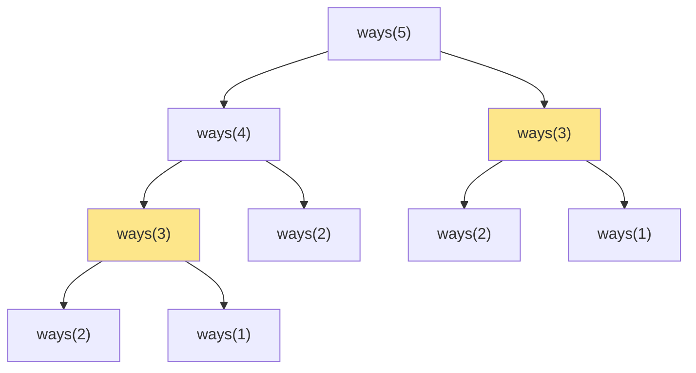

import { Tabs, TabItem, Aside } from '@astrojs/starlight/components';
import QuizBlock from '~/components/QuizBlock.astro';

## Why it matters in interviews

DP is the topic candidates fear most, but at 3-4 years the bar is reasonable: interviewers expect you to recognise a DP problem, define the **state** and **transition** out loud, and code one of the classics (climbing stairs, house robber, coin change, LIS, LCS). Hard 2-D DP is rare outside top product companies. The skill being tested is the method, so learn the five-step recipe below rather than memorising answers.

## Core idea

Dynamic programming = **recursion + caching**, applied when a problem has two properties:

1. **Optimal substructure**: the best answer for the whole is built from best answers to smaller versions (best route to step n uses the best routes to n-1 and n-2).
2. **Overlapping subproblems**: the plain recursion solves the same subproblem many times.

Climbing stairs shows both. `ways(5)` calls `ways(4)` and `ways(3)`, and `ways(4)` calls `ways(3)` again:



The highlighted calls are the same work. Without a cache this tree has O(2^n) nodes; with a cache each `ways(i)` is computed once, O(n).

### How to recognise DP

- The question asks for a **count of ways**, a **min/max**, or **"is it possible"**, not for the actual list of all solutions (that is backtracking).
- Choices at each step: take or skip, which coin, match or don't match characters.
- A greedy idea almost works but has a counter-example (coin change with coins `[1, 3, 4]` and amount 6: greedy takes 4 + 1 + 1 = 3 coins, best is 3 + 3 = 2).
- Input sizes around 10^3 to 10^4 for O(n²) or O(n·amount) solutions.

### The five-step recipe

1. **State**: what does `dp[i]` (or `dp[i, j]`) mean, in words? *"Fewest coins to make amount i."*
2. **Transition**: how is `dp[i]` built from smaller states? *"`dp[i] = min(dp[i - coin] + 1)` over all coins."*
3. **Base cases**: `dp[0] = 0`.
4. **Order**: compute smaller states before larger ones (bottom-up), or let recursion handle it (top-down).
5. **Answer**: which cell holds it? Then check if only the last row or two values are needed, to cut space.

### Top-down vs bottom-up

<Tabs syncKey="lang">
  <TabItem label="C#">
```csharp
// 1. Plain recursion: O(2^n). Same subproblems are solved again and again.
public static int Naive(int n) => n <= 2 ? n : Naive(n - 1) + Naive(n - 2);

// 2. Top-down: recursion + memo. O(n) time, O(n) space.
public static int TopDown(int n, Dictionary<int, int>? memo = null)
{
    memo ??= [];
    if (n <= 2) return n;
    if (memo.TryGetValue(n, out var cached)) return cached;
    return memo[n] = TopDown(n - 1, memo) + TopDown(n - 2, memo);
}

// 3. Bottom-up with two variables: O(n) time, O(1) space.
public static int BottomUp(int n)
{
    if (n <= 2) return n;
    int prev2 = 1, prev1 = 2;            // ways(1), ways(2)
    for (int i = 3; i <= n; i++)
        (prev2, prev1) = (prev1, prev1 + prev2);
    return prev1;
}
```
  </TabItem>
  <TabItem label="TypeScript">
```ts
function climbStairs(n: number): number {
  if (n <= 2) return n;
  let prev2 = 1, prev1 = 2;
  for (let i = 3; i <= n; i++) [prev2, prev1] = [prev1, prev1 + prev2];
  return prev1;
}
```
  </TabItem>
</Tabs>

| | Top-down (memoisation) | Bottom-up (tabulation) |
|---|---|---|
| How | Recursive function + `Dictionary` / array cache | Loops fill a table from base cases up |
| Pros | Easy to derive from the recursion; computes only states you need | No recursion limit; easy to reduce space to O(1) or one row |
| Cons | Call-stack depth O(n) (stack overflow risk); dictionary overhead | Must work out the fill order; may compute unused states |
| Interview tip | Start here if you are stuck: write the recursion, add a cache | Convert to this when asked to optimise |

## Worked problems

### 1. House Robber

[LeetCode 198](https://leetcode.com/problems/house-robber/): you cannot rob two adjacent houses. Maximise the total.

**Approach.** State: best total up to house i. Transition: `best[i] = max(best[i-1], best[i-2] + nums[i])` (skip this house, or rob it and the one two back). Only two previous values are needed, so keep two variables: the best if the last house was **skipped** and the best if it was **taken**.

<Tabs syncKey="lang">
  <TabItem label="C#">
```csharp
public static int Rob(int[] nums)
{
    int skip = 0, take = 0;              // best total so far if we skip / take the current house
    foreach (var money in nums)
    {
        int newTake = skip + money;      // taking it means the previous house was skipped
        skip = Math.Max(skip, take);
        take = newTake;
    }
    return Math.Max(skip, take);
}
```
  </TabItem>
  <TabItem label="TypeScript">
```ts
function rob(nums: number[]): number {
  let skip = 0, take = 0;
  for (const money of nums) {
    const newTake = skip + money;
    skip = Math.max(skip, take);
    take = newTake;
  }
  return Math.max(skip, take);
}
```
  </TabItem>
</Tabs>

**Complexity:** O(n) time, O(1) space.
**Edge cases:** empty array (0), one house, `[2, 1, 1, 2]` where the best skips **two** houses in a row (2 + 2 = 4), which "take every other house" gets wrong.

### 2. Coin Change

[LeetCode 322](https://leetcode.com/problems/coin-change/): fewest coins to make `amount`, or -1. Unlimited coins of each value.

**Approach.** `dp[a]` = fewest coins for amount a. For every amount, try every coin as the **last** coin: `dp[a] = min(dp[a - coin] + 1)`. Fill with `amount + 1` as "infinity" (you can never need more than `amount` coins), which also avoids the `int.MaxValue + 1` overflow.

Trace for coins `[1, 2, 5]`, amount 11:

| a | 0 | 1 | 2 | 3 | 4 | 5 | 6 | 7 | 8 | 9 | 10 | 11 |
|---|---|---|---|---|---|---|---|---|---|---|---|---|
| dp[a] | 0 | 1 | 1 | 2 | 2 | 1 | 2 | 2 | 3 | 3 | 2 | **3** |

<Tabs syncKey="lang">
  <TabItem label="C#">
```csharp
public static int CoinChange(int[] coins, int amount)
{
    var dp = new int[amount + 1];        // dp[a] = fewest coins to make a
    Array.Fill(dp, amount + 1);          // "infinity" (more coins than possible)
    dp[0] = 0;
    for (int a = 1; a <= amount; a++)
        foreach (var coin in coins)
            if (coin <= a)
                dp[a] = Math.Min(dp[a], dp[a - coin] + 1);
    return dp[amount] > amount ? -1 : dp[amount];
}
```
  </TabItem>
  <TabItem label="TypeScript">
```ts
function coinChange(coins: number[], amount: number): number {
  const dp = new Array<number>(amount + 1).fill(amount + 1);
  dp[0] = 0;
  for (let a = 1; a <= amount; a++) {
    for (const coin of coins) {
      if (coin <= a) dp[a] = Math.min(dp[a], dp[a - coin] + 1);
    }
  }
  return dp[amount] > amount ? -1 : dp[amount];
}
```
  </TabItem>
</Tabs>

**Complexity:** O(amount × coins) time, O(amount) space.
**Edge cases:** amount 0 (answer 0), impossible amounts (`[2]`, 3 gives -1), coins larger than the amount. Variant [LeetCode 518](https://leetcode.com/problems/coin-change-ii/) counts **combinations**: loop coins on the outside so each combination is counted once.

### 3. Longest Increasing Subsequence

[LeetCode 300](https://leetcode.com/problems/longest-increasing-subsequence/): `[10,9,2,5,3,7,101,18]` returns 4 (`2,3,7,101`). A subsequence keeps order but may skip elements.

**Approach (O(n²)).** `dp[i]` = length of the LIS that **ends at** index i. For each earlier j with a smaller value, you can extend it: `dp[i] = max(dp[j] + 1)`. The answer is the max over all i, not `dp[n-1]`.

**Approach (O(n log n), follow-up).** Keep `tails`, where `tails[k]` is the smallest possible tail of an increasing subsequence of length k + 1. For each value, binary-search the first tail ≥ it and replace it (or append). `tails` is not itself a valid subsequence, but its length is the answer.

```csharp
// O(n^2): dp[i] = length of the longest increasing subsequence ending at i.
public static int LengthOfLisQuadratic(int[] nums)
{
    if (nums.Length == 0) return 0;
    var dp = new int[nums.Length];
    Array.Fill(dp, 1);
    for (int i = 1; i < nums.Length; i++)
        for (int j = 0; j < i; j++)
            if (nums[j] < nums[i]) dp[i] = Math.Max(dp[i], dp[j] + 1);
    return dp.Max();
}

// O(n log n): tails[k] = smallest tail of any increasing subsequence of length k+1.
public static int LengthOfLis(int[] nums)
{
    var tails = new List<int>();
    foreach (var x in nums)
    {
        int i = tails.BinarySearch(x);
        if (i < 0) i = ~i;               // insertion point
        if (i == tails.Count) tails.Add(x);
        else tails[i] = x;               // a smaller tail for length i+1
    }
    return tails.Count;
}
```

**Complexity:** O(n²) / O(n log n) time, O(n) space.
**Edge cases:** all equal values (`[7,7,7]` gives 1, strictly increasing), already sorted (n), strictly decreasing (1), empty array.

### 4. 0/1 Knapsack

Classic (not a single LeetCode problem; [LeetCode 416 Partition Equal Subset Sum](https://leetcode.com/problems/partition-equal-subset-sum/) is the common disguise). Items have a weight and a value; each item can be used **at most once**. Maximise value within a capacity.

**Approach.** 2-D state `dp[i, c]` = best value using the first i items with capacity c: either skip item i (`dp[i-1, c]`) or take it (`dp[i-1, c - w] + v`). Because row i only reads row i-1, compress to one array, and **iterate capacity backwards** so each item is counted once. Iterating forwards would let the same item be added repeatedly, which is the **unbounded** knapsack.

```csharp
// 0/1 knapsack: each item used at most once.
public static int Knapsack(int[] weights, int[] values, int capacity)
{
    var dp = new int[capacity + 1];      // dp[c] = best value with capacity c
    for (int i = 0; i < weights.Length; i++)
        for (int c = capacity; c >= weights[i]; c--)   // backwards: item i used once
            dp[c] = Math.Max(dp[c], dp[c - weights[i]] + values[i]);
    return dp[capacity];
}
```

**Complexity:** O(n × capacity) time, O(capacity) space. This is **pseudo-polynomial**: it depends on the numeric value of capacity, not its size in bits.
**Edge cases:** items heavier than the capacity (never taken), capacity 0, one item that fits exactly.

### 5. Longest Common Subsequence

[LeetCode 1143](https://leetcode.com/problems/longest-common-subsequence/): `"abcde"`, `"ace"` returns 3.

**Approach.** Two strings means a 2-D table. `dp[i, j]` = LCS of the first i chars of a and the first j chars of b. If the last characters match, extend the diagonal: `dp[i-1, j-1] + 1`. Otherwise drop one character from either string: `max(dp[i-1, j], dp[i, j-1])`. Row 0 and column 0 are 0 (empty prefix).

| | "" | a | c | e |
|---|---|---|---|---|
| **""** | 0 | 0 | 0 | 0 |
| **a** | 0 | 1 | 1 | 1 |
| **b** | 0 | 1 | 1 | 1 |
| **c** | 0 | 1 | 2 | 2 |
| **d** | 0 | 1 | 2 | 2 |
| **e** | 0 | 1 | 2 | **3** |

<Tabs syncKey="lang">
  <TabItem label="C#">
```csharp
public static int LongestCommonSubsequence(string a, string b)
{
    var dp = new int[a.Length + 1, b.Length + 1];
    for (int i = 1; i <= a.Length; i++)
        for (int j = 1; j <= b.Length; j++)
            dp[i, j] = a[i - 1] == b[j - 1]
                ? dp[i - 1, j - 1] + 1                       // extend the match
                : Math.Max(dp[i - 1, j], dp[i, j - 1]);      // drop one char
    return dp[a.Length, b.Length];
}
```
  </TabItem>
  <TabItem label="TypeScript">
```ts
function longestCommonSubsequence(a: string, b: string): number {
  // Rolling 1-D row: prev = row i-1, cur = row i.
  let prev = new Array<number>(b.length + 1).fill(0);
  for (let i = 1; i <= a.length; i++) {
    const cur = new Array<number>(b.length + 1).fill(0);
    for (let j = 1; j <= b.length; j++) {
      cur[j] = a[i - 1] === b[j - 1] ? prev[j - 1] + 1 : Math.max(prev[j], cur[j - 1]);
    }
    prev = cur;
  }
  return prev[b.length];
}
```
  </TabItem>
</Tabs>

**Complexity:** O(m × n) time; O(m × n) space for the table, O(n) with the rolling row.
**Edge cases:** an empty string (0), no common characters (0), identical strings (length). Note the `i - 1` / `j - 1` shift between table indices and string indices.

### 6. Edit Distance

[LeetCode 72](https://leetcode.com/problems/edit-distance/): minimum inserts, deletes and replaces to turn `word1` into `word2`. `"horse"` → `"ros"` is 3.

**Approach.** Same table shape as LCS. `dp[i, j]` = edits to turn the first i chars of word1 into the first j chars of word2. Base cases: turning i chars into an empty string takes i deletes; empty into j chars takes j inserts. If the characters match, no edit: copy the diagonal. Otherwise 1 + the min of replace (diagonal), delete (up) and insert (left).

```csharp
public static int MinDistance(string word1, string word2)
{
    int m = word1.Length, n = word2.Length;
    var dp = new int[m + 1, n + 1];      // dp[i,j] = edits to turn word1[..i] into word2[..j]
    for (int i = 0; i <= m; i++) dp[i, 0] = i;   // delete everything
    for (int j = 0; j <= n; j++) dp[0, j] = j;   // insert everything
    for (int i = 1; i <= m; i++)
        for (int j = 1; j <= n; j++)
            dp[i, j] = word1[i - 1] == word2[j - 1]
                ? dp[i - 1, j - 1]
                : 1 + Math.Min(dp[i - 1, j - 1],                 // replace
                      Math.Min(dp[i - 1, j], dp[i, j - 1]));     // delete, insert
    return dp[m, n];
}
```

**Complexity:** O(m × n) time and space (O(n) with two rows).
**Edge cases:** one empty string (answer is the other's length), identical strings (0). Real-world uses: spell checkers, fuzzy search, diff tools.

## Interview Q&A

<details>
<summary>How do you tell a DP problem from a greedy one?</summary>

Try to break the greedy choice with a small counter-example. If "always take the locally best option" can be beaten (coin change with `[1, 3, 4]` for 6), you need DP to consider all choices. If you can **prove** the greedy choice is always safe (exchange argument, e.g. interval scheduling by earliest end), greedy is simpler and faster.
</details>

<details>
<summary>What is the difference between DP and plain recursion with backtracking?</summary>

Backtracking enumerates every solution and is exponential; it is the right tool when you must **list** all permutations or subsets. DP applies when subproblems **repeat** and you only need an aggregate (count, min, max, true/false), so each subproblem is solved once and cached.
</details>

<details>
<summary>Top-down or bottom-up: which would you write in an interview?</summary>

Start top-down if the recursion is clearer; it is the quickest path to a correct answer. Mention the stack depth risk for large n, then convert to bottom-up if asked to optimise, and reduce space when each state depends only on the previous row or the last few values.
</details>

<details>
<summary>How do you reconstruct the actual solution, not just its value?</summary>

Keep the full table (don't compress it) and walk back from the answer cell: at each step check which transition produced the value (diagonal match, up, or left in LCS) and follow it. Alternatively store a "parent" choice per state while filling.
</details>

<details>
<summary>Why does 0/1 knapsack iterate capacity backwards in the 1-D version?</summary>

With one array, `dp[c - w]` must still hold the value from the **previous** item row. Going backwards guarantees `dp[c - w]` has not been updated for the current item yet. Going forwards would read an already-updated cell and use the same item twice, which is the unbounded knapsack.
</details>

<details>
<summary>What is the time complexity of a memoised recursion?</summary>

Number of distinct states × work per state. Coin change: `amount` states × `coins` choices = O(amount × coins). LCS: m × n states × O(1) = O(m × n). This "states × transitions" rule is the quickest way to state complexity for any DP.
</details>

<details>
<summary>Where does DP show up in real .NET or web work?</summary>

Diff tools and fuzzy matching (edit distance, LCS), text wrapping and layout, pricing/bundle optimisers (knapsack-like), route and cost planning, and caching expensive pure computations with a `Dictionary` (memoisation is the same idea). Being able to name one helps when an interviewer asks why it matters.
</details>

## Pitfalls

<Aside type="caution" title="Common mistakes">
- Starting to code before defining the state in words. Say "dp[i] means ..." first.
- Using `int.MaxValue` as infinity and then adding 1 (overflow to a negative number).
- Returning `dp[n-1]` for LIS instead of the maximum over all `dp[i]`.
- Off-by-one between table indices (size n + 1) and string indices (`a[i - 1]`).
- Forward iteration in 1-D 0/1 knapsack (silently becomes unbounded).
- Memoising with a key that does not capture the full state (e.g. index only, when remaining capacity also matters).
- Deep top-down recursion on n = 10^5 causing a stack overflow.
</Aside>

## Related

- [Recursion & Backtracking](../recursion-backtracking/)
- [Greedy & Intervals](../greedy-intervals/)
- [Binary Search (LIS in n log n)](../binary-search/)
- [Big-O & Complexity Analysis](../big-o/)

## Quick quiz

<QuizBlock section="dsa" topic="dynamic-programming" />
