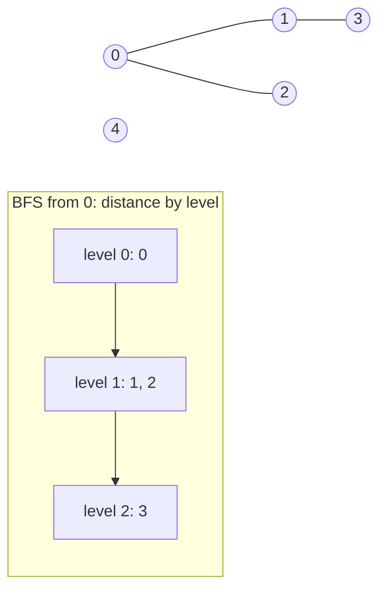
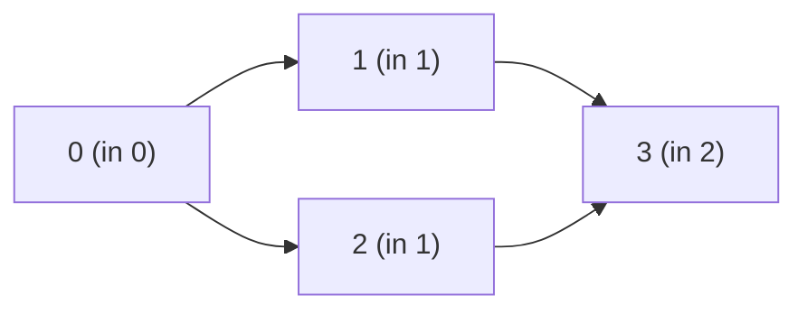

import { Tabs, TabItem, Aside } from '@astrojs/starlight/components';
import QuizBlock from '~/components/QuizBlock.astro';

## Why it matters in interviews

Graph questions are often disguised: a grid of `'1'`/`'0'`, courses with prerequisites, services with dependencies, cities with flight costs. The interviewer is checking whether you can **spot the graph**, pick a representation, and choose between BFS, DFS, topological sort, Dijkstra and union-find. At 3-4 years, number of islands and course schedule are the two most asked; Dijkstra and union-find show up as follow-ups at product companies.

## Core idea

A graph is a set of **nodes** (vertices) and **edges**. Edges can be directed or undirected, weighted or unweighted. Trees are graphs with no cycles and one path between any two nodes; general graphs can have cycles, so you **must track visited nodes**.

### Representations

| | Adjacency list | Adjacency matrix | Edge list |
|---|---|---|---|
| Shape | `List<int>[]` or `Dictionary<int, List<int>>` | `bool[n, n]` | `int[][]` of `[from, to]` |
| Space | O(V + E) | O(V²) | O(E) |
| "Is there an edge u→v?" | O(degree) | O(1) | O(E) |
| Use when | almost always (sparse graphs) | dense graphs, small V | union-find, input format |

A **grid** is an implicit graph: each cell is a node and its up/down/left/right neighbours are edges. You don't build an adjacency list; you compute neighbours on the fly.



Node 4 is in its own **connected component**: BFS from 0 never reaches it (distance -1 below).

### Which algorithm?

| Question in the problem | Tool | Complexity |
|---|---|---|
| Can I reach X? Count regions / components | DFS or BFS (or union-find) | O(V + E) |
| Shortest path, **unweighted** edges (fewest steps) | **BFS** | O(V + E) |
| Spreading from many starting points at once | **multi-source BFS** | O(V + E) |
| Order tasks with dependencies, detect a cycle in a directed graph | **topological sort** (Kahn's BFS) | O(V + E) |
| Shortest path, **non-negative weights** | **Dijkstra** with a min-heap | O((V + E) log V) |
| Edges arrive one by one; are u and v connected? Does this edge make a cycle? | **union-find** | ~O(1) per op |

### BFS and DFS templates

```csharp
public static List<int>[] BuildGraph(int n, int[][] edges, bool directed)
{
    var graph = new List<int>[n];
    for (int i = 0; i < n; i++) graph[i] = [];
    foreach (var e in edges)
    {
        graph[e[0]].Add(e[1]);
        if (!directed) graph[e[1]].Add(e[0]);
    }
    return graph;
}

// BFS from a source: shortest number of edges to every node (-1 = unreachable).
public static int[] BfsDistances(List<int>[] graph, int source)
{
    var dist = new int[graph.Length];
    Array.Fill(dist, -1);
    dist[source] = 0;
    var queue = new Queue<int>([source]);
    while (queue.Count > 0)
    {
        int node = queue.Dequeue();
        foreach (var next in graph[node])
        {
            if (dist[next] != -1) continue;   // mark when ENQUEUED, not when dequeued
            dist[next] = dist[node] + 1;
            queue.Enqueue(next);
        }
    }
    return dist;
}

public static void Dfs(List<int>[] graph, int node, bool[] visited, List<int> order)
{
    visited[node] = true;
    order.Add(node);
    foreach (var next in graph[node])
        if (!visited[next]) Dfs(graph, next, visited, order);
}
```

## Worked problems

### 1. Number of Islands

[LeetCode 200](https://leetcode.com/problems/number-of-islands/): count groups of connected `'1'` cells (4-directional).

**Approach.** Scan every cell. When you find unvisited land, that is a new island: increment the count and **flood fill** (DFS) to sink every connected land cell so it is not counted again. Mutating the grid saves a `visited` array; say so, and offer a `bool[,]` if the input must not change.

<Tabs syncKey="lang">
  <TabItem label="C#">
```csharp
public static int NumIslands(char[][] grid)
{
    int rows = grid.Length, cols = grid[0].Length, count = 0;
    void Sink(int r, int c)
    {
        if (r < 0 || c < 0 || r >= rows || c >= cols || grid[r][c] != '1') return;
        grid[r][c] = '0';                       // mark visited by mutating the grid
        Sink(r + 1, c); Sink(r - 1, c); Sink(r, c + 1); Sink(r, c - 1);
    }
    for (int r = 0; r < rows; r++)
        for (int c = 0; c < cols; c++)
            if (grid[r][c] == '1') { count++; Sink(r, c); }
    return count;
}
```
  </TabItem>
  <TabItem label="TypeScript">
```ts
function numIslands(grid: string[][]): number {
  const rows = grid.length, cols = grid[0].length;
  let count = 0;
  const sink = (r: number, c: number): void => {
    if (r < 0 || c < 0 || r >= rows || c >= cols || grid[r][c] !== '1') return;
    grid[r][c] = '0';
    sink(r + 1, c); sink(r - 1, c); sink(r, c + 1); sink(r, c - 1);
  };
  for (let r = 0; r < rows; r++) {
    for (let c = 0; c < cols; c++) {
      if (grid[r][c] === '1') { count++; sink(r, c); }
    }
  }
  return count;
}
```
  </TabItem>
</Tabs>

**Complexity:** O(rows × cols) time; O(rows × cols) worst-case recursion depth (a grid that is all land). For huge grids, switch the flood fill to BFS with a queue to avoid a stack overflow.
**Edge cases:** all water (0), all land (1), a single cell, diagonal neighbours do **not** connect.

### 2. Course Schedule (topological sort)

[LeetCode 207](https://leetcode.com/problems/course-schedule/) / [LeetCode 210](https://leetcode.com/problems/course-schedule-ii/): `prerequisites[i] = [a, b]` means take b before a. Can you finish all courses, and in what order?

**Approach.** Model it as a directed graph b → a. **Kahn's algorithm**: count incoming edges (in-degree) for every node, start with all nodes that have in-degree 0, and repeatedly remove one, decrementing its neighbours. A neighbour whose in-degree hits 0 is ready. If you process fewer than n nodes, the rest are stuck in a **cycle**.



Order produced: 0, 1, 2, 3.

<Tabs syncKey="lang">
  <TabItem label="C#">
```csharp
// Kahn's algorithm. Returns a valid order, or [] if there is a cycle.
public static int[] FindOrder(int numCourses, int[][] prerequisites)
{
    var graph = new List<int>[numCourses];
    var indegree = new int[numCourses];
    for (int i = 0; i < numCourses; i++) graph[i] = [];
    foreach (var p in prerequisites)            // [course, prereq] means prereq -> course
    {
        graph[p[1]].Add(p[0]);
        indegree[p[0]]++;
    }
    var queue = new Queue<int>();
    for (int i = 0; i < numCourses; i++)
        if (indegree[i] == 0) queue.Enqueue(i);

    var order = new List<int>();
    while (queue.Count > 0)
    {
        int course = queue.Dequeue();
        order.Add(course);
        foreach (var next in graph[course])
            if (--indegree[next] == 0) queue.Enqueue(next);
    }
    return order.Count == numCourses ? [.. order] : [];
}

public static bool CanFinish(int numCourses, int[][] prerequisites) =>
    FindOrder(numCourses, prerequisites).Length == numCourses;
```
  </TabItem>
  <TabItem label="TypeScript">
```ts
function findOrder(numCourses: number, prerequisites: number[][]): number[] {
  const graph: number[][] = Array.from({ length: numCourses }, () => []);
  const indegree = new Array<number>(numCourses).fill(0);
  for (const [course, pre] of prerequisites) {
    graph[pre].push(course);
    indegree[course]++;
  }
  const queue: number[] = [];
  for (let i = 0; i < numCourses; i++) if (indegree[i] === 0) queue.push(i);

  const order: number[] = [];
  for (let head = 0; head < queue.length; head++) {   // index pointer instead of shift()
    const course = queue[head];
    order.push(course);
    for (const next of graph[course]) {
      if (--indegree[next] === 0) queue.push(next);
    }
  }
  return order.length === numCourses ? order : [];
}
```
  </TabItem>
</Tabs>

**Complexity:** O(V + E) time and space.
**Edge cases:** no prerequisites (any order), a self-loop `[0, 0]` (cycle), disconnected groups of courses, duplicate edges (each one increments in-degree once and decrements once, so it still works).

### 3. Rotting Oranges (multi-source BFS)

[LeetCode 994](https://leetcode.com/problems/rotting-oranges/): every minute, rotten oranges (2) rot their fresh neighbours (1). Return the minutes until no fresh orange is left, or -1.

**Approach.** Put **all** rotten oranges in the queue at the start, then BFS level by level. Each level is one minute. Count fresh oranges up front so you can stop early and detect the unreachable case.

<Tabs syncKey="lang">
  <TabItem label="C#">
```csharp
public static int OrangesRotting(int[][] grid)
{
    int rows = grid.Length, cols = grid[0].Length, fresh = 0;
    var queue = new Queue<(int r, int c)>();
    for (int r = 0; r < rows; r++)
        for (int c = 0; c < cols; c++)
        {
            if (grid[r][c] == 2) queue.Enqueue((r, c));   // all sources start together
            else if (grid[r][c] == 1) fresh++;
        }

    int minutes = 0;
    int[][] dirs = [[1, 0], [-1, 0], [0, 1], [0, -1]];
    while (queue.Count > 0 && fresh > 0)
    {
        for (int i = queue.Count; i > 0; i--)             // one BFS level = one minute
        {
            var (r, c) = queue.Dequeue();
            foreach (var d in dirs)
            {
                int nr = r + d[0], nc = c + d[1];
                if (nr < 0 || nc < 0 || nr >= rows || nc >= cols || grid[nr][nc] != 1) continue;
                grid[nr][nc] = 2;
                fresh--;
                queue.Enqueue((nr, nc));
            }
        }
        minutes++;
    }
    return fresh == 0 ? minutes : -1;
}
```
  </TabItem>
  <TabItem label="TypeScript">
```ts
function orangesRotting(grid: number[][]): number {
  const rows = grid.length, cols = grid[0].length;
  let fresh = 0;
  let queue: [number, number][] = [];
  for (let r = 0; r < rows; r++)
    for (let c = 0; c < cols; c++) {
      if (grid[r][c] === 2) queue.push([r, c]);
      else if (grid[r][c] === 1) fresh++;
    }
  const dirs = [[1, 0], [-1, 0], [0, 1], [0, -1]];
  let minutes = 0;
  while (queue.length > 0 && fresh > 0) {
    const next: [number, number][] = [];
    for (const [r, c] of queue) {
      for (const [dr, dc] of dirs) {
        const nr = r + dr, nc = c + dc;
        if (nr < 0 || nc < 0 || nr >= rows || nc >= cols || grid[nr][nc] !== 1) continue;
        grid[nr][nc] = 2;
        fresh--;
        next.push([nr, nc]);
      }
    }
    queue = next;
    minutes++;
  }
  return fresh === 0 ? minutes : -1;
}
```
  </TabItem>
</Tabs>

**Complexity:** O(rows × cols) time and space.
**Edge cases:** no fresh oranges at all (answer 0, not 1, which is why the loop checks `fresh > 0`), a fresh orange walled off by empty cells (-1), no rotten oranges but some fresh (-1).

### 4. Network Delay Time (Dijkstra)

[LeetCode 743](https://leetcode.com/problems/network-delay-time/): `times[i] = [u, v, w]` is a directed edge with travel time w. A signal starts at k. How long until every node has it? Return -1 if some node is unreachable.

**Approach.** Shortest paths with **non-negative weights** means Dijkstra. Keep `dist[]`, and a min-heap of `(node, distance)`. Pop the closest node; if the popped distance is stale (larger than `dist[node]`), skip it; otherwise relax each outgoing edge. The answer is the largest shortest distance.

```csharp
// Dijkstra. times[i] = [from, to, weight], nodes are 1..n.
public static int NetworkDelayTime(int[][] times, int n, int k)
{
    var graph = new List<(int to, int w)>[n + 1];
    for (int i = 1; i <= n; i++) graph[i] = [];
    foreach (var t in times) graph[t[0]].Add((t[1], t[2]));

    var dist = new int[n + 1];
    Array.Fill(dist, int.MaxValue);
    dist[k] = 0;
    var pq = new PriorityQueue<int, int>();
    pq.Enqueue(k, 0);
    while (pq.TryDequeue(out int node, out int d))
    {
        if (d > dist[node]) continue;                     // stale entry, skip
        foreach (var (to, w) in graph[node])
        {
            if (d + w < dist[to])
            {
                dist[to] = d + w;
                pq.Enqueue(to, dist[to]);
            }
        }
    }
    int max = dist.Skip(1).Max();
    return max == int.MaxValue ? -1 : max;
}
```

**Complexity:** O((V + E) log V) time, O(V + E) space.
**Edge cases:** unreachable nodes (-1), 1-indexed nodes (array of size n + 1, skip index 0), a longer path with a smaller total weight (the relax step handles it). **Negative weights break Dijkstra**; use Bellman-Ford (O(V·E)) then.

### 5. Union-Find: components and redundant connection

[LeetCode 323](https://leetcode.com/problems/number-of-connected-components-in-an-undirected-graph/) (count components) and [LeetCode 684](https://leetcode.com/problems/redundant-connection/) (find the edge that creates a cycle).

**Approach.** Union-find (disjoint set union) keeps a `parent` pointer per node; nodes with the same root are in the same set. `Find` follows parents to the root, with **path compression** so future finds are almost O(1). `Union` links two roots, using **union by rank** to keep trees shallow. If both ends of an edge already have the same root, that edge closes a cycle.

```csharp
public class UnionFind
{
    private readonly int[] _parent;
    private readonly int[] _rank;
    public int Components { get; private set; }

    public UnionFind(int n)
    {
        _parent = new int[n];
        _rank = new int[n];
        for (int i = 0; i < n; i++) _parent[i] = i;
        Components = n;
    }

    public int Find(int x)
    {
        if (_parent[x] != x) _parent[x] = Find(_parent[x]);   // path compression
        return _parent[x];
    }

    public bool Union(int a, int b)
    {
        int ra = Find(a), rb = Find(b);
        if (ra == rb) return false;                           // already connected: cycle
        if (_rank[ra] < _rank[rb]) (ra, rb) = (rb, ra);       // union by rank
        _parent[rb] = ra;
        if (_rank[ra] == _rank[rb]) _rank[ra]++;
        Components--;
        return true;
    }
}

// Edges are 1-indexed; return the edge that closes a cycle.
public static int[] FindRedundantConnection(int[][] edges)
{
    var uf = new UnionFind(edges.Length + 1);
    foreach (var e in edges)
        if (!uf.Union(e[0], e[1])) return e;
    return [];
}
```

**Complexity:** O(E · α(V)) where α is the inverse Ackermann function (effectively constant), O(V) space.
**Edge cases:** no edges (n components), edges that repeat, 0- vs 1-indexed nodes.

## Interview Q&A

<details>
<summary>Why must BFS mark a node visited when it is enqueued, not when it is dequeued?</summary>

If you mark on dequeue, the same node can be enqueued many times by different neighbours before it is processed. The result is still correct for plain reachability but the queue can grow to O(E) and work is repeated. Marking on enqueue guarantees each node enters the queue once.
</details>

<details>
<summary>Why does BFS give the shortest path in an unweighted graph but not in a weighted one?</summary>

BFS explores in order of **number of edges**. With unweighted edges, fewer edges means a shorter path. With weights, a path with more edges can be cheaper (1 + 1 is less than 5), so you need Dijkstra, which explores in order of **total weight** using a min-heap.
</details>

<details>
<summary>How do you detect a cycle in a directed vs an undirected graph?</summary>

Directed: Kahn's algorithm (fewer than V nodes processed means a cycle) or DFS with three colours (white/grey/black); reaching a grey node means a back edge. Undirected: DFS that ignores the edge back to its parent, or union-find (an edge whose endpoints already share a root makes a cycle).
</details>

<details>
<summary>What is a topological sort and where does it show up in real systems?</summary>

A linear order of nodes in a directed acyclic graph such that every edge goes from earlier to later. Build systems (project references in a .NET solution), package managers (NuGet/npm dependency resolution), database migration ordering, task schedulers and spreadsheet recalculation all use it. It exists only if the graph has no cycles.
</details>

<details>
<summary>Why does Dijkstra fail with negative edge weights?</summary>

Dijkstra assumes that once a node is popped with the smallest distance, no later path can improve it. A negative edge discovered later can make an already "finished" node cheaper, which breaks that assumption. Bellman-Ford (relax all edges V-1 times) handles negative weights and detects negative cycles.
</details>

<details>
<summary>When would you use union-find instead of DFS for connectivity?</summary>

When edges arrive **incrementally** (online) and you need to answer "are these connected?" after each one, or detect the first edge that creates a cycle (Kruskal's minimum spanning tree, redundant connection). For a single question on a fixed graph, DFS/BFS is simpler and equally fast.
</details>

<details>
<summary>DFS on a large grid crashes with a StackOverflowException. What do you do?</summary>

Recursion depth can reach rows × cols. Switch to an iterative DFS with an explicit `Stack<T>` or to BFS with a `Queue<T>`. In .NET a stack overflow cannot be caught, so this matters in production code, not only in interviews.
</details>

## Pitfalls

<Aside type="caution" title="Common mistakes">
- Forgetting the visited set on a graph with cycles (infinite loop), or reusing it across test cases.
- Getting the edge direction backwards in course schedule (`[a, b]` means b → a).
- Returning 1 instead of 0 in rotting oranges when there is nothing to rot.
- Using BFS for weighted shortest paths, or Dijkstra with negative weights.
- Off-by-one with 1-indexed nodes (array of size n instead of n + 1).
- In TypeScript, `queue.shift()` in a BFS loop is O(n) per call; use a head index or level arrays.
- Building an adjacency matrix for a sparse graph with 10^5 nodes (10^10 cells).
</Aside>

## Related

- [Trees & BST](../trees-bst/)
- [Heaps & Priority Queues](../heaps/)
- [Recursion & Backtracking](../recursion-backtracking/)
- [Curated Problem List](../problem-list/)

## Quick quiz

<QuizBlock section="dsa" topic="graphs" />
