import { Tabs, TabItem, Aside } from '@astrojs/starlight/components';
import QuizBlock from '~/components/QuizBlock.astro';

## Why it matters in interviews

Interval problems are some of the most "real-world" DSA questions: calendar bookings, overlapping shifts, merging time ranges in a report, allocating meeting rooms or servers. They are usually solved by **sorting and sweeping once**, so the code is short and the interviewer focuses on whether you sort by the right key and handle touching boundaries correctly. Greedy questions like jump game test whether you can justify a local choice instead of reaching for DP.

## Core idea

A **greedy** algorithm makes the locally best choice at each step and never revisits it. It is correct only when you can argue that the local choice never hurts the final answer (often an **exchange argument**: "if an optimal solution made a different choice, I could swap in mine without making it worse"). When you can't argue that, use DP.

For intervals, almost every solution is:

1. **Sort** the intervals, by start (merging, inserting, rooms) or by end (keeping the most non-overlapping ones).
2. **Sweep** left to right, comparing each interval with the last one you kept.

Two intervals `[a, b]` and `[c, d]` with `a <= c` **overlap** when `c <= b` (or `c < b` if touching endpoints don't count, as in meetings that end at 10 and start at 10). Always clarify this boundary with the interviewer.

```mermaid
gantt
    title Merge intervals sorted by start
    dateFormat X
    axisFormat %s
    section Input
    1-3   :a1, 1, 3
    2-6   :a2, 2, 6
    8-10  :a3, 8, 10
    15-18 :a4, 15, 18
    section Merged
    1-6   :m1, 1, 6
    8-10  :m2, 8, 10
    15-18 :m3, 15, 18
```



### How to recognise the pattern

- Input is a list of `[start, end]` pairs: think **sort + sweep**.
- *"Minimum number of rooms / platforms / servers at once"*: count the **maximum overlap** (heap of end times, or two sorted arrays).
- *"Remove the fewest to make them non-overlapping"* or *"maximum number of meetings you can attend"*: sort by **end** and greedily keep the one that ends first.
- *"Can you reach the end / minimum jumps"*: track the **farthest reachable** index instead of exploring every path.

## Worked problems

### 1. Merge Intervals

[LeetCode 56](https://leetcode.com/problems/merge-intervals/): `[[1,3],[2,6],[8,10],[15,18]]` returns `[[1,6],[8,10],[15,18]]`.

**Approach.** Sort by start. Keep a result list; for each interval, if it starts before (or exactly when) the last kept one ends, extend the last one's end with `max` (the new one may be fully contained); otherwise start a new group.

<Tabs syncKey="lang">
  <TabItem label="C#">
```csharp
public static int[][] Merge(int[][] intervals)
{
    if (intervals.Length == 0) return [];
    Array.Sort(intervals, (a, b) => a[0].CompareTo(b[0]));   // sort by start
    var merged = new List<int[]> { intervals[0] };
    foreach (var cur in intervals.Skip(1))
    {
        var last = merged[^1];
        if (cur[0] <= last[1]) last[1] = Math.Max(last[1], cur[1]); // overlap: extend
        else merged.Add(cur);
    }
    return [.. merged];
}
```
  </TabItem>
  <TabItem label="TypeScript">
```ts
function merge(intervals: number[][]): number[][] {
  if (intervals.length === 0) return [];
  const sorted = [...intervals].sort((a, b) => a[0] - b[0]); // numeric compare!
  const merged: number[][] = [[...sorted[0]]];
  for (const [start, end] of sorted.slice(1)) {
    const last = merged[merged.length - 1];
    if (start <= last[1]) last[1] = Math.max(last[1], end);
    else merged.push([start, end]);
  }
  return merged;
}
```
  </TabItem>
</Tabs>

**Complexity:** O(n log n) for the sort, O(n) for the sweep; O(n) output.
**Edge cases:** touching intervals `[1,4],[4,5]` merge to `[1,5]`; a contained interval `[1,4],[2,3]` (the `max` matters); unsorted input; empty input. The C# version mutates the input arrays; copy them if the caller must not see changes.

### 2. Insert Interval

[LeetCode 57](https://leetcode.com/problems/insert-interval/): insert into a **sorted, non-overlapping** list and merge if needed.

**Approach.** No sort needed, so it is O(n). Three phases: copy intervals that end before the new one starts, absorb every interval that overlaps (widen start and end), then copy the rest.

```csharp
// intervals are sorted and non-overlapping.
public static int[][] Insert(int[][] intervals, int[] newInterval)
{
    var result = new List<int[]>();
    int i = 0, n = intervals.Length;
    int start = newInterval[0], end = newInterval[1];
    while (i < n && intervals[i][1] < start) result.Add(intervals[i++]);  // fully before
    while (i < n && intervals[i][0] <= end)                              // overlapping
    {
        start = Math.Min(start, intervals[i][0]);
        end = Math.Max(end, intervals[i][1]);
        i++;
    }
    result.Add([start, end]);
    while (i < n) result.Add(intervals[i++]);                            // fully after
    return [.. result];
}
```

**Complexity:** O(n) time, O(n) output.
**Edge cases:** empty list, new interval before all or after all, new interval covering every existing one.

### 3. Meeting Rooms I and II

[LeetCode 252](https://leetcode.com/problems/meeting-rooms/) (can one person attend all?) and [LeetCode 253](https://leetcode.com/problems/meeting-rooms-ii/) (minimum rooms). Both are premium on LeetCode; free equivalents exist on other judges, and they are asked very often.

**Approach.** Rooms I: sort by start, and any meeting that starts before the previous one ends is a clash. Rooms II: sort by start and keep a **min-heap of end times** of rooms in use. If the earliest-ending room is free by the time the next meeting starts, reuse it (pop), then push the new end. The heap size at the end is the peak number of rooms. The TypeScript version uses the equivalent **sweep line** with two sorted arrays, which needs no heap.

<Tabs syncKey="lang">
  <TabItem label="C#">
```csharp
// Meeting Rooms I: can one person attend all meetings?
public static bool CanAttendMeetings(int[][] intervals)
{
    Array.Sort(intervals, (a, b) => a[0].CompareTo(b[0]));
    for (int i = 1; i < intervals.Length; i++)
        if (intervals[i][0] < intervals[i - 1][1]) return false;
    return true;
}

// Meeting Rooms II: minimum rooms. Min-heap of end times of rooms in use.
public static int MinMeetingRooms(int[][] intervals)
{
    Array.Sort(intervals, (a, b) => a[0].CompareTo(b[0]));
    var ends = new PriorityQueue<int, int>();
    foreach (var m in intervals)
    {
        if (ends.Count > 0 && ends.Peek() <= m[0]) ends.Dequeue(); // reuse the room that frees first
        ends.Enqueue(m[1], m[1]);
    }
    return ends.Count;
}
```
  </TabItem>
  <TabItem label="TypeScript">
```ts
function minMeetingRooms(intervals: number[][]): number {
  // Sweep: sorted starts vs sorted ends, no heap needed.
  const starts = intervals.map((i) => i[0]).sort((a, b) => a - b);
  const ends = intervals.map((i) => i[1]).sort((a, b) => a - b);
  let rooms = 0, maxRooms = 0, e = 0;
  for (const s of starts) {
    while (e < ends.length && ends[e] <= s) { rooms--; e++; } // meetings that ended free a room
    rooms++;
    maxRooms = Math.max(maxRooms, rooms);
  }
  return maxRooms;
}
```
  </TabItem>
</Tabs>

**Complexity:** O(n log n) time, O(n) space.
**Edge cases:** back-to-back meetings `[1,5],[5,10]` need **one** room (end ≤ start frees the room); all meetings overlapping (n rooms); empty list (0).

### 4. Non-overlapping Intervals

[LeetCode 435](https://leetcode.com/problems/non-overlapping-intervals/): remove the fewest intervals so the rest don't overlap.

**Approach.** Equivalent to keeping the **most** non-overlapping intervals (activity selection). Sort by **end** and keep an interval whenever it starts at or after the last kept end. Choosing the earliest end leaves the most room for the rest: any optimal solution can swap its first interval for ours without losing anything. Sorting by start fails on `[[1,100],[2,3],[4,5]]`: it would keep the long one.

```csharp
// Remove the fewest intervals so the rest don't overlap.
public static int EraseOverlapIntervals(int[][] intervals)
{
    Array.Sort(intervals, (a, b) => a[1].CompareTo(b[1]));   // sort by END
    int removed = 0, lastEnd = int.MinValue;
    foreach (var iv in intervals)
    {
        if (iv[0] >= lastEnd) lastEnd = iv[1];   // keep: ends earliest, leaves most room
        else removed++;                          // overlaps the kept one: drop it
    }
    return removed;
}
```

**Complexity:** O(n log n) time, O(1) extra space (beyond the sort).
**Edge cases:** identical intervals (keep one, remove the rest), touching intervals `[1,2],[2,3]` do **not** overlap here. Same skeleton solves [LeetCode 452 Minimum Arrows to Burst Balloons](https://leetcode.com/problems/minimum-number-of-arrows-to-burst-balloons/).

### 5. Jump Game I and II

[LeetCode 55](https://leetcode.com/problems/jump-game/): `nums[i]` is the max jump length from i. Can you reach the last index? [LeetCode 45](https://leetcode.com/problems/jump-game-ii/): minimum number of jumps (reaching the end is guaranteed).

**Approach.** Jump Game I: track the **farthest** index reachable so far. If the loop ever reaches an index beyond it, you are stuck. Jump Game II is BFS without a queue: indices reachable with `j` jumps form a contiguous range; when you reach the end of the current range, you must jump again, and the new range ends at the farthest point seen.

<Tabs syncKey="lang">
  <TabItem label="C#">
```csharp
public static bool CanJump(int[] nums)
{
    int farthest = 0;
    for (int i = 0; i < nums.Length; i++)
    {
        if (i > farthest) return false;          // stuck: can't even reach i
        farthest = Math.Max(farthest, i + nums[i]);
    }
    return true;
}

// Jump Game II: minimum jumps (implicit BFS by levels).
public static int Jump(int[] nums)
{
    int jumps = 0, currentEnd = 0, farthest = 0;
    for (int i = 0; i < nums.Length - 1; i++)
    {
        farthest = Math.Max(farthest, i + nums[i]);
        if (i == currentEnd)                     // end of this jump's range
        {
            jumps++;
            currentEnd = farthest;
        }
    }
    return jumps;
}
```
  </TabItem>
  <TabItem label="TypeScript">
```ts
function canJump(nums: number[]): boolean {
  let farthest = 0;
  for (let i = 0; i < nums.length; i++) {
    if (i > farthest) return false;
    farthest = Math.max(farthest, i + nums[i]);
  }
  return true;
}
```
  </TabItem>
</Tabs>

**Complexity:** O(n) time, O(1) space for both. (The DP version is O(n²).)
**Edge cases:** a single element (already at the end: true, 0 jumps), zeros you can jump over (`[2,0,1]`), a zero you cannot pass (`[3,2,1,0,4]`). Jump II's loop stops at `n - 1` so it doesn't count a jump from the last index.

## Interview Q&A

<details>
<summary>How do you prove a greedy algorithm is correct?</summary>

The usual interview-level argument is an **exchange argument**: take any optimal solution, show you can replace its first choice with the greedy choice without making it worse, and repeat. For "earliest end first", the greedy interval ends no later than the optimal one's first interval, so it can't conflict with anything the optimal solution keeps afterwards. If you can't make that argument, look for a counter-example and switch to DP.
</details>

<details>
<summary>Why sort by end time for non-overlapping intervals but by start time for merging?</summary>

Merging needs overlapping intervals to be **adjacent**, which sorting by start guarantees. Selecting the maximum set of compatible intervals needs to leave the **most room** for future intervals, which picking the earliest end does. Sorting by start for selection fails when a long interval starts first.
</details>

<details>
<summary>Do touching intervals like [1,5] and [5,8] overlap?</summary>

It depends on the problem, so ask. In merge intervals (LeetCode 56) they merge. In meeting rooms, a meeting ending at 5 frees the room for one starting at 5. In code this is the difference between `<` and `<=`, the most common source of wrong answers on this topic.
</details>

<details>
<summary>How would you find the minimum number of rooms in a real booking system?</summary>

The same sweep: turn every booking into a +1 event at start and a -1 event at end, sort events by time (ends before starts at the same time), and track the running maximum. In SQL this is a window function over a union of start and end events. For a live system you would store bookings per room and check overlap with `newStart < existingEnd AND newEnd > existingStart`.
</details>

<details>
<summary>What is the overlap check for two intervals in one line?</summary>

`a.start < b.end && b.start < a.end` (use `<=` if touching counts). It is symmetric and does not need sorted input, which makes it the standard condition for calendar and booking validation in application code and SQL.
</details>

<details>
<summary>Is greedy coin change ever correct?</summary>

Yes, for **canonical** coin systems like `[1, 2, 5, 10, 20, 50, 100]` (most real currencies), always taking the largest coin gives the optimum. For arbitrary coins like `[1, 3, 4]` it fails (6 = 4 + 1 + 1 vs 3 + 3), so the general problem needs DP.
</details>

## Pitfalls

<Aside type="caution" title="Common mistakes">
- Forgetting to sort, or sorting by the wrong key (start vs end).
- In JavaScript/TypeScript, calling `.sort()` without a comparator: it sorts **as strings**, so `[10, 9, 1]` becomes `[1, 10, 9]`.
- Replacing `last[1]` with `cur[1]` instead of `Math.Max(...)` when merging, which breaks on contained intervals.
- Mixing up `<` and `<=` for touching intervals.
- Mutating the caller's input array while sorting without saying so.
- Assuming greedy works without a justification or counter-example check.
</Aside>

## Related

- [Sorting](../sorting/)
- [Heaps & Priority Queues](../heaps/)
- [Dynamic Programming](../dynamic-programming/)
- [Arrays & Strings Patterns](../arrays-strings/)

## Quick quiz

<QuizBlock section="dsa" topic="greedy-intervals" />
