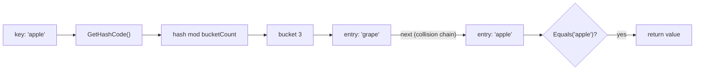

import { Tabs, TabItem, Aside } from '@astrojs/starlight/components';
import QuizBlock from '~/components/QuizBlock.astro';

## Why it matters in interviews

"Two Sum" is the single most asked coding question, and the hash map is the most common way to turn an O(n²) nested loop into O(n). Interviewers expect you to reach for `Dictionary<,>` or `HashSet<>` the moment a question asks *"have we seen this before?"*, *"how many times?"* or *"which items share a property?"*. .NET interviews often follow up with how `Dictionary` works internally and what `GetHashCode` has to do with it.

## Core idea

A hash table trades **O(n) extra memory** for **O(1) average lookup, insert and delete**. Instead of scanning the array again for each element (the inner loop), you remember what you have seen in a map and ask it in constant time.

The pattern is always the same: walk the input once, and at each element **ask the map a question, then update the map**. The skill is choosing the key and the value.

| Question you ask | Key | Value | Example |
|---|---|---|---|
| Have I seen the complement? | number | its index | Two Sum |
| How often does each item occur? | item | count | Valid Anagram, top-k frequent |
| Which items belong together? | canonical form | list of items | Group Anagrams |
| Is this value present at all? | value | (none: `HashSet<T>`) | Longest Consecutive, Contains Duplicate |
| How many earlier prefixes had sum S? | prefix sum | count | Subarray Sum Equals K |
| Where did I last see it? | item | last index | Contains Duplicate II, longest substring |

### How `Dictionary<TKey,TValue>` works



1. `GetHashCode()` turns the key into an int, which picks a bucket.
2. Keys that land in the same bucket form a chain (a **collision**). Lookup walks the chain and calls `Equals` on each entry.
3. When the table gets full it **resizes** (roughly doubling, to a prime size) and rehashes every entry. That is O(n) once, O(1) amortised.

So lookup is O(1) **on average** but O(n) in the worst case, when many keys share a hash. Two rules for custom keys: equal objects must return equal hash codes, and a key must not change while it is in the dictionary. `record` types and value tuples like `(int Row, int Col)` implement both `Equals` and `GetHashCode` for you, which makes them good keys.

## Worked problems

### 1. Two Sum

**Problem:** [Two Sum](https://leetcode.com/problems/two-sum/). Return the indices of the two numbers that add up to `target`. Exactly one solution exists.

**Approach:** for each `nums[i]`, the partner you need is `target - nums[i]`. Ask the map if you have already seen it. Insert the current number **after** checking, so an element is never paired with itself.

<Tabs syncKey="lang">
  <TabItem label="C#">
```csharp
public int[] TwoSum(int[] nums, int target)
{
    var indexOf = new Dictionary<int, int>();  // value -> index
    for (int i = 0; i < nums.Length; i++)
    {
        int need = target - nums[i];
        if (indexOf.TryGetValue(need, out int j)) return [j, i];
        indexOf[nums[i]] = i;                  // add after the check
    }
    return [];
}
```
  </TabItem>
  <TabItem label="TypeScript">
```ts
function twoSum(nums: number[], target: number): number[] {
  const indexOf = new Map<number, number>(); // value -> index
  for (let i = 0; i < nums.length; i++) {
    const j = indexOf.get(target - nums[i]);
    if (j !== undefined) return [j, i];
    indexOf.set(nums[i], i);
  }
  return [];
}
```
  </TabItem>
</Tabs>

**Complexity:** O(n) time, O(n) space. Brute force is O(n²) time and O(1) space.

**Edge cases:** duplicates such as `[3, 3]` with target 6 (works because we check before inserting), negative numbers, no answer (return empty). In TypeScript, check `!== undefined`, because index 0 is falsy.

### 2. Valid Anagram (frequency count)

**Problem:** [Valid Anagram](https://leetcode.com/problems/valid-anagram/). Are `s` and `t` anagrams of each other?

**Approach:** count characters up for `s` and down for `t`; every count must end at zero. For lowercase English letters an `int[26]` is the fastest "hash map", because the key is just `c - 'a'`.

```csharp
public bool IsAnagram(string s, string t)
{
    if (s.Length != t.Length) return false;
    var counts = new int[26];          // lowercase a-z only
    for (int i = 0; i < s.Length; i++)
    {
        counts[s[i] - 'a']++;
        counts[t[i] - 'a']--;
    }
    return counts.All(c => c == 0);
}
```

**Complexity:** O(n) time, O(1) space (26 counters regardless of n). Sorting both strings and comparing is O(n log n).

**Edge cases:** different lengths (early exit), empty strings (true). For Unicode input use `Dictionary<char, int>` instead of the fixed array.

### 3. Group Anagrams (canonical key)

**Problem:** [Group Anagrams](https://leetcode.com/problems/group-anagrams/). Group `["eat","tea","tan","ate","nat","bat"]` into `[["eat","tea","ate"],["tan","nat"],["bat"]]`.

**Approach:** anagrams share the same **sorted** form, so use it as the key and collect words in a list per key.

<Tabs syncKey="lang">
  <TabItem label="C#">
```csharp
public IList<IList<string>> GroupAnagrams(string[] strs)
{
    var groups = new Dictionary<string, IList<string>>();
    foreach (var word in strs)
    {
        char[] chars = word.ToCharArray();
        Array.Sort(chars);
        string key = new(chars);           // "eat", "tea", "ate" -> "aet"
        if (!groups.TryGetValue(key, out var list))
            groups[key] = list = new List<string>();
        list.Add(word);
    }
    return groups.Values.ToList();
}
```
  </TabItem>
  <TabItem label="TypeScript">
```ts
function groupAnagrams(strs: string[]): string[][] {
  const groups = new Map<string, string[]>();
  for (const word of strs) {
    const key = [...word].sort().join('');
    const group = groups.get(key);
    if (group) group.push(word);
    else groups.set(key, [word]);
  }
  return [...groups.values()];
}
```
  </TabItem>
</Tabs>

**Complexity:** O(n · k log k) time for n words of length up to k, O(n · k) space. Using a 26-letter count signature (e.g. `"1#0#0#..."`) as the key instead of sorting gives O(n · k).

**Edge cases:** empty strings (they group together under key `""`), a single word, all words identical.

### 4. Longest Consecutive Sequence (set membership)

**Problem:** [Longest Consecutive Sequence](https://leetcode.com/problems/longest-consecutive-sequence/). In `[100, 4, 200, 1, 3, 2]` the longest run of consecutive values is `1, 2, 3, 4`, length 4. Must be O(n), so sorting is not allowed.

**Approach:** put everything in a `HashSet<int>`. A number starts a run only if `x - 1` is **not** in the set. From each start, count upwards. Every number is visited by at most one counting loop, so the total is O(n).

```csharp
public int LongestConsecutive(int[] nums)
{
    var set = new HashSet<int>(nums);
    int best = 0;
    foreach (int x in set)                 // iterate the set: no duplicate starts
    {
        if (set.Contains(x - 1)) continue; // not the start of a run
        int length = 1;
        while (set.Contains(x + length)) length++;
        best = Math.Max(best, length);
    }
    return best;
}
```

**Complexity:** O(n) time, O(n) space.

**Edge cases:** empty array (0), duplicates (the set removes them), negative numbers, `int.MaxValue` in the input (`x + length` would overflow, which is rare in interviews but worth mentioning).

### 5. Subarray Sum Equals K (prefix sum + map)

**Problem:** [Subarray Sum Equals K](https://leetcode.com/problems/subarray-sum-equals-k/). Count contiguous subarrays whose sum is k. Numbers can be negative, so a sliding window does not work.

**Approach:** if the running sum is `sum` now and was `sum - k` at some earlier point, the elements between those points add up to k. Keep a map of **how many times each prefix sum has occurred**. Seed it with `{0: 1}` for the empty prefix, so subarrays starting at index 0 are counted.

Trace for `nums = [1, 2, 3]`, `k = 3`:

| x | sum | sum - k | seen before | count | map after |
|---|---|---|---|---|---|
| | 0 | | | 0 | `{0:1}` |
| 1 | 1 | -2 | 0 | 0 | `{0:1, 1:1}` |
| 2 | 3 | 0 | 1 | 1 (`[1,2]`) | `{0:1, 1:1, 3:1}` |
| 3 | 6 | 3 | 1 | 2 (`[3]`) | `{0:1, 1:1, 3:1, 6:1}` |

<Tabs syncKey="lang">
  <TabItem label="C#">
```csharp
public int SubarraySum(int[] nums, int k)
{
    var prefixCount = new Dictionary<int, int> { [0] = 1 }; // empty prefix
    int sum = 0, count = 0;
    foreach (int x in nums)
    {
        sum += x;
        count += prefixCount.GetValueOrDefault(sum - k);
        prefixCount[sum] = prefixCount.GetValueOrDefault(sum) + 1;
    }
    return count;
}
```
  </TabItem>
  <TabItem label="TypeScript">
```ts
function subarraySum(nums: number[], k: number): number {
  const prefixCount = new Map<number, number>([[0, 1]]);
  let sum = 0;
  let count = 0;
  for (const x of nums) {
    sum += x;
    count += prefixCount.get(sum - k) ?? 0;
    prefixCount.set(sum, (prefixCount.get(sum) ?? 0) + 1);
  }
  return count;
}
```
  </TabItem>
</Tabs>

**Complexity:** O(n) time, O(n) space.

**Edge cases:** forgetting the `{0: 1}` seed (misses subarrays starting at index 0), negative numbers and zeros (`[0, 0]` with k = 0 has 3 subarrays), updating the map **before** reading it (counts the empty subarray when k = 0).

### 6. Contains Duplicate II (hash set as a window)

**Problem:** [Contains Duplicate II](https://leetcode.com/problems/contains-duplicate-ii/). Is there a pair `i != j` with `nums[i] == nums[j]` and `|i - j| <= k`?

**Approach:** keep a `HashSet<int>` of the last k values. `HashSet.Add` returns `false` when the value is already present, which is the duplicate check for free.

```csharp
public bool ContainsNearbyDuplicate(int[] nums, int k)
{
    var window = new HashSet<int>();           // the last k values
    for (int i = 0; i < nums.Length; i++)
    {
        if (!window.Add(nums[i])) return true; // already in the window
        if (window.Count > k) window.Remove(nums[i - k]);
    }
    return false;
}
```

**Complexity:** O(n) time, O(min(n, k)) space.

**Edge cases:** k = 0 (never true), k larger than the array, duplicates further than k apart.

## Interview Q&A

<details>
<summary>Why is a hash map lookup O(1), and when is it not?</summary>

The hash code picks a bucket directly, so on average only a few entries are compared. If many keys collide (a poor `GetHashCode`, or adversarial input), a bucket becomes a long chain and lookup degrades to O(n). Resizing is O(n) but happens rarely, so inserts are O(1) amortised.
</details>

<details>
<summary>What must you implement to use a custom class as a `Dictionary` key?</summary>

Override `Equals` and `GetHashCode` consistently: equal objects must have equal hash codes. Otherwise the default reference equality is used and two "equal" keys are treated as different. A `record` or a value tuple gives you correct value equality automatically. Never mutate a field that is part of the hash while the object is a key.
</details>

<details>
<summary>`Dictionary` vs `HashSet` vs `int[26]`: which do you pick?</summary>

Use `HashSet<T>` when you only need "is it present?", `Dictionary<K,V>` when you need a count, an index or a list per key, and a fixed array when the key space is small and known (lowercase letters, ASCII, digits). The array has no hashing overhead and is the fastest.
</details>

<details>
<summary>In Two Sum, why insert into the map after checking, not before?</summary>

If you insert first, `nums[i]` can find itself when `target = 2 * nums[i]`, returning `[i, i]`. Checking first guarantees the partner has a smaller index. It also handles duplicates like `[3, 3]` correctly, since the first 3 is in the map when the second arrives.
</details>

<details>
<summary>Why does Subarray Sum Equals K need a hash map instead of a sliding window?</summary>

With negative numbers, extending the window can make the sum smaller and shrinking it can make it bigger, so there is no rule for when to move `left`. Prefix sums turn "subarray sums to k" into "two prefix sums differ by k", which a map answers in O(1).
</details>

<details>
<summary>How do you handle duplicates in Longest Consecutive Sequence?</summary>

Iterate over the `HashSet`, not the original array. If the array has the same run-start many times (e.g. thousands of 1s), iterating the array repeats the inner counting loop for each copy, which can become O(n²).
</details>

<details>
<summary>What is the iteration order of a `Dictionary`?</summary>

Officially undefined. In practice it is insertion order until you remove items, after which freed slots are reused. Never rely on it in an answer. Use `SortedDictionary` for key order, or keep a separate list. In JavaScript, `Map` is guaranteed to iterate in insertion order.
</details>

## Pitfalls

<Aside type="caution" title="Common mistakes">

- **Using `dict[key]` for a missing key** throws `KeyNotFoundException`. Use `TryGetValue` or `GetValueOrDefault`.
- **Checking `ContainsKey` then indexing**: two lookups where `TryGetValue` does one.
- **Mutable keys**: changing an object after inserting it as a key makes it unfindable.
- **Forgetting the `{0: 1}` seed** in prefix-sum counting problems.
- **Truthiness bugs in TypeScript**: `if (map.get(x))` is false for index 0. Compare with `undefined`.
- **Saying O(1) without "average"** when the interviewer asks about the worst case.

</Aside>

## Related

- [Arrays & Strings Patterns](../arrays-strings/)
- [Big-O & Complexity Analysis](../big-o/)
- [Heaps & Priority Queues](../heaps/)
- [Collections & Generics](../../csharp/collections-generics/)

## Quick quiz

<QuizBlock section="dsa" topic="hashing" />
