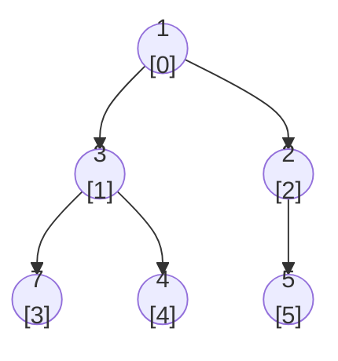
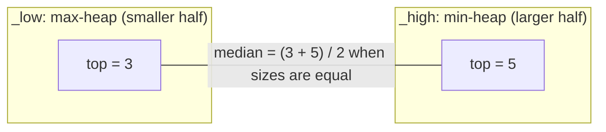

import { Tabs, TabItem, Aside } from '@astrojs/starlight/components';
import QuizBlock from '~/components/QuizBlock.astro';

## Why it matters in interviews

Any problem that says **"k largest", "k closest", "k most frequent"** or **"keep picking the smallest"** is a heap problem. Interviewers like it because the naive answer (sort everything, O(n log n)) is easy, and the heap answer (O(n log k)) shows you understand the data structure. In .NET you also get bonus points for knowing that `PriorityQueue<TElement,TPriority>` exists (since .NET 6), that it is a **min-heap**, and how to turn it into a max-heap.

## Core idea

A binary heap is a **complete binary tree stored in an array** where every parent is smaller than (min-heap) or larger than (max-heap) its children. Only the root is guaranteed to be the minimum; the rest is only partially ordered. For index `i`, the children are at `2i + 1` and `2i + 2`, and the parent is at `(i - 1) / 2`.



Array form of the min-heap above: `[1, 3, 2, 7, 4, 5]`.

| Operation | Cost | How |
|---|---|---|
| Peek min | O(1) | read index 0 |
| Insert (`Enqueue`) | O(log n) | add at the end, **sift up** while smaller than parent |
| Remove min (`Dequeue`) | O(log n) | move last to root, **sift down** to the smaller child |
| Build from n items | O(n) | heapify bottom-up (the constructor that takes a collection of pairs) |
| Search for an arbitrary value | O(n) | a heap is not a search tree |

### How to recognise the pattern

- **Top-k / kth largest**: keep a **min-heap of size k**. Push each item; if the size goes above k, pop the smallest. What is left is the k largest, and the root is the kth largest. O(n log k) time, O(k) space.
- **k closest / k smallest**: the mirror image, a **max-heap of size k** that evicts the largest.
- **Merge k sorted things**: heap of the current head of each source, pop the smallest, push its successor.
- **Running median / balance two halves**: two heaps, a max-heap for the lower half and a min-heap for the upper half.
- **Repeatedly take the best and put something back** (last stone weight, task scheduling, Dijkstra): a heap.

### PriorityQueue in .NET

```csharp
// Min-heap: smallest priority is dequeued first.
var pq = new PriorityQueue<string, int>();
pq.Enqueue("low", 5);
pq.Enqueue("urgent", 1);
pq.Dequeue();                        // "urgent"

// Max-heap: reverse the priority comparer.
var maxHeap = new PriorityQueue<int, int>(Comparer<int>.Create((a, b) => b.CompareTo(a)));

// TryDequeue gives you the element AND its priority.
while (pq.TryDequeue(out var item, out var priority)) { /* ... */ }
```

Facts worth saying out loud: element and priority are **separate** (you can enqueue the same element with any priority); there is **no decrease-key or remove-by-value** (in .NET 9+ there is `Remove`, which is O(n)); ties come out in **no guaranteed order** (it is not stable); and it is **not thread-safe**. The queue itself is not enumerable; its `UnorderedItems` property returns items in internal heap-array order, not priority order.

## Worked problems

### 1. Kth Largest Element in an Array

[LeetCode 215](https://leetcode.com/problems/kth-largest-element-in-an-array/): `[3,2,1,5,6,4], k = 2` returns `5`.

**Approach.** Min-heap of size k. Every value smaller than the current top-k gets evicted, so the root ends up as the kth largest. TypeScript has no built-in heap, so in a TS interview you either write a small one (below) or say you would use a library; mention the trade-off.

<Tabs syncKey="lang">
  <TabItem label="C#">
```csharp
public static int FindKthLargest(int[] nums, int k)
{
    var minHeap = new PriorityQueue<int, int>();   // min-heap of the k largest so far
    foreach (var n in nums)
    {
        minHeap.Enqueue(n, n);
        if (minHeap.Count > k) minHeap.Dequeue();  // drop the smallest
    }
    return minHeap.Peek();                         // smallest of the top k = kth largest
}
```
  </TabItem>
  <TabItem label="TypeScript">
```ts
// Minimal binary heap. compare(a, b) < 0 means a comes out first.
class Heap<T> {
  private items: T[] = [];
  constructor(private compare: (a: T, b: T) => number) {}
  get size(): number { return this.items.length; }
  peek(): T | undefined { return this.items[0]; }

  push(value: T): void {
    const a = this.items;
    a.push(value);
    for (let i = a.length - 1; i > 0; ) {             // sift up
      const p = (i - 1) >> 1;
      if (this.compare(a[i], a[p]) >= 0) break;
      [a[i], a[p]] = [a[p], a[i]];
      i = p;
    }
  }

  pop(): T | undefined {
    const a = this.items;
    if (a.length === 0) return undefined;
    const top = a[0];
    const last = a.pop()!;
    if (a.length > 0) {
      a[0] = last;
      for (let i = 0; ; ) {                            // sift down
        const l = 2 * i + 1, r = l + 1;
        let best = i;
        if (l < a.length && this.compare(a[l], a[best]) < 0) best = l;
        if (r < a.length && this.compare(a[r], a[best]) < 0) best = r;
        if (best === i) break;
        [a[i], a[best]] = [a[best], a[i]];
        i = best;
      }
    }
    return top;
  }
}

function findKthLargest(nums: number[], k: number): number {
  const minHeap = new Heap<number>((a, b) => a - b);
  for (const n of nums) {
    minHeap.push(n);
    if (minHeap.size > k) minHeap.pop();
  }
  return minHeap.peek()!;
}
```
  </TabItem>
</Tabs>

**Complexity:** O(n log k) time, O(k) space. (Quickselect averages O(n) but is O(n²) worst case; mention it as a follow-up.)
**Edge cases:** duplicates count separately (`[3,3,2]`, k = 2 gives 3); k = n gives the minimum; negative numbers.

### 2. Top K Frequent Elements

[LeetCode 347](https://leetcode.com/problems/top-k-frequent-elements/): `[1,1,1,2,2,3], k = 2` returns `[1,2]`.

**Approach.** Count with a dictionary, then run the size-k min-heap over the (number, count) pairs with the count as priority. A neat O(n) alternative is **bucket sort** by frequency: a value can appear at most n times, so make n + 1 buckets and walk them from the top.

<Tabs syncKey="lang">
  <TabItem label="C#">
```csharp
public static int[] TopKFrequent(int[] nums, int k)
{
    var freq = new Dictionary<int, int>();
    foreach (var n in nums) freq[n] = freq.GetValueOrDefault(n) + 1;

    var minHeap = new PriorityQueue<int, int>();   // element = number, priority = count
    foreach (var (num, count) in freq)
    {
        minHeap.Enqueue(num, count);
        if (minHeap.Count > k) minHeap.Dequeue();
    }
    var result = new int[k];
    for (int i = k - 1; i >= 0; i--) result[i] = minHeap.Dequeue(); // most frequent first
    return result;
}
```
  </TabItem>
  <TabItem label="TypeScript">
```ts
function topKFrequent(nums: number[], k: number): number[] {
  const freq = new Map<number, number>();
  for (const n of nums) freq.set(n, (freq.get(n) ?? 0) + 1);

  // Bucket sort: index = frequency. O(n), no heap needed.
  const buckets: number[][] = Array.from({ length: nums.length + 1 }, () => []);
  for (const [num, count] of freq) buckets[count].push(num);

  const result: number[] = [];
  for (let f = buckets.length - 1; f > 0 && result.length < k; f--) {
    result.push(...buckets[f]);
  }
  return result.slice(0, k);
}
```
  </TabItem>
</Tabs>

**Complexity:** heap O(n log k), bucket sort O(n). Both O(n) extra space for the counts.
**Edge cases:** ties at the kth position (any valid answer is accepted), k equal to the number of distinct values.

### 3. K Closest Points to Origin

[LeetCode 973](https://leetcode.com/problems/k-closest-points-to-origin/): return the k points nearest to (0, 0).

**Approach.** We want the k **smallest** distances, so keep a **max-heap** of size k and evict the farthest. Compare squared distances; `Math.Sqrt` is unnecessary because it preserves order.

<Tabs syncKey="lang">
  <TabItem label="C#">
```csharp
public static int[][] KClosest(int[][] points, int k)
{
    // Max-heap by distance: reverse the comparer. Keep k closest, evict the farthest.
    var maxHeap = new PriorityQueue<int[], int>(Comparer<int>.Create((a, b) => b.CompareTo(a)));
    foreach (var p in points)
    {
        int dist = p[0] * p[0] + p[1] * p[1];      // squared distance: no sqrt needed
        maxHeap.Enqueue(p, dist);
        if (maxHeap.Count > k) maxHeap.Dequeue();
    }
    var result = new int[maxHeap.Count][];
    for (int i = 0; i < result.Length; i++) result[i] = maxHeap.Dequeue();
    return result;
}
```
  </TabItem>
  <TabItem label="TypeScript">
```ts
function kClosest(points: number[][], k: number): number[][] {
  const dist = (p: number[]) => p[0] * p[0] + p[1] * p[1];
  const maxHeap = new Heap<number[]>((a, b) => dist(b) - dist(a)); // farthest on top
  for (const p of points) {
    maxHeap.push(p);
    if (maxHeap.size > k) maxHeap.pop();
  }
  const result: number[][] = [];
  while (maxHeap.size > 0) result.push(maxHeap.pop()!);
  return result;
}
```
  </TabItem>
</Tabs>

**Complexity:** O(n log k) time, O(k) space.
**Edge cases:** k = n (return all), points with equal distance, coordinates up to 10^4 (squares fit in `int`; for larger values use `long`).

### 4. Merge k Sorted Lists

[LeetCode 23](https://leetcode.com/problems/merge-k-sorted-lists/): merge k sorted linked lists into one.

**Approach.** Put the head of each list in a min-heap keyed by value. Pop the smallest, append it to the result, and push that node's `next`. The heap never holds more than k nodes. A dummy head avoids special-casing the first node.

```csharp
public static ListNode? MergeKLists(ListNode?[] lists)
{
    var heap = new PriorityQueue<ListNode, int>();
    foreach (var head in lists)
        if (head is not null) heap.Enqueue(head, head.val);

    var dummy = new ListNode(0);
    var tail = dummy;
    while (heap.TryDequeue(out var node, out _))
    {
        tail.next = node;
        tail = node;
        if (node.next is not null) heap.Enqueue(node.next, node.next.val);
    }
    return dummy.next;
}
```

**Complexity:** O(N log k) time where N is the total number of nodes, O(k) heap space. Merging lists one by one is O(N·k); pairwise divide and conquer also gets O(N log k).
**Edge cases:** empty array, arrays of `null` lists, lists of very different lengths.

### 5. Find Median from Data Stream

[LeetCode 295](https://leetcode.com/problems/find-median-from-data-stream/): support `AddNum` and `FindMedian` on a growing stream.

**Approach.** Two heaps split the numbers in half. `_low` is a **max-heap** of the smaller half, `_high` is a **min-heap** of the larger half. Keep `_low` the same size or one bigger. The median is `_low`'s top (odd count) or the average of both tops (even count). Routing every number through `_low` first guarantees every value in `_low` is ≤ every value in `_high`.



```csharp
public class MedianFinder
{
    // low: max-heap with the smaller half. high: min-heap with the larger half.
    private readonly PriorityQueue<int, int> _low = new(Comparer<int>.Create((a, b) => b.CompareTo(a)));
    private readonly PriorityQueue<int, int> _high = new();

    public void AddNum(int num)
    {
        _low.Enqueue(num, num);
        var top = _low.Dequeue();          // move low's largest to high
        _high.Enqueue(top, top);
        if (_high.Count > _low.Count)      // keep low >= high in size
        {
            var back = _high.Dequeue();
            _low.Enqueue(back, back);
        }
    }

    public double FindMedian() =>
        _low.Count > _high.Count ? _low.Peek() : (_low.Peek() + (double)_high.Peek()) / 2;
}
```

**Complexity:** `AddNum` O(log n), `FindMedian` O(1), O(n) space.
**Edge cases:** adding two `int.MaxValue` values: cast to `double` **before** adding, or the sum overflows. Calling `FindMedian` on an empty stream (define the behaviour, e.g. throw).

## Interview Q&A

<details>
<summary>Why use a min-heap to find the k largest elements?</summary>

The heap holds the best k seen so far, and the question at every step is "is the new value better than the **worst** of my k?". The worst of the k largest is the smallest one, so it must be at the top where it can be compared and evicted in O(log k). A max-heap of all n items also works but costs O(n) space and O(n + k log n) time.
</details>

<details>
<summary>Is a heap the same as a sorted array?</summary>

No. A heap only guarantees that each parent beats its children, so only the root is "in order". That weaker invariant is why insert and remove are O(log n) instead of O(n) for a sorted array. Getting all items in sorted order requires n pops (heap sort, O(n log n)).
</details>

<details>
<summary>How do you make a max-heap with `PriorityQueue` in .NET?</summary>

Pass a reversed comparer: `new PriorityQueue<T, int>(Comparer<int>.Create((a, b) => b.CompareTo(a)))`. Negating the priority (`-value`) also works for ints but overflows for `int.MinValue`, so the comparer is the safer answer.
</details>

<details>
<summary>How would you update the priority of an item already in the queue?</summary>

`PriorityQueue` has no decrease-key. The standard trick (used in Dijkstra) is **lazy deletion**: enqueue the item again with the new priority and, when you dequeue, skip entries whose priority is stale. In .NET 9+ `Remove` exists but is O(n), so lazy deletion is usually faster.
</details>

<details>
<summary>Why is building a heap from n items O(n) and not O(n log n)?</summary>

Bottom-up heapify sifts down from the last parent to the root. Most nodes are near the bottom and move only a short distance: half the nodes move 0 levels, a quarter move 1, an eighth move 2, and so on. That series sums to O(n). Inserting items one at a time is O(n log n).
</details>

<details>
<summary>When would you choose `SortedSet<T>` over `PriorityQueue`?</summary>

When you need more than the minimum: removing arbitrary items, getting both min and max (`Min` / `Max`), range queries (`GetViewBetween`), or iterating in order. It is a red-black tree with O(log n) operations, but it rejects duplicates, so you need a tie-breaker (e.g. a tuple with an id) to store equal priorities.
</details>

<details>
<summary>Is `PriorityQueue` thread-safe and is dequeue order stable?</summary>

Neither. Use a lock or a `Channel<T>` around it for concurrent producers, and add a sequence number to the priority (e.g. `(priority, seq)`) if equal priorities must come out first-in-first-out.
</details>

## Pitfalls

<Aside type="caution" title="Common mistakes">
- Using a max-heap for "k largest" (works, but O(n) space and misses the point of the pattern).
- Expecting `pq.UnorderedItems` to list items in priority order. It returns internal heap-array order; only repeated `Dequeue` gives sorted order.
- Negating priorities to fake a max-heap and overflowing on `int.MinValue`.
- Integer overflow in median: `(a + b) / 2` with large ints. Cast to `double` or `long` first.
- Forgetting `Math.Sqrt` is unnecessary for distance comparisons.
- Saying a heap gives O(log n) search. Arbitrary search is O(n).
</Aside>

## Related

- [Trees & BST](../trees-bst/)
- [Graphs (Dijkstra uses a heap)](../graphs/)
- [Sorting (heap sort)](../sorting/)
- [Linked Lists](../linked-lists/)

## Quick quiz

<QuizBlock section="dsa" topic="heaps" />
