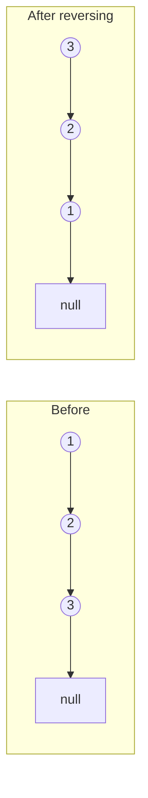
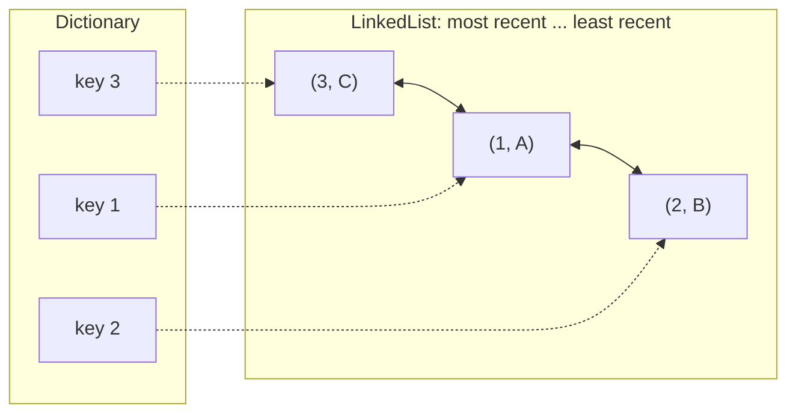

import { Tabs, TabItem, Aside } from '@astrojs/starlight/components';
import QuizBlock from '~/components/QuizBlock.astro';

## Why it matters in interviews

*"Reverse a linked list"* is asked so often that fumbling it is a red flag. Linked list questions test careful pointer handling under pressure: losing the rest of the list, dereferencing null, or mishandling the head. The **LRU cache** is the most common "design a data structure" question for mid-level engineers, and in .NET it maps directly onto `Dictionary` plus `LinkedList<T>`.

## Core idea

A singly linked list is a chain of nodes, each holding a value and a reference to the next node. There is no index, so access is O(n), but inserting or removing **once you hold the node before it** is O(1).

```csharp
// The node type used by LeetCode-style C# problems.
public class ListNode(int val = 0, ListNode? next = null)
{
    public int val = val;
    public ListNode? next = next;
}
```

Three techniques solve almost every list problem:

| Technique | Use it for | Why |
|---|---|---|
| **Pointer rewiring** (`prev`, `curr`, `next`) | reverse, reorder | save `next` before you overwrite `curr.next` |
| **Dummy (sentinel) head** | merge, remove, partition | the real head is no longer a special case |
| **Fast and slow pointers** | middle, cycle, nth from end | one pass, O(1) space, no length needed |

**Fast and slow pointers.** `slow` moves one step and `fast` moves two. When `fast` reaches the end, `slow` is in the middle. If there is a cycle, `fast` enters it first and eventually laps `slow`, so they meet. For "nth from the end", start `fast` n steps ahead and move both one step at a time.



## Worked problems

### 1. Reverse Linked List

**Problem:** [Reverse Linked List](https://leetcode.com/problems/reverse-linked-list/). Reverse `1 → 2 → 3` into `3 → 2 → 1`.

**Approach (iterative):** walk the list with `prev` and `curr`. For each node: save `next`, point `curr.next` back at `prev`, then advance both. When `curr` is null, `prev` is the new head.

| step | prev | curr | next saved | list so far |
|---|---|---|---|---|
| start | null | 1 | | `1 → 2 → 3` |
| 1 | 1 | 2 | 2 | `null ← 1`, `2 → 3` |
| 2 | 2 | 3 | 3 | `null ← 1 ← 2`, `3` |
| 3 | 3 | null | null | `null ← 1 ← 2 ← 3` |

<Tabs syncKey="lang">
  <TabItem label="C#">
```csharp
public ListNode? ReverseList(ListNode? head)
{
    ListNode? prev = null, curr = head;
    while (curr != null)
    {
        ListNode? next = curr.next;  // 1. save the rest of the list
        curr.next = prev;            // 2. flip the pointer
        prev = curr;                 // 3. advance both pointers
        curr = next;
    }
    return prev;                     // the old tail is the new head
}

public ListNode? ReverseListRecursive(ListNode? head)
{
    if (head?.next == null) return head;          // empty or last node
    ListNode? newHead = ReverseListRecursive(head.next);
    head.next.next = head;           // the node after head points back to it
    head.next = null;
    return newHead;
}
```
  </TabItem>
  <TabItem label="TypeScript">
```ts
class ListNode {
  val: number;
  next: ListNode | null;
  constructor(val = 0, next: ListNode | null = null) {
    this.val = val;
    this.next = next;
  }
}

function reverseList(head: ListNode | null): ListNode | null {
  let prev: ListNode | null = null;
  let curr = head;
  while (curr !== null) {
    const next: ListNode | null = curr.next;
    curr.next = prev;
    prev = curr;
    curr = next;
  }
  return prev;
}
```
  </TabItem>
</Tabs>

**Complexity:** iterative O(n) time, O(1) space. Recursive O(n) time, **O(n) stack space**, and it can overflow the stack on very long lists.

**Edge cases:** empty list (returns null), one node, two nodes. Forgetting `head.next = null` in the recursive version creates a cycle between the first two nodes.

### 2. Linked List Cycle (Floyd)

**Problem:** [Linked List Cycle](https://leetcode.com/problems/linked-list-cycle/). Does the list loop back on itself? Use O(1) memory.

**Approach:** a `HashSet<ListNode>` of visited nodes works in O(n) space. Floyd's tortoise and hare does it in O(1): if there is a cycle, the fast pointer gains one step per iteration on the slow one inside the loop, so it must land on it.

```csharp
public bool HasCycle(ListNode? head)
{
    ListNode? slow = head, fast = head;
    while (fast?.next != null)
    {
        slow = slow!.next;
        fast = fast.next.next;
        if (slow == fast) return true;   // fast caught up inside the loop
    }
    return false;                        // fast reached the end: no cycle
}
```

**Follow-up:** [Linked List Cycle II](https://leetcode.com/problems/linked-list-cycle-ii/) asks where the cycle starts. After the pointers meet, move one back to `head` and step both one node at a time; they meet at the cycle start (the distance from head to the start equals the distance from the meeting point to the start, modulo the loop length).

```csharp
public ListNode? DetectCycle(ListNode? head)
{
    ListNode? slow = head, fast = head;
    while (fast?.next != null)
    {
        slow = slow!.next;
        fast = fast.next.next;
        if (slow != fast) continue;
        slow = head;                     // restart one pointer from head
        while (slow != fast) { slow = slow!.next; fast = fast!.next; }
        return slow;                     // the start of the cycle
    }
    return null;
}
```

**Complexity:** O(n) time, O(1) space.

**Edge cases:** empty list, single node without a cycle, single node pointing to itself, cycle back to the head. Compare **references** (`==` on nodes), not values.

### 3. Merge Two Sorted Lists

**Problem:** [Merge Two Sorted Lists](https://leetcode.com/problems/merge-two-sorted-lists/). Merge `1 → 2 → 4` and `1 → 3 → 4` into one sorted list by relinking nodes.

**Approach:** a dummy head means you never special-case "which list provides the first node". Always attach the smaller head to `tail`, then append whichever list is left over.

<Tabs syncKey="lang">
  <TabItem label="C#">
```csharp
public ListNode? MergeTwoLists(ListNode? a, ListNode? b)
{
    var dummy = new ListNode();          // placeholder before the real head
    var tail = dummy;
    while (a != null && b != null)
    {
        if (a.val <= b.val) { tail.next = a; a = a.next; }
        else { tail.next = b; b = b.next; }
        tail = tail.next;
    }
    tail.next = a ?? b;                  // attach the remainder
    return dummy.next;
}
```
  </TabItem>
  <TabItem label="TypeScript">
```ts
function mergeTwoLists(a: ListNode | null, b: ListNode | null): ListNode | null {
  const dummy = new ListNode();
  let tail = dummy;
  while (a !== null && b !== null) {
    if (a.val <= b.val) {
      tail.next = a;
      a = a.next;
    } else {
      tail.next = b;
      b = b.next;
    }
    tail = tail.next;
  }
  tail.next = a ?? b;
  return dummy.next;
}
```
  </TabItem>
</Tabs>

**Complexity:** O(n + m) time, O(1) extra space (nodes are reused, not copied).

**Edge cases:** one or both lists empty, all of one list smaller than the other, equal values (`<=` keeps the merge stable). This is the merge step of merge sort, and the building block for merging k sorted lists with a [heap](../heaps/).

### 4. Middle of the Linked List

**Problem:** [Middle of the Linked List](https://leetcode.com/problems/middle-of-the-linked-list/). Return the middle node; for an even length, return the second of the two middles.

**Approach:** when `fast` (two steps) can no longer move, `slow` (one step) is halfway.

```csharp
public ListNode? MiddleNode(ListNode? head)
{
    ListNode? slow = head, fast = head;
    while (fast?.next != null)
    {
        slow = slow!.next;
        fast = fast.next.next;
    }
    return slow;        // even length: the second middle
}
```

**Complexity:** O(n) time, O(1) space, one pass instead of "count, then walk to n/2".

**Edge cases:** one node (itself), two nodes (the second). To get the **first** middle instead, loop while `fast.next?.next != null`.

### 5. Remove Nth Node From End of List

**Problem:** [Remove Nth Node From End of List](https://leetcode.com/problems/remove-nth-node-from-end-of-list/). Remove the nth node from the end in one pass.

**Approach:** move `fast` n nodes ahead, then move both until `fast` is on the last node. `slow` is now just **before** the node to delete. The dummy node handles deleting the head itself.

```csharp
public ListNode? RemoveNthFromEnd(ListNode? head, int n)
{
    var dummy = new ListNode(0, head);   // makes removing the head easy
    ListNode fast = dummy, slow = dummy;
    for (int i = 0; i < n; i++) fast = fast.next!;  // open a gap of n
    while (fast.next != null)
    {
        fast = fast.next;
        slow = slow.next!;
    }
    slow.next = slow.next!.next;         // unlink the target
    return dummy.next;
}
```

**Complexity:** O(n) time, O(1) space.

**Edge cases:** removing the head (n = length), a one-node list (result is empty), n = 1 (remove the tail).

### 6. LRU Cache (Dictionary + LinkedList)

**Problem:** [LRU Cache](https://leetcode.com/problems/lru-cache/). Design a cache with a fixed capacity where `Get` and `Put` are O(1), evicting the least recently used key when full.

**Approach:** the dictionary gives O(1) lookup by key; a doubly linked list keeps usage order with the most recent at the front. The dictionary stores the **list node**, so moving or removing it is O(1). .NET's `LinkedList<T>` is already doubly linked and `Remove(node)` is O(1).



<Tabs syncKey="lang">
  <TabItem label="C#">
```csharp
public class LRUCache(int capacity)
{
    private readonly Dictionary<int, LinkedListNode<(int Key, int Value)>> _map = new();
    private readonly LinkedList<(int Key, int Value)> _order = new(); // front = newest

    public int Get(int key)
    {
        if (!_map.TryGetValue(key, out var node)) return -1;
        _order.Remove(node);                 // O(1): we already hold the node
        _order.AddFirst(node);
        return node.Value.Value;
    }

    public void Put(int key, int value)
    {
        if (_map.TryGetValue(key, out var existing))
        {
            _order.Remove(existing);
        }
        else if (_map.Count == capacity)
        {
            var lru = _order.Last!;          // least recently used
            _order.RemoveLast();
            _map.Remove(lru.Value.Key);      // why the node stores the key too
        }
        _map[key] = _order.AddFirst((key, value));
    }
}
```
  </TabItem>
  <TabItem label="TypeScript">
```ts
class LRUCache {
  private readonly cache = new Map<number, number>(); // keeps insertion order
  private readonly capacity: number;

  constructor(capacity: number) {
    this.capacity = capacity;
  }

  get(key: number): number {
    const value = this.cache.get(key);
    if (value === undefined) return -1;
    this.cache.delete(key); // re-insert to mark as most recent
    this.cache.set(key, value);
    return value;
  }

  put(key: number, value: number): void {
    this.cache.delete(key);
    this.cache.set(key, value);
    if (this.cache.size > this.capacity) {
      const oldest = this.cache.keys().next().value!; // first = least recent
      this.cache.delete(oldest);
    }
  }
}
```
  </TabItem>
</Tabs>

**Complexity:** O(1) for `Get` and `Put`, O(capacity) space. The TypeScript version relies on `Map` iterating in insertion order, which the language guarantees.

**Edge cases:** capacity 1, `Put` on an existing key (update the value and move it to the front, without evicting), `Get` on a missing key. In production you would also need thread safety (a `lock`, since neither collection is thread-safe), or use `MemoryCache` with a size limit.

## Interview Q&A

<details>
<summary>Why use a dummy head node?</summary>

Operations that may change the head (merge, remove the first node, partition) otherwise need a special case. With a dummy node before the head, every real node has a predecessor, so one code path handles everything. Return `dummy.next` at the end.
</details>

<details>
<summary>Iterative or recursive reversal: which should you write?</summary>

Write the iterative one first: O(1) space and no risk of stack overflow. Know the recursive version too, because interviewers ask for it as a follow-up. Its O(n) stack depth is a real problem in C# for lists with hundreds of thousands of nodes.
</details>

<details>
<summary>Why does Floyd's algorithm always detect a cycle?</summary>

Once both pointers are inside the loop, each iteration the fast pointer closes the gap to the slow pointer by exactly one node. The gap shrinks by one per step until it is zero, so they must meet within one lap of the loop. They cannot "jump over" each other.
</details>

<details>
<summary>Array vs linked list: when would you choose a linked list?</summary>

When you insert and remove in the middle often **and already hold a reference to the position**, as in an LRU cache. Otherwise arrays (`List<T>`) win: O(1) indexing, contiguous memory and far better CPU cache behaviour. In practice `List<T>` is faster for most workloads even with some inserts.
</details>

<details>
<summary>In the LRU cache, why does the list node store the key as well as the value?</summary>

On eviction you remove the last node from the list and must also remove its entry from the dictionary. Without the key in the node you would have no way to find which dictionary entry to delete except an O(n) search.
</details>

<details>
<summary>How do you find the intersection node of two linked lists?</summary>

Walk two pointers, `a` from list A and `b` from list B; when one reaches the end, restart it at the other list's head. Both travel lengthA + lengthB steps, so they meet at the intersection node, or both reach null together if there is none. O(n + m) time and O(1) space.
</details>

<details>
<summary>What is `LinkedList<T>` in .NET, and what does it cost?</summary>

A doubly linked list of `LinkedListNode<T>` objects with `First`, `Last`, `AddFirst/AddLast/AddBefore/AddAfter` and `Remove(node)`, all O(1). `Find` and `Contains` are O(n), and there is no indexer. Each node is a separate heap allocation, which adds GC pressure.
</details>

## Pitfalls

<Aside type="caution" title="Common mistakes">

- **Losing the rest of the list** by overwriting `curr.next` before saving it.
- **Null dereference** in fast/slow loops: check `fast != null && fast.next != null` (or `fast?.next != null`) before stepping twice.
- **Comparing values instead of node references** when detecting cycles or intersections.
- **Forgetting `head.next = null`** in recursive reversal, which leaves a two-node cycle.
- **Off-by-one in nth-from-end**: without a dummy node, removing the head needs a special case.
- **Storing values instead of nodes** in the LRU dictionary, which makes moving an entry O(n).

</Aside>

## Related

- [Stacks & Queues](../stacks-queues/)
- [Recursion & Backtracking](../recursion-backtracking/)
- [Heaps & Priority Queues](../heaps/)
- [Collections & Generics](../../csharp/collections-generics/)

## Quick quiz

<QuizBlock section="dsa" topic="linked-lists" />
