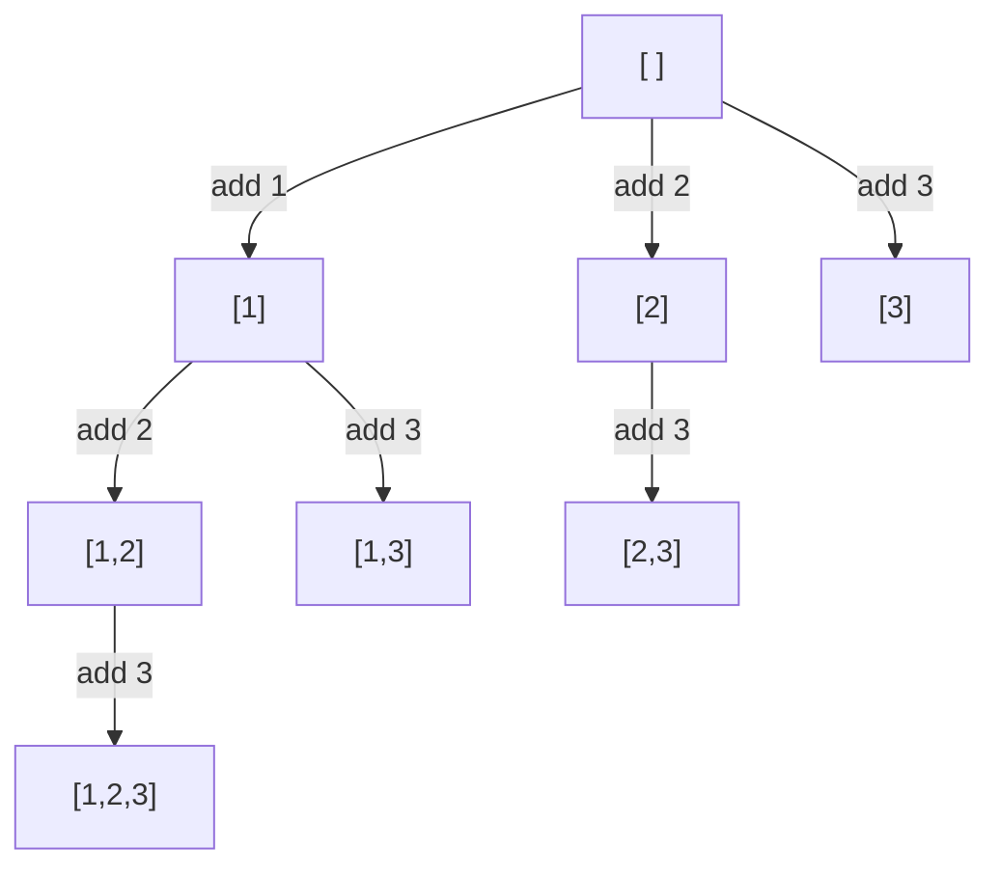

import { Tabs, TabItem, Aside } from '@astrojs/starlight/components';
import QuizBlock from '~/components/QuizBlock.astro';

## Why it matters in interviews

Any question that says *"return all"* (all subsets, all permutations, all combinations that sum to a target, all valid placements) is backtracking. Interviewers check three things: that you can write a clean recursive function with a correct base case, that you **undo** your choice after exploring it, and that you can explain why the complexity is exponential. Recursion is also the foundation for trees, graphs and [dynamic programming](../dynamic-programming/).

## Core idea

### Recursion template

Every recursive function needs:

1. **Base case**: the smallest input you can answer directly. Without it, the function recurses until `StackOverflowException`.
2. **Recursive case**: express the answer in terms of a **smaller** input, and trust that the call returns the right answer for it.
3. **Progress**: each call must move towards the base case.

The extra space is the maximum **depth** of the recursion, because each active call holds a stack frame.

### Backtracking template

Backtracking is a depth-first search over a **decision tree**. At each node you have a partial answer and a set of choices. For each choice:

1. **Choose**: add it to the current partial answer.
2. **Explore**: recurse.
3. **Un-choose**: remove it again, so the next choice starts from the same state.

When the partial answer is complete (or every node counts, as with subsets), record a **copy** of it. The decision tree for subsets of `[1, 2, 3]`, where each node is one recorded subset:



Passing a `start` index means each element is only considered after the ones before it, which is why `[2,1]` never appears: subsets are unordered.

| Recognise it when | Shape of the tree | Typical complexity |
|---|---|---|
| "all subsets", "power set" | each element: in or out | O(n · 2ⁿ) |
| "all permutations", "arrangements" | each level picks an unused element | O(n · n!) |
| "combinations summing to target" | pick from `start` onward, prune when over | exponential, pruned |
| "find a path in a grid", "word search" | 4 directions, mark visited | O(cells · 3ᴸ) |
| constraint n ≤ 20 | small n is a strong hint | |

**Pruning** is what makes backtracking practical: stop exploring a branch as soon as it cannot lead to a valid answer (sum already too big, cell already used, prefix already invalid).

## Worked problems

### 1. Subsets

**Problem:** [Subsets](https://leetcode.com/problems/subsets/). Return all subsets of distinct integers. `[1,2,3]` has 8.

**Approach:** every node of the decision tree is a valid subset, so record the current list on entry, then try adding each remaining element.

<Tabs syncKey="lang">
  <TabItem label="C#">
```csharp
public IList<IList<int>> Subsets(int[] nums)
{
    var result = new List<IList<int>>();
    var current = new List<int>();

    void Backtrack(int start)
    {
        result.Add(new List<int>(current));        // record a copy
        for (int i = start; i < nums.Length; i++)
        {
            current.Add(nums[i]);                  // choose
            Backtrack(i + 1);                      // explore
            current.RemoveAt(current.Count - 1);   // un-choose
        }
    }

    Backtrack(0);
    return result;
}
```
  </TabItem>
  <TabItem label="TypeScript">
```ts
function subsets(nums: number[]): number[][] {
  const result: number[][] = [];
  const current: number[] = [];
  const backtrack = (start: number): void => {
    result.push([...current]); // record a copy
    for (let i = start; i < nums.length; i++) {
      current.push(nums[i]);
      backtrack(i + 1);
      current.pop();
    }
  };
  backtrack(0);
  return result;
}
```
  </TabItem>
</Tabs>

**Complexity:** 2ⁿ subsets, each copied in up to O(n), so O(n · 2ⁿ) time and space for the output; O(n) recursion depth.

**Edge cases:** empty input (returns `[[]]`). Adding `current` itself instead of a copy is the classic bug: every entry ends up as the same, finally empty, list.

### 2. Subsets II (handling duplicates)

**Problem:** [Subsets II](https://leetcode.com/problems/subsets-ii/). The input may contain duplicates, but the output must not contain duplicate subsets. `[1,2,2]` gives `[], [1], [1,2], [1,2,2], [2], [2,2]`.

**Approach:** sort so equal values sit together. At the **same level** of the tree, skip a value equal to the previous one; picking the first 2 already covers every subset that starts with a 2 at this position.

```csharp
public IList<IList<int>> SubsetsWithDup(int[] nums)
{
    Array.Sort(nums);                                    // group duplicates
    var result = new List<IList<int>>();
    var current = new List<int>();

    void Backtrack(int start)
    {
        result.Add(new List<int>(current));
        for (int i = start; i < nums.Length; i++)
        {
            if (i > start && nums[i] == nums[i - 1]) continue; // same choice, same level
            current.Add(nums[i]);
            Backtrack(i + 1);
            current.RemoveAt(current.Count - 1);
        }
    }

    Backtrack(0);
    return result;
}
```

**Complexity:** O(n · 2ⁿ) worst case, plus O(n log n) for the sort.

**Edge cases:** all values equal (`[2,2,2]` gives 4 subsets), the condition is `i > start`, not `i > 0`: using `i > 0` would also skip the second 2 when it is deeper in the tree and wrongly drop `[2,2]`. Deduplicating with a `HashSet` of strings works but wastes the exponential work you already did.

### 3. Permutations

**Problem:** [Permutations](https://leetcode.com/problems/permutations/). Return all orderings of distinct integers. `[1,2,3]` has 6.

**Approach:** order matters now, so every level may pick **any** unused element (no `start` index). A `used` array tracks what is already in the current permutation. Record only when the permutation is full.

<Tabs syncKey="lang">
  <TabItem label="C#">
```csharp
public IList<IList<int>> Permute(int[] nums)
{
    var result = new List<IList<int>>();
    var current = new List<int>();
    var used = new bool[nums.Length];

    void Backtrack()
    {
        if (current.Count == nums.Length) { result.Add(new List<int>(current)); return; }
        for (int i = 0; i < nums.Length; i++)
        {
            if (used[i]) continue;
            used[i] = true; current.Add(nums[i]);                   // choose
            Backtrack();                                            // explore
            used[i] = false; current.RemoveAt(current.Count - 1);   // un-choose
        }
    }

    Backtrack();
    return result;
}
```
  </TabItem>
  <TabItem label="TypeScript">
```ts
function permute(nums: number[]): number[][] {
  const result: number[][] = [];
  const current: number[] = [];
  const used = new Array<boolean>(nums.length).fill(false);
  const backtrack = (): void => {
    if (current.length === nums.length) {
      result.push([...current]);
      return;
    }
    for (let i = 0; i < nums.length; i++) {
      if (used[i]) continue;
      used[i] = true;
      current.push(nums[i]);
      backtrack();
      used[i] = false;
      current.pop();
    }
  };
  backtrack();
  return result;
}
```
  </TabItem>
</Tabs>

**Complexity:** n! permutations × O(n) to copy each = O(n · n!) time; O(n) extra space besides the output.

**Edge cases:** one element (one permutation). With duplicates ([Permutations II](https://leetcode.com/problems/permutations-ii/)), sort and skip `nums[i] == nums[i - 1]` when `!used[i - 1]`.

### 4. Combination Sum

**Problem:** [Combination Sum](https://leetcode.com/problems/combination-sum/). Distinct candidates, each usable **unlimited** times. Return all combinations that sum to `target`. `[2,3,6,7]`, target 7 gives `[[2,2,3],[7]]`.

**Approach:** like subsets, but recurse with `i` (not `i + 1`) so the same number can be picked again, and track the remaining sum. Sorting lets you `break` as soon as a candidate is larger than what remains.

<Tabs syncKey="lang">
  <TabItem label="C#">
```csharp
public IList<IList<int>> CombinationSum(int[] candidates, int target)
{
    Array.Sort(candidates);                        // enables the early break
    var result = new List<IList<int>>();
    var current = new List<int>();

    void Backtrack(int start, int remaining)
    {
        if (remaining == 0) { result.Add(new List<int>(current)); return; }
        for (int i = start; i < candidates.Length; i++)
        {
            if (candidates[i] > remaining) break;  // prune: the rest are bigger
            current.Add(candidates[i]);
            Backtrack(i, remaining - candidates[i]);  // i: reuse allowed
            current.RemoveAt(current.Count - 1);
        }
    }

    Backtrack(0, target);
    return result;
}
```
  </TabItem>
  <TabItem label="TypeScript">
```ts
function combinationSum(candidates: number[], target: number): number[][] {
  const sorted = [...candidates].sort((a, b) => a - b); // numeric sort!
  const result: number[][] = [];
  const current: number[] = [];
  const backtrack = (start: number, remaining: number): void => {
    if (remaining === 0) {
      result.push([...current]);
      return;
    }
    for (let i = start; i < sorted.length && sorted[i] <= remaining; i++) {
      current.push(sorted[i]);
      backtrack(i, remaining - sorted[i]);
      current.pop();
    }
  };
  backtrack(0, target);
  return result;
}
```
  </TabItem>
</Tabs>

**Complexity:** exponential. The tree depth is at most `target / min(candidates)`, and each level branches up to n ways, so roughly O(n^(target/min)) in the worst case; pruning cuts most of it.

**Edge cases:** no combination (returns empty), target smaller than every candidate. In TypeScript, `sort()` without a comparator sorts **as strings** (`[10, 9, 2]` becomes `[10, 2, 9]`), which breaks the early stop.

### 5. Word Search (backtracking on a grid)

**Problem:** [Word Search](https://leetcode.com/problems/word-search/). Can `word` be formed from horizontally or vertically adjacent cells, using each cell at most once?

**Approach:** start a DFS from every cell. At each step the cell must match `word[i]`. Mark it visited by overwriting it, explore the four neighbours, then **restore** it, so other paths can use it.

```csharp
public bool Exist(char[][] board, string word)
{
    int rows = board.Length, cols = board[0].Length;

    bool Dfs(int r, int c, int i)
    {
        if (i == word.Length) return true;
        if (r < 0 || c < 0 || r >= rows || c >= cols || board[r][c] != word[i])
            return false;
        char saved = board[r][c];
        board[r][c] = '#';                         // choose: mark visited
        bool found = Dfs(r + 1, c, i + 1) || Dfs(r - 1, c, i + 1)
                  || Dfs(r, c + 1, i + 1) || Dfs(r, c - 1, i + 1);
        board[r][c] = saved;                       // un-choose: restore
        return found;
    }

    for (int r = 0; r < rows; r++)
        for (int c = 0; c < cols; c++)
            if (Dfs(r, c, 0)) return true;
    return false;
}
```

**Complexity:** O(rows · cols · 3ᴸ) time for a word of length L (after the first step, at most 3 directions are new), O(L) recursion depth.

**Edge cases:** word longer than the number of cells (return false early), reusing a cell (prevented by the `#` mark), a one-cell board. The `||` short-circuits, so the search stops at the first success.

### 6. Climbing Stairs (memoisation: the bridge to DP)

**Problem:** [Climbing Stairs](https://leetcode.com/problems/climbing-stairs/). You can climb 1 or 2 steps at a time. How many distinct ways reach step n?

**Approach:** the last move was either 1 step (from n-1) or 2 steps (from n-2), so `ways(n) = ways(n-1) + ways(n-2)`. Plain recursion recomputes the same values exponentially often; caching each result (**memoisation**) makes it linear. When a recursive solution has **overlapping sub-problems**, memoise it: that is top-down dynamic programming.

```csharp
public int ClimbStairs(int n)
{
    var memo = new int[n + 1];

    int Ways(int step)
    {
        if (step <= 1) return 1;                  // step 0 or 1: one way
        if (memo[step] != 0) return memo[step];   // already computed
        return memo[step] = Ways(step - 1) + Ways(step - 2);
    }

    return Ways(n);
}
```

**Complexity:** without memo O(2ⁿ); with memo O(n) time and O(n) space. The bottom-up version with two variables is O(1) space, covered in [Dynamic Programming](../dynamic-programming/).

**Edge cases:** n = 1 (1 way), n = 2 (2 ways). Backtracking problems like subsets do **not** benefit from memoisation, because every branch produces a different partial answer; there is nothing to reuse.

## Interview Q&A

<details>
<summary>What is the difference between recursion and backtracking?</summary>

Recursion is the technique of a function calling itself on a smaller input. Backtracking is an algorithm built on recursion that explores choices, records valid complete answers and **undoes** each choice before trying the next. All backtracking is recursive (or uses an explicit stack); not all recursion is backtracking.
</details>

<details>
<summary>Why do we add a copy of `current` and not `current` itself?</summary>

`current` is one list that is mutated throughout the search. Adding the reference stores the same object many times, and after all the un-choose steps it is empty, so the result becomes a list of empty lists. `new List<int>(current)` (or `[...current]` in TS) snapshots it.
</details>

<details>
<summary>Why is generating subsets O(n · 2ⁿ)?</summary>

Each of the n elements is either in or out, giving 2ⁿ subsets. Copying each one into the result costs up to O(n). You cannot do better than the size of the output, so this is optimal for "return all subsets".
</details>

<details>
<summary>How would you handle duplicates in the input?</summary>

Sort the input so equal values are adjacent, then skip a value at the same tree level if it equals the previous one (`i > start && nums[i] == nums[i - 1]`). This avoids generating duplicates at all, rather than generating them and filtering with a set afterwards.
</details>

<details>
<summary>How do you decide between `i` and `i + 1` in the recursive call?</summary>

`i + 1` means each element can be used at most once (subsets, Combination Sum II). `i` means the same element can be reused (Combination Sum). Looping from 0 with a `used` array means order matters (permutations).
</details>

<details>
<summary>What happens if the recursion is too deep in C#?</summary>

Each call uses stack space (1 MB by default for the main thread). Too many nested calls throw `StackOverflowException`, which **cannot be caught** and terminates the process. Backtracking depth is usually small (≤ n), but recursive DFS on large graphs or long lists may need an explicit `Stack<T>`.
</details>

<details>
<summary>When should you add memoisation to a recursive solution?</summary>

When the same arguments are computed more than once (overlapping sub-problems) and the result depends only on those arguments. Fibonacci, climbing stairs and coin change qualify. Subsets and permutations do not, because each path builds a different answer.
</details>

## Pitfalls

<Aside type="caution" title="Common mistakes">

- **Missing or wrong base case**, leading to infinite recursion and a `StackOverflowException`.
- **Adding the shared list** to the result instead of a copy.
- **Forgetting to un-choose** (remove the last element, reset `used[i]`, restore the grid cell).
- **Using `i > 0` instead of `i > start`** when skipping duplicates, which drops valid answers.
- **No pruning**: exploring branches whose sum already exceeds the target.
- **TypeScript `sort()` without a comparator**, which sorts numbers as strings.

</Aside>

## Related

- [Big-O & Complexity Analysis](../big-o/)
- [Dynamic Programming](../dynamic-programming/)
- [Trees & BST](../trees-bst/)
- [Graphs](../graphs/)

## Quick quiz

<QuizBlock section="dsa" topic="recursion-backtracking" />
