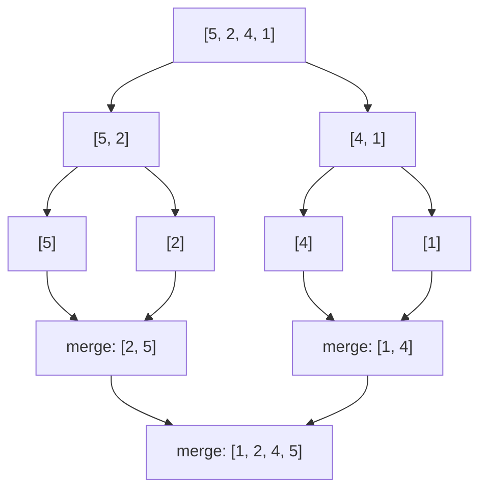

import { Tabs, TabItem, Aside } from '@astrojs/starlight/components';
import QuizBlock from '~/components/QuizBlock.astro';

## Why it matters in interviews

You will rarely be asked to implement a sort from scratch in production code, but interviews still ask *"write merge sort"*, *"why is quick sort O(n²) in the worst case?"* and *"what does stable mean?"*. More often, sorting is **the first step** of a bigger solution (intervals, two pointers, grouping), and you need to know its cost, how to sort by custom rules with `IComparer<T>` or a lambda, and that `Array.Sort` is unstable while LINQ `OrderBy` is stable.

## Core idea

### Algorithm comparison

| Algorithm | Best | Average | Worst | Extra space | Stable | When it is used |
|---|---|---|---|---|---|---|
| Bubble | O(n) | O(n²) | O(n²) | O(1) | yes | teaching only |
| Selection | O(n²) | O(n²) | O(n²) | O(1) | no | minimal swaps |
| Insertion | O(n) | O(n²) | O(n²) | O(1) | yes | small (≤ 16) or nearly sorted arrays |
| Merge | O(n log n) | O(n log n) | O(n log n) | O(n) | yes | linked lists, external sorting, stable sort |
| Quick | O(n log n) | O(n log n) | O(n²) | O(log n) stack | no | fastest in practice on arrays |
| Heap | O(n log n) | O(n log n) | O(n log n) | O(1) | no | guaranteed bound, no extra memory |
| Counting | O(n + k) | O(n + k) | O(n + k) | O(k) | yes | small integer range k |

No comparison-based sort can beat **O(n log n)** in the worst case. Counting and radix sort get around this by not comparing elements, which only works for keys like small integers.

### Divide and conquer

Merge sort and quick sort both split the problem, but in opposite orders:

- **Merge sort** splits blindly in the middle, sorts both halves, and does the real work while **merging**.
- **Quick sort** does the real work while **partitioning** around a pivot (smaller left, larger right), then sorts both sides. No merge step is needed.



The tree has log n levels, and each level merges n elements in total, giving O(n log n).

### Stability

A sort is **stable** if items with equal keys keep their original relative order. It matters when you sort by one key after another: sort orders by date, then stable-sort by customer, and each customer's orders stay in date order.

### What .NET actually uses

| API | Algorithm | Stable | Notes |
|---|---|---|---|
| `Array.Sort`, `List<T>.Sort`, `Span<T>.Sort` | **Introsort** | no | in place, O(n log n) worst case |
| LINQ `OrderBy` / `ThenBy` | buffered sort with index tie-break | **yes** | returns a new sequence, deferred |
| JavaScript `Array.prototype.sort` | TimSort (V8) | yes (since ES2019) | default comparator compares **strings** |

**Introsort** starts as quick sort (median-of-three pivot), switches to **insertion sort** for partitions of 16 elements or fewer, and falls back to **heap sort** if the recursion gets deeper than about 2 log n. That combination gives quick sort's speed, insertion sort's efficiency on tiny ranges, and heap sort's O(n log n) worst-case guarantee.

## Worked problems

### 1. Merge sort

**Problem:** [Sort an Array](https://leetcode.com/problems/sort-an-array/). Sort in O(n log n) without built-in sort functions.

**Approach:** recursively sort each half, then merge two sorted halves with two pointers into a buffer. Allocating one buffer up front avoids an allocation per merge.

<Tabs syncKey="lang">
  <TabItem label="C#">
```csharp
public int[] SortArray(int[] nums)
{
    MergeSort(nums, new int[nums.Length], 0, nums.Length - 1);
    return nums;
}

private void MergeSort(int[] a, int[] buffer, int lo, int hi)
{
    if (lo >= hi) return;                          // 0 or 1 element: sorted
    int mid = lo + (hi - lo) / 2;
    MergeSort(a, buffer, lo, mid);
    MergeSort(a, buffer, mid + 1, hi);

    int i = lo, j = mid + 1, k = lo;
    while (i <= mid && j <= hi)
        buffer[k++] = a[i] <= a[j] ? a[i++] : a[j++];  // <= keeps it stable
    while (i <= mid) buffer[k++] = a[i++];
    while (j <= hi) buffer[k++] = a[j++];
    Array.Copy(buffer, lo, a, lo, hi - lo + 1);
}
```
  </TabItem>
  <TabItem label="TypeScript">
```ts
function mergeSort(nums: number[]): number[] {
  if (nums.length < 2) return nums;
  const mid = Math.floor(nums.length / 2);
  const left = mergeSort(nums.slice(0, mid));
  const right = mergeSort(nums.slice(mid));

  const merged: number[] = [];
  let i = 0;
  let j = 0;
  while (i < left.length && j < right.length) {
    merged.push(left[i] <= right[j] ? left[i++] : right[j++]);
  }
  return merged.concat(left.slice(i), right.slice(j));
}
```
  </TabItem>
</Tabs>

**Complexity:** O(n log n) time in every case, O(n) extra space for the buffer plus O(log n) stack.

**Edge cases:** empty and single-element arrays (base case), duplicates (`<=` takes from the left half first, which keeps equal items in order), already sorted input (still O(n log n)).

### 2. Quick sort

**Problem:** implement in-place quick sort and explain its worst case.

**Approach:** pick a pivot, partition so smaller elements are on its left, then recurse on both sides. A **random** pivot makes the O(n²) case (always picking the smallest or largest element, as happens with a "last element" pivot on sorted input) extremely unlikely.

```csharp
public void QuickSort(int[] a) => QuickSort(a, 0, a.Length - 1);

private void QuickSort(int[] a, int lo, int hi)
{
    if (lo >= hi) return;
    int p = Partition(a, lo, hi);
    QuickSort(a, lo, p - 1);
    QuickSort(a, p + 1, hi);
}

// Lomuto partition with a random pivot; returns the pivot's final index.
private int Partition(int[] a, int lo, int hi)
{
    int r = Random.Shared.Next(lo, hi + 1);
    (a[r], a[hi]) = (a[hi], a[r]);                // move the pivot to the end
    int pivot = a[hi], store = lo;
    for (int i = lo; i < hi; i++)
    {
        if (a[i] < pivot)
        {
            (a[i], a[store]) = (a[store], a[i]);  // grow the "smaller" zone
            store++;
        }
    }
    (a[store], a[hi]) = (a[hi], a[store]);        // pivot into its final place
    return store;
}
```

**Complexity:** O(n log n) average, O(n²) worst case, O(log n) average stack depth. Not stable.

**Edge cases:** sorted or reverse-sorted input with a fixed pivot (O(n²)), **many duplicates** (Lomuto puts all equal values on one side, which also degrades to O(n²); a three-way partition, as in Sort Colors below, fixes it), empty array.

### 3. Sort Colors (three-way partition)

**Problem:** [Sort Colors](https://leetcode.com/problems/sort-colors/). Sort an array of 0s, 1s and 2s in place, in one pass.

**Approach:** the Dutch national flag algorithm keeps three zones: `[0, low)` holds 0s, `[low, mid)` holds 1s, `(high, end]` holds 2s, and `[mid, high]` is still unknown. Look at `nums[mid]` and swap it into the right zone. When swapping with `high`, do **not** advance `mid`: the value that came from `high` has not been examined yet.

<Tabs syncKey="lang">
  <TabItem label="C#">
```csharp
public void SortColors(int[] nums)
{
    int low = 0, mid = 0, high = nums.Length - 1;
    while (mid <= high)
    {
        if (nums[mid] == 0)
        {
            (nums[low], nums[mid]) = (nums[mid], nums[low]);
            low++; mid++;
        }
        else if (nums[mid] == 1) mid++;
        else
        {
            (nums[mid], nums[high]) = (nums[high], nums[mid]);
            high--;                                // re-check the swapped-in value
        }
    }
}
```
  </TabItem>
  <TabItem label="TypeScript">
```ts
function sortColors(nums: number[]): void {
  let low = 0;
  let mid = 0;
  let high = nums.length - 1;
  while (mid <= high) {
    if (nums[mid] === 0) {
      [nums[low], nums[mid]] = [nums[mid], nums[low]];
      low++;
      mid++;
    } else if (nums[mid] === 1) {
      mid++;
    } else {
      [nums[mid], nums[high]] = [nums[high], nums[mid]];
      high--;
    }
  }
}
```
  </TabItem>
</Tabs>

**Complexity:** O(n) time, one pass, O(1) space. Counting sort (count 0s, 1s, 2s, then overwrite) is also O(n) but needs two passes.

**Edge cases:** all the same colour, already sorted, empty array.

### 4. Largest Number (custom comparison)

**Problem:** [Largest Number](https://leetcode.com/problems/largest-number/). Arrange numbers to form the largest number. `[3,30,34,5,9]` gives `"9534330"`.

**Approach:** sorting numerically or as plain strings is wrong (`"30"` vs `"3"`). The right rule compares the two possible **concatenations**: `a` goes first if `a + b > b + a`. This rule is transitive, so it is a valid comparator.

<Tabs syncKey="lang">
  <TabItem label="C#">
```csharp
public string LargestNumber(int[] nums)
{
    var parts = nums.Select(n => n.ToString()).ToArray();
    // "9" before "34" because "934" > "349"
    Array.Sort(parts, (a, b) => string.CompareOrdinal(b + a, a + b));
    return parts[0] == "0" ? "0" : string.Concat(parts);
}
```
  </TabItem>
  <TabItem label="TypeScript">
```ts
function largestNumber(nums: number[]): string {
  const parts = nums.map(String);
  parts.sort((a, b) => (a + b > b + a ? -1 : a + b < b + a ? 1 : 0));
  return parts[0] === '0' ? '0' : parts.join('');
}
```
  </TabItem>
</Tabs>

**Complexity:** O(n log n) comparisons, each O(k) for numbers with up to k digits: O(k · n log n) time, O(n · k) space.

**Edge cases:** all zeros (`[0, 0]` must return `"0"`, not `"00"`), a single number. Use ordinal comparison in C#; culture-aware comparison is slower and is the wrong tool for digit strings.

### 5. Custom sort orders in C#

**Problem:** sort employees by department ascending, then salary descending. Show the main ways to express a custom order in .NET.

**Approach:** a comparer returns a negative number if `x` comes first, 0 if equal, positive if `y` comes first. For descending order, swap the operands. Chain keys by falling through to the next key only when the previous comparison is 0.

```csharp
public record Employee(string Name, string Dept, decimal Salary);

// 1. IComparer<T>: reusable, testable, can be injected.
public class ByDeptThenSalaryDesc : IComparer<Employee>
{
    public int Compare(Employee? x, Employee? y)
    {
        if (ReferenceEquals(x, y)) return 0;
        if (x is null) return -1;
        if (y is null) return 1;
        int byDept = string.CompareOrdinal(x.Dept, y.Dept);
        return byDept != 0 ? byDept : y.Salary.CompareTo(x.Salary); // y first = desc
    }
}

// 2. Comparison<T> lambda: in place, NOT stable.
public void SortInPlace(List<Employee> staff) => staff.Sort(new ByDeptThenSalaryDesc());

public void SortByName(List<Employee> staff) =>
    staff.Sort((a, b) => string.CompareOrdinal(a.Name, b.Name));

// 3. LINQ: returns a new list and IS stable.
public List<Employee> SortWithLinq(IEnumerable<Employee> staff) =>
    staff.OrderBy(e => e.Dept, StringComparer.Ordinal)
         .ThenByDescending(e => e.Salary)
         .ToList();
```

**Complexity:** O(n log n) comparisons for all three. LINQ allocates a new list and an array of keys; `List<T>.Sort` sorts in place.

**Edge cases:** null elements (handle them in `Compare`), ties on every key (only LINQ guarantees original order is kept), `Comparer<T>.Create(...)` turns a lambda into an `IComparer<T>` when an API needs one (e.g. `SortedSet<T>`, `PriorityQueue`). Never write `return a.Salary - b.Salary` for ints: subtraction can overflow and flip the sign.

### 6. Kth Largest Element (quickselect)

**Problem:** [Kth Largest Element in an Array](https://leetcode.com/problems/kth-largest-element-in-an-array/). Find the kth largest without fully sorting.

**Approach:** after one `Partition` (from quick sort above), the pivot is at its final sorted index. If that index is the one you want, stop; otherwise continue on **one** side only. Sorting is O(n log n); a min-heap of size k is O(n log k) (see [Heaps](../heaps/)); quickselect is O(n) on average.

```csharp
public int FindKthLargest(int[] nums, int k)
{
    int target = nums.Length - k;              // its index in ascending order
    int lo = 0, hi = nums.Length - 1;
    while (true)
    {
        int p = Partition(nums, lo, hi);       // same Partition as quick sort
        if (p == target) return nums[p];
        if (p < target) lo = p + 1;            // answer is on the right
        else hi = p - 1;                       // answer is on the left
    }
}
```

**Complexity:** O(n) average (n + n/2 + n/4 + ... < 2n), O(n²) worst case, O(1) extra space. It reorders the input array.

**Edge cases:** k = 1 (the max), k = n (the min), many duplicates (the Lomuto partition degrades; use a three-way partition or the heap approach if the interviewer mentions it).

## Interview Q&A

<details>
<summary>Is `Array.Sort` stable? What about LINQ `OrderBy`?</summary>

`Array.Sort` and `List<T>.Sort` use introsort, which is **not stable**: equal elements may be reordered. LINQ `OrderBy`/`ThenBy` is **stable**. If you need stability with `Array.Sort`, add the original index as a final tie-breaker, or use LINQ.
</details>

<details>
<summary>Why is quick sort usually faster than merge sort when both are O(n log n)?</summary>

Quick sort works in place on a contiguous array, so it has good CPU cache behaviour and no extra allocation. Merge sort copies data into a buffer at every level. Quick sort's constant factor is smaller, and a random or median-of-three pivot makes the O(n²) case practically impossible.
</details>

<details>
<summary>When would you prefer merge sort?</summary>

When you need stability, a guaranteed O(n log n) worst case, or are sorting a **linked list** (merging relinks nodes with O(1) extra space and needs no random access). It is also the basis of external sorting, where data does not fit in memory and sorted chunks are merged from disk.
</details>

<details>
<summary>What causes quick sort's O(n²) worst case?</summary>

Pivots that split the array very unevenly, e.g. always picking the smallest or largest element. With a "first" or "last" element pivot, that happens on already sorted input. Each partition then removes only one element, giving n + (n-1) + ... = O(n²). Random pivots, median-of-three, or introsort's heap-sort fallback avoid it.
</details>

<details>
<summary>What does a comparer need to return, and what are the rules?</summary>

Negative if `x < y`, zero if equal, positive if `x > y`. It must be consistent: `Compare(x, x) == 0`, antisymmetric, and **transitive** (if a < b and b < c then a < c). A comparer that breaks transitivity, or returns random values, can make `Array.Sort` throw `InvalidOperationException` ("IComparer.Compare() method returns inconsistent results") or produce garbage.
</details>

<details>
<summary>How do you sort numbers correctly in JavaScript/TypeScript?</summary>

`[10, 9, 1].sort()` returns `[1, 10, 9]` because the default comparator converts elements to strings. Always pass a comparator: `nums.sort((a, b) => a - b)`. Since ES2019 `sort` is guaranteed stable, and `toSorted()` returns a sorted copy instead of mutating.
</details>

<details>
<summary>Can you sort faster than O(n log n)?</summary>

Not with comparisons: any comparison sort needs Ω(n log n) comparisons in the worst case. If the keys are integers in a small range, counting sort runs in O(n + k), and radix sort in O(d · (n + k)) for d-digit keys. Sort Colors is a tiny example (k = 3).
</details>

## Pitfalls

<Aside type="caution" title="Common mistakes">

- **Assuming `List<T>.Sort` is stable**: it is not; use `OrderBy` or an index tie-breaker.
- **Comparers that subtract** (`a - b`) on large ints overflow and invert the order. Use `a.CompareTo(b)`.
- **Culture-sensitive string sorting** where ordinal is meant (`OrderBy(s => s)` uses the current culture).
- **Sorting inside a loop**, turning an O(n log n) step into O(n² log n).
- **Fixed pivot on sorted input** in a hand-written quick sort.
- **JavaScript default `sort()`** on numbers.

</Aside>

## Related

- [Big-O & Complexity Analysis](../big-o/)
- [Binary Search](../binary-search/)
- [Heaps & Priority Queues](../heaps/)
- [Greedy & Intervals](../greedy-intervals/)

## Quick quiz

<QuizBlock section="dsa" topic="sorting" />
