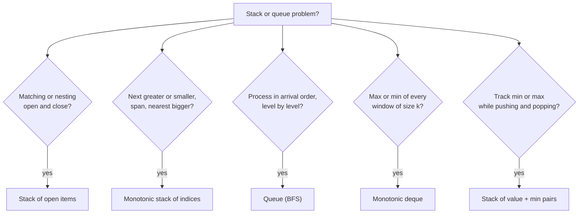

import { Tabs, TabItem, Aside } from '@astrojs/starlight/components';
import QuizBlock from '~/components/QuizBlock.astro';

## Why it matters in interviews

*"Valid parentheses"* and *"min stack"* are warm-up favourites, and *"daily temperatures"* or *"next greater element"* test whether you know the **monotonic stack**, which turns an O(n²) "look ahead for the next bigger item" into O(n). Interviewers also like design questions such as *"implement a queue with two stacks"* because they test amortised analysis, and .NET candidates are expected to know `Stack<T>`, `Queue<T>` and what to use when there is no built-in deque.

## Core idea

- A **stack** is LIFO (last in, first out): `Push`, `Pop`, `Peek`, all O(1). Use it when the most recent unfinished thing must be handled first: matching brackets, undo, DFS, evaluating expressions.
- A **queue** is FIFO (first in, first out): `Enqueue`, `Dequeue`, `Peek`, all O(1). Use it when items must be processed in arrival order: BFS, task scheduling, buffering.
- A **deque** allows add/remove at both ends. .NET has no `Deque<T>`; use `LinkedList<T>` (`AddLast`, `RemoveFirst`, `RemoveLast` are O(1)) or a circular array.

### Monotonic stack

A monotonic stack keeps its elements in sorted order (for example, decreasing from bottom to top). Before pushing a new element, you **pop everything it breaks the order with**. The popped elements have just found their answer: the new element is their "next greater" item.



Each element is pushed once and popped at most once, so a monotonic stack pass is **O(n)** even though it has a `while` inside a `for`.

## Worked problems

### 1. Valid Parentheses

**Problem:** [Valid Parentheses](https://leetcode.com/problems/valid-parentheses/). Given a string of `()[]{}`, is every bracket closed by the right type in the right order?

**Approach:** push for every opening bracket; on a closing bracket, the top of the stack must be its partner. At the end the stack must be empty. A neat trick in C# is to push the **expected closer**, so the check is a single comparison.

<Tabs syncKey="lang">
  <TabItem label="C#">
```csharp
public bool IsValid(string s)
{
    var stack = new Stack<char>();
    foreach (char c in s)
    {
        switch (c)
        {
            case '(': stack.Push(')'); break;  // push the expected closer
            case '[': stack.Push(']'); break;
            case '{': stack.Push('}'); break;
            default:
                if (stack.Count == 0 || stack.Pop() != c) return false;
                break;
        }
    }
    return stack.Count == 0;
}
```
  </TabItem>
  <TabItem label="TypeScript">
```ts
function isValid(s: string): boolean {
  const openerFor: Record<string, string> = { ')': '(', ']': '[', '}': '{' };
  const stack: string[] = [];
  for (const c of s) {
    if (c in openerFor) {
      if (stack.pop() !== openerFor[c]) return false;
    } else {
      stack.push(c);
    }
  }
  return stack.length === 0;
}
```
  </TabItem>
</Tabs>

**Complexity:** O(n) time, O(n) space.

**Edge cases:** empty string (valid), a closer first like `")("` (stack empty when popping), only openers like `"(("` (stack not empty at the end), odd length (can return false immediately).

### 2. Min Stack

**Problem:** [Min Stack](https://leetcode.com/problems/min-stack/). Design a stack with `Push`, `Pop`, `Top` and `GetMin`, all O(1).

**Approach:** a single "current min" variable fails when the minimum is popped. Instead, store with each entry **the minimum at the time it was pushed**. Popping restores the previous minimum automatically.

<Tabs syncKey="lang">
  <TabItem label="C#">
```csharp
public class MinStack
{
    // Each entry keeps its value and the stack minimum when it was pushed.
    private readonly Stack<(int Value, int Min)> _stack = new();

    public void Push(int val)
    {
        int min = _stack.Count == 0 ? val : Math.Min(val, _stack.Peek().Min);
        _stack.Push((val, min));
    }

    public void Pop() => _stack.Pop();
    public int Top() => _stack.Peek().Value;
    public int GetMin() => _stack.Peek().Min;
}
```
  </TabItem>
  <TabItem label="TypeScript">
```ts
class MinStack {
  private stack: { value: number; min: number }[] = [];

  push(val: number): void {
    const min = this.stack.length === 0 ? val : Math.min(val, this.getMin());
    this.stack.push({ value: val, min });
  }
  pop(): void {
    this.stack.pop();
  }
  top(): number {
    return this.stack[this.stack.length - 1].value;
  }
  getMin(): number {
    return this.stack[this.stack.length - 1].min;
  }
}
```
  </TabItem>
</Tabs>

**Complexity:** O(1) for every operation, O(n) space.

**Edge cases:** pushing duplicates of the minimum (each copy stores the min, so popping one keeps the other), calling `Top` or `GetMin` on an empty stack (`Stack<T>.Peek` throws `InvalidOperationException`; clarify the contract with the interviewer).

### 3. Daily Temperatures (monotonic stack)

**Problem:** [Daily Temperatures](https://leetcode.com/problems/daily-temperatures/). For each day, how many days until a warmer temperature? 0 if none.

**Approach:** keep a stack of **indices** of days still waiting for a warmer day, with temperatures decreasing from bottom to top. When today is warmer than the top, today is that day's answer: pop and record the distance.

Trace for `[73, 74, 75, 71, 69, 72, 76, 73]`:

| i | temp | popped (answer set) | stack after (temps) |
|---|---|---|---|
| 0 | 73 | | 73 |
| 1 | 74 | day 0 → 1 | 74 |
| 2 | 75 | day 1 → 1 | 75 |
| 3 | 71 | | 75, 71 |
| 4 | 69 | | 75, 71, 69 |
| 5 | 72 | day 4 → 1, day 3 → 2 | 75, 72 |
| 6 | 76 | day 5 → 1, day 2 → 4 | 76 |
| 7 | 73 | | 76, 73 |

Result: `[1, 1, 4, 2, 1, 1, 0, 0]`. Days 6 and 7 are never popped, so they keep 0.

<Tabs syncKey="lang">
  <TabItem label="C#">
```csharp
public int[] DailyTemperatures(int[] temps)
{
    var answer = new int[temps.Length];
    var stack = new Stack<int>();            // indices; temps decreasing
    for (int i = 0; i < temps.Length; i++)
    {
        while (stack.Count > 0 && temps[i] > temps[stack.Peek()])
        {
            int j = stack.Pop();             // day i is j's next warmer day
            answer[j] = i - j;
        }
        stack.Push(i);
    }
    return answer;                           // unresolved days stay 0
}
```
  </TabItem>
  <TabItem label="TypeScript">
```ts
function dailyTemperatures(temps: number[]): number[] {
  const answer = new Array<number>(temps.length).fill(0);
  const stack: number[] = []; // indices; temps decreasing
  for (let i = 0; i < temps.length; i++) {
    while (stack.length > 0 && temps[i] > temps[stack[stack.length - 1]]) {
      const j = stack.pop()!;
      answer[j] = i - j;
    }
    stack.push(i);
  }
  return answer;
}
```
  </TabItem>
</Tabs>

**Complexity:** O(n) time (each index pushed and popped once), O(n) space.

**Edge cases:** strictly decreasing input (nothing is popped, all zeros), equal temperatures (use `>` not `>=`, since equal is not warmer), single day.

### 4. Next Greater Element I

**Problem:** [Next Greater Element I](https://leetcode.com/problems/next-greater-element-i/). `nums1` is a subset of `nums2` (distinct values). For each `x` in `nums1`, find the first greater value to its right in `nums2`, or -1.

**Approach:** run the same monotonic stack over `nums2`, but record the answers in a `Dictionary` keyed by value. Then look each `nums1` value up.

```csharp
public int[] NextGreaterElement(int[] nums1, int[] nums2)
{
    var nextGreater = new Dictionary<int, int>(); // value -> next greater in nums2
    var stack = new Stack<int>();                 // values, decreasing
    foreach (int x in nums2)
    {
        while (stack.Count > 0 && x > stack.Peek())
            nextGreater[stack.Pop()] = x;
        stack.Push(x);
    }
    return nums1.Select(x => nextGreater.GetValueOrDefault(x, -1)).ToArray();
}
```

**Complexity:** O(n + m) time, O(n) space, compared with O(n · m) for scanning right from each element.

**Edge cases:** values with no greater element (default -1). For the circular version ([Next Greater Element II](https://leetcode.com/problems/next-greater-element-ii/)), loop over the array twice using `i % n`.

### 5. Implement Queue using Stacks

**Problem:** [Implement Queue using Stacks](https://leetcode.com/problems/implement-queue-using-stacks/). Build a FIFO queue with only two stacks.

**Approach:** push into `_in`. To dequeue, take from `_out`; only when `_out` is empty, pour all of `_in` into it, which reverses the order so the oldest item is on top.

```csharp
public class MyQueue
{
    private readonly Stack<int> _in = new();
    private readonly Stack<int> _out = new();

    public void Push(int x) => _in.Push(x);
    public int Pop() { MoveIfNeeded(); return _out.Pop(); }
    public int Peek() { MoveIfNeeded(); return _out.Peek(); }
    public bool Empty() => _in.Count == 0 && _out.Count == 0;

    // Refill only when _out is empty: each element moves once => amortised O(1).
    private void MoveIfNeeded()
    {
        if (_out.Count > 0) return;
        while (_in.Count > 0) _out.Push(_in.Pop());
    }
}
```

**Complexity:** `Push` O(1). `Pop`/`Peek` are O(n) in the worst case but **amortised O(1)**, because each element is moved from `_in` to `_out` exactly once.

**Edge cases:** interleaved pushes and pops (new pushes wait in `_in` until `_out` drains, which keeps the order correct), pop on empty (throws).

### 6. Sliding Window Maximum (monotonic deque)

**Problem:** [Sliding Window Maximum](https://leetcode.com/problems/sliding-window-maximum/). Return the maximum of every window of size k. `[1,3,-1,-3,5,3,6,7]`, k = 3 gives `[3,3,5,5,6,7]`.

**Approach:** keep a deque of indices whose values are **decreasing**. The front is always the max of the current window. For each new index: drop the front if it slid out of the window, then drop from the back every value ≤ the new one (they can never be a max again while the new one is in the window).

```csharp
public int[] MaxSlidingWindow(int[] nums, int k)
{
    var result = new int[nums.Length - k + 1];
    var deque = new LinkedList<int>();         // indices; values decreasing
    for (int i = 0; i < nums.Length; i++)
    {
        if (deque.Count > 0 && deque.First!.Value <= i - k)
            deque.RemoveFirst();               // front slid out of the window
        while (deque.Count > 0 && nums[deque.Last!.Value] <= nums[i])
            deque.RemoveLast();                // can never be the max again
        deque.AddLast(i);
        if (i >= k - 1) result[i - k + 1] = nums[deque.First!.Value];
    }
    return result;
}
```

**Complexity:** O(n) time (each index added and removed once), O(k) space. A `PriorityQueue` solution is O(n log n) and is an acceptable first answer.

**Edge cases:** k = 1 (the array itself), k = n (a single max), duplicates (use `<=` so older equal values are dropped).

## Interview Q&A

<details>
<summary>Why is the monotonic stack O(n) when there is a while loop inside a for loop?</summary>

Each index is pushed exactly once and popped at most once. The total number of pops across the whole run is at most n, so the `while` loop body runs at most n times in total. Overall it is O(n), not O(n²).
</details>

<details>
<summary>Why store indices instead of values in the monotonic stack?</summary>

The answer often needs a distance (`i - j` in Daily Temperatures) or a position in the output array. With the index you can always read the value back as `nums[j]`, but not the other way round, especially when values repeat.
</details>

<details>
<summary>How do you choose between an increasing and a decreasing stack?</summary>

Ask what you are looking for. "Next **greater**" means you pop smaller items when a bigger one arrives, so the stack is **decreasing**. "Next **smaller**" pops bigger items, so the stack is **increasing**. Iterate from the right instead of the left to get "previous greater/smaller".
</details>

<details>
<summary>Explain why the two-stack queue is amortised O(1).</summary>

An element is pushed onto `_in` once, moved to `_out` once and popped from `_out` once: three O(1) operations over its lifetime. A single `Pop` can move n items, but that only happens after n cheap pushes, so the average per operation is constant.
</details>

<details>
<summary>.NET has no Deque. What do you use?</summary>

`LinkedList<T>` gives O(1) `AddFirst`, `AddLast`, `RemoveFirst`, `RemoveLast`, at the cost of a node allocation per item. For performance-critical code, a circular array with head and tail indices avoids allocations. In TypeScript, an array with a head index works; `shift()` is O(n).
</details>

<details>
<summary>`Stack<T>` vs recursion: when would you convert one into the other?</summary>

Recursion uses the call stack implicitly. An explicit `Stack<T>` avoids `StackOverflowException` on deep inputs (e.g. DFS over a 10⁵-node path) and lets you pause and resume. Recursion is usually shorter to write, so start with it and mention the iterative version as the fix for deep inputs.
</details>

<details>
<summary>What does `Stack<T>.Pop()` do on an empty stack in .NET?</summary>

It throws `InvalidOperationException`. Check `Count > 0` first, or use `TryPop(out var item)` and `TryPeek`, which return false instead of throwing. The same applies to `Queue<T>.Dequeue` and `TryDequeue`.
</details>

## Pitfalls

<Aside type="caution" title="Common mistakes">

- **Popping an empty stack**: always check `Count > 0` (or use `TryPop`) before `Pop`/`Peek`.
- **Forgetting the final emptiness check** in bracket matching (`"(("` would be accepted).
- **Using `>=` vs `>` carelessly** in monotonic stacks: it decides how equal values are treated.
- **Tracking the minimum in one variable** in Min Stack, which breaks when the minimum is popped.
- **Using `array.shift()` as a queue in TypeScript** inside a hot loop: it is O(n) per call.
- **Moving items from `_in` to `_out` on every pop**, which destroys the amortised O(1) guarantee.

</Aside>

## Related

- [Arrays & Strings Patterns](../arrays-strings/)
- [Linked Lists](../linked-lists/)
- [Graphs](../graphs/)
- [Collections & Generics](../../csharp/collections-generics/)

## Quick quiz

<QuizBlock section="dsa" topic="stacks-queues" />
