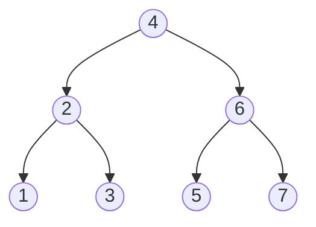

import { Tabs, TabItem, Aside } from '@astrojs/starlight/components';
import QuizBlock from '~/components/QuizBlock.astro';

## Why it matters in interviews

Binary trees are the most common "medium" topic after arrays and hashing. They test whether you can **think recursively**: trust the call on the children, then combine the answers at the current node. At 3-4 years you are expected to write a traversal from memory, do level order with a queue, and solve one "compute something per subtree" problem (height, diameter, validate BST, LCA) cleanly and with the right complexity.

## Core idea

A binary tree node has a value and up to two children. A **binary search tree (BST)** adds an ordering rule: every value in the left subtree is smaller than the node and every value in the right subtree is larger. That rule applies to the **whole subtree**, not just the direct children.



| Traversal | Order | Result for the tree above | Typical use |
|---|---|---|---|
| Preorder | node, left, right | 4 2 1 3 6 5 7 | copy / serialize a tree |
| Inorder | left, node, right | 1 2 3 4 5 6 7 | BST gives **sorted** output |
| Postorder | left, right, node | 1 3 2 5 7 6 4 | compute from children first (height, delete) |
| Level order | level by level (BFS) | 4, 2 6, 1 3 5 7 | levels, right side view, min depth |

### How to recognise the pattern

- *"For every node, compute X from its subtrees"* (height, diameter, balanced, max path sum): **postorder DFS** that returns a value up.
- *"Something about levels / nearest / minimum depth"*: **BFS with a queue**, processing one level at a time.
- *"BST"* in the statement: use the ordering. Inorder is sorted, and you can discard half the tree at each step (O(h) instead of O(n)).
- *"Pass a constraint down"* (valid range, path so far): DFS with extra parameters.

### The recursive template

Almost every tree problem fits this shape: handle `null`, recurse into both children, combine.

```csharp
public class TreeNode(int val, TreeNode? left = null, TreeNode? right = null)
{
    public int val = val;
    public TreeNode? left = left;
    public TreeNode? right = right;
}

public static void InorderRec(TreeNode? node, List<int> result)
{
    if (node is null) return;        // base case
    InorderRec(node.left, result);   // left
    result.Add(node.val);            // node  (move this line for pre/post order)
    InorderRec(node.right, result);  // right
}
```

### Iterative traversals

Interviewers often ask for the iterative version to check that you understand the call stack. Replace recursion with an explicit `Stack<TreeNode>`.

```csharp
public static List<int> InorderIterative(TreeNode? root)
{
    var result = new List<int>();
    var stack = new Stack<TreeNode>();
    var current = root;
    while (current is not null || stack.Count > 0)
    {
        while (current is not null)      // go as far left as possible
        {
            stack.Push(current);
            current = current.left;
        }
        current = stack.Pop();           // visit
        result.Add(current.val);
        current = current.right;         // then the right subtree
    }
    return result;
}

public static List<int> PreorderIterative(TreeNode? root)
{
    var result = new List<int>();
    if (root is null) return result;
    var stack = new Stack<TreeNode>([root]);
    while (stack.Count > 0)
    {
        var node = stack.Pop();
        result.Add(node.val);
        if (node.right is not null) stack.Push(node.right); // right first,
        if (node.left is not null) stack.Push(node.left);   // so left pops first
    }
    return result;
}
```

Complexity for any full traversal: **O(n) time**, **O(h) space** for the stack, where h is the height. h is O(log n) for a balanced tree and O(n) for a skewed one (a "linked list" tree).

## Worked problems

### 1. Binary Tree Level Order Traversal

[LeetCode 102](https://leetcode.com/problems/binary-tree-level-order-traversal/): return the values level by level, e.g. `[[4],[2,6],[1,3,5,7]]`.

**Approach.** BFS with a queue. The trick is to read `queue.Count` **before** the inner loop: that is exactly the number of nodes on the current level.

<Tabs syncKey="lang">
  <TabItem label="C#">
```csharp
public static IList<IList<int>> LevelOrder(TreeNode? root)
{
    var result = new List<IList<int>>();
    if (root is null) return result;
    var queue = new Queue<TreeNode>();
    queue.Enqueue(root);
    while (queue.Count > 0)
    {
        int size = queue.Count;              // nodes on this level
        var level = new List<int>(size);
        for (int i = 0; i < size; i++)
        {
            var node = queue.Dequeue();
            level.Add(node.val);
            if (node.left is not null) queue.Enqueue(node.left);
            if (node.right is not null) queue.Enqueue(node.right);
        }
        result.Add(level);
    }
    return result;
}
```
  </TabItem>
  <TabItem label="TypeScript">
```ts
class TreeNode {
  constructor(
    public val: number,
    public left: TreeNode | null = null,
    public right: TreeNode | null = null,
  ) {}
}

function levelOrder(root: TreeNode | null): number[][] {
  const result: number[][] = [];
  if (!root) return result;
  let queue: TreeNode[] = [root];
  while (queue.length > 0) {
    const next: TreeNode[] = []; // build the next level instead of shift() (O(n))
    result.push(queue.map((n) => n.val));
    for (const node of queue) {
      if (node.left) next.push(node.left);
      if (node.right) next.push(node.right);
    }
    queue = next;
  }
  return result;
}
```
  </TabItem>
</Tabs>

**Complexity:** O(n) time, O(w) space where w is the widest level (up to n/2).
**Edge cases:** empty tree returns `[]`; a skewed tree gives one value per level. Variants with the same skeleton: right side view (last value of each level), zigzag order, minimum depth (stop at the first leaf).

### 2. Maximum Depth and Diameter of a Binary Tree

[LeetCode 104](https://leetcode.com/problems/maximum-depth-of-binary-tree/) and [LeetCode 543](https://leetcode.com/problems/diameter-of-binary-tree/): the diameter is the number of **edges** on the longest path between any two nodes. The path does not have to pass through the root.

**Approach.** Postorder. A helper returns the height of a subtree; while it is at a node it also checks "longest path that bends here" = left height + right height, and keeps the best one in a field. One pass, instead of calling `Height` from every node (O(n²)).

<Tabs syncKey="lang">
  <TabItem label="C#">
```csharp
public class DiameterSol
{
    public static int MaxDepth(TreeNode? root) =>
        root is null ? 0 : 1 + Math.Max(MaxDepth(root.left), MaxDepth(root.right));

    private int _best;

    public int DiameterOfBinaryTree(TreeNode? root)
    {
        _best = 0;
        Height(root);
        return _best;
    }

    // Returns height in nodes; records the longest path (in edges) through each node.
    private int Height(TreeNode? node)
    {
        if (node is null) return 0;
        int left = Height(node.left);
        int right = Height(node.right);
        _best = Math.Max(_best, left + right);
        return 1 + Math.Max(left, right);
    }
}
```
  </TabItem>
  <TabItem label="TypeScript">
```ts
function diameterOfBinaryTree(root: TreeNode | null): number {
  let best = 0;
  const height = (node: TreeNode | null): number => {
    if (!node) return 0;
    const left = height(node.left);
    const right = height(node.right);
    best = Math.max(best, left + right);
    return 1 + Math.max(left, right);
  };
  height(root);
  return best;
}
```
  </TabItem>
</Tabs>

**Complexity:** O(n) time, O(h) recursion space.
**Edge cases:** empty tree and single node both give 0. A tree where the longest path lives entirely in the left subtree (the root is not on it) is the case that breaks "left depth + right depth of root".

### 3. Validate Binary Search Tree

[LeetCode 98](https://leetcode.com/problems/validate-binary-search-tree/): check the BST rule for the whole tree.

**Approach.** Checking only `left.val < node.val < right.val` is the classic wrong answer: a 3 deep in the right subtree of 5 passes the local check but breaks the rule. Pass a **(low, high) window** down instead. Going left tightens `high`, going right tightens `low`. Use `long` bounds so a node holding `int.MaxValue` still fits. (Alternative: an inorder traversal must be strictly increasing.)

<Tabs syncKey="lang">
  <TabItem label="C#">
```csharp
public static bool IsValidBST(TreeNode? root) => Check(root, long.MinValue, long.MaxValue);

// Every node must sit strictly inside the (low, high) window set by its ancestors.
private static bool Check(TreeNode? node, long low, long high)
{
    if (node is null) return true;
    if (node.val <= low || node.val >= high) return false;
    return Check(node.left, low, node.val) && Check(node.right, node.val, high);
}
```
  </TabItem>
  <TabItem label="TypeScript">
```ts
function isValidBST(root: TreeNode | null): boolean {
  const check = (node: TreeNode | null, low: number, high: number): boolean => {
    if (!node) return true;
    if (node.val <= low || node.val >= high) return false;
    return check(node.left, low, node.val) && check(node.right, node.val, high);
  };
  return check(root, -Infinity, Infinity);
}
```
  </TabItem>
</Tabs>

**Complexity:** O(n) time, O(h) space.
**Edge cases:** duplicates (LeetCode treats equal values as invalid, hence `<=` / `>=`), `int.MinValue` / `int.MaxValue` values, empty tree (valid).

### 4. Lowest Common Ancestor

[LeetCode 236](https://leetcode.com/problems/lowest-common-ancestor-of-a-binary-tree/) (any binary tree) and [LeetCode 235](https://leetcode.com/problems/lowest-common-ancestor-of-a-binary-search-tree/) (BST): find the deepest node that has both `p` and `q` as descendants (a node is a descendant of itself).

**Approach.** For a general tree, search both subtrees. If `p` is found on one side and `q` on the other, the current node is where their paths split, so it is the LCA. If both are on one side, pass that side's answer up. For a BST you don't need to search: if both values are smaller go left, if both are larger go right, otherwise you are at the split point.

```csharp
// Binary tree (not necessarily BST). p and q are guaranteed to exist.
public static TreeNode? LowestCommonAncestor(TreeNode? root, TreeNode p, TreeNode q)
{
    if (root is null || root == p || root == q) return root;
    var left = LowestCommonAncestor(root.left, p, q);
    var right = LowestCommonAncestor(root.right, p, q);
    if (left is not null && right is not null) return root; // p and q split here
    return left ?? right;                                    // both on one side
}

// BST version: use the ordering. O(h) time, O(1) space.
public static TreeNode LcaBst(TreeNode root, TreeNode p, TreeNode q)
{
    var node = root;
    while (true)
    {
        if (p.val < node.val && q.val < node.val) node = node.left!;
        else if (p.val > node.val && q.val > node.val) node = node.right!;
        else return node;
    }
}
```

**Complexity:** general tree O(n) time, O(h) space. BST O(h) time, O(1) space.
**Edge cases:** one node is an ancestor of the other (the ancestor is the answer, handled by `root == p` returning early); `p == q`.

### 5. Serialize and Deserialize a Binary Tree

[LeetCode 297](https://leetcode.com/problems/serialize-and-deserialize-binary-tree/): convert a tree to a string and back.

**Approach.** Preorder with a marker for `null` (`#`). The null markers make the encoding unambiguous, so preorder alone is enough to rebuild the tree. Deserialize reads tokens from a queue in the same preorder: a value creates a node, then its left subtree, then its right subtree.

```csharp
public class Codec
{
    // Preorder with "#" for null, e.g. "4,2,#,#,6,#,#"
    public string Serialize(TreeNode? root)
    {
        var parts = new List<string>();
        void Write(TreeNode? n)
        {
            if (n is null) { parts.Add("#"); return; }
            parts.Add(n.val.ToString());
            Write(n.left);
            Write(n.right);
        }
        Write(root);
        return string.Join(',', parts);
    }

    public TreeNode? Deserialize(string data)
    {
        var tokens = new Queue<string>(data.Split(','));
        TreeNode? Read()
        {
            var t = tokens.Dequeue();
            if (t == "#") return null;
            var node = new TreeNode(int.Parse(t));
            node.left = Read();
            node.right = Read();
            return node;
        }
        return Read();
    }
}
```

**Complexity:** O(n) time and space for both directions.
**Edge cases:** empty tree serializes to `"#"`; negative values (use a separator, never assume one character per value); deep skewed trees can overflow the recursion stack for very large inputs, so mention an iterative or BFS-based alternative.

## Interview Q&A

<details>
<summary>What is the difference between a binary tree, a BST and a balanced BST?</summary>

A binary tree only limits each node to two children. A BST adds the ordering rule (left subtree smaller, right subtree larger), which gives O(h) search. A balanced BST (AVL, red-black) keeps h at O(log n) by rotating on insert/delete. Without balancing, inserting sorted data turns a BST into a linked list with O(n) operations.
</details>

<details>
<summary>Which .NET collections are trees under the hood?</summary>

`SortedDictionary<TKey,TValue>` and `SortedSet<T>` are red-black trees: O(log n) insert, delete and lookup, and in-order enumeration. `SortedList<TKey,TValue>` is two sorted arrays (fast lookups, O(n) inserts). `PriorityQueue<TElement,TPriority>` is an array-based heap, which is a tree stored in an array but not a search tree.
</details>

<details>
<summary>When would you choose BFS over DFS on a tree?</summary>

BFS when the question is about levels or the **closest** match: level order, right side view, minimum depth (BFS can stop at the first leaf). DFS when you compute something from subtrees (height, diameter, path sums) or need to pass state down a path. DFS uses O(h) memory and BFS uses O(width), so on a very wide tree DFS is lighter and on a very deep tree BFS avoids stack overflow.
</details>

<details>
<summary>What is the space complexity of a recursive traversal?</summary>

O(h), the maximum depth of the call stack. That is O(log n) for a balanced tree and O(n) for a skewed one. Always say both, because "O(log n)" alone is wrong for an unbalanced input.
</details>

<details>
<summary>How do you find the kth smallest element in a BST?</summary>

Do an inorder traversal (which visits values in sorted order) and stop at the kth visited node. With the iterative inorder above it is O(h + k) time. If the tree is modified often and you query a lot, store subtree sizes in each node so you can pick left or right in O(h).
</details>

<details>
<summary>Why does checking only the immediate children fail when validating a BST?</summary>

The BST rule is about whole subtrees. In `5 -> right 6 -> left 3`, the node 3 is a valid left child of 6 but it sits in the right subtree of 5, so it must be greater than 5. Passing a (low, high) range down, or checking that the inorder sequence is strictly increasing, catches that.
</details>

<details>
<summary>How would you return the result of a tree DFS that needs two values per node?</summary>

Return a tuple, e.g. `(int height, bool balanced)` for "is the tree balanced", or use a field (or closure variable) for a global best like the diameter. Tuples keep the function pure and are easy to reason about; a field is shorter. Both are fine in an interview if you explain why.
</details>

## Pitfalls

<Aside type="caution" title="Common mistakes">
- Forgetting the `null` base case, or checking `node.left.val` without a null check.
- Validating a BST by comparing only parent and children.
- Calling `Height()` from inside another recursion over every node, turning an O(n) solution into O(n²).
- Using `int` bounds for BST validation and failing on `int.MinValue` / `int.MaxValue` nodes.
- In TypeScript BFS, using `queue.shift()` in a loop: each shift is O(n), so the traversal becomes O(n²) on large trees.
- Quoting O(log n) space for recursion without saying "if balanced".
</Aside>

## Related

- [Recursion & Backtracking](../recursion-backtracking/)
- [Graphs (BFS/DFS on general graphs)](../graphs/)
- [Heaps & Priority Queues](../heaps/)
- [Collections & Generics](../../csharp/collections-generics/)

## Quick quiz

<QuizBlock section="dsa" topic="trees-bst" />
