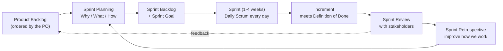
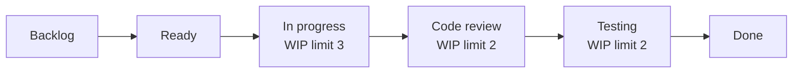

import { Tabs, TabItem, Aside } from '@astrojs/starlight/components';
import QuizBlock from '~/components/QuizBlock.astro';

## Why it matters in interviews

Service companies ask Scrum MCQs in online tests, and almost every manager or hiring-manager round asks *"walk me through your sprint"*, *"how do you estimate?"*, *"what is your definition of done?"* or *"how do you handle technical debt?"*. They are checking that you have worked in a real team and that you think about delivery, quality and collaboration, not just code. Answer with specifics from your own project.

## Core idea

Agile is a set of values (the 2001 **Agile Manifesto**): individuals and interactions, working software, customer collaboration and responding to change, valued **over** processes and tools, comprehensive documentation, contract negotiation and following a plan. Scrum and Kanban are concrete frameworks that put those values into practice by delivering in small increments and inspecting and adapting frequently.

### Scrum at a glance



**Roles (accountabilities)** in the Scrum Guide 2020:

| Role | Accountable for | Not |
|---|---|---|
| **Product Owner** | Maximising product value; ordering and clarifying the Product Backlog; the Product Goal | A project manager assigning tasks |
| **Scrum Master** | The team's effectiveness and Scrum adoption; removing impediments; coaching | The team's boss or the person who runs every meeting |
| **Developers** | Creating a usable Increment each sprint; the Sprint Backlog; quality via the DoD | Only coders: testers, designers and DBAs on the team are all "Developers" |

**Events** (timeboxes are maximums for a one-month sprint; shorter sprints usually take less):

| Event | Purpose | Timebox |
|---|---|---|
| Sprint | Container for all work; fixed length, 1 month or less | 1-4 weeks (2 is common) |
| Sprint Planning | Agree the Sprint Goal, select backlog items, plan how | 8 h |
| Daily Scrum | Developers inspect progress toward the Sprint Goal and adapt the plan | 15 min |
| Sprint Review | Show the Increment to stakeholders, adapt the backlog | 4 h |
| Sprint Retrospective | Improve people, process, tools and the DoD | 3 h |

**Backlog refinement** (splitting, clarifying and estimating upcoming items) is an ongoing activity, not a formal event, though many teams schedule a weekly session.

**Artifacts and their commitments**: Product Backlog → **Product Goal**; Sprint Backlog → **Sprint Goal**; Increment → **Definition of Done**.

### User stories and estimation

A user story: *"As a **store manager**, I want **to export orders to CSV** so that **I can reconcile them in Excel**."* Good stories follow **INVEST**: Independent, Negotiable, Valuable, Estimable, Small, Testable. Each has **acceptance criteria** specific to that story.

**Story points** are a **relative** measure of effort, complexity and uncertainty, not hours. The team compares a new item with a reference story ("the login page was a 3; this is about twice that, so 5 or 8").

- Scales: modified Fibonacci (1, 2, 3, 5, 8, 13, 20...) so big items get coarse numbers, reflecting uncertainty. Anything above ~13 is a signal to **split**.
- **Planning poker**: everyone reveals an estimate at once, the highest and lowest explain, re-vote. The discussion surfaces hidden work (migrations, edge cases) and matters more than the number.
- **T-shirt sizes** (S/M/L/XL) for rough roadmap-level sizing.
- **Velocity** = points completed per sprint, averaged over a few sprints, used for **the team's own** forecasting. It is not comparable across teams and should never be a performance target.

### Kanban

Kanban visualises work on a board and limits **work in progress (WIP)** to improve flow. There are no fixed sprints or prescribed roles; work is **pulled** when capacity frees up.



Key metrics: **lead time** (request to delivery), **cycle time** (work started to delivery), **throughput** (items finished per period). Little's Law: average cycle time ≈ WIP / throughput, which is why lowering WIP speeds things up.

| | Scrum | Kanban |
|---|---|---|
| Cadence | Fixed-length sprints | Continuous flow |
| Roles | PO, SM, Developers | None prescribed |
| Change during iteration | Sprint scope protected (the Sprint Goal stays fixed) | Any time, if WIP allows |
| Limits work by | Sprint capacity | Explicit WIP limits per column |
| Metrics | Velocity, burndown | Lead/cycle time, throughput, cumulative flow |
| Good for | Product feature development | Support, ops, maintenance, unpredictable inflow |

Many teams run "Scrumban": sprints for planning and review, plus WIP limits on the board.

### Definition of Done vs acceptance criteria

- **Definition of Done (DoD)**: a quality checklist that applies to **every** backlog item. Example: code reviewed and merged to `main`, unit tests written and passing, CI green, no new analyzer warnings, API documented in OpenAPI, deployed to the test environment, product owner has seen it.
- **Acceptance criteria**: the conditions **one specific** story must satisfy ("CSV includes order id, date and total; export is limited to the selected date range").
- **Definition of Ready** (not part of the Scrum Guide but common): an item is clear, small and estimated enough to pull into a sprint.

If an item does not meet the DoD by the end of the sprint, it is not part of the Increment and goes back to the backlog.

### Code review etiquette

As the **author**: keep PRs small, describe what and why, self-review the diff first, respond to every comment, and do not take feedback personally.

As the **reviewer**:

- Review the **code, not the person**: *"this query runs per item, could we batch it?"* rather than *"you wrote an N+1"*.
- **Ask questions** rather than issue orders when intent is unclear.
- Label severity: blocking issues vs `nit:` suggestions vs questions. Do not block on personal style; automate style with formatters and analyzers (`dotnet format`, ESLint, Prettier).
- Focus on correctness, security, readability, tests and design, roughly in that order.
- Respond within a working day; slow reviews are a top cause of long lead times.
- Praise good solutions too.

### Technical debt

Technical debt is the future cost of choosing an easier or faster solution now. Like financial debt, it accrues **interest**: every change in that area is slower and riskier until it is paid back.

Martin Fowler's quadrant classifies it as **deliberate vs inadvertent** and **prudent vs reckless**: *"we must ship now and will clean up after the release"* (deliberate, prudent) is a business decision; *"what's layering?"* (inadvertent, reckless) is a skills problem.

How to manage it:

- Make it **visible**: log debt items in the backlog with the cost of not fixing them ("each new report takes 2 extra days because of X").
- Reserve capacity (for example 15-20% of each sprint) or pair debt fixes with feature work in the same area (the **boy scout rule**: leave the code better than you found it).
- Prioritise by **interest rate**: fix debt in code that changes often, not in stable corners nobody touches.
- Prevent it: DoD, code review, automated tests, analyzers, and refactoring as part of normal work.

## Code

**A user story with acceptance criteria in Given/When/Then form (used by BDD tools such as Reqnroll)**

```text
Story: Export orders to CSV
  As a store manager
  I want to export orders for a date range to CSV
  So that I can reconcile them in Excel

  Scenario: Export within a date range
    Given orders exist on 2026-10-01 and 2026-10-15
    When I export orders from 2026-10-10 to 2026-10-31
    Then the file contains only the order from 2026-10-15
    And the columns are OrderId, PlacedAt, Total
```

**Review comments that work (and ones that do not)**

```text
Good:  "Blocking: this loads all orders into memory before filtering. Could we
        apply the date filter in the IQueryable so it runs in SQL?"
Good:  "nit: consider renaming `data` to `ordersByCustomer` for clarity. Not blocking."
Good:  "Question: is the 30 s timeout intentional? Our gateway cuts off at 15 s."
Avoid: "This is wrong."
Avoid: "Why would anyone do it this way?"
```

## Interview Q&A

<details>
<summary>Walk me through a sprint in your team.</summary>

Give specifics: sprint length, Sprint Planning (we set a goal and pull items to our average velocity), daily stand-up focused on the goal and blockers, mid-sprint refinement for the next sprint, a Sprint Review demoing to the product owner and stakeholders, and a retrospective with one or two action items we track. Mention your tools (Azure DevOps or Jira) and how work moves from PR to deployment.
</details>

<details>
<summary>What are story points and why not estimate in hours?</summary>

Story points are a relative measure of effort, complexity and risk compared with reference stories. Relative sizing is faster and more consistent than absolute time estimates, and it does not vary with who picks the item up. Velocity then converts points into a forecast for the team. Hours tend to be treated as commitments and hide uncertainty.
</details>

<details>
<summary>What is the difference between Definition of Done and acceptance criteria?</summary>

The DoD is a team-wide quality bar that every item must meet (reviewed, tested, merged, deployed to test). Acceptance criteria are the functional conditions for one specific story. A story is done only when it meets both.
</details>

<details>
<summary>Scrum vs Kanban: when would you use each?</summary>

Scrum suits planned product development where a stable sprint goal and regular stakeholder reviews add value. Kanban suits work with unpredictable arrival and priority, such as support, operations or maintenance, where continuous flow and WIP limits matter more than timeboxes.
</details>

<details>
<summary>What does the Scrum Master do? Is it the team lead?</summary>

The Scrum Master is accountable for the team's effectiveness: coaching Scrum practices, facilitating when needed, removing impediments and helping the PO with backlog management. It is a servant-leadership role, not a manager who assigns tasks or a technical lead.
</details>

<details>
<summary>The sprint is half over and a stakeholder wants a new urgent feature. What happens?</summary>

The request goes to the Product Owner. If it is not truly urgent, it is added to the Product Backlog for a future sprint. If it is, the PO and Developers can renegotiate scope with items of similar size as long as the Sprint Goal is not endangered. If the Sprint Goal becomes obsolete, only the PO can cancel the sprint. Production incidents are typically handled by a reserved buffer or support rotation.
</details>

<details>
<summary>How do you handle technical debt?</summary>

Make it visible as backlog items with a concrete cost, prioritise by how often the affected code changes, reserve a share of each sprint or attach clean-up to features in the same area, and prevent new debt through code review, tests and the DoD. Give an example: "we replaced a hand-rolled retry loop with Polly policies while adding a new payment provider".
</details>

<details>
<summary>How do you give and receive code review feedback?</summary>

Comment on the code, not the person; explain why and suggest an alternative; mark nits as non-blocking; and automate style. When receiving, assume good intent, ask for clarification, and either change the code or explain the reasoning. Keep PRs small so reviews are fast and thorough.
</details>

## Pitfalls

<Aside type="caution" title="Common mistakes">

- Calling the daily stand-up a status report to the manager. It is for the Developers to plan the next 24 hours toward the Sprint Goal.
- Converting story points to hours, or comparing velocity between teams.
- Treating the Scrum Master as the project manager or team lead.
- Saying "done" when code is written but not reviewed, tested or merged. Quote your DoD.
- Listing "backlog refinement" as one of the five official Scrum events.
- Answering "we don't have technical debt". Every real codebase has some; interviewers want to hear how you manage it.

</Aside>

## Related

- [Git](../git/)
- [Testing strategy](../../testing-devops/testing-strategy/)
- [CI/CD pipelines](../../testing-devops/ci-cd/)
- [STAR story bank](../../behavioral/star-stories/)

## Quick quiz

<QuizBlock section="fundamentals" topic="agile-practices" />
