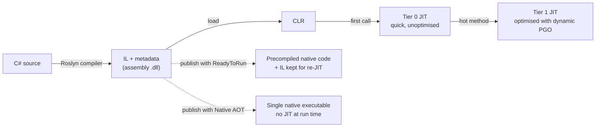
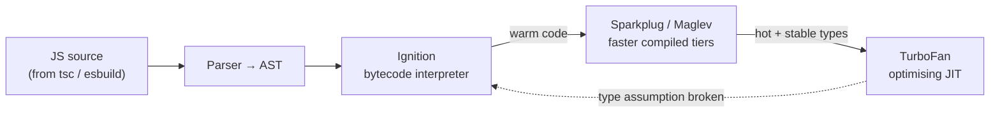

import { Tabs, TabItem, Aside } from '@astrojs/starlight/components';
import QuizBlock from '~/components/QuizBlock.astro';

## Why it matters in interviews

*"Is C# compiled or interpreted?"*, *"what is JIT?"*, *"how does garbage collection work?"* and *"what is managed code?"* are common warm-up questions. A good answer shows you know the **pipeline** from source to machine code for both halves of your stack: C# on the CLR and TypeScript on a JavaScript engine. It also explains real decisions such as Native AOT for fast-starting containers and Angular's AOT template compiler.

## Core idea

The CPU only runs **machine code**. Every language reaches it by some mix of three strategies: translate ahead of time, translate on the fly, or interpret.

### Compiled vs interpreted vs JIT vs AOT

| | Ahead-of-time compiled | Interpreted | JIT compiled | AOT for managed languages |
|---|---|---|---|---|
| When is machine code produced? | At build time | Never; an interpreter executes the source or bytecode step by step | At **run time**, per method, just before first use | At build/publish time |
| Startup | Fast | Fast | Slower (compile on first call) | Fast |
| Peak performance | High | Low | High, can use **runtime profile data** | High, but no runtime re-optimization |
| Portability | Binary per OS/CPU | Source runs anywhere with the interpreter | Bytecode runs anywhere with the runtime | Binary per OS/CPU |
| Examples | C, C++, Rust, Go | Classic shells, early JavaScript, CPython (bytecode interpreter) | .NET CLR, JVM HotSpot, V8 TurboFan | .NET Native AOT, ReadyToRun, GraalVM native image |

"Compiled vs interpreted" is a property of an **implementation**, not of a language. C# is compiled to IL by Roslyn, and IL is JIT-compiled (or AOT-compiled) to native code, so the honest answer to *"is C# compiled or interpreted?"* is **"compiled twice: to IL, then to native code"**.

**Transpiling** is source-to-source compilation: `tsc` or esbuild turns TypeScript into JavaScript, erasing types. TypeScript types do not exist at run time.

### How .NET executes code



- **Roslyn** compiles C# to **IL** (Intermediate Language) plus metadata, packaged in an assembly.
- The **CLR** loads the assembly, verifies types and **JIT-compiles** each method to native code on its first call.
- **Tiered compilation** (default since .NET Core 3.0): methods start with a fast, lightly optimised Tier 0, and methods that get hot are recompiled at Tier 1. **Dynamic PGO** (on by default since .NET 8) uses data gathered at Tier 0, such as which concrete types a virtual call actually sees, to optimise Tier 1 code.
- **ReadyToRun** ships precompiled native code inside the assembly to cut startup time, while keeping IL so hot methods can still be re-JITed.
- **Native AOT** compiles the whole app to one native binary: very fast startup and small memory, but no run-time code generation, so reflection-heavy code and some libraries need source generators instead. Good fit for serverless functions and containers that scale to zero. More in [.NET platform, CLR & JIT](../../csharp/dotnet-platform/).

### How JavaScript engines execute code (V8 as the example)



- Code starts running quickly in the **interpreter** while the engine collects **type feedback**.
- Hot functions are compiled by progressively more optimising tiers. TurboFan generates machine code that assumes the types it has seen (for example, "this property is always a number at this offset").
- If an assumption breaks (a different object shape arrives), the engine **deoptimises** back to bytecode. This is why consistent object shapes (**hidden classes**) and monomorphic call sites keep JS fast.
- JavaScript runs your code on a **single thread** with an event loop; see [Event loop, promises & async](../../web/js-event-loop/).
- **Angular's AOT compiler** is a different thing: at build time it compiles component templates into JavaScript instructions, so the browser never parses templates at run time. AOT has been the default since Ivy.

### Managed vs unmanaged code

| | Managed | Unmanaged |
|---|---|---|
| Runs under | A runtime (CLR, JVM) | Directly on the OS |
| Memory | Garbage collected | Manually freed (`malloc`/`free`, `new`/`delete`) or RAII |
| Safety | Type-safe, bounds-checked arrays, no dangling pointers (outside `unsafe`) | Buffer overflows, use-after-free possible |
| Examples | C#, F#, Java | C, C++, Win32 APIs, native drivers |

The GC frees **memory**, but not **unmanaged resources** such as file handles, sockets and DB connections. That is what `IDisposable`, `using` and `SafeHandle` are for. Calling native code from .NET is done with **P/Invoke** (`LibraryImport`) or COM interop.

### Garbage collection approaches

| Approach | How it works | Pros | Cons | Used by |
|---|---|---|---|---|
| Reference counting | Each object counts references; freed at zero | Immediate, predictable reclamation | Cannot free **cycles** without extra help; counter updates cost | CPython (plus a cycle detector), Swift/Objective-C ARC, COM |
| Mark-and-sweep | Trace from **roots** (stacks, statics, registers); free what is unmarked | Handles cycles | Pauses; leaves fragmentation | Basis of most tracing GCs |
| Mark-compact | Mark, then slide live objects together | No fragmentation, fast bump allocation | Moving objects costs time | .NET (gen 2 compaction), V8 old space |
| Copying | Copy live objects to a fresh space | Very fast when most objects die | Needs spare space | V8 young generation (scavenger) |
| **Generational** | Most objects die young, so collect the young area often and the old area rarely | Short, frequent collections | Needs write barriers to track old → young references | .NET (gen 0/1/2), JVM, V8 |

.NET adds a **Large Object Heap** for objects of 85,000 bytes or more (collected with gen 2, not compacted by default), **workstation vs server** GC modes, and **background** GC that runs gen 2 concurrently with your code. Details and leak patterns are in [Memory, GC & IDisposable](../../csharp/memory-gc/).

## Code

**Choosing a compilation mode when publishing**

```bash
# Default: IL in the assembly, JIT at run time (tiered + dynamic PGO)
dotnet publish -c Release

# ReadyToRun: precompiled code for faster startup, still JIT-capable
dotnet publish -c Release -r linux-x64 -p:PublishReadyToRun=true

# Native AOT: single native binary, no JIT, needs trimming-safe code
dotnet publish -c Release -r linux-x64 -p:PublishAot=true

# Angular: production build uses the AOT template compiler + esbuild
ng build --configuration production
```

**Managed code calling unmanaged code, and releasing an unmanaged resource**

```csharp
using System.Runtime.InteropServices;

internal static partial class Native
{
    // P/Invoke via source-generated marshalling (AOT friendly).
    [LibraryImport("kernel32.dll")]
    internal static partial uint GetCurrentProcessId();
}

public sealed class ReportWriter : IDisposable
{
    // FileStream wraps a SafeFileHandle: an OS handle the GC alone would not release promptly.
    private readonly FileStream _file = new("report.csv", FileMode.Create);

    public void Write(string line) => _file.Write(System.Text.Encoding.UTF8.GetBytes(line + "\n"));

    public void Dispose() => _file.Dispose(); // deterministic release of the handle
}

// Usage
using var writer = new ReportWriter();          // Dispose runs at end of scope
writer.Write($"pid,{Native.GetCurrentProcessId()}");
```

## Interview Q&A

<details>
<summary>Is C# compiled or interpreted?</summary>

Compiled, in two steps. Roslyn compiles C# to IL at build time. At run time the CLR's JIT compiles IL to native machine code per method on first call, with tiered compilation re-optimising hot methods. With Native AOT the second step also happens at publish time.
</details>

<details>
<summary>What are the advantages of JIT over AOT, and vice versa?</summary>

JIT can optimise for the actual machine and the actual run-time behaviour (dynamic PGO, devirtualising calls to the types really seen), and supports run-time code generation and full reflection. AOT gives fast startup, lower memory, no JIT cost and a self-contained binary, which suits serverless and scale-to-zero containers, but limits dynamic features.
</details>

<details>
<summary>What is managed code?</summary>

Code that runs under a runtime which manages memory and type safety for it: in .NET, the CLR provides garbage collection, type checking, bounds checks and exception handling. Unmanaged code (C/C++, OS APIs) runs directly on the OS with manual memory management. .NET calls unmanaged code via P/Invoke or COM interop.
</details>

<details>
<summary>Why does reference counting fail for cycles, and how do tracing collectors avoid it?</summary>

If A references B and B references A, both counts stay at 1 even when nothing else can reach them, so they are never freed. Tracing collectors start from roots and mark everything reachable; unreachable cycles are simply never marked, so they get collected.
</details>

<details>
<summary>What is generational GC and why does it work?</summary>

It relies on the observation that most objects die young. New objects go into gen 0, which is collected often and cheaply; survivors are promoted to gen 1 and gen 2, which are collected rarely. Short-lived request objects in an ASP.NET Core API die in gen 0 almost for free, while long-lived caches sit in gen 2.
</details>

<details>
<summary>How does V8 make JavaScript fast if it is dynamically typed?</summary>

It interprets bytecode first while recording type feedback, then JIT-compiles hot functions with optimisations that assume the observed types and object shapes (hidden classes, inline caches). If an assumption is violated it deoptimises and falls back to bytecode. Keeping object shapes consistent avoids deopts.
</details>

<details>
<summary>What does Angular's AOT compilation do?</summary>

At build time it compiles component templates and metadata into JavaScript instructions, so the browser does not ship or run the template compiler. Benefits: faster rendering, smaller bundles, and template errors caught at build time. It is unrelated to .NET Native AOT apart from the name.
</details>

## Pitfalls

<Aside type="caution" title="Common mistakes">

- Saying "C# is interpreted" or "IL is interpreted". The CLR JIT-compiles IL to native code.
- Believing the GC handles everything. It frees managed memory, not file handles, sockets or DB connections; `Dispose` them.
- Expecting reflection-heavy libraries to work unchanged under Native AOT. Trimming and AOT need source generators or annotations.
- Thinking TypeScript types exist at run time. They are erased; validate external data yourself.
- Confusing Angular AOT (template compilation) with .NET Native AOT (machine-code compilation).

</Aside>

## Related

- [.NET platform, CLR & JIT](../../csharp/dotnet-platform/)
- [Memory, GC & IDisposable](../../csharp/memory-gc/)
- [Event loop, promises & async](../../web/js-event-loop/)
- [Operating systems basics](../operating-systems/)

## Quick quiz

<QuizBlock section="fundamentals" topic="compilers-runtimes" />
