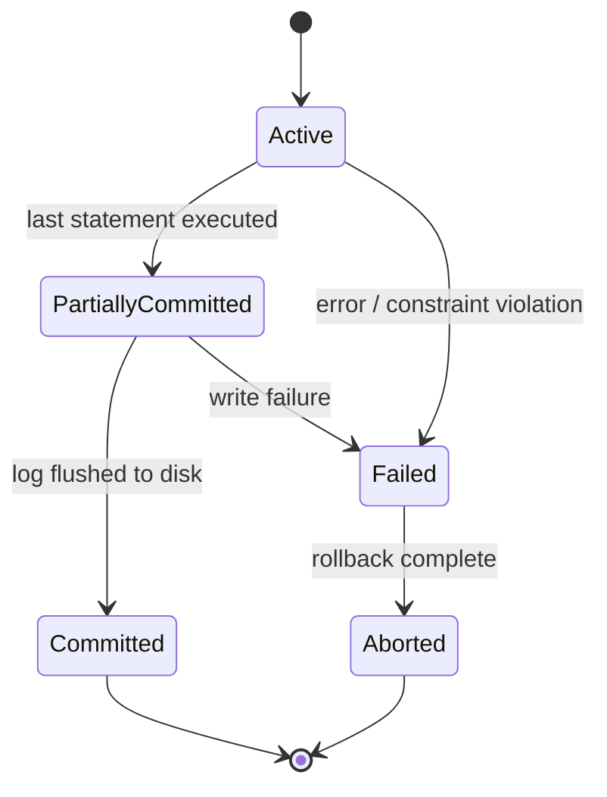
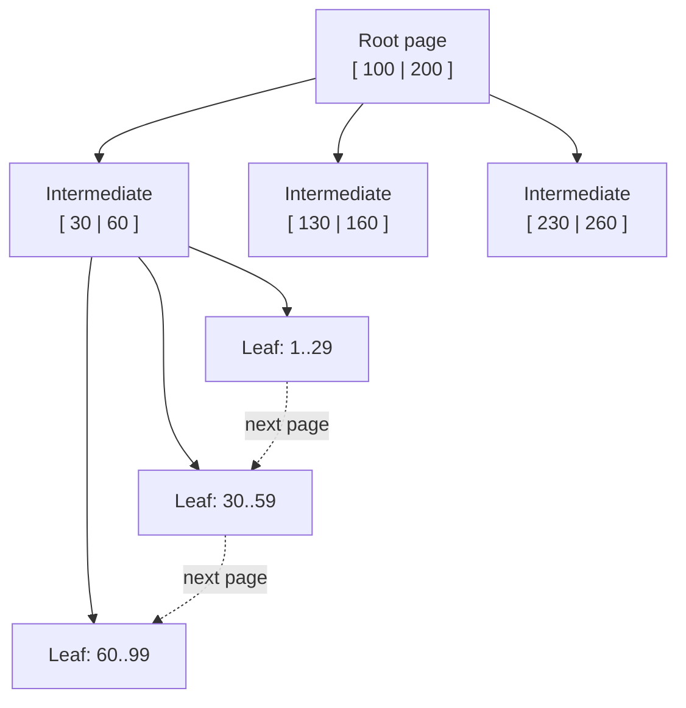
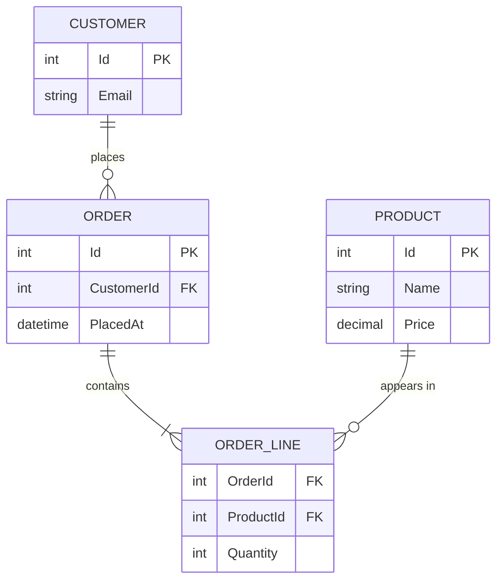

import { Tabs, TabItem, Aside } from '@astrojs/starlight/components';
import QuizBlock from '~/components/QuizBlock.astro';

## Why it matters in interviews

Service-company online tests are full of DBMS MCQs (*"which normal form removes transitive dependency?"*, *"what does the I in ACID mean?"*), and product-company first rounds ask *"how does an index make a query fast?"* or *"ACID vs BASE?"*. This page is the theory layer; the SQL Server specifics are in [Indexes](../../data/indexes/), [Transactions & isolation](../../data/transactions-isolation/) and [Normalization & keys](../../data/normalization/).

## Core idea

A DBMS stores data durably, lets many users read and write it concurrently, and keeps it consistent. Three ideas carry most of the weight: **transactions** (a group of operations that succeed or fail together), **indexes** (data structures that avoid scanning everything), and a **schema** designed so each fact is stored once.

### ACID

| Property | Meaning | How the engine provides it |
|---|---|---|
| **Atomicity** | All operations in the transaction happen, or none do | Undo information in the transaction log; rollback |
| **Consistency** | A transaction moves the database from one valid state to another (constraints, FKs, checks hold) | Constraint enforcement + correct application logic |
| **Isolation** | Concurrent transactions do not see each other's partial work (to the degree set by the isolation level) | Locks and/or row versioning (MVCC) |
| **Durability** | Once committed, the change survives a crash | **Write-ahead logging**: the log record is flushed to disk before commit returns |

**Write-ahead logging (WAL)**: changes are first written to a sequential log; data pages are updated in memory and flushed later. After a crash, recovery **redoes** committed work from the log and **undoes** uncommitted work. Sequential log writes are much cheaper than random page writes, which is why commits are fast.

### Transaction lifecycle



### Isolation anomalies (recap)

| Anomaly | What happens | Prevented from level |
|---|---|---|
| Dirty read | Read another transaction's **uncommitted** change | Read Committed |
| Non-repeatable read | Re-read a row and get a different value | Repeatable Read |
| Phantom read | Re-run a range query and get new rows | Serializable (or Snapshot) |
| Lost update | Two transactions read-modify-write and one overwrites the other | Repeatable Read+, or optimistic concurrency (rowversion) |

SQL Server's default is **Read Committed**; Azure SQL Database turns on **Read Committed Snapshot Isolation** (row versioning) by default, so readers do not block writers. Full table with locks and deadlocks: [Transactions, isolation & locking](../../data/transactions-isolation/).

### ACID vs BASE

| | ACID | BASE |
|---|---|---|
| Stands for | Atomicity, Consistency, Isolation, Durability | **B**asically **A**vailable, **S**oft state, **E**ventual consistency |
| Priority | Correctness of every transaction | Availability and scale across nodes |
| Consistency | Strong: reads see the latest committed write | Eventual: replicas converge over time |
| Typical systems | SQL Server, PostgreSQL, Oracle | Cassandra, DynamoDB, Cosmos DB (with eventual consistency) |
| Good for | Payments, orders, inventory | Feeds, analytics, carts, telemetry, caches |

The line is blurry today: Cosmos DB offers five consistency levels including strong, and MongoDB supports multi-document ACID transactions. See [SQL vs NoSQL](../../data/sql-vs-nosql/).

### B-tree and B+ tree indexes

Without an index, finding a row means a **full scan**: O(n). Most relational databases use a **B+ tree**: a balanced tree with very high fan-out (hundreds of keys per page), so even millions of rows need only 3-4 page reads.



- **B-tree vs B+ tree**: a B-tree may store data in every node; a B+ tree keeps data (or row pointers) **only in the leaves**, and links the leaves together. That makes range scans (`BETWEEN`, `ORDER BY`) a walk along the leaf chain, and keeps internal nodes small so fan-out is higher.
- Lookup, insert and delete are **O(log n)**. The tree stays balanced by splitting and merging pages.
- **Clustered index**: the leaf level **is** the table, sorted by the key (one per table). **Non-clustered index**: a separate B+ tree whose leaves hold the key plus a pointer to the row (in SQL Server, the clustering key).
- **Hash index**: O(1) equality lookups but useless for ranges and sorting. Used by in-memory tables and many key-value stores.
- Every index speeds up reads but **costs writes** (each insert/update must maintain it) and storage.

### Normalization recap

| Normal form | Rule | Removes |
|---|---|---|
| 1NF | Atomic values, no repeating groups, a primary key | Comma-separated lists in a column |
| 2NF | 1NF + every non-key column depends on the **whole** key | Partial dependencies (only matters with composite keys) |
| 3NF | 2NF + no non-key column depends on another non-key column | **Transitive** dependencies (`ZipCode → City`) |
| BCNF | Every determinant is a candidate key | Remaining anomalies in 3NF with overlapping candidate keys |

Normalization prevents **update, insert and delete anomalies**. Denormalize deliberately for read performance (reporting tables, cached totals), accepting the cost of keeping copies in sync. Worked examples in [Normalization & keys](../../data/normalization/).

### ER modelling

An **entity-relationship** model describes entities (tables), attributes (columns) and relationships with **cardinality**.



- **One-to-many**: FK on the "many" side (`Order.CustomerId`).
- **Many-to-many**: a **junction table** (`ORDER_LINE` between orders and products), often with its own attributes.
- **One-to-one**: FK with a unique constraint, or a shared primary key.
- A **weak entity** cannot be identified without its owner (an order line without its order).

### CAP recap

In a distributed data store, when a **network partition** happens you must choose between **Consistency** (every read sees the latest write, or errors) and **Availability** (every request gets a non-error response, possibly stale). Partition tolerance is not optional across a network, so the real choice is **CP vs AP during a partition**. **PACELC** extends it: *else* (no partition) you trade **Latency vs Consistency**. A single SQL Server instance is not a distributed system, so CAP applies once you add replicas. Deeper treatment: [Databases at scale](../../system-design/databases-at-scale/).

## Code

**A transaction that is atomic and isolated**

```sql
SET XACT_ABORT ON;            -- any runtime error rolls back the whole transaction
BEGIN TRANSACTION;

UPDATE Accounts SET Balance = Balance - 500 WHERE Id = 1 AND Balance >= 500;
IF @@ROWCOUNT = 0
BEGIN
    ROLLBACK;                 -- insufficient funds: undo everything
    THROW 50001, 'Insufficient funds', 1;
END

UPDATE Accounts SET Balance = Balance + 500 WHERE Id = 2;
INSERT INTO Transfers (FromId, ToId, Amount, At) VALUES (1, 2, 500, SYSUTCDATETIME());

COMMIT;                       -- durable once the log record is hardened
```

**How an index changes the access path**

```sql
-- Without an index on Email: clustered index scan, reads every page.
SELECT Id, Email FROM Customers WHERE Email = 'a@contoso.com';

-- With a non-clustered index: an index seek, O(log n) page reads.
CREATE NONCLUSTERED INDEX IX_Customers_Email ON Customers (Email);

-- Range queries walk the linked leaf level of the B+ tree.
SELECT Id, PlacedAt FROM Orders WHERE PlacedAt >= '2026-01-01' AND PlacedAt < '2026-02-01';
```

The same transaction from EF Core is `SaveChanges()` (implicitly transactional) or `BeginTransactionAsync()` for multiple calls; see [Transactions, bulk ops & raw SQL](../../data/transactions-raw-sql/).

## Interview Q&A

<details>
<summary>Explain ACID with a bank transfer.</summary>

Atomicity: debit and credit both happen or neither does. Consistency: balances never go negative if a check constraint says so. Isolation: another transaction never sees money debited but not yet credited. Durability: once the transfer commits, a power cut does not undo it, because the log was flushed before commit returned.
</details>

<details>
<summary>How does a database guarantee durability without writing every page to disk on commit?</summary>

Write-ahead logging. Each change is appended to the transaction log, and commit waits only for the log flush, which is a fast sequential write. Data pages are written later by checkpoints. On restart, recovery replays committed log records (redo) and rolls back incomplete transactions (undo).
</details>

<details>
<summary>Why do databases use B+ trees rather than binary search trees or hash tables?</summary>

Disk and memory pages are read in blocks. A B+ tree packs hundreds of keys into each page, so the tree is very shallow (3-4 levels for millions of rows), minimising page reads. Linked leaves make range scans and ordered reads efficient. A binary tree would be far deeper, and a hash table cannot serve range or sort queries.
</details>

<details>
<summary>Clustered vs non-clustered index?</summary>

A clustered index defines the physical order of the table: its leaf level is the data, so there can be only one. A non-clustered index is a separate structure with the key and a pointer back to the row; a table can have many. Looking up extra columns through a non-clustered index costs a key lookup unless the index covers them with `INCLUDE`.
</details>

<details>
<summary>ACID vs BASE: when would you pick each?</summary>

ACID when correctness of each transaction is critical: payments, orders, stock. BASE when you need horizontal scale and high availability and can tolerate briefly stale reads: activity feeds, product views, telemetry. Many systems use both: SQL Server for orders and a NoSQL store or cache for read-heavy views.
</details>

<details>
<summary>What are 2NF and 3NF in one line each?</summary>

2NF: no non-key column depends on only part of a composite key. 3NF: no non-key column depends on another non-key column (no transitive dependencies). Mnemonic: every non-key attribute depends on "the key, the whole key, and nothing but the key".
</details>

<details>
<summary>How do you model a many-to-many relationship?</summary>

With a junction table holding foreign keys to both sides, usually with a composite primary key or a surrogate key plus a unique constraint. Students and courses become an `Enrollments` table, which can also carry attributes like grade or enrolled date. EF Core can map it implicitly or as an explicit entity.
</details>

<details>
<summary>Explain CAP in one minute.</summary>

When replicas cannot talk to each other (a partition), a system must either refuse some requests to stay consistent (CP) or answer with possibly stale data to stay available (AP). Without a partition you can have both, but PACELC notes you still trade latency against consistency. It is about distributed stores, not a single database server.
</details>

## Pitfalls

<Aside type="caution" title="Common mistakes">

- Defining the C in ACID the same as the C in CAP. ACID consistency = **constraints hold**; CAP consistency = **linearizable reads** across replicas.
- Saying "CA systems" are a real option for a distributed database. You cannot opt out of partitions across a network.
- Assuming more indexes are always better. Each index slows inserts, updates and deletes and uses storage.
- Claiming "B-tree" when the engine actually uses a B+ tree, then being unable to explain why range scans are fast.
- Over-normalizing a read-heavy reporting model, or denormalizing an OLTP model without a plan to keep copies in sync.

</Aside>

## Related

- [Indexes](../../data/indexes/)
- [Transactions, isolation & locking](../../data/transactions-isolation/)
- [Normalization & keys](../../data/normalization/)
- [Databases at scale](../../system-design/databases-at-scale/)

## Quick quiz

<QuizBlock section="fundamentals" topic="dbms-theory" />
