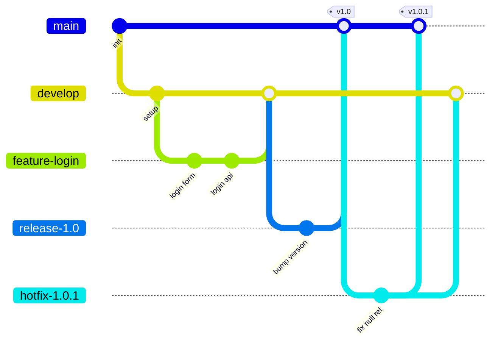

import { Tabs, TabItem, Aside } from '@astrojs/starlight/components';
import QuizBlock from '~/components/QuizBlock.astro';

## Why it matters in interviews

Every team uses Git, so interviewers check whether you can work safely in a shared repository: *"merge vs rebase?"*, *"how do you undo a commit that is already pushed?"*, *"what branching strategy does your team use and why?"*, *"how do you find which commit introduced a bug?"*. Wrong answers here (force-pushing a shared branch, `reset --hard` on `main`) are red flags for real damage.

## Core idea

Git stores a project as a graph of **commits**. Each commit is a snapshot of the whole tree plus metadata and a pointer to its parent(s), identified by a SHA hash. A **branch** is just a movable pointer to a commit; **HEAD** points at the branch (or commit) you have checked out. Almost everything else follows from that.

### The three areas

| Area | What it holds | Moves with |
|---|---|---|
| Working tree | Files on disk as you edit them | Editing |
| Index (staging area) | The snapshot that the next commit will record | `git add`, `git restore --staged` |
| Repository (HEAD) | Committed history | `git commit`, `git reset`, `git switch` |

### Branching strategies



| Strategy | Shape | Fits | Drawbacks |
|---|---|---|---|
| **GitFlow** | `main` (released), `develop` (integration), `feature/*`, `release/*`, `hotfix/*` (diagram above) | Versioned products with scheduled releases, several versions in support | Long-lived branches, merge pain, slow feedback |
| **GitHub flow** | `main` is always deployable; short feature branches + PR + deploy | Web apps and APIs with continuous delivery | Needs good CI and tests |
| **Trunk-based** | Everyone integrates into `main` at least daily; very short branches or direct commits; unfinished work hidden behind **feature flags** | High-velocity teams, CI/CD, DORA-style metrics | Requires discipline, feature flags and strong automated tests |

A typical .NET + Angular team today runs GitHub flow or trunk-based development with PRs into `main`, build validation in Azure DevOps or GitHub Actions, and release branches only when they must patch an older version. See [CI/CD pipelines](../../testing-devops/ci-cd/).

### Merge vs rebase

Both bring the changes from one branch into another; they differ in how history looks.

| | `git merge` | `git rebase` |
|---|---|---|
| What it does | Creates a **merge commit** joining two histories (or fast-forwards if possible) | **Replays** your commits on top of another base, creating **new commits** (new SHAs) |
| History | True, non-linear; shows when branches joined | Linear and clean |
| Rewrites history? | No | **Yes** |
| Safe on shared/pushed branches? | Yes | No, unless everyone agrees (requires force-push) |
| Conflicts | Resolved once, in the merge commit | May be resolved per replayed commit |
| Typical use | Merging a PR into `main` | Updating your local feature branch with `main`; cleaning up commits before a PR |

**The golden rule of rebasing**: never rebase commits that others have already based work on. Rebase your own local work freely. Interactive rebase (`git rebase -i`) lets you squash, reword, reorder and drop commits before opening a PR. PR platforms offer **merge commit**, **squash merge** and **rebase merge**; squash merge gives one commit per PR on `main`.

### Reset vs revert (and restore)

| | `git reset` | `git revert` |
|---|---|---|
| What it does | Moves the current branch pointer back to an earlier commit | Creates a **new commit** that undoes the changes of an earlier one |
| History | Rewrites (commits disappear from the branch) | Preserves; adds to it |
| Safe for pushed/shared commits? | **No** | **Yes** |
| Typical use | Undo local, unpushed commits | Undo a bad commit already on `main` |

`git reset` modes: `--soft` moves HEAD only (changes stay staged), `--mixed` (default) also resets the index (changes stay in the working tree, unstaged), `--hard` also discards working-tree changes (**destructive**). `git restore <file>` discards changes to a file; `git restore --staged <file>` unstages it. Lost a commit after a bad reset? `git reflog` lists where HEAD has been, so you can recover it.

### Cherry-pick, stash, bisect

- **Cherry-pick** copies a specific commit onto your current branch as a new commit. Classic use: apply a hotfix from `main` to a `release` branch. Overuse leads to duplicate commits with different SHAs.
- **Stash** shelves uncommitted changes so you can switch context: `git stash push -m "wip"`, then `git stash pop` (apply and drop) or `git stash apply` (keep in the stash). `-u` includes untracked files.
- **Bisect** binary-searches history for the commit that introduced a bug. You mark one good and one bad commit; Git checks out the midpoint until it isolates the culprit in about log2(n) steps. `git bisect run <test-script>` automates it.

### Resolving conflicts

A conflict happens when both sides changed the same lines (or one deleted a file the other edited). Git marks the file:

```text
<<<<<<< HEAD
var timeout = TimeSpan.FromSeconds(30);
=======
var timeout = TimeSpan.FromSeconds(60);
>>>>>>> feature-retry
```

Steps: understand **both** intents (read the PRs or commits), edit to the correct combined result, remove markers, build and run tests, then `git add` and `git commit` (merge) or `git rebase --continue` (rebase). `git merge --abort` / `git rebase --abort` gets you back out. Prevent conflicts with small PRs, frequent syncing with `main`, and not reformatting whole files in feature PRs. For `package-lock.json` or `*.csproj` conflicts, resolve the manifest, then regenerate the lock file.

### PR hygiene

- **Small, focused PRs** (a few hundred lines at most) that do one thing; refactors in separate PRs from behaviour changes.
- A clear title and description: *what*, *why*, how it was tested, screenshots for UI changes, linked work item.
- Meaningful commit messages in the imperative (`Add retry to payment client`), optionally Conventional Commits (`feat:`, `fix:`).
- Branch is up to date with `main`, CI green, no secrets, no commented-out code, no unrelated formatting churn.
- Protect `main` with branch policies: required reviewers, build validation, no direct pushes. Review etiquette is covered in [Agile & engineering practices](../agile-practices/).

## Code

**Everyday flow: feature branch, sync with main, clean up, push**

```bash
git switch -c feature/order-export          # create and switch to a branch
git add -p                                   # stage hunks interactively, review as you go
git commit -m "Add CSV export for orders"

git fetch origin
git rebase origin/main                       # replay my local commits on latest main
git rebase -i origin/main                    # optional: squash fixups before the PR
git push --force-with-lease                  # safe force: fails if someone else pushed
```

**Undoing things**

```bash
git restore src/app/app.config.ts            # discard local edits to a file
git restore --staged appsettings.json        # unstage, keep the edit
git commit --amend -m "Better message"       # fix the last (unpushed) commit
git reset --soft HEAD~1                      # undo last commit, keep changes staged
git reset --hard HEAD~1                      # undo last commit AND discard changes (local only!)
git revert 3f2a91c                           # undo a pushed commit with a new commit
git reflog                                   # find a "lost" commit after a bad reset
git reset --hard HEAD@{2}                    # ...and jump back to it
```

**Hotfix, stash and bisect**

```bash
git switch release/2.3 && git cherry-pick 9c1e7b4    # copy one fix to a release branch

git stash push -u -m "half-done refactor"            # park work, including untracked files
git switch main && git pull
git switch - && git stash pop                         # back to previous branch and restore

git bisect start
git bisect bad                                        # current commit has the bug
git bisect good v2.2.0                                # this tag was fine
git bisect run dotnet test --filter "Category=Pricing"   # exit code decides good/bad
git bisect reset
```

## Interview Q&A

<details>
<summary>Merge vs rebase: which do you use and when?</summary>

Merge preserves the true history and never rewrites commits, so it is the safe default for integrating shared branches and completing PRs. Rebase rewrites my commits onto a new base for a linear history, so I use it on my own local or personal feature branch to catch up with `main` and tidy commits before a PR. I never rebase commits others have pulled.
</details>

<details>
<summary>How do you undo a commit that has already been pushed to main?</summary>

`git revert <sha>`. It adds a new commit that reverses the change, so nobody's history is rewritten and the undo itself is reviewable. `git reset` plus force-push would rewrite shared history and break everyone who already pulled.
</details>

<details>
<summary>Explain `git reset --soft`, `--mixed` and `--hard`.</summary>

All three move the current branch to the target commit. `--soft` keeps the changes staged. `--mixed` (the default) keeps them in the working tree but unstaged. `--hard` throws them away entirely. `--hard` is the only one that can lose uncommitted work, although committed work can usually be found again through `git reflog`.
</details>

<details>
<summary>GitFlow vs trunk-based development?</summary>

GitFlow uses long-lived `develop` and `main` plus feature, release and hotfix branches; it suits versioned products with scheduled releases. Trunk-based development integrates small changes into `main` at least daily, hides incomplete features behind flags and relies on strong CI; it suits continuous delivery and reduces merge pain. Most web teams lean trunk-based or GitHub flow today.
</details>

<details>
<summary>What is cherry-pick and when is it appropriate?</summary>

It applies the changes of one commit onto the current branch as a new commit. It is appropriate for backporting a hotfix to a release branch or rescuing a commit made on the wrong branch. It is not a substitute for merging whole branches, since repeated cherry-picks create duplicate commits and confusing history.
</details>

<details>
<summary>How would you find which commit introduced a regression?</summary>

`git bisect`: mark a known bad commit and a known good one, and Git checks out the midpoint each time. Test and mark good or bad until it names the first bad commit, roughly log2(n) steps. With a failing test, `git bisect run` automates it.
</details>

<details>
<summary>Why `--force-with-lease` instead of `--force`?</summary>

`--force` overwrites the remote branch unconditionally, discarding commits someone else pushed. `--force-with-lease` only succeeds if the remote branch is still where you last fetched it, so it refuses to clobber unseen work.
</details>

<details>
<summary>What makes a good pull request?</summary>

Small and focused, a description of what and why and how it was tested, green CI, up to date with `main`, clean commit history, and no unrelated changes. Reviewers should be able to understand it in one sitting.
</details>

## Pitfalls

<Aside type="caution" title="Common mistakes">

- Rebasing or resetting a branch others have pulled, then force-pushing. Use `revert` for shared history.
- Using `git push --force` instead of `--force-with-lease`.
- `git reset --hard` with uncommitted work you wanted. Stash or commit first.
- Resolving a conflict by blindly taking "ours" or "theirs" without building and running tests.
- Huge PRs mixing refactoring, formatting and features. They get rubber-stamped, not reviewed.
- Committing secrets (`appsettings.Development.json` with keys). Rewriting history does not un-leak them; rotate the secret.

</Aside>

## Related

- [CI/CD pipelines](../../testing-devops/ci-cd/)
- [Agile & engineering practices](../agile-practices/)
- [Testing strategy](../../testing-devops/testing-strategy/)

## Quick quiz

<QuizBlock section="fundamentals" topic="git" />
