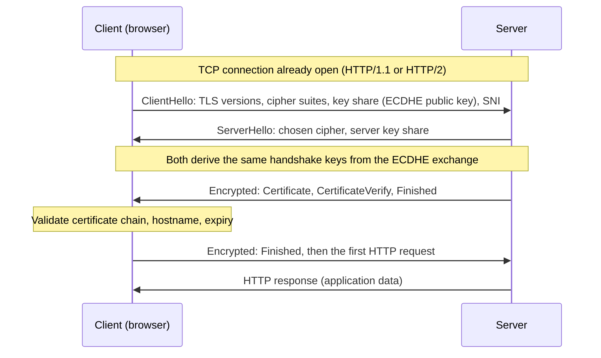
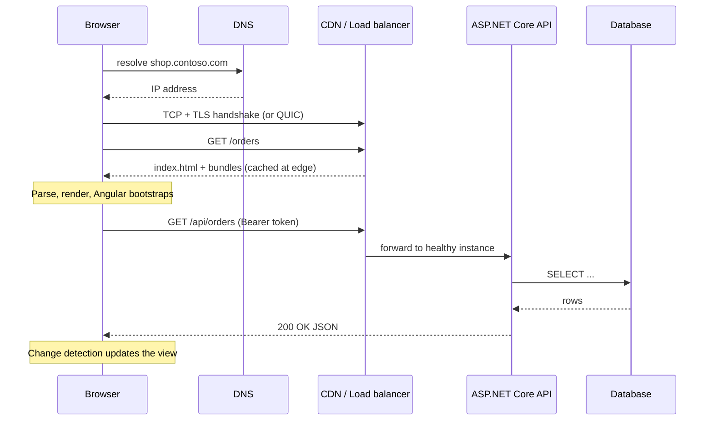

import { Tabs, TabItem, Aside } from '@astrojs/starlight/components';
import QuizBlock from '~/components/QuizBlock.astro';

## Why it matters in interviews

*"What happens when you type a URL into the browser and press Enter?"* is the single most common fundamentals question, because it touches DNS, TCP, TLS, HTTP, servers and rendering in one go. Web developers also get *"401 vs 403?"*, *"PUT vs PATCH?"*, *"HTTP/2 vs HTTP/3?"* and *"WebSockets or SSE for live updates?"*. These map directly onto ASP.NET Core APIs and Angular's `HttpClient`.

## Core idea

HTTP is a **stateless request/response protocol**: the client sends a method, a target, headers and an optional body; the server replies with a status code, headers and an optional body. HTTPS is the same HTTP carried inside a **TLS** connection, which adds encryption, integrity and server authentication.

### Methods

| Method | Purpose | Safe | Idempotent | Body |
|---|---|---|---|---|
| GET | Read a resource | Yes | Yes | No (by convention) |
| HEAD | GET without the body | Yes | Yes | No |
| POST | Create / trigger processing | No | **No** | Yes |
| PUT | Replace a resource entirely (or create at a known URL) | No | Yes | Yes |
| PATCH | Partial update | No | Not guaranteed | Yes |
| DELETE | Remove a resource | No | Yes | Rarely |
| OPTIONS | Ask what is allowed (CORS preflight uses it) | Yes | Yes | No |

**Safe** = does not change server state. **Idempotent** = repeating the request has the same effect on the server as sending it once (the response may differ, e.g. a second DELETE returns 404). Idempotency is what makes retries safe; for POST you need an **idempotency key**. API design detail lives in [REST API design](../../aspnet/rest-api-design/).

### Status codes worth knowing

| Code | Meaning | Typical use |
|---|---|---|
| 200 / 201 / 204 | OK / Created (with `Location`) / No Content | GET, POST create, DELETE or PUT with no body |
| 301 / 308 | Permanent redirect (308 keeps the method and body) | Moved URLs, HTTP → HTTPS |
| 302 / 307 | Temporary redirect (307 keeps the method and body) | Login redirects |
| 304 | Not Modified | Conditional GET with `If-None-Match` / ETag |
| 400 | Bad Request | Validation failure (ASP.NET Core returns ProblemDetails) |
| 401 | Unauthorized = **not authenticated** | Missing or invalid token |
| 403 | Forbidden = authenticated but **not allowed** | Wrong role or policy |
| 404 / 409 | Not Found / Conflict | Missing entity / concurrency or duplicate |
| 422 | Unprocessable Content | Semantically invalid input |
| 429 | Too Many Requests (with `Retry-After`) | Rate limiting |
| 500 | Internal Server Error | Unhandled exception |
| 502 / 503 / 504 | Bad Gateway / Service Unavailable / Gateway Timeout | Proxy got a bad upstream reply / app down or overloaded / upstream too slow |

### Headers you should be able to explain

- **Request**: `Host` (required in HTTP/1.1, lets many sites share one IP), `Authorization: Bearer ...`, `Accept`, `Content-Type`, `Cookie`, `If-None-Match`, `Origin`.
- **Response**: `Content-Type`, `Cache-Control` (`no-store`, `max-age`, `private`), `ETag`, `Set-Cookie`, `Location`, `Strict-Transport-Security` (HSTS), `Access-Control-Allow-Origin` (CORS).

### HTTP/1.1 vs HTTP/2 vs HTTP/3

| | HTTP/1.1 | HTTP/2 | HTTP/3 |
|---|---|---|---|
| Transport | TCP | TCP | **QUIC over UDP** |
| Format | Text | Binary frames | Binary frames (QUIC streams) |
| Concurrency | One request at a time per connection; browsers open ~6 connections per host | **Multiplexed streams** on one connection | Multiplexed, **independent** streams |
| Head-of-line blocking | At HTTP level | Solved at HTTP level, still at **TCP** level (one lost packet stalls all streams) | Solved: loss on one stream does not block others |
| Header compression | None | HPACK | QPACK |
| TLS | Optional | Optional in the spec, required in practice by browsers | **Built in** (TLS 1.3 inside QUIC) |
| Connection setup | TCP + TLS handshakes | TCP + TLS handshakes | Combined transport + crypto handshake (1-RTT, 0-RTT on resumption) |
| Extras | Keep-alive (persistent connections) | Stream priorities; server push (now dropped by major browsers) | Connection migration (switch Wi-Fi to mobile without reconnecting) |

gRPC requires HTTP/2, which is why it does not run directly from browsers without gRPC-Web. Kestrel supports HTTP/1.1, HTTP/2 and HTTP/3.

### HTTPS and the TLS 1.3 handshake

TLS gives **confidentiality** (encryption), **integrity** (tampering is detected) and **authentication** (the certificate proves the server owns the domain, signed by a CA the browser trusts). Asymmetric cryptography is used only to agree on keys and to prove identity; the bulk data is encrypted with a fast **symmetric** cipher (AES-GCM or ChaCha20-Poly1305).



- **TLS 1.3 takes 1 round trip** before the client can send its request (TLS 1.2 took 2). On resumption, **0-RTT** lets the client send data in the first flight, at the cost of possible **replay**, so only idempotent requests should use it.
- TLS 1.3 only allows ephemeral (EC)DHE key exchange, so every connection has **forward secrecy**: stealing the server's private key later does not decrypt recorded traffic.
- **SNI** (Server Name Indication) tells the server which hostname the client wants, so one IP can serve many certificates.
- **HSTS** tells the browser to always use HTTPS for the domain, preventing SSL-stripping on the first plain-HTTP hop. ASP.NET Core: `app.UseHsts()` plus `app.UseHttpsRedirection()`.

### Cookies and sessions

HTTP is stateless, so state is carried by the client. A **cookie** is set by the server with `Set-Cookie` and sent back automatically by the browser to matching domains and paths.

| Attribute | Effect |
|---|---|
| `HttpOnly` | JavaScript cannot read it (`document.cookie`), which limits XSS token theft |
| `Secure` | Sent only over HTTPS |
| `SameSite=Strict` / `Lax` / `None` | Controls sending on cross-site requests; `Lax` is the default in modern browsers and blocks most CSRF; `None` requires `Secure` |
| `Domain`, `Path` | Scope |
| `Expires` / `Max-Age` | Persistent cookie; without them it is a session cookie |

A **server-side session** stores data on the server and puts only a random session id in a cookie. A **token** approach (JWT) puts signed claims in the token itself, so the server needs no session store. Trade-offs are covered in [Sessions, JWT & refresh tokens](../../security/authn-authz-tokens/).

### WebSockets vs SSE vs polling

| | Short polling | Long polling | Server-Sent Events | WebSockets |
|---|---|---|---|---|
| Direction | Client asks repeatedly | Client asks, server holds the request until data | Server → client only | **Bidirectional** |
| Transport | Plain HTTP | Plain HTTP | One long HTTP response, `text/event-stream` | HTTP `Upgrade` to the WebSocket protocol, then frames |
| Reconnect | N/A | Manual | **Built-in** auto-reconnect with `Last-Event-ID` | Manual |
| Data | Any | Any | UTF-8 text | Text or binary |
| Good for | Rarely changing data | Legacy fallback | Notifications, progress, live feeds, LLM token streams | Chat, collaborative editing, games |

**SignalR** picks WebSockets when available and falls back to SSE and then long polling, so in .NET you rarely choose by hand (see [SignalR, gRPC & GraphQL](../../aspnet/signalr-grpc/)).

### What happens when you type a URL and press Enter

Take `https://shop.contoso.com/orders` served by an Angular app with an ASP.NET Core API.

1. **Parse the input.** The browser decides it is a URL (not a search), extracts the scheme, host, port (443 by default for https) and path. If the domain is on the **HSTS** list, `http://` is upgraded to `https://` before anything is sent.
2. **Check caches.** A service worker or the HTTP cache may answer directly. Otherwise continue.
3. **DNS lookup.** Browser cache → OS cache and hosts file → recursive resolver → root → TLD → authoritative server, returning an A/AAAA record (often a CNAME to a CDN first). See [Networking](../networking/).
4. **Open a connection.** For HTTP/1.1 or HTTP/2: the TCP 3-way handshake (1 RTT). If the browser knows the server speaks HTTP/3 (via an `Alt-Svc` header or a DNS HTTPS record), it uses QUIC over UDP instead. Existing connections are reused when possible.
5. **TLS handshake.** ClientHello with SNI, ServerHello, certificate validation against trusted CAs, key agreement. 1 RTT with TLS 1.3. ALPN in the same handshake picks `h2` or `http/1.1`.
6. **Send the HTTP request.** `GET /orders` with `Host`, `Accept`, cookies, `User-Agent` and so on.
7. **Edge and infrastructure.** The request may hit a **CDN** (cached static files), a **WAF**, then an L7 **load balancer / reverse proxy** (Azure Front Door or Application Gateway; AWS: CloudFront or ALB) that may terminate TLS and forward to a healthy instance.
8. **Server processing.** For a SPA route, the server (or static host) returns `index.html`. For API calls, Kestrel parses the request, runs the **middleware pipeline** (HTTPS redirection, auth, routing, CORS), model binding, the controller, services and a database query, then serialises JSON. See [Request pipeline & middleware](../../aspnet/middleware-pipeline/).
9. **Response.** Status line, headers (`Content-Type`, `Cache-Control`, `Set-Cookie`, `ETag`), compressed body (gzip/Brotli).
10. **Rendering.** The browser parses HTML into the **DOM**, CSS into the **CSSOM**, combines them into the render tree, runs **layout** and **paint**, and composites layers. `<script>` tags without `defer`/`async` block parsing. See [Browser, DOM & storage](../../web/browser-dom/).
11. **Sub-resources and the app.** JS bundles, CSS, fonts and images are fetched (multiplexed over HTTP/2 or HTTP/3). Angular bootstraps, the router matches `/orders`, and the component calls the API with `HttpClient`, repeating steps 6-9 (with a CORS preflight `OPTIONS` if the API is on another origin).
12. **Afterwards.** The connection is kept alive for reuse; DNS and resources are cached according to TTL and `Cache-Control`.



## Code

**A raw HTTP/1.1 exchange**

```http
GET /api/orders/42 HTTP/1.1
Host: api.contoso.com
Accept: application/json
Authorization: Bearer eyJhbGciOi...
If-None-Match: "a1b2c3"

HTTP/1.1 304 Not Modified
ETag: "a1b2c3"
Cache-Control: private, max-age=60
```

**Secure cookie and an SSE endpoint in ASP.NET Core, consumed from Angular**

<Tabs syncKey="lang">
  <TabItem label="C#">
```csharp
app.MapPost("/login", (HttpContext ctx) =>
{
    ctx.Response.Cookies.Append("sid", Guid.NewGuid().ToString("N"), new CookieOptions
    {
        HttpOnly = true,                 // not readable from JS
        Secure = true,                   // HTTPS only
        SameSite = SameSiteMode.Strict,  // not sent on cross-site requests
        MaxAge = TimeSpan.FromHours(8),
    });
    return Results.NoContent();
});

// Server-Sent Events: one long response with text/event-stream.
app.MapGet("/orders/{id}/status", async (int id, HttpResponse res, CancellationToken ct) =>
{
    res.Headers.ContentType = "text/event-stream";
    foreach (var status in new[] { "Placed", "Packed", "Shipped" })
    {
        await res.WriteAsync($"data: {status}\n\n", ct);
        await res.Body.FlushAsync(ct);
        await Task.Delay(1000, ct);
    }
});
```
  </TabItem>
  <TabItem label="TypeScript">
```ts
import { Component, DestroyRef, inject, signal } from '@angular/core';

@Component({
  selector: 'app-order-status',
  template: `<p>Status: {{ status() }}</p>`,
})
export class OrderStatusComponent {
  status = signal('waiting...');

  constructor() {
    const source = new EventSource('/orders/42/status'); // auto-reconnects
    source.onmessage = (e) => this.status.set(e.data);
    inject(DestroyRef).onDestroy(() => source.close());
  }
}
```
  </TabItem>
</Tabs>

## Interview Q&A

<details>
<summary>What happens when you type a URL into the browser?</summary>

Parse the URL and apply HSTS, check caches, resolve DNS, open a TCP connection (or QUIC for HTTP/3), do the TLS handshake with SNI and ALPN, send the HTTP request, pass through CDN/load balancer to the app server, run the middleware pipeline and handler, return the response, then parse HTML/CSS into DOM and CSSOM, lay out and paint, and fetch sub-resources. Tailor the depth to the interviewer: drill into whichever layer they ask about.
</details>

<details>
<summary>401 vs 403?</summary>

401 means the request is **not authenticated**: no credentials or invalid ones, and the response should include `WWW-Authenticate`. 403 means the server knows who you are but you are **not allowed**. In ASP.NET Core, a challenge produces 401 and a failed authorization policy produces 403.
</details>

<details>
<summary>Which HTTP methods are idempotent, and why does it matter?</summary>

GET, HEAD, OPTIONS, PUT and DELETE are idempotent; POST is not, and PATCH is not guaranteed to be. Idempotent requests can be retried safely after a timeout, which is what retry policies (Polly) and proxies rely on. To retry a POST safely, send an idempotency key and deduplicate on the server.
</details>

<details>
<summary>HTTP/1.1 vs HTTP/2 vs HTTP/3?</summary>

HTTP/1.1 is text-based and handles one request at a time per connection. HTTP/2 is binary and multiplexes many streams over one TCP connection with HPACK header compression, but a lost TCP packet still blocks all streams. HTTP/3 runs over QUIC on UDP, so streams are independent, TLS 1.3 is built in, setup is faster and connections survive network changes.
</details>

<details>
<summary>Walk through the TLS 1.3 handshake.</summary>

The client sends ClientHello with supported ciphers, a key share and SNI. The server replies with ServerHello and its key share; both derive keys via ECDHE. The server then sends its certificate, a signature proving it holds the private key, and Finished, all encrypted. The client validates the chain and hostname, sends Finished and can send the request immediately: one round trip in total.
</details>

<details>
<summary>Why is symmetric encryption used for the data if TLS uses certificates?</summary>

Asymmetric operations are far slower. TLS uses asymmetric crypto (ECDHE plus the certificate's signature) only to agree on a shared secret and authenticate the server, then encrypts the actual traffic with a symmetric AEAD cipher such as AES-GCM.
</details>

<details>
<summary>WebSockets vs Server-Sent Events: how do you choose?</summary>

If only the server pushes (notifications, progress, dashboards, streaming AI responses), SSE is simpler: plain HTTP, automatic reconnect, works through most proxies. If the client also sends frequent messages (chat, collaborative editing), use WebSockets. In .NET, SignalR negotiates the best transport for you.
</details>

<details>
<summary>How do cookies protect against XSS and CSRF?</summary>

`HttpOnly` prevents JavaScript from reading the cookie, so an XSS payload cannot steal it (though it can still make requests as the user). `SameSite=Lax` or `Strict` stops the browser sending the cookie on most cross-site requests, which blocks classic CSRF. `Secure` keeps it off plain HTTP.
</details>

<details>
<summary>PUT vs PATCH?</summary>

PUT replaces the whole resource with the request body and is idempotent. PATCH applies a partial change (JSON Merge Patch or JSON Patch); it is not guaranteed idempotent, e.g. an "append item" patch adds twice if repeated.
</details>

## Pitfalls

<Aside type="caution" title="Common mistakes">

- Saying 401 means "forbidden". 401 is **unauthenticated**; 403 is **forbidden**.
- Claiming HTTP/2 removed head-of-line blocking entirely. It removed it at the HTTP layer only; TCP still has it. HTTP/3 fixes that with QUIC.
- Saying HTTP/3 runs over TCP. It runs over **QUIC on UDP**.
- Describing TLS 1.3 as a 2-RTT handshake. It is **1-RTT** (0-RTT on resumption, with replay risk).
- Treating POST retries as safe. Without an idempotency key you can charge a card twice.
- Storing tokens in `localStorage` and calling it "secure because HTTPS". HTTPS protects the wire, not the browser from XSS.
- Leaving the "type a URL" answer at "DNS then HTTP". Mention TCP/QUIC, TLS, the server side and rendering.

</Aside>

## Related

- [Networking basics](../networking/)
- [REST API design](../../aspnet/rest-api-design/)
- [Sessions, JWT & refresh tokens](../../security/authn-authz-tokens/)
- [Browser, DOM & storage](../../web/browser-dom/)

## Quick quiz

<QuizBlock section="fundamentals" topic="http-https" />
