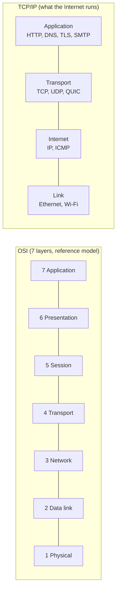
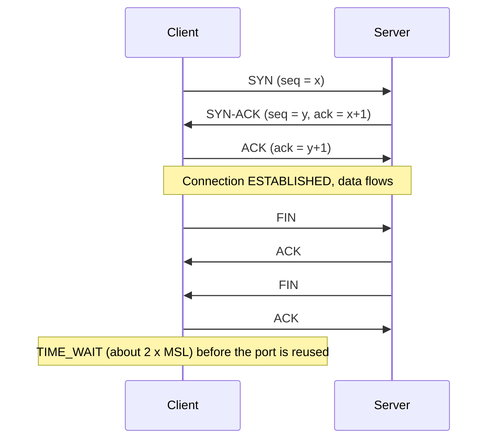
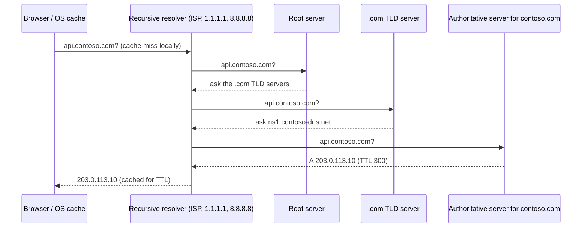

import { Tabs, TabItem, Aside } from '@astrojs/starlight/components';
import QuizBlock from '~/components/QuizBlock.astro';

## Why it matters in interviews

Networking shows up as MCQs in online tests (*"which layer does a router work at?"*, *"which protocol uses port 53?"*) and as the foundation of *"what happens when you type a URL"* (covered end to end in [HTTP, HTTPS & the Web](../http-https/)). For a web developer it explains socket exhaustion with `HttpClient`, why CORS is not a network concept, and how a load balancer in front of your API sees the request.

## Core idea

Networking is built in **layers**: each layer offers a service to the one above and uses the one below. Data going down the stack is **encapsulated** (each layer adds a header); going up, each layer strips its own header.

### OSI vs TCP/IP model



| OSI layer | Unit | Examples | Devices / where you meet it |
|---|---|---|---|
| 7 Application | Message | HTTP, DNS, SMTP, FTP | Your API, browser, L7 load balancer |
| 6 Presentation | | Encoding, compression, encryption (TLS is often placed here or at 5) | |
| 5 Session | | Session setup and teardown | |
| 4 Transport | Segment (TCP) / datagram (UDP) | TCP, UDP, ports | L4 load balancer, firewall rules on ports |
| 3 Network | Packet | IP, ICMP (ping), routing | Router |
| 2 Data link | Frame | Ethernet, Wi-Fi, MAC addresses, ARP | Switch |
| 1 Physical | Bits | Cables, radio | Hub, NIC |

OSI is a teaching model; TCP/IP is the real stack. In TCP/IP, OSI layers 5-7 collapse into **Application**, and layers 1-2 into **Link**. Mnemonic for OSI from the bottom: *Please Do Not Throw Sausage Pizza Away*.

### IP addresses and ports

- An **IP address** identifies a host interface. IPv4 is 32-bit (`203.0.113.10`), IPv6 is 128-bit (`2001:db8::1`).
- **Private IPv4 ranges** (not routed on the Internet): `10.0.0.0/8`, `172.16.0.0/12`, `192.168.0.0/16`. `127.0.0.1` is loopback.
- **CIDR** `/24` means the first 24 bits are the network part, leaving 256 addresses.
- A **port** (16-bit, 0-65535) identifies an application on the host. Well-known ports: 0-1023 (22 SSH, 53 DNS, 80 HTTP, 443 HTTPS, 1433 SQL Server). Clients use **ephemeral** ports from a high range.
- A **TCP connection** is identified by the 4-tuple *(source IP, source port, destination IP, destination port)*.

### TCP vs UDP

| | TCP | UDP |
|---|---|---|
| Connection | Connection-oriented (handshake first) | Connectionless |
| Reliability | Guaranteed delivery, retransmission, ACKs | Best effort, may lose packets |
| Ordering | In order (byte stream) | No ordering guarantees (independent datagrams) |
| Flow / congestion control | Yes (sliding window, congestion window) | No (application must do it if needed) |
| Header | 20-60 bytes | 8 bytes |
| Latency | Higher (handshake, head-of-line blocking) | Lower |
| Used by | HTTP/1.1 and HTTP/2, SQL Server (TDS), SSH, SMTP | DNS (mostly), video/voice calls, gaming, **QUIC / HTTP/3** |

**Head-of-line blocking**: TCP delivers bytes in order, so one lost segment stalls everything behind it until it is retransmitted. This is the main reason HTTP/3 moved to QUIC over UDP.

### TCP 3-way handshake and teardown



The handshake synchronises **initial sequence numbers** in both directions and costs **one round trip** before data can be sent. Teardown is a 4-way exchange because each direction is closed independently. The side that closes first sits in **TIME_WAIT**, which is why creating and disposing `new HttpClient()` per request can exhaust ephemeral ports (**socket exhaustion**); use `IHttpClientFactory` or a long-lived `HttpClient` (see [Performance & resilience](../../aspnet/performance-resilience/)).

### DNS resolution

DNS turns `api.contoso.com` into an IP address. It mostly runs over **UDP port 53** (TCP for large responses and zone transfers; DNS over HTTPS/TLS also exist).



Order of caches checked before the network: browser cache → OS cache (and the `hosts` file) → the recursive resolver's cache. The resolver does the **iterative** walk (root → TLD → authoritative); the client makes a **recursive** query to the resolver.

Common record types: **A** (IPv4), **AAAA** (IPv6), **CNAME** (alias to another name), **MX** (mail), **TXT** (verification, SPF), **NS** (delegation). Azure App Service custom domains use a CNAME or an A record plus a TXT verification record (AWS: Route 53 alias records).

### Load balancers

A load balancer spreads traffic across server instances and removes unhealthy ones using health checks.

| | Layer 4 (transport) | Layer 7 (application) |
|---|---|---|
| Sees | IPs and ports, TCP/UDP | Full HTTP: path, headers, cookies |
| Can do | Fast forwarding, any TCP/UDP protocol | Path-based routing, TLS termination, WAF, header rewrites, sticky sessions by cookie |
| Azure (AWS) | Azure Load Balancer (AWS: NLB) | Application Gateway, Front Door (AWS: ALB, CloudFront) |

Algorithms: round robin, weighted round robin, least connections, IP hash (sticky by client). Deeper coverage in [Scaling fundamentals](../../system-design/scaling-fundamentals/).

### Proxies

- **Forward proxy**: sits in front of **clients** and makes requests on their behalf (corporate proxy, content filtering). The server sees the proxy's IP.
- **Reverse proxy**: sits in front of **servers** and receives requests on their behalf (nginx, YARP, IIS in front of Kestrel, Application Gateway). It can terminate TLS, cache, compress and load-balance. The client sees only the proxy.

Behind a reverse proxy, your ASP.NET Core app sees the proxy's IP and `http` scheme unless you enable **forwarded headers** (`X-Forwarded-For`, `X-Forwarded-Proto`) with `UseForwardedHeaders()`.

### NAT

**Network Address Translation** lets many devices with private IPs share one public IP. The router rewrites the source IP and port of outgoing packets and keeps a translation table so replies find their way back. NAT is why your laptop's `192.168.1.20` is not reachable from the Internet unless you configure port forwarding. In the cloud, a NAT gateway gives private subnets a stable outbound IP (useful when a partner whitelists your IP).

## Code

**Inspecting the network from the command line**

```bash
nslookup api.github.com          # DNS lookup (Windows and Linux)
dig +trace example.com           # follow root -> TLD -> authoritative (Linux/macOS)
ping 8.8.8.8                     # ICMP reachability (may be blocked by firewalls)
tracert example.com              # Windows; 'traceroute' on Linux/macOS
netstat -ano | findstr :443      # Windows: connections on port 443 with PIDs
ss -tan state time-wait | wc -l  # Linux: count sockets in TIME_WAIT
curl -v https://example.com      # shows DNS, TCP connect, TLS and HTTP exchange
```

**TCP vs UDP in .NET**

```csharp
using System.Net.Sockets;
using System.Text;

// TCP: connect (3-way handshake happens here), then a reliable byte stream.
using var tcp = new TcpClient();
await tcp.ConnectAsync("example.com", 80);
await using var stream = tcp.GetStream();
await stream.WriteAsync("HEAD / HTTP/1.1\r\nHost: example.com\r\nConnection: close\r\n\r\n"u8.ToArray());

// UDP: no connection, each datagram stands alone and may be lost.
using var udp = new UdpClient();
byte[] payload = Encoding.UTF8.GetBytes("ping");
await udp.SendAsync(payload, payload.Length, "127.0.0.1", 9999);
```

## Interview Q&A

<details>
<summary>Explain the OSI model and map it to TCP/IP.</summary>

Seven layers: physical, data link, network, transport, session, presentation, application. TCP/IP has four: link (OSI 1-2), internet (3), transport (4), application (5-7). Routers work at layer 3 (IP), switches at layer 2 (MAC), and HTTP, DNS and your API live at the application layer.
</details>

<details>
<summary>TCP vs UDP, and when would you choose UDP?</summary>

TCP is connection-oriented, reliable and ordered, with flow and congestion control. UDP is connectionless, best-effort and has an 8-byte header. Choose UDP when low latency matters more than every packet (voice, video, games, DNS lookups) or when you build your own reliability on top, as QUIC does for HTTP/3.
</details>

<details>
<summary>Why does TCP need a 3-way handshake and not 2?</summary>

Both sides must choose an initial sequence number and confirm the other received it. SYN carries the client's number, SYN-ACK acknowledges it and carries the server's, and the final ACK confirms the server's. With only two messages the server could not know the client received its sequence number, and stale duplicate SYNs could open bogus connections.
</details>

<details>
<summary>Walk me through DNS resolution.</summary>

Check browser cache, OS cache and hosts file. On a miss, ask the configured recursive resolver. If it has no cached answer it asks a root server (which points to the TLD servers), the TLD server (which points to the domain's authoritative servers), and the authoritative server (which returns the record). The resolver caches the answer for its TTL and returns it.
</details>

<details>
<summary>L4 vs L7 load balancer?</summary>

An L4 balancer routes by IP and port without reading the payload, so it is fast and protocol-agnostic. An L7 balancer understands HTTP, so it can route by path or host, terminate TLS, add a WAF and use cookie-based stickiness. Azure Load Balancer is L4; Application Gateway and Front Door are L7 (AWS: NLB vs ALB).
</details>

<details>
<summary>Forward proxy vs reverse proxy?</summary>

A forward proxy represents clients to the outside world (corporate egress proxy). A reverse proxy represents servers to clients (nginx, YARP, Application Gateway in front of your API) and handles TLS termination, caching, routing and load balancing.
</details>

<details>
<summary>What is NAT and why does it exist?</summary>

NAT rewrites private source addresses to a shared public IP and tracks connections so replies come back to the right device. It exists mainly because of IPv4 address scarcity, and as a side effect hides internal hosts from unsolicited inbound traffic.
</details>

<details>
<summary>What is socket exhaustion with HttpClient?</summary>

Creating and disposing an `HttpClient` per request opens a new TCP connection each time; the closed sockets linger in TIME_WAIT and can use up the available ephemeral ports under load. Reuse connections with a long-lived `HttpClient` (with `PooledConnectionLifetime` for DNS changes) or `IHttpClientFactory`.
</details>

## Pitfalls

<Aside type="caution" title="Common mistakes">

- Saying "DNS uses TCP". It mainly uses **UDP 53**, falling back to TCP for large responses and zone transfers.
- Claiming UDP is "unreliable so never used for important things". DNS, QUIC and HTTP/3 run on it.
- Mixing up the resolver's iterative queries with the client's recursive query.
- Forgetting that a reverse proxy changes what your app sees (client IP, scheme) until forwarded headers are configured.
- Assuming lowering a DNS TTL takes effect instantly. Caches keep the old record until the **old** TTL expires.

</Aside>

## Related

- [HTTP, HTTPS & the Web](../http-https/)
- [Scaling fundamentals](../../system-design/scaling-fundamentals/)
- [Performance & resilience (HttpClient)](../../aspnet/performance-resilience/)
- [Hosting model & Kestrel](../../aspnet/hosting-startup/)

## Quick quiz

<QuizBlock section="fundamentals" topic="networking" />
