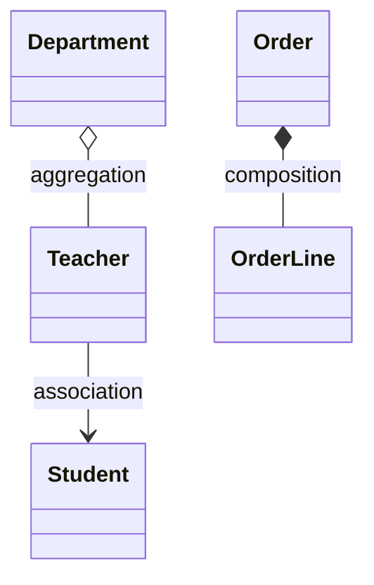

import { Tabs, TabItem, Aside } from '@astrojs/starlight/components';
import QuizBlock from '~/components/QuizBlock.astro';

## Why it matters in interviews

Online tests and first rounds almost always open with *"explain the four pillars of OOP with an example"*, *"overloading vs overriding?"* or *"composition vs inheritance?"*. The interviewer wants crisp definitions **plus** a real example from your own code, not textbook phrases. This page is language-agnostic; the C#-specific syntax (virtual/override/new, abstract class vs interface) lives in [OOP in C#](../../csharp/oop-csharp/).

## Core idea

A **class** is a blueprint: it declares state (fields) and behaviour (methods). An **object** is a runtime instance of that class with its own copy of the state. Object-oriented programming organises a program as objects that **own their data and expose behaviour**, instead of free functions passing data structures around.

### The four pillars

| Pillar | One-line definition | What it buys you | .NET / Angular example |
|---|---|---|---|
| **Encapsulation** | Bundle data with the methods that change it, and hide the internals | Invariants are enforced in one place | `Order` with a private list of lines and an `AddLine()` method that validates quantity |
| **Abstraction** | Expose *what* an object does, hide *how* | Callers depend on a simple contract | `IEmailSender.SendAsync()`; an Angular `AuthService` that hides token storage |
| **Inheritance** | A class reuses and extends another (an *is-a* relationship) | Code reuse, a common base type | `ControllerBase` → your `OrdersController` |
| **Polymorphism** | One interface, many implementations; the call is resolved to the right one | Add new behaviour without changing callers | A list of `IPaymentProvider` (card, UPI, wallet) called through the same method |

Encapsulation and abstraction are often confused. **Encapsulation** is about *protecting state* (access modifiers, no public setters, validation inside methods). **Abstraction** is about *designing the contract* (interfaces, abstract classes) so the caller does not need the details. A good one-liner: *"abstraction is the design view, encapsulation is the implementation that enforces it."*

### Kinds of polymorphism

- **Compile-time (static)**: method **overloading** and operator overloading. The compiler picks the method from the argument types.
- **Run-time (dynamic)**: method **overriding** through virtual dispatch. The runtime picks the method from the **actual object type**, not the variable type.
- **Parametric**: generics, e.g. `List<T>` works for any `T`.

### Overloading vs overriding

| | Overloading | Overriding |
|---|---|---|
| Where | Same class (or a derived class adds one) | Derived class redefines a base method |
| Signature | Same name, **different parameters** | Same name **and** same parameters |
| Resolved | At compile time | At run time (virtual dispatch) |
| Differ by return type only? | Not allowed | Return type must match (C# 9+ allows covariant returns) |
| Keyword in C# | None | `virtual`/`abstract` on base, `override` on derived |

### Association, aggregation, composition

All three are *has-a* relationships, differing in **ownership and lifetime**:



- **Association**: objects know about or use each other, with independent lifetimes (a teacher teaches students).
- **Aggregation** (hollow diamond): whole/part, but parts can exist without the whole and may be shared (a department has teachers; close the department and the teachers still exist).
- **Composition** (filled diamond): strong ownership; the part's lifetime is bound to the whole (an order's lines are deleted with the order). In EF Core terms this is close to an **owned type** or a cascade-delete child.

### Composition over inheritance

Inheritance is the tightest coupling there is: the subclass depends on the base class's internals, and changes ripple down (the *fragile base class* problem). Deep hierarchies also suffer combinatorial explosion (`LoggedCachedRetryingHttpClient`). Prefer **composing** behaviour from small objects behind interfaces, which is exactly what ASP.NET Core DI and the Decorator pattern do. Use inheritance only for a true *is-a* relationship that obeys the Liskov Substitution Principle (see [SOLID](../../patterns/solid/)).

### Coupling and cohesion

- **Coupling** = how much one module depends on another. Aim for **low** coupling: depend on interfaces, not concrete classes; pass dependencies in through the constructor.
- **Cohesion** = how closely the members of one module belong together. Aim for **high** cohesion: an `InvoiceService` that only does invoicing, not invoicing plus email plus PDF rendering.

Low coupling plus high cohesion is the goal behind SOLID, clean architecture and Angular feature folders alike.

### OOP vs functional programming

| | OOP | Functional |
|---|---|---|
| Unit of design | Objects with state + behaviour | Pure functions over immutable data |
| State | Mutable, encapsulated | Immutable, transformed into new values |
| Reuse | Inheritance, composition of objects | Higher-order functions, function composition |
| Side effects | Common, controlled by encapsulation | Pushed to the edges |
| Where you see it | Domain models, services, DI | LINQ, RxJS pipelines, NgRx reducers, signal `computed` |

Modern C# and TypeScript are **multi-paradigm**: records and `with` expressions, pattern matching, LINQ and lambdas are functional features inside an OOP language. A strong answer says *"I use OOP for the domain model and service boundaries, and a functional style for data transformation."*

## Code

<Tabs syncKey="lang">
  <TabItem label="C#">
```csharp
// Abstraction: callers only see the contract.
public interface IPaymentProvider
{
    string Name { get; }
    Task<bool> ChargeAsync(decimal amount, CancellationToken ct);
}

// Inheritance + run-time polymorphism via an abstract base.
public abstract class PaymentProviderBase : IPaymentProvider
{
    public abstract string Name { get; }
    public Task<bool> ChargeAsync(decimal amount, CancellationToken ct)
    {
        ArgumentOutOfRangeException.ThrowIfNegativeOrZero(amount);
        return ChargeCoreAsync(amount, ct);   // template method
    }
    protected abstract Task<bool> ChargeCoreAsync(decimal amount, CancellationToken ct);
}

public sealed class CardProvider : PaymentProviderBase
{
    public override string Name => "card";
    protected override Task<bool> ChargeCoreAsync(decimal amount, CancellationToken ct) =>
        Task.FromResult(true);
}

// Encapsulation + composition: Order owns its lines and guards the invariant.
public sealed class Order
{
    private readonly List<OrderLine> _lines = [];
    public IReadOnlyList<OrderLine> Lines => _lines;
    public decimal Total => _lines.Sum(l => l.Price * l.Quantity);

    public void AddLine(string sku, decimal price, int quantity)
    {
        if (quantity <= 0) throw new ArgumentException("Quantity must be positive.");
        _lines.Add(new OrderLine(sku, price, quantity));
    }
}
public sealed record OrderLine(string Sku, decimal Price, int Quantity);
```
  </TabItem>
  <TabItem label="TypeScript">
```ts
// Same ideas in TypeScript (an Angular service would be provided and inject()-ed).
interface PaymentProvider {
  readonly name: string;
  charge(amount: number): Promise<boolean>;
}

class CardProvider implements PaymentProvider {
  readonly name = 'card';
  async charge(amount: number): Promise<boolean> {
    return amount > 0;
  }
}

class Order {
  #lines: { sku: string; price: number; qty: number }[] = []; // truly private at run time
  get total() {
    return this.#lines.reduce((sum, l) => sum + l.price * l.qty, 0);
  }
  addLine(sku: string, price: number, qty: number) {
    if (qty <= 0) throw new Error('Quantity must be positive.');
    this.#lines.push({ sku, price, qty });
  }
}

// Polymorphism: the caller does not care which provider it gets.
async function pay(provider: PaymentProvider, order: Order) {
  return provider.charge(order.total);
}
```
  </TabItem>
</Tabs>

**Overloading vs overriding in one snippet**

```csharp
public class Shape
{
    public virtual double Area() => 0;                 // can be overridden
    public string Describe() => "shape";               // overload #1
    public string Describe(int precision) =>           // overload #2 (different params)
        $"shape with area {Math.Round(Area(), precision)}";
}

public class Circle(double r) : Shape
{
    public override double Area() => Math.PI * r * r; // run-time polymorphism
}

// Usage
Shape s = new Circle(2);
Console.WriteLine(s.Area());        // 12.566... (Circle.Area chosen at run time)
Console.WriteLine(s.Describe(2));   // overload chosen at compile time
```

## Interview Q&A

<details>
<summary>Explain the four pillars of OOP with one example.</summary>

Take a payment module. **Abstraction**: an `IPaymentProvider` interface with `ChargeAsync`. **Encapsulation**: each provider keeps its API keys and HTTP details private. **Inheritance**: providers share validation in a `PaymentProviderBase`. **Polymorphism**: checkout calls `ChargeAsync` on whichever provider DI resolved, without an `if/else` per type.
</details>

<details>
<summary>What is the difference between abstraction and encapsulation?</summary>

Abstraction decides **what to expose**: a simplified contract that hides complexity. Encapsulation decides **how to protect** the internals: private fields, validation in methods, no public setters. You can have an abstraction (an interface) whose implementation is poorly encapsulated (public mutable fields), so they are related but separate ideas.
</details>

<details>
<summary>Overloading vs overriding?</summary>

Overloading: same method name, different parameter lists, resolved by the **compiler**. Overriding: a derived class supplies a new implementation of a virtual method with the **same signature**, resolved at **run time** from the actual object type. Overloading is compile-time polymorphism, overriding is run-time polymorphism.
</details>

<details>
<summary>Composition vs aggregation vs association?</summary>

All are *has-a*. Association is a plain "uses/knows" link with independent lifetimes. Aggregation is whole/part where the part can live on its own (department and teachers). Composition is whole/part with **owned lifetime**: destroy the whole and the parts go too (order and order lines).
</details>

<details>
<summary>Why "favour composition over inheritance"?</summary>

Inheritance couples a subclass to its base's implementation, so base changes can break subclasses (fragile base class), and C# allows only one base class. Composition lets you swap behaviour at run time through interfaces and DI, test parts in isolation and avoid deep hierarchies. Keep inheritance for genuine *is-a* cases that respect Liskov.
</details>

<details>
<summary>What do low coupling and high cohesion mean in practice?</summary>

Low coupling: a class depends on few things, and on abstractions, so a change in one place does not ripple. High cohesion: everything in a class serves one purpose. In ASP.NET Core this looks like small services injected by interface; in Angular, feature-scoped services and presentational components that only take inputs and emit outputs.
</details>

<details>
<summary>Can you achieve polymorphism without inheritance?</summary>

Yes. Interface implementation gives run-time polymorphism without class inheritance. Generics give parametric polymorphism. Overloading gives ad-hoc compile-time polymorphism. TypeScript also has **structural typing**: any object with the right shape satisfies an interface, no `implements` needed.
</details>

<details>
<summary>OOP vs functional: which is better?</summary>

Neither in general. OOP models entities with identity and changing state well (domain models, services). Functional style suits transformation pipelines and concurrency, because immutable data cannot race. Most modern code mixes them: LINQ, RxJS, records and Angular signals are functional ideas used inside OOP codebases.
</details>

## Pitfalls

<Aside type="caution" title="Common mistakes">

- Defining encapsulation as "using private fields". It is about **protecting invariants**; a class full of public get/set properties is not really encapsulated even though its backing fields are private.
- Saying overloads can differ by **return type only**. They cannot; the parameter list must differ.
- Using inheritance for code reuse between unrelated classes (`Customer : Address`). That is a *has-a*, so compose.
- Deep hierarchies (4+ levels) that make every change risky.
- Confusing aggregation and composition. The test is **lifetime ownership**, not "holds a reference".
- Calling interfaces "multiple inheritance" without nuance. A C# class implements many interfaces but inherits from exactly one class.

</Aside>

## Related

- [OOP in C#](../../csharp/oop-csharp/)
- [SOLID principles](../../patterns/solid/)
- [DRY, KISS, YAGNI & friends](../../patterns/design-principles/)
- [Behavioral patterns](../../patterns/behavioral-patterns/)

## Quick quiz

<QuizBlock section="fundamentals" topic="oop-concepts" />
