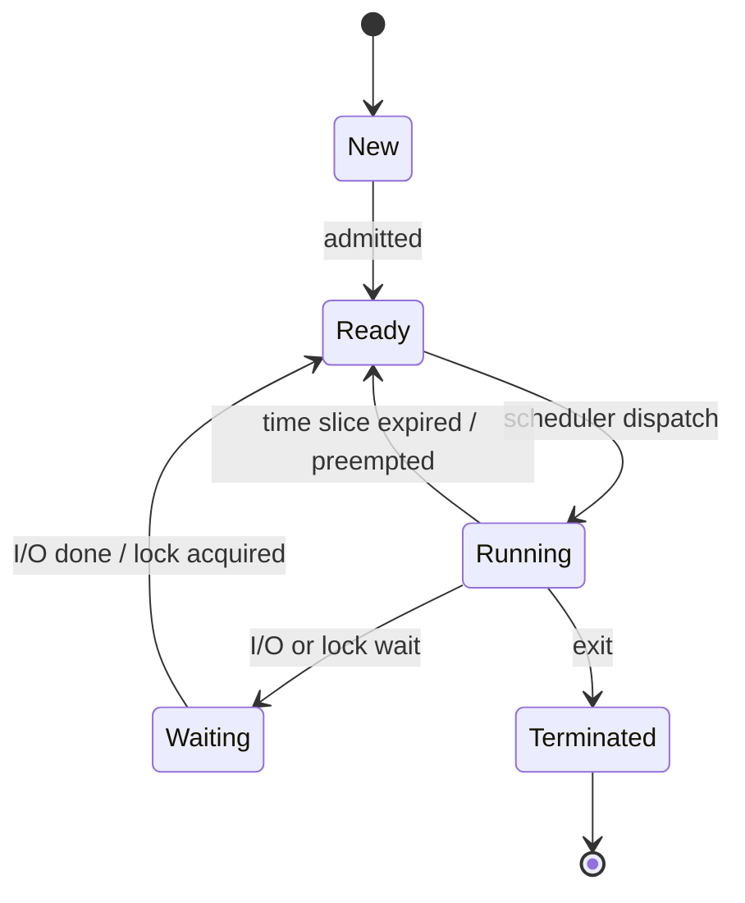
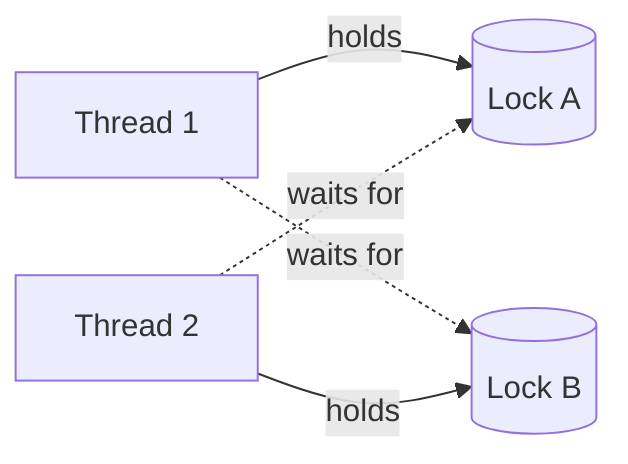

import { Tabs, TabItem, Aside } from '@astrojs/starlight/components';
import QuizBlock from '~/components/QuizBlock.astro';

## Why it matters in interviews

OS questions are a staple of online tests (MCQs on scheduling, paging and deadlock) and of first rounds at product companies: *"process vs thread?"*, *"what are the four conditions for deadlock?"*, *"mutex vs semaphore?"*. For a .NET developer they also explain **why** the thread pool, `lock`, `SemaphoreSlim` and async I/O exist, so tie every answer back to code you have written.

## Core idea

The operating system shares a few CPUs and a fixed amount of RAM among many programs, and isolates them from each other. Two abstractions do most of the work: the **process** (an isolated container of resources) and the **thread** (a unit of execution scheduled on a CPU).

### Process vs thread

| | Process | Thread |
|---|---|---|
| What it is | A running program with its own resources | A path of execution inside a process |
| Memory | **Own virtual address space** (code, heap, globals) | **Shares** the process's heap and globals; has its own **stack** and registers |
| Isolation | A crash or bad pointer stays inside the process | A crash on one thread usually brings down the whole process |
| Creation / switch cost | Higher (new address space, page tables, handles) | Lower |
| Communication | IPC: pipes, sockets, shared memory, message queues | Directly through shared memory (needs synchronisation) |
| .NET example | Each `dotnet MyApi.dll`, each IIS worker process (w3wp) | Thread-pool threads serving requests inside that API |

A browser is a nice example of both: Chrome runs **separate processes** per site (isolation, a crashed tab does not kill the browser), while each tab's renderer uses several **threads** (main thread, compositor, workers).

### Process (and thread) states



A thread blocked on synchronous I/O sits in **Waiting** and holds its stack (about 1 MB reserved by default on Windows) while doing nothing. That is the cost async/await avoids on a busy web server.

### Context switching

A **context switch** is the OS saving the state of the running thread (registers, program counter, stack pointer) and restoring another's. Switching between **threads of the same process** is cheaper than between **processes**, because a process switch also changes the address space (page tables), which invalidates much of the TLB and cache warmth. Context switches are pure overhead: too many runnable threads (for example, hundreds of threads blocked and waking on sync I/O) means the CPU spends time switching instead of working.

### CPU scheduling

The scheduler picks which **Ready** thread runs next. **Preemptive** schedulers can interrupt a running thread (all modern desktop and server OSes); **non-preemptive** ones wait for it to block or finish.

| Algorithm | Idea | Strength | Weakness |
|---|---|---|---|
| FCFS (first come, first served) | Queue order | Simple, fair in order | Convoy effect: short jobs wait behind a long one |
| SJF / SRTF | Shortest (remaining) job first | Minimises average waiting time | Needs burst estimates; long jobs can starve |
| Priority | Highest priority first | Important work first | Starvation; fixed by **aging** (raise priority over time) |
| Round Robin | Each gets a fixed time quantum in turn | Good response time, no starvation | Quantum too small = switch overhead; too big = FCFS |
| Multilevel feedback queue | Several RR queues; CPU-heavy jobs drift down | Favours interactive work automatically | More complex to tune |

Windows and Linux use priority-based preemptive schedulers that combine these ideas (Linux's default class has been CFS, replaced by EEVDF in kernel 6.6).

### Memory: virtual memory and paging

Every process sees its own **virtual address space**. The CPU's **MMU** translates virtual addresses to physical ones using **page tables** kept by the OS; the **TLB** caches recent translations.

- **Paging**: memory is split into fixed-size **pages** (commonly 4 KB) mapped onto physical **frames**. No external fragmentation, and pages need not be contiguous in RAM.
- **Page fault**: the page is not in RAM; the OS loads it from disk (or allocates it) and retries the instruction.
- **Swapping / demand paging** lets the total virtual memory exceed physical RAM. If the working set does not fit, the system **thrashes**: it spends its time paging instead of running.
- Benefits: isolation (one process cannot read another's memory), simpler programs (every process starts from a clean address space), and shared pages for common libraries.
- Page replacement policies: FIFO, LRU, Optimal (theoretical), Clock (an LRU approximation). FIFO can suffer **Belady's anomaly** (more frames, more faults).

Stack vs heap at the OS level: each thread has its own **stack** (call frames, fixed reserved size, overflow = `StackOverflowException`); the **heap** is shared by all threads of the process. The .NET GC manages the managed heap on top of memory it reserves from the OS (see [Memory & GC](../../csharp/memory-gc/)).

### Deadlock

A deadlock is a set of threads each waiting for a resource held by another in the set, so none can proceed. It needs **all four Coffman conditions** at once:

1. **Mutual exclusion**: a resource can be held by only one thread.
2. **Hold and wait**: a thread holds one resource while waiting for another.
3. **No preemption**: a resource cannot be forcibly taken away.
4. **Circular wait**: T1 waits for T2, T2 waits for T1 (or a longer cycle).



Handling strategies:

- **Prevention**: break one condition. The practical one is **lock ordering** (always take A before B), which breaks circular wait. Taking all locks at once breaks hold-and-wait.
- **Avoidance**: grant a request only if the system stays in a safe state (**Banker's algorithm**). Mostly academic.
- **Detection and recovery**: build a wait-for graph, find a cycle, kill or roll back a victim. **SQL Server does exactly this**: it picks a deadlock victim and raises error 1205 (see [Transactions & isolation](../../data/transactions-isolation/)).
- **Timeouts**: `Monitor.TryEnter(obj, timeout)` or `SemaphoreSlim.WaitAsync(timeout)` turns a hang into an error you can handle.

Related terms: **livelock** (threads keep reacting to each other and make no progress, though not blocked) and **starvation** (a thread never gets the resource because others keep winning).

### Synchronisation: mutex vs semaphore

A **race condition** happens when the result depends on the timing of threads touching shared data, e.g. two threads doing `count++` (read, add, write) and losing an update. The code that touches shared state is the **critical section**.

| | Mutex / lock | Semaphore |
|---|---|---|
| Purpose | Mutual exclusion: **one** thread in the critical section | Limit access to **N** concurrent holders |
| State | Locked / unlocked | A counter |
| Ownership | **Owned**: only the thread that acquired it may release it | **No owner**: any thread may release (signal) |
| Typical use | Protect shared data | Throttle (e.g. max 5 concurrent outbound calls), pools |
| .NET types | `lock` / `Monitor` (in-process), `System.Threading.Mutex` (named, cross-process) | `SemaphoreSlim` (in-process, async-friendly), `Semaphore` (named, cross-process) |

A **binary semaphore** (count 1) gives mutual exclusion but without ownership, which is why it is not quite the same as a mutex. A **spinlock** busy-waits instead of sleeping; worth it only when the wait is shorter than a context switch.

### Concurrency vs parallelism

- **Concurrency**: dealing with many things at once, by interleaving. Possible on one core. Async I/O in ASP.NET Core and the JavaScript event loop are concurrency.
- **Parallelism**: doing many things **at the same instant** on multiple cores. `Parallel.For`, PLINQ and Web Workers are parallelism.

Concurrency is about **structure**, parallelism is about **execution**. A Node or browser JS app is highly concurrent but runs your JS on a single thread.

## Code

**Race condition and three fixes**

```csharp
int unsafeCount = 0, lockedCount = 0, atomicCount = 0;
var gate = new Lock(); // .NET 9+ System.Threading.Lock; use 'object' on older versions

Parallel.For(0, 100_000, _ =>
{
    unsafeCount++;                                // race: read-modify-write is not atomic
    lock (gate) { lockedCount++; }                // mutual exclusion
    Interlocked.Increment(ref atomicCount);       // single atomic CPU instruction
});

Console.WriteLine($"{unsafeCount} {lockedCount} {atomicCount}");
// e.g. "71234 100000 100000": the unsafe counter loses updates
```

**Semaphore as a throttle, and lock ordering to avoid deadlock**

```csharp
public sealed class Throttled(HttpClient http)
{
    private readonly SemaphoreSlim _slots = new(initialCount: 5); // max 5 in flight

    public async Task<string> GetAsync(string url, CancellationToken ct)
    {
        await _slots.WaitAsync(ct);               // async wait, no thread blocked
        try { return await http.GetStringAsync(url, ct); }
        finally { _slots.Release(); }             // always release
    }
}

public static class Bank
{
    // Always lock accounts in a global order (by Id) so no cycle can form.
    public static void Transfer(Account from, Account to, decimal amount)
    {
        var (first, second) = from.Id < to.Id ? (from, to) : (to, from);
        lock (first.Sync)
        lock (second.Sync)
        {
            from.Balance -= amount;
            to.Balance += amount;
        }
    }
}
public sealed class Account(int id)
{
    public int Id { get; } = id;
    public decimal Balance { get; set; }
    public object Sync { get; } = new();
}
```

You cannot `await` inside a `lock` block in C#, which is one reason `SemaphoreSlim(1, 1)` is the usual async mutex. More in [Threading & synchronization](../../csharp/threading/).

## Interview Q&A

<details>
<summary>What is the difference between a process and a thread?</summary>

A process is an isolated running program with its own virtual address space and resources. A thread is a unit of execution inside a process; threads share the process heap and globals but each has its own stack and registers. Threads are cheaper to create and switch, but a fault in one thread can kill the whole process, while processes are isolated.
</details>

<details>
<summary>What happens during a context switch and why is it expensive?</summary>

The OS saves the current thread's registers, program counter and stack pointer, picks the next thread, and restores its state. A process switch also swaps page tables, so TLB entries and caches go cold. The cost is not the save/restore itself but the lost cache locality and the time the CPU is doing no useful work.
</details>

<details>
<summary>Name the four conditions for deadlock and how you prevent it in practice.</summary>

Mutual exclusion, hold and wait, no preemption, circular wait. All four must hold. In application code the usual fix is a consistent **lock order** (breaks circular wait), plus keeping critical sections small, avoiding calls to unknown code while holding a lock, and using timeouts. In databases, access tables in the same order and keep transactions short.
</details>

<details>
<summary>Mutex vs semaphore?</summary>

A mutex gives exclusive access to one thread and has ownership: only the owner releases it. A semaphore is a counter that allows up to N holders and has no ownership. In .NET, `lock` is the in-process mutex, `Mutex` is the cross-process one, and `SemaphoreSlim` is the go-to for throttling and for an async-compatible lock.
</details>

<details>
<summary>What is virtual memory and why do we need it?</summary>

Each process gets its own virtual address space, translated to physical memory by the MMU using page tables. It provides isolation between processes, lets programs use more memory than physical RAM (pages swap to disk), and allows sharing pages such as common DLLs. A page fault occurs when a page is not in RAM and must be loaded.
</details>

<details>
<summary>Concurrency vs parallelism?</summary>

Concurrency is making progress on multiple tasks by interleaving them, which works even on one core (async I/O, the JS event loop). Parallelism is executing multiple tasks at the same instant on multiple cores (`Parallel.For`). A web server handling 1000 requests with async I/O on 8 threads is concurrent; a parallel image resize is parallel.
</details>

<details>
<summary>What is starvation and how is it fixed?</summary>

A thread never gets the CPU or a resource because others keep being preferred, for example low-priority work under strict priority scheduling. **Aging** (gradually raising the priority of waiting work) or fair queuing fixes it. Thread-pool starvation in .NET is a related idea: all pool threads are blocked on sync-over-async, so new work waits.
</details>

<details>
<summary>Why is Round Robin's time quantum a trade-off?</summary>

Too small and the CPU spends a large share of time on context switches. Too large and Round Robin degenerates into FCFS, hurting response time for interactive tasks. The quantum is chosen so most interactive bursts finish within one slice.
</details>

## Pitfalls

<Aside type="caution" title="Common mistakes">

- Saying threads have separate heaps. They share the heap; only the **stack** (and registers, thread-local storage) is per thread.
- Treating a binary semaphore as identical to a mutex. A mutex has an owner; a semaphore does not.
- Listing only "circular wait" as the deadlock cause. All **four** Coffman conditions are required.
- Mixing up concurrency and parallelism, or claiming async/await creates threads.
- Taking two locks in different orders in different code paths. This is the classic production deadlock.
- Using `lock` around `await` (does not compile) or holding a `Mutex` across an await (thread affinity). Use `SemaphoreSlim`.

</Aside>

## Related

- [Threading & synchronization](../../csharp/threading/)
- [Async/Await deep dive](../../csharp/async-await/)
- [Transactions, isolation & locking](../../data/transactions-isolation/)
- [Compilers & runtimes](../compilers-runtimes/)

## Quick quiz

<QuizBlock section="fundamentals" topic="operating-systems" />
