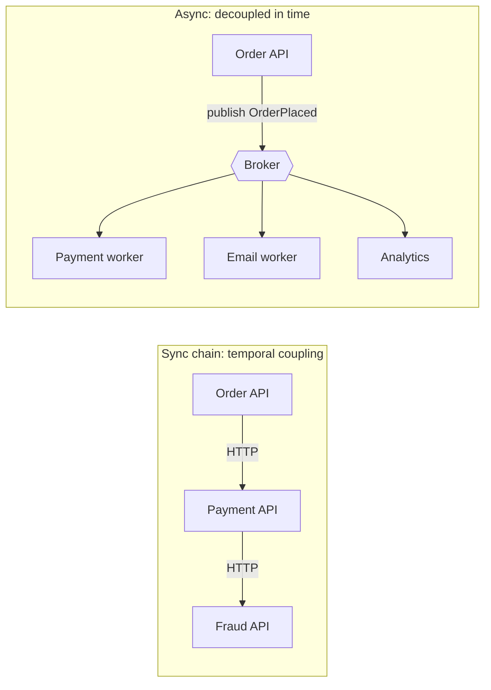
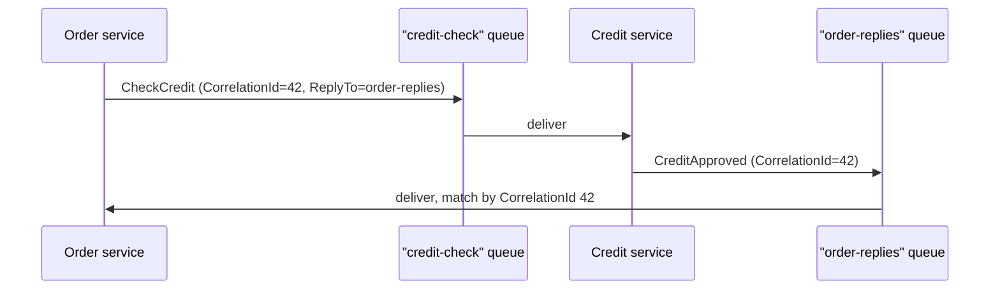
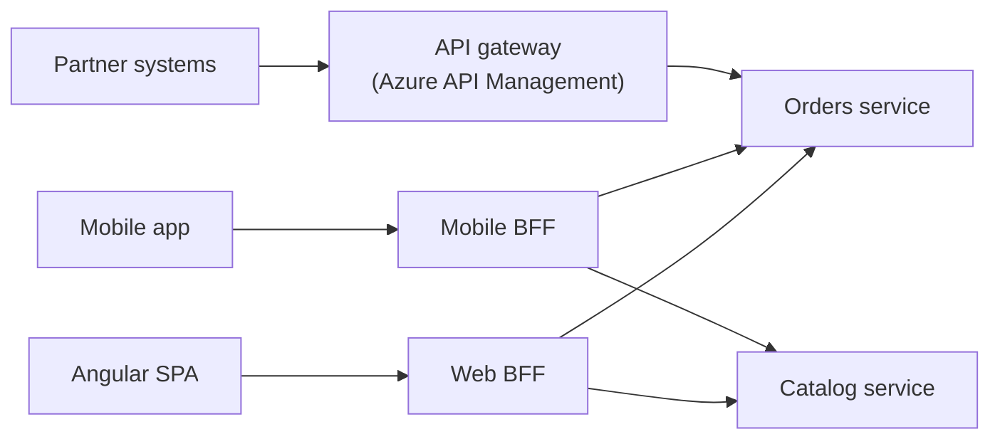
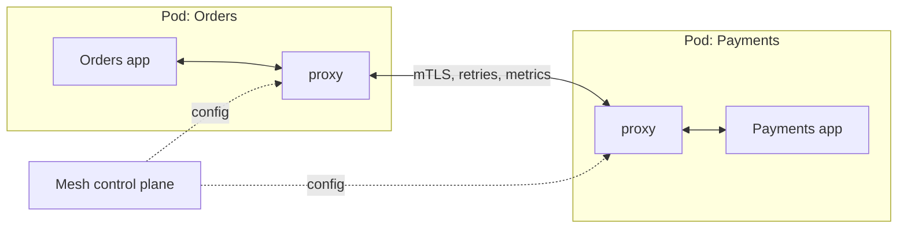

import { Tabs, TabItem, Aside } from '@astrojs/starlight/components';
import QuizBlock from '~/components/QuizBlock.astro';

## Why it matters in interviews

*"How do your services talk to each other?"* is the most common microservices question. A weak answer is "REST". A strong answer explains **when** you use synchronous calls, **when** you publish a message, the difference between a **command** and an **event**, and what sits at the edge (gateway, BFF). Expect follow-ups like *"what if the payment service is down when the order is placed?"*.

## Core idea

### Synchronous vs asynchronous

| | Synchronous (REST, gRPC) | Asynchronous (messages via a broker) |
|---|---|---|
| Caller waits? | Yes, for the response | No, it hands the message to the broker and moves on |
| Temporal coupling | Both services must be up **at the same time** | Receiver can be down; the message waits in the queue |
| Latency for the user | Sum of the call chain | User gets "accepted", work completes later |
| Failure handling | Retries, timeouts, circuit breaker in the caller | Broker retries, dead-letter queue, idempotent consumer |
| Consistency | Easier to reason about (immediate answer) | Eventual consistency |
| Good for | Queries, user-facing reads, "I need the answer now" | State changes that other services react to, long-running work, spikes |

**Rule of thumb:** use sync for **queries** where the caller needs data right now, and async for **commands and events** that change state, especially when several services must react. Availability of a synchronous chain is the **product** of each service's availability: five services at 99.9% each give about 99.5% for the chain.



### REST vs gRPC between services

| | REST + JSON | gRPC |
|---|---|---|
| Transport | HTTP/1.1 or HTTP/2 | HTTP/2 (required) |
| Contract | OpenAPI (optional) | `.proto` file, code generated |
| Payload | Text JSON | Binary Protobuf, smaller and faster to parse |
| Streaming | Not native (use SSE / WebSockets) | Client, server and bidirectional streaming |
| Browser support | Native | Needs gRPC-Web or JSON transcoding |
| Best for | Public APIs, simple internal calls | High-volume internal calls, polyglot contracts |

### Commands vs events

- A **command** asks one specific receiver to do something: `ChargePayment`, `SendEmail`. Imperative name, **one** logical handler, sent to a **queue**. The sender knows (and depends on) who handles it.
- An **event** states a fact that already happened: `OrderPlaced`, `PaymentFailed`. Past-tense name, **zero or many** subscribers, published to a **topic**. The publisher does not know who listens.

Events reduce coupling (adding an analytics subscriber needs no change to Orders). Commands make intent explicit. Most systems use both.

### Request-reply over messaging

Sometimes you want async transport but still need an answer (for example a long credit check). The requester sends a message with a **ReplyTo** address and a **CorrelationId**. The responder sends the result to that reply queue with the same correlation id. Azure Service Bus supports this with `ReplyTo`, `CorrelationId` and sessions (`ReplyToSessionId`); RabbitMQ with `reply_to` and `correlation_id` properties (or the direct reply-to feature).



Do not overuse it: request-reply over a broker has sync-style coupling plus broker latency. If the caller really blocks waiting, gRPC or HTTP is simpler.

### API gateway and BFF

An **API gateway** is the single entry point for clients: routing, TLS termination, authentication, rate limiting, request aggregation, caching. Options: **YARP** (a .NET reverse proxy library you host yourself), **Azure API Management** (managed, with developer portal, policies, products and subscriptions), Azure Application Gateway / Front Door for L7 load balancing and WAF. AWS equivalents: **Amazon API Gateway**, ALB, CloudFront.

A **Backend for Frontend (BFF)** is a gateway per client type (web SPA, mobile app, partner API). Each BFF shapes responses for its client and is owned by the client team. For an Angular SPA, a BFF also lets you keep tokens server-side in an HTTP-only cookie instead of in the browser.



Keep gateways thin: routing, auth, rate limits, simple aggregation. Business logic in the gateway turns it into a new monolith.

### Service mesh basics

A **service mesh** (Istio, Linkerd; on Azure, the Istio-based add-on for AKS) puts a proxy next to every service (a sidecar, or a per-node proxy in newer "ambient" modes) that handles **service-to-service** concerns without code changes: mutual TLS, retries, timeouts, traffic splitting for canary releases, and telemetry. It is about east-west (internal) traffic, while a gateway handles north-south (client to system) traffic. A mesh adds operational complexity; many .NET teams get far with in-process libraries (`Microsoft.Extensions.Http.Resilience`, OpenTelemetry) before needing one.



## Code

**Sync call with a typed client, service discovery and the standard resilience handler** (timeouts, retries with jitter, circuit breaker):

```csharp
var builder = WebApplication.CreateBuilder(args);
builder.Services.AddServiceDiscovery(); // Microsoft.Extensions.ServiceDiscovery (used by .NET Aspire)

builder.Services.AddHttpClient<CatalogClient>(c => c.BaseAddress = new("https+http://catalog"))
    .AddServiceDiscovery()
    .AddStandardResilienceHandler(); // Microsoft.Extensions.Http.Resilience

public sealed class CatalogClient(HttpClient http)
{
    public Task<ProductDto?> GetAsync(string sku, CancellationToken ct) =>
        http.GetFromJsonAsync<ProductDto>($"/api/products/{sku}", ct);
}
```

**Publishing an event vs sending a command** with MassTransit 8:

```csharp
public sealed class PlaceOrderHandler(IPublishEndpoint publish, ISendEndpointProvider send, OrdersDb db)
{
    public async Task HandleAsync(Order order, CancellationToken ct)
    {
        db.Orders.Add(order);
        // Event: any number of subscribers (topic / fanout exchange).
        await publish.Publish(new OrderPlaced(order.Id, order.CustomerId, order.Total), ct);
        // Command: exactly one logical receiver (a named queue).
        var endpoint = await send.GetSendEndpoint(new Uri("queue:charge-payment"));
        await endpoint.Send(new ChargePayment(order.Id, order.Total), ct);
        await db.SaveChangesAsync(ct); // with the EF outbox, both messages are stored here atomically
    }
}
```

**Request-reply** with MassTransit's request client:

```csharp
public sealed class CreditCheck(IRequestClient<CheckCredit> client)
{
    public async Task<bool> IsApprovedAsync(Guid customerId, decimal amount, CancellationToken ct)
    {
        var response = await client.GetResponse<CreditResult>(new CheckCredit(customerId, amount), ct);
        return response.Message.Approved;
    }
}
```

**A YARP gateway** in a few lines:

```csharp
var builder = WebApplication.CreateBuilder(args);
builder.Services.AddReverseProxy()
    .LoadFromConfig(builder.Configuration.GetSection("ReverseProxy"));
builder.Services.AddAuthentication().AddJwtBearer();
builder.Services.AddAuthorization();

var app = builder.Build();
app.UseAuthentication();
app.UseAuthorization();
app.MapReverseProxy().RequireAuthorization();
app.Run();
```

## Interview Q&A

<details>
<summary>When do you choose synchronous over asynchronous communication?</summary>

Sync when the caller needs the answer to continue (a query, a validation the user is waiting for) and the dependency is fast and reliable. Async when the operation changes state that other services react to, can complete later, must survive the receiver being down, or arrives in spikes. Many flows mix both: a sync API accepts the request and returns `202 Accepted`, and the processing happens through messages.
</details>

<details>
<summary>What is the difference between a command and an event?</summary>

A command (`ChargePayment`) is a request to one specific handler to do something, and it may be rejected. An event (`PaymentCharged`) announces a fact that already happened; it cannot be rejected and can have many subscribers. Commands go to queues, events to topics. Naming is a giveaway: imperative vs past tense.
</details>

<details>
<summary>Why not just use HTTP everywhere?</summary>

Temporal coupling and cascading failure. If Orders synchronously calls Payments, Inventory and Email, an outage or slowdown in any of them fails or slows order placement, and availability multiplies down. With events, Orders only needs the broker to be up, and consumers catch up when they recover.
</details>

<details>
<summary>What does an API gateway do, and what should it NOT do?</summary>

It routes, terminates TLS, authenticates, rate-limits, caches, and may aggregate a few calls. It should not hold business rules or orchestrate long workflows; that makes it a shared bottleneck owned by no team. Keep domain logic in services.
</details>

<details>
<summary>What is a BFF and when is it worth it?</summary>

A Backend for Frontend is a dedicated API layer per client type. It is worth it when clients need very different shapes of data (mobile wants small payloads, web wants rich pages) or when you want the SPA to use secure cookie sessions while the BFF holds the access tokens. Cost: one more service per client.
</details>

<details>
<summary>gRPC or REST for internal calls?</summary>

gRPC for high-throughput internal calls, strict contracts, and streaming: Protobuf is compact and the client is generated. REST for public or browser-facing APIs, simpler debugging, and when tooling expects JSON. Both are synchronous, so the coupling concerns are the same.
</details>

<details>
<summary>What problem does a service mesh solve?</summary>

It moves service-to-service networking concerns (mTLS, retries, timeouts, traffic shifting, telemetry) out of application code into proxies managed by a control plane, so they are consistent across languages. The cost is extra infrastructure, latency per hop, and operational complexity.
</details>

<details>
<summary>How do you avoid chatty communication between services?</summary>

Revisit boundaries (chattiness often means a wrong split), return coarser-grained responses, keep a local read model of the other service's data updated by events, cache reference data, and batch requests. Composing data for the UI belongs in a BFF or gateway, not in deep call chains.
</details>

## Pitfalls

<Aside type="caution" title="Common mistakes">

- **Long synchronous chains** without timeouts: one slow service ties up threads in every caller above it.
- **Retrying non-idempotent calls** (POST /payments) without an idempotency key, producing duplicate charges.
- **Events that are really commands** (`SendWelcomeEmailEvent`): the publisher is still coupled to one consumer's behaviour.
- **Fat events vs thin events chosen by accident.** Thin events (just ids) force consumers to call back synchronously; decide deliberately.
- **Business logic in the gateway.**
- **Request-reply over a broker** used for everything, getting the downsides of both styles.

</Aside>

## Related

- [RabbitMQ vs Kafka vs Azure Service Bus](../message-brokers/)
- [Outbox, Saga & Resilience](../reliability-patterns/)
- [API Design & Rate Limiting](../../system-design/api-design-rate-limiting/)
- [SignalR & gRPC](../../aspnet/signalr-grpc/)

## Quick quiz

<QuizBlock section="microservices" topic="communication-patterns" />
