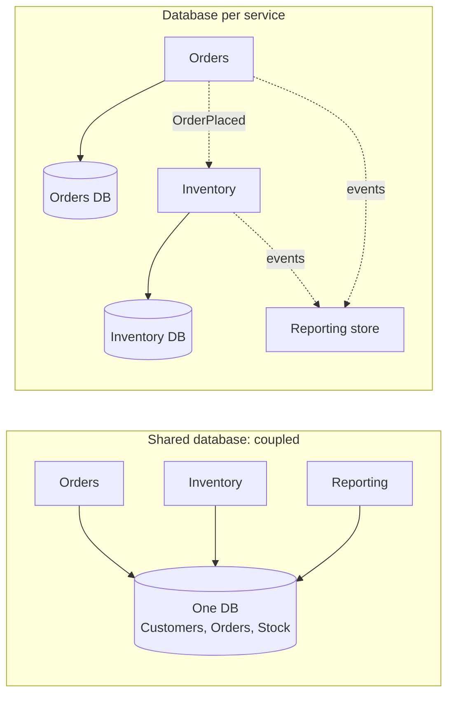
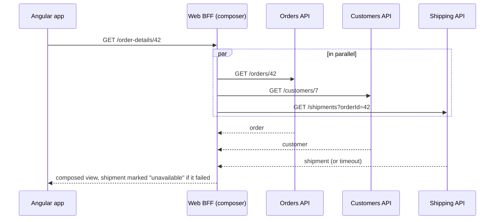

import { Tabs, TabItem, Aside } from '@astrojs/starlight/components';
import QuizBlock from '~/components/QuizBlock.astro';

## Why it matters in interviews

Data is where microservices get hard. With a single SQL Server you had joins, foreign keys and transactions. Interviewers ask: *"Each service has its own database. How do you show a page that needs orders and customer names?"*, *"How does finance get a report across all services?"*, *"Why not just share the database?"* and *"How do you keep a copy of product prices in sync?"*. Answers with trade-offs, not slogans, are what score.

## Core idea

### Database per service

Each service **owns** its data and is the only one allowed to read or write it directly. Others go through its API or its events.

| Isolation level | What it means | Cost | When |
|---|---|---|---|
| Private tables | Same database, tables owned per service, enforced by permissions | Cheapest, weakest isolation | Early stage, modular monolith |
| **Schema per service** | Same server, separate schema and login per service | Low | Common compromise |
| **Database per service** | Separate database (same or different server) | Medium | Default target |
| Different technology per service | SQL Server for orders, Cosmos DB for catalog, Redis for sessions (polyglot persistence) | High | When the access pattern needs it |

Why it matters: a service can change its schema, scale its store and pick its technology without coordinating with anyone. The cost: no cross-service joins, no cross-service foreign keys, no ACID transactions across services.

### The shared database anti-pattern



Problems with sharing tables: a column rename breaks other services at runtime; nobody knows who owns the data; one service's heavy query locks rows another needs; deployments must be coordinated. It is the quickest route to a **distributed monolith**.

### Querying across services

**1. API composition.** A composer (BFF, gateway or the calling service) calls several services in parallel and joins in memory.



Simple and always fresh, but latency is the slowest call, availability multiplies down, and it breaks for large joins ("all orders of customers in Pune with unpaid invoices") because you cannot page and filter across services efficiently.

**2. Replicated data / read models (CQRS).** A service keeps a **local, read-only copy** of the data it needs from others, updated by their events. Orders keeps `CustomerName` and `ProductPrice` snapshots; a search service keeps a denormalised index. Fast and resilient (works when the source is down) but **eventually consistent**, and you must handle missed or out-of-order events (idempotent upserts, versions, a way to rebuild from scratch).

**3. Reporting store.** Analytics and finance reports need everything. Feed a separate store from events or **change data capture** (SQL Server CDC, Debezium, Azure Data Factory pipelines) into a warehouse or lakehouse (Microsoft Fabric, Azure Synapse, Azure Data Explorer; AWS: Redshift, Athena over S3). Never let reporting queries hit service databases directly.

| Approach | Freshness | Resilience | Query power | Complexity |
|---|---|---|---|---|
| API composition | Real time | Low (needs all services up) | Low (in-memory joins) | Low |
| Local replica via events | Seconds | High | Medium | Medium |
| Reporting store / CDC | Minutes | High | High (SQL, BI tools) | Medium-high |

### Data ownership tips

- **Snapshot what you need at the time of the business event.** An order line stores the price *at purchase*, not a reference to the current price. That is correct business behaviour, not duplication.
- **Reference by id across services**, never by foreign key. Validate existence through an API call or a local replica when needed.
- **One writer per piece of data.** If two services both update customer addresses, ownership is unclear.

### Distributed caching

- **Where**: in-process memory (fastest, per instance, inconsistent across instances), a distributed cache such as Redis (Azure Managed Redis / Azure Cache for Redis; AWS: ElastiCache), or both. .NET 9+ **`HybridCache`** combines an in-memory L1 with a distributed L2 and adds **stampede protection** (one factory call per key under concurrent misses) and tag-based invalidation.
- **What**: reference data owned by other services (product names, tax rates), expensive composed views, session data.
- **Invalidation**: TTL as a safety net plus event-driven invalidation (`ProductPriceChanged` evicts the key). Keep TTLs short for data that drives money.
- Caching does not replace ownership: the cache is a copy of someone else's truth.

See [Caching at Scale](../../system-design/caching/) for patterns and eviction.

### Eventual consistency

Across services, consistency is **eventual**: after an update, other services and read models converge after a delay. Design for it:

- Make the delay visible and acceptable in the UX (pending states, "processing").
- Use sagas for multi-service business invariants ([Outbox, Saga & Resilience](../reliability-patterns/)).
- Keep **strong consistency inside one service** where the invariant lives (stock cannot go negative is enforced in Inventory's own transaction).
- Reconcile: periodic jobs that compare sources and fix drift catch the cases events missed.

## Code

**API composition in a BFF** with parallel calls and graceful degradation:

```csharp
app.MapGet("/order-details/{id:guid}", async (Guid id, OrdersClient orders, CustomersClient customers,
    ShippingClient shipping, CancellationToken ct) =>
{
    var order = await orders.GetAsync(id, ct);
    if (order is null) return Results.NotFound();

    var customerTask = customers.GetAsync(order.CustomerId, ct);
    var shipmentTask = shipping.TryGetForOrderAsync(id, ct); // returns null on failure/timeout
    await Task.WhenAll(customerTask, shipmentTask);

    return Results.Ok(new OrderDetailsView(
        order.Id, order.Total, order.Status,
        CustomerName: customerTask.Result.Name,
        Shipment: shipmentTask.Result));      // UI shows "tracking unavailable" when null
});
```

**Local replica updated by events** (idempotent upsert with a version):

```csharp
public sealed class ProductChangedConsumer(OrdersDbContext db) : IConsumer<ProductPriceChanged>
{
    public async Task Consume(ConsumeContext<ProductPriceChanged> ctx)
    {
        var m = ctx.Message;
        var updated = await db.ProductSnapshots
            .Where(p => p.Sku == m.Sku && p.Version < m.Version)
            .ExecuteUpdateAsync(s => s
                .SetProperty(p => p.Price, m.NewPrice)
                .SetProperty(p => p.Version, m.Version), ctx.CancellationToken);

        if (updated == 0 && !await db.ProductSnapshots.AnyAsync(p => p.Sku == m.Sku, ctx.CancellationToken))
        {
            db.ProductSnapshots.Add(new ProductSnapshot(m.Sku, m.NewPrice, m.Version));
            await db.SaveChangesAsync(ctx.CancellationToken);
        }
    }
}
```

**HybridCache for another service's reference data**, invalidated by event:

```csharp
builder.Services.AddStackExchangeRedisCache(o => o.Configuration = builder.Configuration.GetConnectionString("redis"));
builder.Services.AddHybridCache(); // L1 memory + L2 Redis (picked up from IDistributedCache)

public sealed class ProductLookup(HybridCache cache, CatalogClient catalog)
{
    public ValueTask<ProductDto?> GetAsync(string sku, CancellationToken ct) =>
        cache.GetOrCreateAsync($"product:{sku}",
            async token => await catalog.GetAsync(sku, token),
            new HybridCacheEntryOptions { Expiration = TimeSpan.FromMinutes(10) },
            tags: [$"sku:{sku}"],
            cancellationToken: ct);

    public ValueTask OnPriceChangedAsync(string sku, CancellationToken ct) =>
        cache.RemoveByTagAsync($"sku:{sku}", ct);
}
```

## Interview Q&A

<details>
<summary>Why database per service?</summary>

Loose coupling and autonomy: a service can change its schema, scale and pick its storage technology without coordinating with other teams, and its data can only be changed through its business rules. The price is no cross-service joins or transactions, which you replace with API composition, replicated read models, sagas and eventual consistency.
</details>

<details>
<summary>What is wrong with a shared database?</summary>

It couples services at the schema level: one team's change can break another at runtime, ownership of data is unclear, deployments must be coordinated, and one service's load affects others. Sharing a server with separate schemas or databases and strict permissions is acceptable; sharing tables is not.
</details>

<details>
<summary>How do you implement a query that needs data from three services?</summary>

For a single-entity view, API composition: call the services in parallel from a BFF, with timeouts and partial results. For list or search views with filters across services, build a read model fed by events (CQRS projection) in the service or a dedicated query service. For analytics, a reporting store fed by events or CDC.
</details>

<details>
<summary>How do you produce company-wide reports?</summary>

Stream data from every service into a reporting store (data warehouse or lakehouse) via integration events or change data capture, and run BI tools there. Do not let reports query service databases directly: that recreates the shared database through the back door and couples schemas.
</details>

<details>
<summary>Isn't duplicating customer data in the Orders database bad normalisation?</summary>

Within one database, yes. Across services it is a deliberate trade-off: Orders keeps the fields it needs, owned by Customers and updated by events, so it can work when Customers is down. Some duplication is actually required by the business: an order must keep the shipping address and prices at the time it was placed.
</details>

<details>
<summary>How do you keep a cache consistent with the owning service?</summary>

Short TTL as a backstop, plus event-driven invalidation when the owner publishes a change. Use stampede protection (`HybridCache`, or a lock per key) so a popular key's expiry does not send a burst of calls to the owner. Accept that it is eventually consistent, and do not cache data where staleness costs money without a final check at the owner.
</details>

<details>
<summary>How would you enforce "stock must never go negative" across services?</summary>

Keep the invariant inside the service that owns stock. Inventory reserves stock in its own transaction (for example `UPDATE ... SET Reserved = Reserved + @qty WHERE Sku = @sku AND OnHand - Reserved >= @qty`), and the order saga reacts to `StockReserved` or `StockReservationFailed`. Do not check stock in Orders and then decrement in Inventory: that is a race.
</details>

## Pitfalls

<Aside type="caution" title="Common mistakes">

- **Reading another service's tables "just for a report".**
- **Synchronous calls on every read** for reference data instead of caching or replicating it.
- **Replicas with no rebuild path**: when events were missed, you cannot recover without a full re-sync mechanism.
- **Non-idempotent replica updates** that break on redelivery or out-of-order events.
- **Distributed transactions** (2PC) across service databases to "keep it consistent".
- **Unclear data ownership**: two services writing the same entity.
- **Caching money-critical data** with long TTLs and no invalidation.

</Aside>

## Related

- [Event-Driven Design](../event-driven-design/)
- [Outbox, Saga & Resilience](../reliability-patterns/)
- [Databases at Scale](../../system-design/databases-at-scale/)
- [Caching at Scale](../../system-design/caching/)

## Quick quiz

<QuizBlock section="microservices" topic="data-management" />
