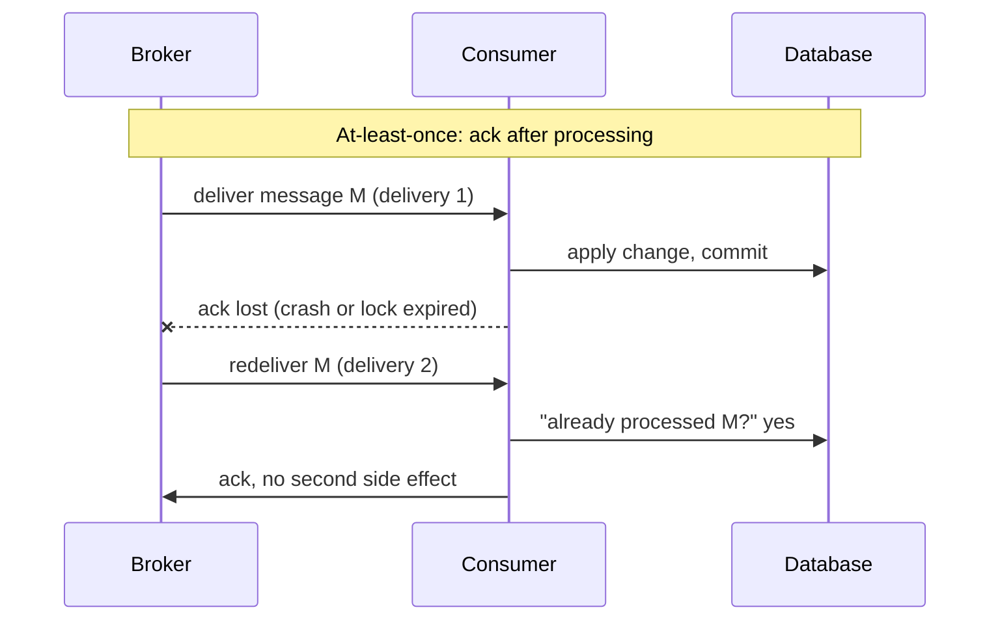
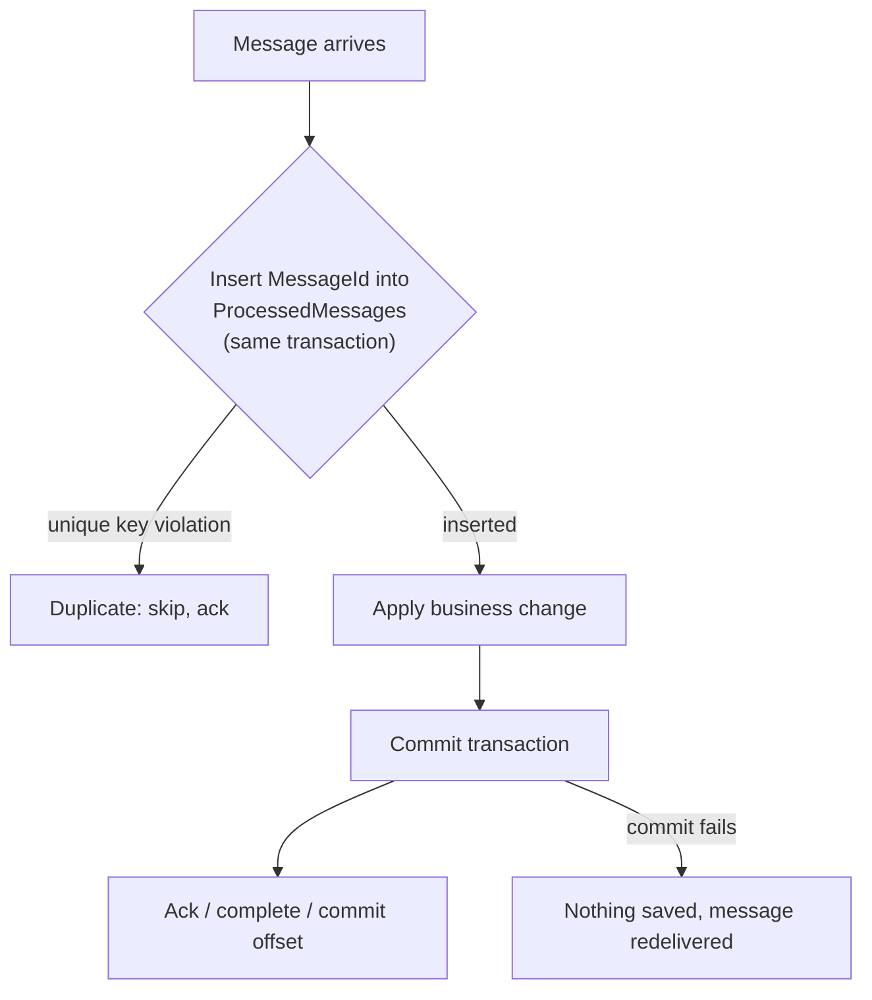
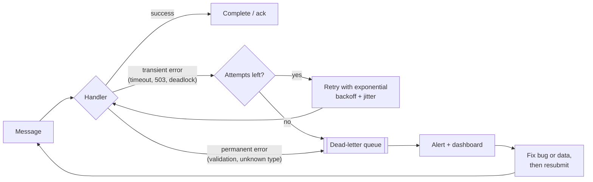

import { Tabs, TabItem, Aside } from '@astrojs/starlight/components';
import QuizBlock from '~/components/QuizBlock.astro';

## Why it matters in interviews

*"What happens if the same message is delivered twice?"* is the single most common messaging question. The expected answer: **brokers give you at-least-once delivery, so every consumer must be idempotent**. Interviewers then probe ordering (*"how do you keep events for one order in sequence?"*), poison messages and what you do with a dead-letter queue at 3 a.m.

## Core idea

### The three delivery semantics

| Semantics | How it happens | Can lose messages? | Can duplicate? | Use for |
|---|---|---|---|---|
| **At-most-once** | Ack / commit **before** processing (auto-ack, receive-and-delete) | **Yes** | No | Metrics, telemetry where loss is fine |
| **At-least-once** | Ack / commit **after** processing; redeliver on failure | No | **Yes** | Default for business messages |
| **Exactly-once** | Not achievable end to end over a network on its own; approximated by at-least-once + idempotency (**effectively once**) | No | No *effect* is duplicated | Payments, emails, inventory |



Why duplicates are unavoidable: the consumer can crash **after** committing its work but **before** the ack reaches the broker, a lock can expire during a slow handler, a Kafka rebalance can happen before the offset is committed, or a producer can retry a send whose first attempt actually succeeded.

**Exactly-once in Kafka** exists in a narrow sense: the **idempotent producer** removes duplicates caused by producer retries, and **transactions** let a consume-transform-produce app atomically write output records and commit input offsets, with downstream consumers using `isolation.level=read_committed`. That covers Kafka-to-Kafka. The moment you write to SQL Server, call an API or send an email, you are back to at-least-once plus idempotency.

### Idempotent consumers

An operation is **idempotent** if applying it twice has the same effect as applying it once. Three techniques, from cheapest to most general:

1. **Naturally idempotent operations**: `SET status = 'Paid'`, upsert by key, "reserve stock for order 42" where the reservation key is the order id.
2. **Optimistic checks on state**: only apply `OrderShipped` if the order is in state `Paid`; use a version / row version so a stale or repeated event is a no-op.
3. **Dedup store (inbox / processed-messages table)**: record each handled `MessageId` per consumer **in the same database transaction** as the business change. A unique key turns the second attempt into a no-op.



The message id must be **stable across redeliveries and producer retries**: set it from the business operation (e.g. `OrderId` + event type, or an id generated once and stored in the outbox), not a fresh `Guid` at send time. Brokers help on the producer side: Azure Service Bus **duplicate detection** drops repeat `MessageId`s within a time window, and SQS FIFO deduplicates within a 5-minute interval. These protect against producer retries, not against consumer redelivery.

Keep the dedup table bounded: delete rows older than the longest possible redelivery window (for example 7-30 days).

### Ordering and partition keys

Brokers only order within a unit:

- **Kafka**: per partition. Use the entity id as the **key** so all events for that entity hit the same partition.
- **Azure Service Bus**: per **session** (`SessionId = orderId`). Without sessions, competing consumers process in parallel and order is lost.
- **SQS FIFO**: per `MessageGroupId`. **RabbitMQ**: per queue with a single active consumer (or the single-active-consumer queue option).

Even with ordered delivery, retries can reorder **effects**. Make consumers tolerant: include a **sequence number or version** in each event and ignore or park events older than the stored version. Prefer designs where order does not matter (commutative updates, "set to absolute value" rather than "add 1").

### Poison messages, retries and DLQs

A **poison message** fails every time (bad schema, missing reference data, a bug). Without a limit it loops forever and blocks or burns resources.



- **Classify errors.** Transient (timeouts, HTTP 503, SQL deadlock 1205, throttling) deserve retries. Permanent (validation, deserialisation, business rule) should be dead-lettered **immediately** with a reason.
- **Immediate retries** (a few, in memory) catch blips. **Delayed retries / redelivery** with exponential backoff and jitter (for example 10 s, 1 min, 5 min) ride out longer outages without hammering the dependency.
- **Built-in limits**: Service Bus `MaxDeliveryCount` (default 10) moves the message to the entity's DLQ; RabbitMQ quorum queues support a `delivery-limit` and a dead-letter exchange; SQS uses a redrive policy with `maxReceiveCount`. Kafka has none: implement **retry topics** and a **dead-letter topic** so one bad record does not block the partition.
- **DLQ is not a bin.** Monitor its depth, alert on growth, record the failure reason and exception, build a tool or runbook to inspect, fix and **resubmit**, and make sure the consumer is idempotent before replaying.

## Code

**Dedup store** (SQL Server):

```sql
CREATE TABLE dbo.ProcessedMessages (
    MessageId    varchar(100)  NOT NULL,
    Consumer     varchar(100)  NOT NULL,
    ProcessedAt  datetime2(3)  NOT NULL CONSTRAINT DF_ProcessedMessages_At DEFAULT SYSUTCDATETIME(),
    CONSTRAINT PK_ProcessedMessages PRIMARY KEY (MessageId, Consumer)
);
```

**Idempotent consumer with EF Core**: the dedup row and the business change are saved in **one** `SaveChangesAsync`, so they commit or roll back together.

```csharp
public sealed record ProcessedMessage(string MessageId, string Consumer, DateTime ProcessedAt);

public sealed class OrderPlacedHandler(BillingDbContext db, ILogger<OrderPlacedHandler> log)
{
    private const string ConsumerName = "billing.order-placed";

    public async Task HandleAsync(string messageId, OrderPlaced evt, CancellationToken ct)
    {
        db.ProcessedMessages.Add(new ProcessedMessage(messageId, ConsumerName, DateTime.UtcNow));
        db.Invoices.Add(Invoice.Create(evt.OrderId, evt.CustomerId, evt.Total));
        try
        {
            await db.SaveChangesAsync(ct); // one implicit transaction for both inserts
        }
        catch (DbUpdateException ex) when (ex.InnerException is SqlException { Number: 2627 or 2601 })
        {
            // PK/unique violation on ProcessedMessages: already handled, treat as success.
            log.LogInformation("Duplicate message {MessageId} ignored", messageId);
        }
    }
}
```

The handler must use a fresh `DbContext` per message (a DI scope per message), otherwise the failed entities stay tracked.

**Classifying failures with Azure.Messaging.ServiceBus**: dead-letter permanent errors at once, and use scheduled re-enqueue for backoff because `AbandonMessageAsync` makes the message available again immediately.

```csharp
processor.ProcessMessageAsync += async args =>
{
    var msg = args.Message;
    var id = OriginalId(msg); // stable across our own retries
    try
    {
        await handler.HandleAsync(id, msg.Body.ToObjectFromJson<OrderPlaced>()!, args.CancellationToken);
        await args.CompleteMessageAsync(msg);
    }
    catch (Exception ex) when (ex is JsonException or ValidationException)
    {
        await args.DeadLetterMessageAsync(msg, deadLetterReason: "Permanent", deadLetterErrorDescription: ex.Message);
    }
    catch (Exception) when (Retries(msg) < 5)
    {
        var n = Retries(msg) + 1;
        var retry = new ServiceBusMessage(msg) { MessageId = $"{id}:retry-{n}" }; // new id survives duplicate detection
        retry.ApplicationProperties["original-id"] = id;
        retry.ApplicationProperties["retry-count"] = n;
        var delay = TimeSpan.FromSeconds(10 * Math.Pow(2, n - 1) + Random.Shared.Next(0, 5)); // 10s, 20s, 40s... + jitter
        await retrySender.ScheduleMessageAsync(retry, DateTimeOffset.UtcNow.Add(delay));
        await args.CompleteMessageAsync(msg);
    }
    // Anything else escapes: the processor abandons the unsettled message (peek-lock mode),
    // and MaxDeliveryCount eventually dead-letters it.
};

static int Retries(ServiceBusReceivedMessage m) =>
    m.ApplicationProperties.TryGetValue("retry-count", out var v) ? Convert.ToInt32(v) : 0;
static string OriginalId(ServiceBusReceivedMessage m) =>
    m.ApplicationProperties.TryGetValue("original-id", out var v) ? (string)v : m.MessageId;
```

Scheduling the copy and completing the original are two separate operations; if the process dies between them you get a duplicate, which the idempotent handler absorbs. Libraries such as MassTransit and NServiceBus implement delayed redelivery for you.

**Rejecting out-of-order events with a version check**:

```csharp
var rows = await db.Database.ExecuteSqlInterpolatedAsync($"""
    UPDATE dbo.OrderView SET Status = {evt.Status}, Version = {evt.Version}
    WHERE OrderId = {evt.OrderId} AND Version < {evt.Version}
    """, ct);
if (rows == 0) log.LogInformation("Stale or duplicate event v{Version} ignored", evt.Version);
```

## Interview Q&A

<details>
<summary>Can a message broker guarantee exactly-once delivery?</summary>

Not end to end across a network. A consumer can always fail between doing the work and acknowledging it, so the broker must choose between redelivering (duplicates) or not (loss). Kafka's transactions give exactly-once **within Kafka** (consume, transform, produce). For anything else, aim for **effectively-once**: at-least-once delivery plus idempotent processing.
</details>

<details>
<summary>How do you make a consumer idempotent?</summary>

Prefer naturally idempotent operations (upserts, setting absolute state). Otherwise store the processed message id in a dedup table with a unique key, in the **same transaction** as the business change, and treat a key violation as "already done". For external side effects (payment gateway, email provider) pass an **idempotency key** the provider honours.
</details>

<details>
<summary>Why must the dedup insert be in the same transaction as the business change?</summary>

If they are separate, a crash between them leaves either a recorded id with no business change (message lost forever, because the retry is skipped) or a business change with no recorded id (duplicate on retry). One transaction makes them atomic.
</details>

<details>
<summary>How do you guarantee ordering for events of the same order?</summary>

Route them to the same ordered unit: Kafka partition key = `orderId`, Service Bus `SessionId = orderId`, SQS FIFO `MessageGroupId = orderId`. Then process one message per key at a time. Also put a version in each event so the consumer can ignore stale ones, because retries and DLQ resubmits can still reorder effects.
</details>

<details>
<summary>What is a poison message and how do you handle it?</summary>

A message that fails every time it is processed. Limit attempts (Service Bus `MaxDeliveryCount`, RabbitMQ delivery limit, SQS redrive policy, Kafka retry and dead-letter topics), move it to a DLQ with the reason, alert, fix the cause and resubmit. Permanent errors such as deserialisation failures should skip retries entirely.
</details>

<details>
<summary>What would you do with messages in a dead-letter queue?</summary>

Alert on DLQ depth, inspect the dead-letter reason and exception, group by cause, fix the bug or bad data, then resubmit to the original entity (after deploying the fix) using a tool or script. Messages that are obsolete are archived with a note. Never silently purge. Make sure handlers are idempotent before resubmitting.
</details>

<details>
<summary>Why add jitter to exponential backoff?</summary>

Without jitter, many clients that failed at the same moment retry at the same moments (1 s, 2 s, 4 s), producing synchronized waves that can knock the recovering dependency over again. Random jitter spreads the retries out.
</details>

<details>
<summary>A Kafka consumer commits offsets automatically every 5 seconds. What can go wrong?</summary>

Auto-commit commits offsets of records returned by `poll`, independent of whether your processing finished. A crash after a commit but before processing loses records (at-most-once for those), and a crash after processing but before a commit replays them. Disable auto-commit and commit after processing (or after durably storing results) for at-least-once.
</details>

## Pitfalls

<Aside type="caution" title="Common mistakes">

- **Generating a new message id on every send or retry**, which defeats deduplication.
- **Dedup check and business change in separate transactions.**
- **Retrying permanent errors** until `MaxDeliveryCount`, delaying the alert and wasting capacity.
- **Abandoning a Service Bus message in a tight loop** expecting a delay; abandon is immediate.
- **Blocking a Kafka partition** on one bad record instead of sending it to a dead-letter topic.
- **Unbounded dedup tables** that grow forever.
- **Ignoring the DLQ**: no alert, no owner, no replay tool.
- **Assuming order is preserved** with competing consumers or after retries.

</Aside>

## Related

- [RabbitMQ vs Kafka vs Azure Service Bus](../message-brokers/)
- [Outbox, Saga & Resilience](../reliability-patterns/)
- [Messaging in .NET](../dotnet-messaging/)
- [API Design & Rate Limiting](../../system-design/api-design-rate-limiting/) (idempotency keys for HTTP)

## Quick quiz

<QuizBlock section="microservices" topic="delivery-guarantees" />
