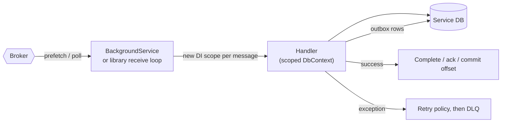
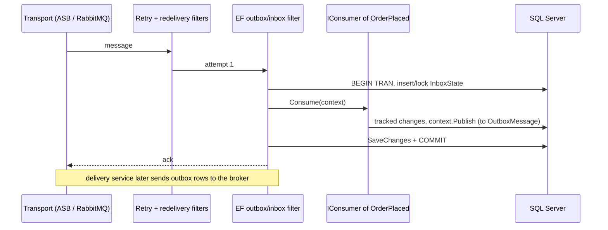

import { Tabs, TabItem, Aside } from '@astrojs/starlight/components';
import QuizBlock from '~/components/QuizBlock.astro';

## Why it matters in interviews

.NET interviews go from concepts to code fast: *"How did you consume messages? MassTransit or the raw SDK?"*, *"Where did you configure retries?"*, *"How does your Kafka consumer commit offsets?"*, *"How is `ServiceBusClient` registered?"*. Knowing the exact building blocks (processor, session processor, consumer group, `IConsumer<T>`, outbox) and where each library helps shows real experience.

## Core idea

### Library or raw client?

| Option | What you get | Trade-offs |
|---|---|---|
| **Raw SDKs** (`Azure.Messaging.ServiceBus`, `Confluent.Kafka`, `RabbitMQ.Client`) | Full control, every broker feature, fewest dependencies | You write serialisation, retries, outbox, inbox, topology, tracing glue |
| **MassTransit** | Broker-agnostic consumers, retries and delayed redelivery, EF Core/Mongo outbox + inbox, state machine sagas, request client, test harness | Abstraction hides some broker features. v8 is open source (Apache 2.0); the maintainers announced a commercial licence for v9 onwards, so check licensing before adopting |
| **NServiceBus** (Particular) | Very mature: outbox, sagas, recoverability, monitoring and replay tooling (ServicePulse, ServiceInsight) | Commercial licence |
| **Wolverine** | Messaging + in-process mediator, outbox, integrates with Marten | Smaller ecosystem |
| **Dapr pub/sub** | Sidecar with an HTTP/gRPC API; the broker is swapped by a YAML component | Extra runtime (sidecar), lowest-common-denominator features |

A reasonable interview answer: *"For business messaging I'd use a library like MassTransit or NServiceBus to get the outbox, retries and sagas right; I'd use the raw SDK for high-throughput streaming (Kafka) or when I need a broker feature the abstraction hides."*

### How a hosted consumer fits in ASP.NET Core



Rules that apply whichever library you use: **create a DI scope per message** (`DbContext` is scoped), keep the broker client **singleton** (it owns connections), honour the `CancellationToken` for graceful shutdown, and set **concurrency** deliberately (prefetch, `MaxConcurrentCalls`, partitions).

### MassTransit pipeline



## Code

### MassTransit 8: consumer, outbox and retries

```csharp
public sealed class OrderPlacedConsumer(BillingDbContext db, ILogger<OrderPlacedConsumer> log) : IConsumer<OrderPlaced>
{
    public async Task Consume(ConsumeContext<OrderPlaced> context)
    {
        var msg = context.Message;
        db.Invoices.Add(new Invoice(msg.OrderId, msg.Total));
        // Stored in the outbox table in the same transaction, sent after commit.
        await context.Publish(new InvoiceCreated(msg.OrderId, msg.Total), context.CancellationToken);
        log.LogInformation("Invoice created for {OrderId}", msg.OrderId);
        // No SaveChanges here: the EF outbox filter saves and commits after Consume returns.
    }
}
```

```csharp
builder.Services.AddDbContext<BillingDbContext>(o => o.UseSqlServer(cs));
builder.Services.AddMassTransit(x =>
{
    x.SetKebabCaseEndpointNameFormatter();
    x.AddConsumer<OrderPlacedConsumer>();

    x.AddEntityFrameworkOutbox<BillingDbContext>(o =>
    {
        o.UseSqlServer();
        o.UseBusOutbox();                                   // also covers Publish from API controllers
        o.DuplicateDetectionWindow = TimeSpan.FromMinutes(30); // inbox dedup window
    });

    x.AddConfigureEndpointsCallback((context, name, cfg) =>
    {
        cfg.UseMessageRetry(r => r.Exponential(5, TimeSpan.FromSeconds(1), TimeSpan.FromSeconds(30), TimeSpan.FromSeconds(2)));
        cfg.UseEntityFrameworkOutbox<BillingDbContext>(context);  // inbox + outbox for consumers
    });

    x.UsingAzureServiceBus((context, cfg) =>   // or x.UsingRabbitMq(...): consumer code is unchanged
    {
        cfg.Host(builder.Configuration.GetConnectionString("ServiceBus"));
        cfg.ConfigureEndpoints(context);
    });
});

// In BillingDbContext.OnModelCreating:
//   modelBuilder.AddInboxStateEntity(); modelBuilder.AddOutboxMessageEntity(); modelBuilder.AddOutboxStateEntity();
```

After retries are exhausted MassTransit moves the message to an `_error` queue (or the broker's DLQ, depending on transport configuration) with the exception details in headers.

### MassTransit saga state machine

```csharp
public sealed class OrderState : SagaStateMachineInstance
{
    public Guid CorrelationId { get; set; }
    public string CurrentState { get; set; } = null!;
    public decimal Total { get; set; }
}

public sealed class OrderStateMachine : MassTransitStateMachine<OrderState>
{
    public State AwaitingPayment { get; private set; } = null!;
    public State Completed { get; private set; } = null!;
    public State Cancelled { get; private set; } = null!;
    public Event<OrderPlaced> Placed { get; private set; } = null!;
    public Event<PaymentCaptured> Captured { get; private set; } = null!;
    public Event<PaymentFailed> Failed { get; private set; } = null!;

    public OrderStateMachine()
    {
        InstanceState(x => x.CurrentState);
        Event(() => Placed, e => e.CorrelateById(m => m.Message.OrderId));
        Event(() => Captured, e => e.CorrelateById(m => m.Message.OrderId));
        Event(() => Failed, e => e.CorrelateById(m => m.Message.OrderId));

        Initially(When(Placed)
            .Then(ctx => ctx.Saga.Total = ctx.Message.Total)
            .Send(new Uri("queue:charge-payment"), ctx => new ChargePayment(ctx.Message.OrderId, ctx.Message.Total))
            .TransitionTo(AwaitingPayment));

        During(AwaitingPayment,
            When(Captured).TransitionTo(Completed).Finalize(),
            When(Failed)
                .Publish(ctx => new OrderCancelled(ctx.Saga.CorrelationId, "Payment failed"))
                .TransitionTo(Cancelled));
    }
}
// Registration: x.AddSagaStateMachine<OrderStateMachine, OrderState>()
//     .EntityFrameworkRepository(r => { r.ExistingDbContext<OrdersDbContext>(); r.UseSqlServer(); });
```

Real sagas add a **timeout** with a scheduled message (`Schedule(...)`) so "payment never answered" also ends in a defined state.

### Raw clients

<Tabs>
<TabItem label="Azure Service Bus">

```csharp
// One client per app: it owns the AMQP connection. Senders/processors are cached and reused.
builder.Services.AddSingleton(_ => new ServiceBusClient(
    builder.Configuration["ServiceBus:Namespace"], new DefaultAzureCredential()));

// Send: SessionId keeps all messages of one order in FIFO order.
var sender = client.CreateSender("orders");
var msg = new ServiceBusMessage(BinaryData.FromObjectAsJson(evt))
{
    MessageId = evt.EventId.ToString(),     // stable: enables duplicate detection
    SessionId = evt.OrderId.ToString(),
    Subject = nameof(OrderPlaced),
    ContentType = "application/json",
};
msg.ApplicationProperties["Region"] = "EU";  // usable in subscription SQL filters
await sender.SendMessageAsync(msg, ct);

// Receive with a session processor.
await using var processor = client.CreateSessionProcessor("orders", new ServiceBusSessionProcessorOptions
{
    MaxConcurrentSessions = 8,              // 8 orders in parallel
    MaxConcurrentCallsPerSession = 1,       // strictly in order within one order
    AutoCompleteMessages = false,
});
processor.ProcessMessageAsync += async args =>
{
    await handler.HandleAsync(args.Message, args.CancellationToken);
    await args.CompleteMessageAsync(args.Message);
};
processor.ProcessErrorAsync += args =>
{
    log.LogError(args.Exception, "Service Bus error on {Entity}", args.EntityPath);
    return Task.CompletedTask;
};
await processor.StartProcessingAsync(ct);
```

```csharp
// Inspect and resubmit the dead-letter queue (after the fix is deployed).
await using var dlq = client.CreateReceiver("orders", new ServiceBusReceiverOptions { SubQueue = SubQueue.DeadLetter });
foreach (var m in await dlq.ReceiveMessagesAsync(maxMessages: 50, maxWaitTime: TimeSpan.FromSeconds(5)))
{
    log.LogWarning("DLQ {Id}: {Reason} {Description}", m.MessageId, m.DeadLetterReason, m.DeadLetterErrorDescription);
    await sender.SendMessageAsync(new ServiceBusMessage(m)); // copy keeps body, ids, properties
    await dlq.CompleteMessageAsync(m);
}
```

</TabItem>
<TabItem label="Kafka">

```csharp
// Producer: singleton, thread-safe. Idempotence stops duplicates/reordering from retries.
var producerConfig = new ProducerConfig
{
    BootstrapServers = "localhost:9092",
    EnableIdempotence = true,
    Acks = Acks.All,
    LingerMs = 5,
};
using var producer = new ProducerBuilder<string, string>(producerConfig).Build();
var result = await producer.ProduceAsync("orders", new Message<string, string>
{
    Key = evt.OrderId.ToString(),           // same key, same partition, ordered per order
    Value = JsonSerializer.Serialize(evt),
}, ct);
log.LogInformation("Written to {Position}", result.TopicPartitionOffset);
```

```csharp
// Consumer: manual commit AFTER processing = at-least-once.
public sealed class OrderEventsConsumer(IServiceScopeFactory scopes, ILogger<OrderEventsConsumer> log) : BackgroundService
{
    protected override Task ExecuteAsync(CancellationToken stoppingToken) =>
        Task.Run(() => ConsumeLoopAsync(stoppingToken), stoppingToken); // Consume() blocks: keep it off the startup path

    private async Task ConsumeLoopAsync(CancellationToken ct)
    {
        var config = new ConsumerConfig
        {
            BootstrapServers = "localhost:9092",
            GroupId = "billing",
            EnableAutoCommit = false,
            AutoOffsetReset = AutoOffsetReset.Earliest,
        };
        using var consumer = new ConsumerBuilder<string, string>(config).Build();
        consumer.Subscribe("orders");
        try
        {
            while (!ct.IsCancellationRequested)
            {
                var cr = consumer.Consume(ct);
                await using var scope = scopes.CreateAsyncScope();
                var handler = scope.ServiceProvider.GetRequiredService<OrderEventHandler>();
                await handler.HandleAsync(cr.Message.Key, cr.Message.Value, ct); // idempotent
                consumer.Commit(cr);
            }
        }
        catch (OperationCanceledException) { }
        finally { consumer.Close(); } // leave the group cleanly so partitions are reassigned quickly
    }
}
```

Committing every message synchronously is slow. For throughput, keep `EnableAutoCommit = true` but set `EnableAutoOffsetStore = false` and call `consumer.StoreOffset(cr)` after processing: the background commit then only includes processed records. Wrap the handler in try/catch and publish failures to a retry or dead-letter topic so one bad record does not block the partition.

</TabItem>
<TabItem label="RabbitMQ">

```csharp
// RabbitMQ.Client 7.x: async-only API.
var factory = new ConnectionFactory { HostName = "localhost" };
await using var connection = await factory.CreateConnectionAsync(ct);
await using var channel = await connection.CreateChannelAsync(cancellationToken: ct);
await channel.BasicQosAsync(prefetchSize: 0, prefetchCount: 20, global: false, cancellationToken: ct);

var consumer = new AsyncEventingBasicConsumer(channel);
consumer.ReceivedAsync += async (_, ea) =>
{
    try
    {
        var evt = JsonSerializer.Deserialize<OrderPlaced>(ea.Body.Span)!; // body is only valid inside the handler
        await handler.HandleAsync(ea.BasicProperties.MessageId!, evt, ct);
        await channel.BasicAckAsync(ea.DeliveryTag, multiple: false);
    }
    catch (Exception ex)
    {
        log.LogError(ex, "Processing failed, dead-lettering {Tag}", ea.DeliveryTag);
        await channel.BasicNackAsync(ea.DeliveryTag, multiple: false, requeue: false); // goes to the DLX
    }
};
await channel.BasicConsumeAsync("email-orders", autoAck: false, consumer: consumer, cancellationToken: ct);
```

</TabItem>
<TabItem label="Dapr">

```csharp
// Publisher: talks to the local Dapr sidecar; the broker is chosen by a component YAML.
await daprClient.PublishEventAsync("pubsub", "orders", evt, ct);

// Subscriber (Dapr.AspNetCore): Dapr delivers CloudEvents over HTTP.
var app = builder.Build();
app.UseCloudEvents();
app.MapSubscribeHandler();
app.MapPost("/events/orders", async (OrderPlaced evt, OrderEventHandler handler, CancellationToken ct) =>
{
    await handler.HandleAsync(evt.OrderId.ToString(), JsonSerializer.Serialize(evt), ct);
    return Results.Ok();                    // non-success status makes Dapr retry (per its resiliency policy)
}).WithTopic("pubsub", "orders");
```

```yaml
apiVersion: dapr.io/v1alpha1
kind: Component
metadata:
  name: pubsub
spec:
  type: pubsub.azure.servicebus.topics   # swap for pubsub.kafka or pubsub.rabbitmq
  version: v1
  metadata:
    - name: namespaceName
      value: "mycompany.servicebus.windows.net"
```

</TabItem>
</Tabs>

## Interview Q&A

<details>
<summary>How should `ServiceBusClient` be registered in DI, and why?</summary>

As a singleton (directly or via `AddAzureClients` from `Microsoft.Extensions.Azure`). It owns the AMQP connection, and senders, receivers and processors created from it share that connection. Creating a client per message opens a new connection each time, which is slow and can exhaust connection limits. Senders and processors are also safe to cache and reuse.
</details>

<details>
<summary>What does MassTransit's EF Core outbox give you?</summary>

On the consumer side, an **inbox**: the message id is recorded in `InboxState` inside the same transaction as your changes, so redeliveries are detected. Messages you publish or send during `Consume` are written to `OutboxMessage` in that transaction and delivered after commit. With `UseBusOutbox()`, publishes from API controllers also go through the outbox. The result is effectively-once processing for database work.
</details>

<details>
<summary>Why run a Kafka consumer loop with `Task.Run` inside a BackgroundService?</summary>

`Consume()` is a blocking call. `ExecuteAsync` runs synchronously until its first real `await`, so blocking there delays the rest of host startup. Moving the loop onto its own thread keeps startup responsive. Also, a consumer instance should be driven from a single thread, so one loop owns it.
</details>

<details>
<summary>Explain `MaxConcurrentSessions` vs `MaxConcurrentCallsPerSession`.</summary>

`MaxConcurrentSessions` is how many sessions (for example orders) the processor works on in parallel. `MaxConcurrentCallsPerSession` is how many messages of the same session run concurrently; keep it at 1 when you rely on in-order processing within a session. Total concurrency is roughly the product.
</details>

<details>
<summary>Where do retries belong: in the broker, in a library, or in the handler?</summary>

Short immediate retries for transient errors belong in the consumer pipeline (MassTransit `UseMessageRetry`, a Polly pipeline around the handler). Longer delayed retries use broker features or library redelivery (scheduled messages, `UseDelayedRedelivery`, retry topics). The broker's max delivery count is the final safety net that dead-letters poison messages. Avoid stacking retries at every layer.
</details>

<details>
<summary>What is Dapr pub/sub and when would you use it?</summary>

Dapr runs as a sidecar exposing a broker-agnostic HTTP/gRPC API; the actual broker (Service Bus, Kafka, RabbitMQ, Redis Streams) is configured with a component file. It suits polyglot teams on Kubernetes or Azure Container Apps who want portability. You lose some broker-specific features and add a runtime component to operate.
</details>

<details>
<summary>How do you test message consumers?</summary>

Unit-test the handler logic directly. Use MassTransit's test harness (`AddMassTransitTestHarness`) to publish a message in memory and assert it was consumed and what was published. For integration tests, run the real broker in a container (Testcontainers for RabbitMQ, Kafka, or the Azure Service Bus emulator) together with `WebApplicationFactory`.
</details>

<details>
<summary>What happens to in-flight messages when the app shuts down?</summary>

On `SIGTERM` the host signals the stopping token. Processors stop receiving and wait for in-flight handlers within the host shutdown timeout. Messages not completed are not lost: their locks expire (Service Bus), they are redelivered after the channel closes (RabbitMQ), or their offsets were not committed (Kafka), so they are processed again, which is why idempotency matters.
</details>

## Pitfalls

<Aside type="caution" title="Common mistakes">

- **Creating `ServiceBusClient`, a Kafka producer or a RabbitMQ connection per message.**
- **Injecting a scoped `DbContext` into a singleton hosted service** instead of creating a scope per message.
- **`EnableAutoCommit = true` with the default offset store**: offsets may be committed before processing finishes.
- **Blocking `Consume()` directly in `ExecuteAsync`** and delaying host startup.
- **Using the old `Microsoft.Azure.ServiceBus` package**; it is deprecated. Use `Azure.Messaging.ServiceBus`.
- **Lock expiry on slow handlers**: Service Bus lock duration is short; use `MaxAutoLockRenewalDuration` (enabled by default on processors) and keep handlers fast.
- **Sending from a consumer through a separately created client** instead of `context.Publish`/`context.Send`, which bypasses the outbox and its atomicity.
- **Adopting a library without checking its licence** for the major version you will run.

</Aside>

## Related

- [Delivery Guarantees & Idempotency](../delivery-guarantees/)
- [Outbox, Saga & Resilience](../reliability-patterns/)
- [Background Services](../../aspnet/background-services/)
- [Integration Testing in .NET](../../testing-devops/dotnet-integration-testing/)

## Quick quiz

<QuizBlock section="microservices" topic="dotnet-messaging" />
