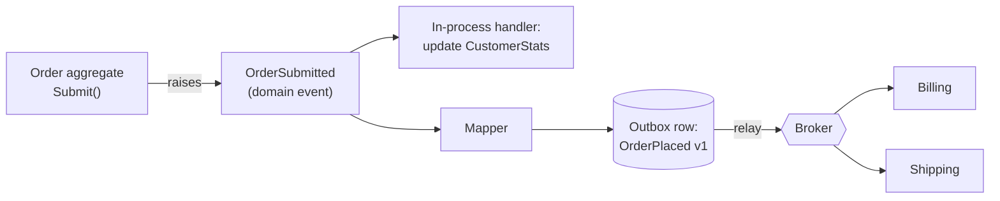
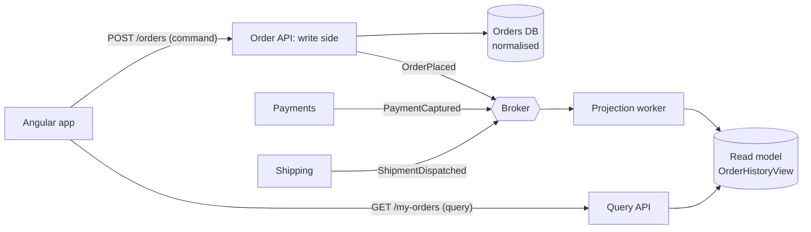
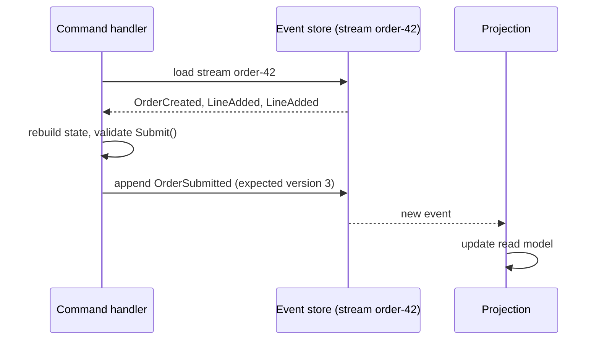

import { Tabs, TabItem, Aside } from '@astrojs/starlight/components';
import QuizBlock from '~/components/QuizBlock.astro';

## Why it matters in interviews

Once you say "we publish events", interviewers ask: *"What goes into an event?"*, *"How do you change an event without breaking consumers?"*, *"Is that CQRS? Event sourcing?"* and *"The user saves and the list doesn't show the new item. How do you handle that?"*. Many candidates mix up domain events, integration events, CQRS and event sourcing. Keeping them apart is an easy win.

## Core idea

### Domain events vs integration events

| | Domain event | Integration event |
|---|---|---|
| Scope | **Inside** one service / bounded context | **Between** services |
| Transport | In-memory (dispatcher, MediatR-style notification) | Message broker |
| Transaction | Handled in the same transaction (or just before commit) | Published after commit, via the outbox |
| Shape | Rich domain types, can change freely | Public **contract**: stable, versioned, primitive types |
| Example | `OrderLineAdded`, `OrderSubmitted` | `OrderPlaced { orderId, customerId, total, currency }` |

A common flow: the aggregate raises a domain event; an in-process handler reacts (update another aggregate in the same service) and maps the relevant ones to integration events written to the outbox.



### Designing event payloads

- **Notification (thin) events** carry ids only: `OrderPlaced { orderId }`. Consumers call back for details, which reintroduces synchronous coupling and race conditions.
- **Event-carried state transfer (fat) events** carry the data consumers need: `OrderPlaced { orderId, customerId, lines, total }`. Consumers can keep a local copy and work while the producer is down. Cost: bigger messages and more contract surface.
- Always include **metadata**: event id, type, version, occurred-at time, correlation id, and the aggregate id (also used as the partition key or session id). The **CloudEvents** specification standardises these envelope fields (`id`, `source`, `type`, `time`, `subject`) and is supported by Azure Event Grid.

### Schema evolution and versioning

Producers and consumers deploy independently, so an event schema must evolve without breaking anyone.

| Change | Safe? | Why |
|---|---|---|
| Add an optional field | Yes (backward compatible) | Old consumers ignore it (tolerant reader) |
| Remove a field consumers use | **No** | Old consumers break |
| Rename a field | **No** | It is a remove + add |
| Change a type (`int` to `string`) | **No** | Deserialisation fails |
| Change meaning of a field | **No**, and the most dangerous | Nothing fails, data is silently wrong |

Techniques:

- **Tolerant reader**: consumers ignore unknown fields and use defaults for missing optional ones (`System.Text.Json` ignores unknown members by default).
- **Additive changes only** within a version; for a breaking change publish a **new event type** (`OrderPlacedV2` or a `version` header), run both for a while, migrate consumers, then retire v1.
- **Upcasting**: convert old event versions to the new shape when reading (important in event sourcing, where old events live forever).
- **Schema registry**: a central store of schemas with compatibility checks enforced at publish time. Confluent Schema Registry (Avro, Protobuf, JSON Schema) is common with Kafka; Azure Event Hubs has an Azure Schema Registry (AWS: Glue Schema Registry). Compatibility modes: **backward** (new consumers read old data), **forward** (old consumers read new data), **full** (both).
- **Consumer-driven contract tests** (for example Pact) catch breaking changes in CI.

### CQRS with read models

**CQRS** (Command Query Responsibility Segregation) separates the **write model** (commands validated by aggregates, normalised tables) from one or more **read models** shaped for queries. In microservices the read model is often built from events of several services, which also solves cross-service queries without joins.



CQRS does **not** require event sourcing or separate databases; the simplest form is separate command and query handlers on the same database. Add separate stores only when the read and write workloads genuinely differ.

### Event sourcing basics

Instead of storing current state, store the **sequence of events** for each aggregate in an append-only **event store**; current state is computed by replaying them.



- **Benefits**: full audit trail, temporal queries ("what did the basket look like at 10:05?"), new read models by replaying history, natural fit with event-driven integration.
- **Costs**: event schema can never be "migrated" in place (upcasting needed), queries always need projections, snapshots for long streams, eventual consistency everywhere, a steeper learning curve, and GDPR deletion needs techniques such as crypto-shredding.
- **Concurrency**: append with an **expected version**; a mismatch means someone else wrote first (optimistic concurrency).
- **Tools in .NET**: Marten (event store on PostgreSQL), EventStoreDB (now KurrentDB), or a custom table in SQL Server / Cosmos DB.

Use event sourcing for a few core aggregates where history matters (ledger, orders, bookings), not as a system-wide default.

### Eventual consistency in the UI

Read models lag the write side by milliseconds to seconds. Strategies:

1. **Return what you know**: the command response includes the new id and state, and the UI inserts it into the list locally (optimistic UI).
2. **`202 Accepted` + status resource**: return `Location: /orders/42/status`; the client polls or listens.
3. **Push**: SignalR (or WebSockets/SSE) notifies the browser when the projection is updated.
4. **Read-your-writes**: for the user who made the change, read from the write model or wait until the read model has caught up to the version returned by the command.
5. **Honest wording**: "Order received, confirming payment…" is better UX than a spinner that blocks.

## Code

**Domain events collected by the aggregate and turned into outbox rows inside `SaveChangesAsync`:**

```csharp
public abstract class AggregateRoot
{
    private readonly List<IDomainEvent> _events = [];
    public IReadOnlyList<IDomainEvent> DomainEvents => _events;
    protected void Raise(IDomainEvent e) => _events.Add(e);
    public void ClearEvents() => _events.Clear();
}

public sealed class OrdersDbContext(DbContextOptions<OrdersDbContext> options) : DbContext(options)
{
    public DbSet<OutboxMessage> Outbox => Set<OutboxMessage>();

    public override async Task<int> SaveChangesAsync(CancellationToken ct = default)
    {
        var aggregates = ChangeTracker.Entries<AggregateRoot>().Select(e => e.Entity).ToList();
        foreach (var e in aggregates.SelectMany(a => a.DomainEvents))
        {
            if (IntegrationEventMapper.TryMap(e, out var integration)) // e.g. OrderSubmitted -> OrderPlacedV1
                Outbox.Add(OutboxMessage.From(integration));
        }
        aggregates.ForEach(a => a.ClearEvents());
        return await base.SaveChangesAsync(ct); // business rows + outbox rows in one transaction
    }
}
```

**A versioned integration event contract** (shared via a small contracts package or schema, never via domain classes):

```csharp
namespace Ordering.Contracts.V1;

public sealed record OrderPlaced(
    Guid EventId,
    Guid OrderId,
    Guid CustomerId,
    decimal Total,
    string Currency,
    DateTimeOffset OccurredAt,
    string? SalesChannel = null); // added later as optional: backward compatible
```

**A projection that builds a read model idempotently** (upsert by key plus version check):

```csharp
public sealed class OrderHistoryProjection(ReadDbContext db)
{
    public async Task On(OrderPlaced e, CancellationToken ct)
    {
        if (await db.OrderHistory.AnyAsync(x => x.OrderId == e.OrderId, ct)) return; // duplicate
        db.OrderHistory.Add(new OrderHistoryRow(e.OrderId, e.CustomerId, e.Total, "Placed", Version: 1));
        await db.SaveChangesAsync(ct);
    }

    public Task On(PaymentCaptured e, CancellationToken ct) =>
        db.OrderHistory.Where(x => x.OrderId == e.OrderId && x.Version < e.Version)
            .ExecuteUpdateAsync(s => s.SetProperty(x => x.Status, "Paid").SetProperty(x => x.Version, e.Version), ct);
}
```

**Eventual consistency in Angular**: show the accepted state immediately and update when the server confirms.

```ts
@Component({
  selector: 'app-place-order',
  template: `
    @if (status() === 'pending') { <p>Order received, confirming payment…</p> }
    @if (status() === 'confirmed') { <p>Order confirmed.</p> }
  `,
})
export class PlaceOrderComponent {
  private http = inject(HttpClient);
  status = signal<'idle' | 'pending' | 'confirmed'>('idle');

  place(cmd: PlaceOrder) {
    this.status.set('pending');
    this.http.post<{ statusUrl: string }>('/api/orders', cmd).pipe(
      switchMap((r) => timer(0, 1000).pipe(switchMap(() => this.http.get<{ state: string }>(r.statusUrl)))),
      first((s) => s.state === 'Confirmed'),
      timeout(30_000),
    ).subscribe({ next: () => this.status.set('confirmed') });
  }
}
```

## Interview Q&A

<details>
<summary>What is the difference between a domain event and an integration event?</summary>

A domain event is an in-process notification inside one bounded context, using rich domain types, handled typically within the same transaction. An integration event is a public, versioned contract published through a broker to other services after the transaction commits (via an outbox). Not every domain event becomes an integration event.
</details>

<details>
<summary>Is CQRS the same as event sourcing?</summary>

No. CQRS separates the write model from read models. Event sourcing stores state as a sequence of events. They combine well (events feed projections), but CQRS works fine with a normal relational write model, and event sourcing can be used without separate read stores for simple cases.
</details>

<details>
<summary>How do you make a breaking change to an event?</summary>

Avoid it if possible by making only additive, optional changes. If unavoidable, introduce a new version (new type or version header), have the producer publish both versions during migration, move consumers to v2, then stop publishing v1. A schema registry with compatibility rules and contract tests stops accidental breaking changes.
</details>

<details>
<summary>Thin events or fat events?</summary>

Thin events are small and leak less, but consumers must call the producer back, re-creating sync coupling and risking reading newer state than the event describes. Fat events (event-carried state transfer) let consumers be autonomous at the cost of larger payloads and a bigger contract. A common middle ground: include the data that consumers routinely need and that is stable.
</details>

<details>
<summary>When would you use event sourcing?</summary>

When the history is the business value: financial ledgers, audit-heavy domains, booking systems, or when you need to build new read models from past behaviour. Avoid it for CRUD-style data, reporting-heavy domains without strong history needs, or teams new to the pattern, because of schema evolution and projection complexity.
</details>

<details>
<summary>The user creates an item and the list page doesn't show it. Why, and what do you do?</summary>

The list reads from a read model updated asynchronously by a projection, so it lags. Options: insert the created item into the UI locally from the command response, show a pending state and confirm via polling or SignalR, or route the creator's next read to the write model (read-your-writes).
</details>

<details>
<summary>What is a schema registry for?</summary>

It stores the versions of each event schema and checks that new versions follow the configured compatibility mode before producers can publish them. Messages carry a schema id instead of the full schema, and consumers fetch the schema to deserialise. It prevents a producer deploy from silently breaking consumers.
</details>

## Pitfalls

<Aside type="caution" title="Common mistakes">

- **Publishing domain entities as integration events**: every internal refactor becomes a breaking change for other teams.
- **Changing the meaning of a field** without changing its name or version.
- **Events named like commands** (`UpdateCustomer`): events describe facts, `CustomerAddressChanged`.
- **Event sourcing everything** because it sounds powerful.
- **Non-idempotent projections**: redelivered events double counts and totals.
- **Ignoring eventual consistency in the UI** until users report "missing" data.
- **No event metadata** (id, version, correlation id), which makes dedup, routing and tracing hard later.

</Aside>

## Related

- [Outbox, Saga & Resilience](../reliability-patterns/)
- [Data in Microservices](../data-management/)
- [Enterprise Patterns (CQRS, Mediator)](../../patterns/enterprise-patterns/)
- [SignalR & gRPC](../../aspnet/signalr-grpc/)

## Quick quiz

<QuizBlock section="microservices" topic="event-driven-design" />
