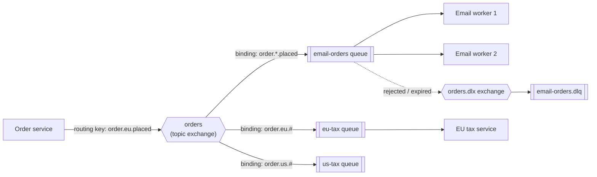
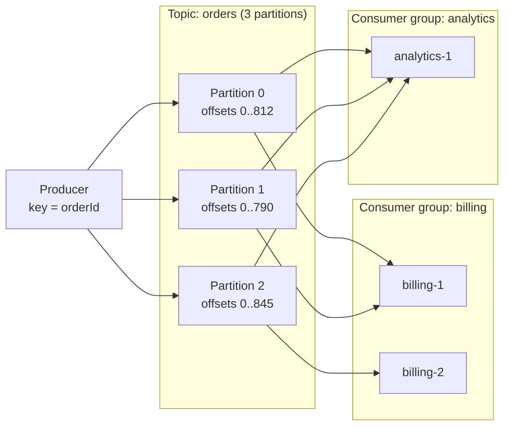
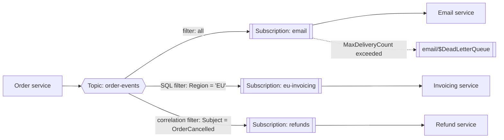

import { Tabs, TabItem, Aside } from '@astrojs/starlight/components';
import QuizBlock from '~/components/QuizBlock.astro';

## Why it matters in interviews

*"Kafka or RabbitMQ?"* and *"why did you use Service Bus?"* are favourites because the answer reveals whether you understand the **model** behind each broker: a smart broker that routes and deletes messages (RabbitMQ, Service Bus) versus a **distributed log** that keeps events and lets consumers track their own position (Kafka). Get the vocabulary exactly right: exchange, binding, partition, offset, consumer group, subscription, session, dead-letter queue.

## Core idea

Two families:

- **Message queues / brokers** (RabbitMQ, Azure Service Bus, AWS SQS): the broker tracks each message, delivers it to a consumer, waits for an **ack**, then **deletes** it. Great for **work distribution** and commands.
- **Event logs / streams** (Kafka, Azure Event Hubs, AWS Kinesis): the broker **appends** events to a partitioned log and **keeps them** for a retention period. Consumers read sequentially and store their **offset**. Great for high-throughput event streams, **replay** and multiple independent readers.

### RabbitMQ: exchanges, bindings, queues

Producers never publish directly to a queue. They publish to an **exchange** with a **routing key**. **Bindings** connect exchanges to queues using a binding key (or headers). Consumers read from queues.

| Exchange type | Routing rule | Typical use |
|---|---|---|
| **direct** | Routing key equals binding key | Commands to a specific queue |
| **fanout** | Copy to every bound queue, key ignored | Broadcast events |
| **topic** | Pattern match on dot-separated words: `*` = exactly one word, `#` = zero or more words | Events filtered by category/region |
| **headers** | Match on message header values | Rare; routing on several attributes |



Key RabbitMQ concepts:

- **Acks**: with manual ack, the broker redelivers a message if the consumer's channel closes before `ack`. `nack`/`reject` with `requeue: false` routes it to a **dead-letter exchange** if one is configured.
- **Prefetch** (`basic.qos`): how many unacked messages a consumer may hold. Too high starves other consumers, too low hurts throughput.
- **Competing consumers**: several consumers on one queue share the work, round-robin within prefetch limits.
- **Queue types**: classic queues, **quorum queues** (replicated with Raft, the recommended choice for durability; classic mirrored queues were removed in RabbitMQ 4.0) and **streams** (an append-only log with replay, closer to Kafka).
- **Publisher confirms**: the broker confirms each persisted message so the producer knows it was not lost.

### Kafka: topics, partitions, offsets, consumer groups

A **topic** is split into **partitions**. Each partition is an ordered, append-only log; every record gets an increasing **offset**. The producer picks the partition by hashing the record **key**, so all events for one key (say one `orderId`) land in the same partition and stay **in order**. There is **no ordering across partitions**.

A **consumer group** is a set of consumers sharing the work for a topic. Each partition is assigned to **exactly one** consumer in the group, so the maximum useful parallelism equals the partition count. Different groups read independently, each with its own committed offsets: that is how Kafka does pub/sub.



Key Kafka concepts:

- **Retention**: records are kept for a time or size limit whether consumed or not. Consumers can **rewind** offsets and replay.
- **Log compaction**: for a compacted topic Kafka keeps at least the **latest record per key**, which makes it a changelog (for example current customer profile).
- **Replication**: each partition has a leader and followers; the **in-sync replicas (ISR)** are the followers that are caught up. Producers with `acks=all` wait for all in-sync replicas, combined with the topic setting `min.insync.replicas`.
- **Rebalancing**: when consumers join or leave a group, partitions are reassigned. Long processing that exceeds `max.poll.interval.ms` gets the consumer kicked out.
- **No per-message ack or built-in DLQ**: a consumer commits an offset ("everything up to here is done"). Retries and dead-letter topics are application patterns.
- Modern Kafka (4.x) runs in **KRaft** mode without ZooKeeper.

### Azure Service Bus: queues, topics, subscriptions, sessions

A fully managed enterprise broker in a **namespace**. **Queues** give point-to-point delivery. **Topics** give pub/sub: each **subscription** behaves like its own virtual queue with an optional **filter** (SQL filter on application properties, or a cheaper correlation filter).



Key Service Bus features:

- **Peek-lock** (default): the message is locked for the lock duration; the receiver must **complete**, **abandon**, **dead-letter** or **defer** it. **Receive-and-delete** removes it immediately (at-most-once).
- **Dead-letter queue**: every queue and subscription has one. Messages land there after `MaxDeliveryCount` (default 10) failed deliveries, on TTL expiry if enabled, on filter evaluation errors, or when explicitly dead-lettered.
- **Sessions**: messages with the same `SessionId` are delivered **in order** to one receiver at a time, which gives FIFO per entity (per order, per customer). Sessions also store session state.
- **Duplicate detection**: drops messages with a `MessageId` already seen within a configured time window.
- **Scheduled messages** (`ScheduledEnqueueTime`), **deferral**, **auto-forwarding**, and **transactions** across entities in the same namespace.
- Tiers: Basic (queues only), Standard (topics, sessions, shared capacity), Premium (dedicated capacity, larger messages, network isolation).

Related Azure services: **Event Hubs** is the Kafka-like streaming service (it exposes a Kafka-compatible endpoint), **Event Grid** is push-based event routing for reactive, lightweight notifications, and **Storage Queues** are a cheap, simple queue.

### Comparison table

| | RabbitMQ | Kafka | Azure Service Bus | AWS SQS / SNS |
|---|---|---|---|---|
| Model | Smart broker, push to consumers | Distributed partitioned log, consumers pull | Managed broker | SQS queue (pull) + SNS topic (push fan-out) |
| Message after consumption | Deleted on ack | **Kept** until retention expires | Deleted on complete | Deleted when consumer deletes it |
| Replay | No (yes with Streams) | **Yes**, reset offsets | No | No |
| Ordering | Per queue, weakened by multiple consumers and requeues | **Per partition** (by key) | **Per session** (FIFO) | SQS FIFO per message group id; Standard is best effort |
| Routing | Very flexible (exchanges, bindings) | By topic and key only | Topic subscriptions with filters | SNS subscription filter policies |
| Throughput | High (tens of thousands/s per node) | **Very high** (millions/s across a cluster) | High, tier dependent | Very high, managed |
| DLQ | Dead-letter exchange | Pattern (dead-letter topic) | Built in per entity | Built in redrive policy |
| Hosting | Self-hosted, or managed (e.g. Amazon MQ, CloudAMQP) | Self-hosted, Confluent Cloud, Amazon MSK, Event Hubs Kafka endpoint | Azure PaaS only | AWS only |
| Sweet spot | Task queues, complex routing, RPC | Event streaming, analytics, event sourcing, CDC | Enterprise workflows on Azure, ordered sessions, transactions | Serverless and AWS-native decoupling |

**AWS mapping**: SQS ≈ Service Bus queue; SNS (+ SQS subscribers) ≈ Service Bus topic + subscriptions; **Amazon MSK** = managed Kafka; **Kinesis Data Streams** ≈ Event Hubs; **Amazon MQ** = managed RabbitMQ/ActiveMQ; **EventBridge** ≈ Event Grid.

### When to choose which

- **Azure Service Bus (AWS: SQS/SNS)**: business commands and events in an Azure shop, need DLQ, sessions for per-entity ordering, scheduled delivery, duplicate detection, no ops team for a broker.
- **Kafka / Event Hubs (AWS: MSK / Kinesis)**: high-volume event streams (clicks, telemetry, IoT), multiple teams reading the same events at their own pace, replay to rebuild read models, stream processing, change data capture.
- **RabbitMQ**: rich routing, on-premises or multi-cloud, low latency task queues, protocols like AMQP/MQTT/STOMP, and teams already running it.

A sentence that lands well: *"Queues are for work that must be done once; logs are for facts that many readers may want to re-read."*

## Code

**RabbitMQ.Client 7.x** (fully async API): declare topology, publish with confirms.

```csharp
var factory = new ConnectionFactory { HostName = "localhost" };
await using var connection = await factory.CreateConnectionAsync();
await using var channel = await connection.CreateChannelAsync(
    new CreateChannelOptions(publisherConfirmationsEnabled: true, publisherConfirmationTrackingEnabled: true));

await channel.ExchangeDeclareAsync("orders", ExchangeType.Topic, durable: true);
await channel.QueueDeclareAsync("email-orders", durable: true, exclusive: false, autoDelete: false,
    arguments: new Dictionary<string, object?>
    {
        ["x-queue-type"] = "quorum",
        ["x-dead-letter-exchange"] = "orders.dlx",
    });
await channel.QueueBindAsync("email-orders", "orders", routingKey: "order.*.placed");

var props = new BasicProperties { Persistent = true, ContentType = "application/json", MessageId = orderId.ToString() };
var body = JsonSerializer.SerializeToUtf8Bytes(new OrderPlaced(orderId, customerId, total));
// With confirmations enabled, this completes when the broker confirms and throws if it nacks.
await channel.BasicPublishAsync("orders", "order.eu.placed", mandatory: true, basicProperties: props, body: body);
```

**Azure Service Bus**: create a topic subscription with a SQL filter (usually done in infrastructure-as-code, shown here for clarity).

```csharp
var admin = new ServiceBusAdministrationClient(fullyQualifiedNamespace, new DefaultAzureCredential());

await admin.CreateSubscriptionAsync(
    new CreateSubscriptionOptions("order-events", "eu-invoicing")
    {
        MaxDeliveryCount = 5,
        LockDuration = TimeSpan.FromMinutes(1),
        DeadLetteringOnMessageExpiration = true,
    },
    new CreateRuleOptions("eu-only", new SqlRuleFilter("Region = 'EU'")));
```

Full producer and consumer code for all three brokers is on [Messaging in .NET](../dotnet-messaging/).

## Interview Q&A

<details>
<summary>What is the fundamental difference between Kafka and RabbitMQ?</summary>

RabbitMQ is a message broker: it routes messages through exchanges to queues, pushes them to consumers, tracks acks per message and deletes them once acked. Kafka is a distributed log: it appends records to partitions and keeps them for a retention period; consumers pull and track their own offsets, so many groups can read and replay the same data. RabbitMQ optimises for flexible routing and per-message work distribution, Kafka for throughput, retention and replay.
</details>

<details>
<summary>How does Kafka guarantee ordering?</summary>

Only within a partition. Records with the same key go to the same partition (default partitioner hashes the key), so per-key order is preserved as long as the partition count does not change and the producer does not reorder on retry (the idempotent producer prevents that). There is no global order across partitions.
</details>

<details>
<summary>You have 6 partitions and 10 consumers in one group. What happens?</summary>

Only 6 consumers get a partition; 4 sit idle as hot standbys. Each partition goes to exactly one consumer in a group. To scale further you must increase partitions, which changes the key-to-partition mapping for new records and can break per-key ordering during the transition.
</details>

<details>
<summary>What is a consumer group and how does Kafka do pub/sub with it?</summary>

A consumer group is a set of consumers that split a topic's partitions between them, sharing the work like competing consumers. Pub/sub is achieved by giving each subscribing application its own group: every group receives every record and keeps its own offsets.
</details>

<details>
<summary>Explain Service Bus sessions. When would you use them?</summary>

Setting `SessionId` on messages groups them; a session-enabled queue or subscription delivers all messages of one session in order to a single receiver that holds the session lock. Different sessions are processed in parallel. Use them when you need FIFO per entity, for example all events for one order, without serialising the whole queue. AWS equivalent: SQS FIFO with `MessageGroupId`.
</details>

<details>
<summary>Peek-lock vs receive-and-delete?</summary>

Peek-lock locks the message and waits for the receiver to complete it; if the receiver crashes or the lock expires, the message becomes available again and its delivery count increases. That gives at-least-once delivery. Receive-and-delete removes the message as soon as it is handed out, which is faster but at-most-once: a crash loses it.
</details>

<details>
<summary>What is log compaction?</summary>

A Kafka topic cleanup policy that keeps at least the latest record for each key and removes older ones in the background (a record with a null value, a tombstone, eventually deletes the key). The topic becomes a snapshot of current state per key, useful for changelogs and rebuilding caches.
</details>

<details>
<summary>Which would you choose for an order-processing system on Azure, and why?</summary>

Azure Service Bus: business messages that must each be processed, per-order ordering with sessions, built-in DLQ, duplicate detection, scheduled retries, and no broker to operate. If the same platform also needs a high-volume clickstream or analytics feed, add Event Hubs for that rather than forcing one broker to do both.
</details>

<details>
<summary>What do topic exchange wildcards `*` and `#` mean?</summary>

Routing keys are dot-separated words. `*` matches exactly one word, `#` matches zero or more words. `order.*.placed` matches `order.eu.placed` but not `order.eu.retail.placed`; `order.#` matches all of them and `order` itself.
</details>

## Pitfalls

<Aside type="caution" title="Common mistakes">

- **Treating Kafka as a queue**: no per-message ack, no built-in DLQ, parallelism capped by partitions. A poison record blocks its partition until you handle it.
- **Too few partitions** on day one. Adding them later remaps keys and breaks ordering assumptions.
- **Auto-ack in RabbitMQ** (or receive-and-delete in Service Bus) for messages that matter: a crash loses them.
- **Huge prefetch** values that let one slow consumer hoard messages.
- **Large payloads** in messages. Use the claim-check pattern: store the blob in Azure Blob Storage (AWS: S3) and send a reference.
- **Assuming exactly-once** from any broker without idempotent consumers. See [Delivery Guarantees](../delivery-guarantees/).

</Aside>

## Related

- [Delivery Guarantees & Idempotency](../delivery-guarantees/)
- [Messaging in .NET](../dotnet-messaging/)
- [Queues & Pub/Sub Basics](../../system-design/messaging-basics/)
- [Azure ↔ AWS Mapping](../../system-design/azure-aws-mapping/)

## Quick quiz

<QuizBlock section="microservices" topic="message-brokers" />
