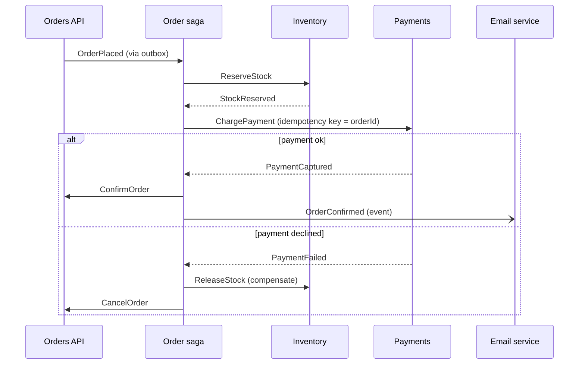
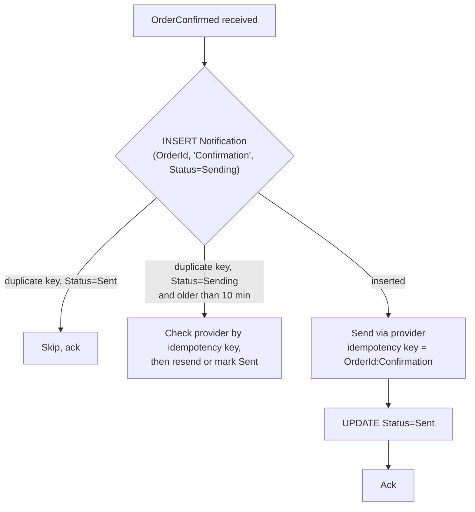
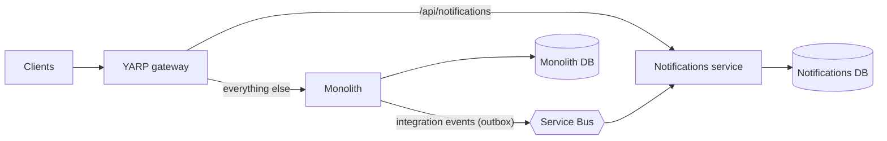
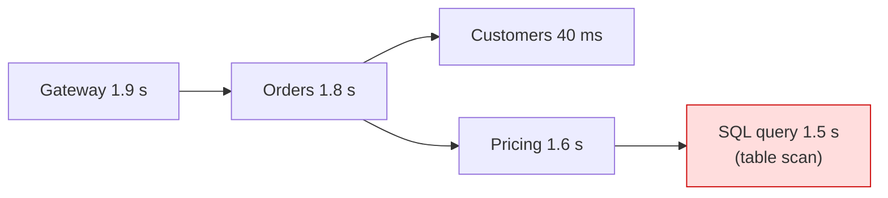

import { Tabs, TabItem, Aside } from '@astrojs/starlight/components';
import QuizBlock from '~/components/QuizBlock.astro';

## Why it matters in interviews

At 3-4 years, microservices rounds are mostly **open scenarios**: the interviewer describes a situation and watches how you reason. They reward a calm structure more than buzzwords. Each scenario below follows the same five steps, which you can reuse for any question.

## Core idea

**The answer framework**

1. **Clarify**: volumes, latency expectations, consistency needs, what "failure" means to the business, existing stack (Azure? .NET?).
2. **Design**: the components and the message flow. Name commands vs events and sync vs async.
3. **Diagram**: draw it (sequence diagrams are best for flows).
4. **Failure handling**: walk through what breaks at each arrow and how the system recovers.
5. **Trade-offs**: what you gave up and what you would do differently at 10x scale.

### Scenario 1: Order → payment → inventory → email. What fails and how do you recover?

**Clarify.** Is payment authorised at checkout or captured later? Can we oversell slightly (backorder) or never? Is email part of the business transaction? (Usually not: an order is valid even if the email is late.)

**Design.** Orders API saves the order as `Pending` and an `OrderPlaced` event in the **outbox** in one transaction, then returns `202 Accepted` with the order id. An **orchestrated saga** (MassTransit state machine on Azure Service Bus; AWS: Step Functions or SQS/SNS) drives: reserve stock → charge payment → confirm order → publish `OrderConfirmed`. Email is a separate consumer of `OrderConfirmed`, outside the saga.



**Failure handling, arrow by arrow.**

| Failure | Recovery |
|---|---|
| API crashes after commit, before publish | Outbox relay publishes later |
| Broker down | Outbox rows wait; relay retries; API still accepts orders |
| Inventory service down | Message waits in its queue; saga timeout (e.g. 15 min) cancels if needed |
| Out of stock | `StockReservationFailed` → saga cancels order, nothing to compensate |
| Payment gateway timeout (unknown result) | Retry with the **same idempotency key**; if still unknown, query status before compensating |
| Payment declined | Compensate: release stock, cancel order, notify user |
| Duplicate `PaymentCaptured` | Saga ignores events not valid in current state; consumers are idempotent |
| Email provider down | Retries with backoff, then DLQ; order stays confirmed |

**Trade-offs.** Orchestration gives one place to see order state and handle timeouts, at the cost of a central component. The user sees "Order received, confirming…" instead of an instant confirmation (eventual consistency). Reserving stock before payment can hold stock for abandoned payments, so reservations need an expiry.

### Scenario 2: How do you guarantee a customer never gets duplicate emails?

**Clarify.** "Never" across what window? Is a rare duplicate acceptable for marketing mail but not for "your payment was taken"? Does the email provider support idempotency keys?

**Design.** Email consumer is idempotent with a **sent-notifications table** keyed by `(OrderId, TemplateType)`, a natural business key rather than the message id (two different messages may describe the same fact). Before sending, **claim** the row; after the provider accepts, mark it sent.



**Failure handling.** Crash after the provider accepted but before `Status=Sent`: on redelivery the row is `Sending`, so we check the provider (or rely on its idempotency key) instead of blindly resending. Provider down: retry with backoff, DLQ after N attempts, alert. Duplicate events from the outbox or broker: blocked by the unique key.

**Trade-offs.** True exactly-once to a human inbox is impossible (SMTP itself can duplicate); you can make duplicates extremely rare. The claim-then-send design favours "maybe late" over "maybe twice". If the provider honours idempotency keys, most of the edge cases disappear.

### Scenario 3: Kafka or Azure Service Bus?

**Clarify.** What are the messages: business commands/events (orders, payments) or high-volume streams (clicks, telemetry, IoT)? Volume per second? Need replay? Per-entity ordering? Team skills and ops capacity? Already on Azure?

**Decision table.**

| Need | Pick |
|---|---|
| Order workflow, thousands of msgs/s, DLQ, sessions for per-order FIFO, scheduled retries, minimal ops | **Azure Service Bus** (AWS: SQS/SNS) |
| 100k+ events/s, many independent consumers, replay to rebuild read models, stream processing | **Kafka** (Confluent Cloud, Amazon MSK) or **Azure Event Hubs** with its Kafka endpoint |
| Complex routing, on-premises, multi-protocol | RabbitMQ |

**Answer shape.** *"For the order workflow I'd choose Service Bus: each message is a unit of work, I need dead-lettering, sessions and duplicate detection, and it is fully managed. For the clickstream feeding analytics and recommendations I'd use Event Hubs or Kafka, because multiple teams need to read the same events at their own pace and replay them. Using both is normal."*

**Trade-offs.** Kafka gives retention and throughput but you build DLQ, delayed retries and per-message ack semantics yourself, and parallelism is capped by partitions. Service Bus gives rich per-message features but no replay after completion and lower peak throughput.

### Scenario 4: How would you split our monolith?

**Clarify.** Why split: release contention, scaling hotspots, team growth, reliability? Team size? Test coverage and CI/CD maturity? Which parts change most often?

**Design.**

1. **Modularise first**: draw bounded contexts with the business, enforce module boundaries in code, give each module its own schema. Many problems are solved here.
2. **Put a gateway in front** (YARP or Azure API Management) to enable strangler-fig routing.
3. **Pick the first extraction**: high change rate or scaling need, low coupling, clear data (notifications, search, reporting).
4. **Separate data**: new service gets its own database; sync via events or CDC during migration; the monolith publishes integration events through an outbox.
5. **Shift traffic gradually** (feature flag or percentage routing), compare results, then delete the old code.
6. Build the **platform** alongside: pipelines per service, OpenTelemetry, central logs, contract tests.



**Failure handling.** Keep rollback cheap: routing switch back to the monolith; dual-run with comparison for read paths; never share tables between old and new during the transition except through an explicit sync.

**Trade-offs.** More moving parts and eventual consistency in exchange for independent deploys. If the real problem was slow builds or messy code, a modular monolith may be the better end state.

### Scenario 5: A request across five services is slow. How do you debug it?

**Clarify.** Always slow or only sometimes (p99)? Since when (a deploy)? All users or some tenants/regions?

**Approach.**

1. **Find the trace**: by trace id from the error/response, or query traces with duration over the SLO in Application Insights / Jaeger (AWS: X-Ray).
2. **Read the waterfall**: which span dominates? Are spans sequential that could be parallel? Are there **gaps** between spans (queue wait, thread-pool starvation, retries, cold starts)?
3. **Drill into that service**: logs filtered by trace id, metrics (DB query duration, connection pool waits, CPU, GC, thread pool queue length), recent deploys.
4. **Common culprits**: N+1 queries, missing index, sync-over-async causing thread-pool starvation, chatty sequential calls, retries hiding a failing dependency, cache stampede, message sitting in a queue because consumers are scaled down.



**Fix and prevent.** Fix the hotspot, then add an SLO alert on p95/p99, set timeouts so one slow dependency can't hold the whole chain, and consider caching or parallel calls.

### Scenario 6: The queue backlog keeps growing. What do you do?

**Clarify.** Is throughput down (consumers failing or slow) or is input up (traffic spike)? Is the DLQ also growing?

**Approach.** Check consumer error rate and DLQ: a **poison message** or a failing dependency causing retries looks like a slow consumer. If processing is healthy but slow: scale out consumers (KEDA on AKS or Azure Container Apps scale rules on queue length; AWS: scaling on SQS queue depth), raise concurrency within limits of the database, batch work. For Kafka, check **consumer lag per partition**: one hot partition means a skewed key, and more consumers than partitions do not help.

**Trade-offs.** Scaling consumers can overload the downstream database; protect it with concurrency limits. If the work is not urgent (reports, emails), a backlog that drains overnight may be fine: messaging exists precisely to absorb spikes.

### Scenario 7: Payments is down during a flash sale. What happens to checkout?

**Clarify.** Does the business accept orders without immediate payment (pay later, authorise later)? How long are outages typically?

**Design options.**

- **Synchronous payment call**: circuit breaker opens quickly, the UI says "payments temporarily unavailable, try again", no threads pile up thanks to timeouts and bulkheads. Simple, but sales are lost.
- **Asynchronous**: accept the order as `PendingPayment`, queue `ChargePayment`; when Payments recovers, the backlog drains and the saga confirms or cancels orders. Requires an inventory reservation with expiry and clear UX ("we'll email confirmation").

**Trade-offs.** Async keeps revenue flowing but customers wait for confirmation and some orders will fail later (declined cards). Many shops authorise synchronously with a fallback provider and capture asynchronously.

## Code

**Claim-then-send email consumer** (Scenario 2):

```csharp
public sealed class OrderConfirmedEmailConsumer(NotificationsDb db, IEmailProvider email, TimeProvider clock)
    : IConsumer<OrderConfirmed>
{
    public async Task Consume(ConsumeContext<OrderConfirmed> ctx)
    {
        var key = $"{ctx.Message.OrderId}:Confirmation";
        var existing = await db.Notifications.FindAsync([key], ctx.CancellationToken);
        if (existing is { Status: NotificationStatus.Sent }) return;                       // duplicate
        if (existing is { Status: NotificationStatus.Sending } &&
            clock.GetUtcNow() - existing.ClaimedAt < TimeSpan.FromMinutes(10)) throw new RetryLaterException(key);

        if (existing is null)
        {
            db.Notifications.Add(new Notification(key, NotificationStatus.Sending, clock.GetUtcNow()));
            await db.SaveChangesAsync(ctx.CancellationToken);  // unique key: a concurrent duplicate fails here
        }

        // The provider deduplicates on the idempotency key, so a resend after a crash is safe.
        await email.SendAsync(ctx.Message.CustomerEmail, "order-confirmed", ctx.Message, idempotencyKey: key);

        var row = await db.Notifications.FindAsync([key], ctx.CancellationToken);
        row!.Status = NotificationStatus.Sent;
        await db.SaveChangesAsync(ctx.CancellationToken);
    }
}
```

`IEmailProvider` stands for your provider's client; check that the provider you use actually supports idempotency keys, otherwise use the provider's message lookup before resending.

## Interview Q&A

<details>
<summary>The interviewer says "just use a distributed transaction". How do you respond?</summary>

Explain that 2PC across services and brokers is usually unavailable (cloud databases and brokers like Kafka or Service Bus don't participate with SQL Server in MSDTC), holds locks across systems, and couples availability. Propose the outbox for atomic "save + publish", a saga for the multi-step business transaction, and idempotent consumers.
</details>

<details>
<summary>"An event was published but one subscriber never processed it." How do you investigate?</summary>

Check whether the message reached that subscriber's queue or subscription (filter rules, subscription existed at publish time), then its DLQ with the dead-letter reason, then consumer logs by message id or trace id. For Kafka, check the consumer group's committed offset and lag for that partition. Then fix and resubmit, and add an alert on DLQ depth.
</details>

<details>
<summary>How do you deploy a breaking change to an event schema with zero downtime?</summary>

Expand and contract: deploy consumers that understand both v1 and v2, then make the producer publish v2 (or both), wait until v1 messages are drained, then remove v1 support. A schema registry or contract tests in CI catch accidental breaking changes.
</details>

<details>
<summary>Two instances of a service both process the same scheduled job. How do you prevent it?</summary>

Use a distributed lock or lease (blob lease, SQL `sp_getapplock`, Redis lock with expiry), a single-active-consumer pattern (send the job as a message to a queue so only one consumer gets it), or a scheduler that guarantees one execution. Still make the job idempotent, because locks can expire mid-run.
</details>

<details>
<summary>How do you test a saga end to end?</summary>

Unit-test the state machine with an in-memory test harness (MassTransit's harness lets you publish events and assert state transitions and sent commands). Integration-test with the real broker and databases in containers (Testcontainers, the Service Bus emulator). In staging, inject failures (stop the payments container, add latency) to verify compensations and timeouts.
</details>

<details>
<summary>How would you roll out a new service version safely?</summary>

Backward-compatible API and message contracts, readiness probes, rolling or blue-green deployment, canary a small percentage of traffic (gateway or service mesh weights), watch error rate and latency SLOs, and automate rollback. For consumers, make sure old and new versions can run side by side on the same queue.
</details>

## Pitfalls

<Aside type="caution" title="Common mistakes in scenario answers">

- **Jumping to tools** ("Kafka!") before clarifying volumes and consistency needs.
- **Only describing the happy path.** Walk every arrow and say what happens when it fails.
- **Claiming exactly-once** without explaining idempotency.
- **Ignoring the user experience** of eventual consistency.
- **Forgetting operations**: DLQ alerts, dashboards, replay tooling, runbooks.
- **No trade-offs.** Every design has costs; say them before the interviewer does.

</Aside>

## Related

- [Outbox, Saga & Resilience](../reliability-patterns/)
- [Delivery Guarantees & Idempotency](../delivery-guarantees/)
- [E-commerce Order Processing case study](../../system-design/case-ecommerce-orders/)
- [Notification System case study](../../system-design/case-notification-system/)

## Quick quiz

<QuizBlock section="microservices" topic="microservices-scenarios" />
