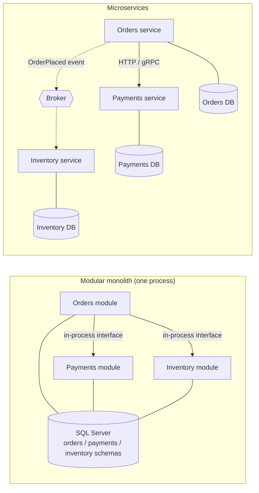
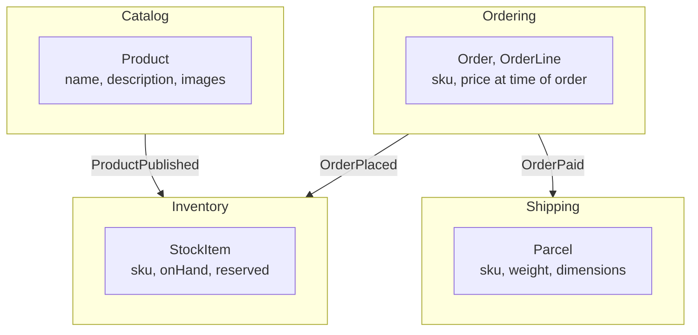
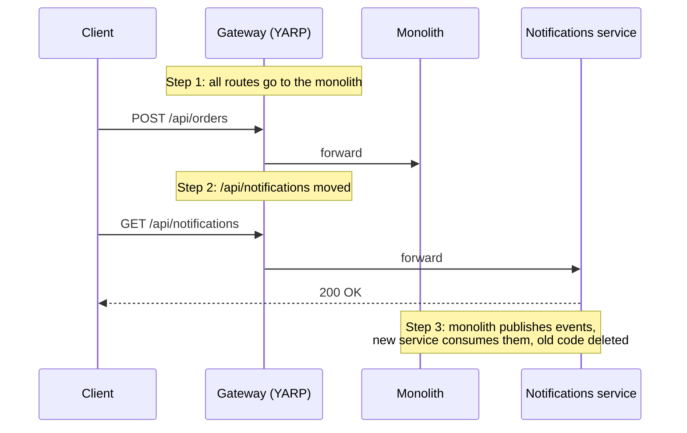

import { Tabs, TabItem, Aside } from '@astrojs/starlight/components';
import QuizBlock from '~/components/QuizBlock.astro';

## Why it matters in interviews

Almost every microservices conversation starts with *"why did your team use microservices?"* or *"would you split this monolith?"*. Interviewers are not looking for enthusiasm. They want to hear that you know microservices are an **organisational and operational trade-off**, that a well-structured monolith is often the right answer, and that you can find service boundaries using business capabilities rather than database tables.

## Core idea

| Style | Deployment unit | Data | Typical team size | Main risk |
|---|---|---|---|---|
| **Monolith** | One process, one deploy | One database | 1-3 teams | Becomes a "big ball of mud" with no internal boundaries |
| **Modular monolith** | One process, one deploy | One database, **schema or tables owned per module** | 2-6 teams | Boundaries erode if not enforced (references, shared tables) |
| **Microservices** | Many independently deployable services | **Database per service** | Many teams, each owning 1-3 services | Distributed-systems complexity, data consistency, ops cost |

A **microservice** is a small, independently deployable service that owns one business capability **and its data**, and talks to others only through APIs or messages. The key word is *independently*: if you must deploy five services together, you have a **distributed monolith**, which has the costs of both styles and the benefits of neither.



### When to split (and when not to)

Good reasons to extract a service:

- **Independent scaling**: one capability (image processing, search) needs 20 instances while the rest needs 2.
- **Independent release cadence**: a team is blocked by another team's release train.
- **Different technology or runtime needs**: a Python ML model, a CPU-heavy worker, a component with stricter compliance (PCI for payments).
- **Fault isolation**: a crash or memory leak in reporting should not take checkout down.
- **Team autonomy at scale**: 40+ engineers stepping on each other in one codebase.

Bad reasons: "it is modern", "the CV needs it", "the code is messy" (a messy monolith becomes messy microservices with network calls in between).

**Default answer in interviews:** start with a **modular monolith**, enforce module boundaries, and extract a module into a service when one of the reasons above becomes real and measurable.

### Finding boundaries: bounded contexts

Domain-Driven Design gives the vocabulary. A **bounded context** is a part of the business where a term has one precise meaning and one model. "Product" in the Catalog context has descriptions and images. In Inventory it has stock levels and warehouse bins. In Shipping it has weight and dimensions. Trying to build one shared `Product` entity for all three creates coupling.



Heuristics for good service boundaries:

- **High cohesion inside, low coupling outside.** Things that change together live together.
- **Each service owns its data.** If two services need to update the same table in one transaction, they probably belong together.
- **Few chatty calls.** If rendering one page needs 12 synchronous calls between two services, the boundary is wrong.
- **Aligned with a team** (Conway's law: systems mirror the communication structure of the organisation that builds them).

### Team topology

Conway's law works both ways. The **inverse Conway manoeuvre** means shaping teams the way you want the architecture to look. Common team types (from the book *Team Topologies*): **stream-aligned teams** own a business flow end to end (e.g. checkout), a **platform team** provides the paved road (CI/CD templates, Kubernetes, observability, a messaging library), and **enabling teams** coach others. One stream-aligned team owning 1-3 services that it can build, run and deploy alone is the target.

### The real cost of distribution

| You gain | You pay |
|---|---|
| Independent deploys and scaling | Network calls fail, are slow, and can't be wrapped in one DB transaction |
| Fault isolation | Retries, timeouts, circuit breakers and idempotency everywhere |
| Smaller codebases per team | **Eventual consistency** and sagas instead of ACID transactions |
| Tech freedom | Distributed tracing, centralised logging, contract testing, API versioning |
| Team autonomy | More infrastructure: brokers, gateways, service discovery, many pipelines |

The *fallacies of distributed computing* are worth naming: the network is **not** reliable, latency is **not** zero, bandwidth is **not** infinite, the network is **not** secure, and topology **does** change.

### Strangler fig migration

You almost never rewrite a monolith in one go. The **strangler fig** pattern puts a routing layer (a reverse proxy or gateway such as YARP or Azure API Management; AWS: API Gateway / ALB) in front of the monolith, then moves one capability at a time to a new service and redirects its routes. The monolith shrinks until it can be retired.



Practical order: pick a capability with **few inbound dependencies and clearly owned data** (notifications, reporting, search). Put an **anti-corruption layer** between the new service and the monolith's model so legacy concepts do not leak in. Keep data in sync during the transition with events or change data capture, then cut over and delete the old code.

## Code

A modular monolith keeps boundaries in code. Each module exposes a small public contract and registers itself. Other modules depend on the contract only.

```csharp
// Orders.Contracts project: the only thing other modules may reference.
namespace Orders.Contracts;

public interface IOrderModule
{
    Task<OrderSummary?> GetSummaryAsync(Guid orderId, CancellationToken ct);
}
public sealed record OrderSummary(Guid Id, decimal Total, string Status);
public sealed record OrderPlaced(Guid OrderId, Guid CustomerId, decimal Total); // integration event
```

```csharp
// Orders module (separate project): internal implementation, own DbContext and schema.
namespace Orders;

internal sealed class OrdersDbContext(DbContextOptions<OrdersDbContext> options) : DbContext(options)
{
    public DbSet<Order> Orders => Set<Order>();
    protected override void OnModelCreating(ModelBuilder b) => b.HasDefaultSchema("orders");
}

public static class OrdersModule
{
    public static IServiceCollection AddOrdersModule(this IServiceCollection services, string cs) =>
        services
            .AddDbContext<OrdersDbContext>(o => o.UseSqlServer(cs))
            .AddScoped<IOrderModule, OrderModuleFacade>(); // internal class implementing the contract
}
```

```csharp
// Program.cs of the single host. Later, Orders can move to its own host:
// callers keep IOrderModule, whose implementation becomes an HTTP/gRPC client.
var builder = WebApplication.CreateBuilder(args);
var cs = builder.Configuration.GetConnectionString("Main")!;
builder.Services.AddOrdersModule(cs).AddPaymentsModule(cs).AddInventoryModule(cs);
var app = builder.Build();
app.MapOrdersEndpoints();
app.Run();
```

Enforce the boundary with an architecture test (for example with NetArchTest or ArchUnitNET) that fails the build if `Payments` references anything in `Orders` other than `Orders.Contracts`.

**Strangler routing with YARP** (`appsettings.json`): the specific route has a lower `Order` so it is matched first, and everything else falls through to the monolith.

```json
{
  "ReverseProxy": {
    "Routes": {
      "notifications": { "ClusterId": "notifications", "Order": 1, "Match": { "Path": "/api/notifications/{**rest}" } },
      "legacy": { "ClusterId": "monolith", "Order": 100, "Match": { "Path": "{**catch-all}" } }
    },
    "Clusters": {
      "notifications": { "Destinations": { "d1": { "Address": "https://notifications-svc/" } } },
      "monolith": { "Destinations": { "d1": { "Address": "https://legacy-app/" } } }
    }
  }
}
```

## Interview Q&A

<details>
<summary>What is the difference between a monolith and a modular monolith?</summary>

Both deploy as one unit. A modular monolith adds **enforced internal boundaries**: each module owns its tables (often its own schema and `DbContext`), exposes a narrow public contract, and other modules cannot reach into its internals. That gives most of the design benefits of microservices (clear ownership, independent reasoning) without network calls, distributed transactions or extra infrastructure.
</details>

<details>
<summary>When would you NOT choose microservices?</summary>

A small team (roughly under 10-15 engineers), a new product where the domain is still changing, no mature CI/CD or observability, or strong consistency requirements across most operations. Boundaries drawn too early are expensive to move once they are network calls and separate databases. Start modular, extract later.
</details>

<details>
<summary>What is a distributed monolith and how do you spot one?</summary>

Services that are separately deployed but **tightly coupled**: they must be released together, share a database, or call each other synchronously in long chains so one failure cascades. Signs: lock-step deployments, a shared "Common" library with domain models, cross-service DB joins, and an outage in one service taking down most of the others.
</details>

<details>
<summary>How do you decide service boundaries?</summary>

Use business capabilities and DDD bounded contexts: group things that change together and share a language. Each service owns its data. Test the boundary: can this service do its main job if the others are down? Does a typical use case need many synchronous calls across the boundary? Can one team own it end to end?
</details>

<details>
<summary>Explain the strangler fig pattern.</summary>

Put a routing layer in front of the legacy system, build new functionality (or re-implement one capability) as a separate service, and route that slice of traffic to it. Repeat until the legacy system has nothing left. It lowers risk because every step is small, reversible and in production quickly, unlike a big-bang rewrite.
</details>

<details>
<summary>What is Conway's law and why does it matter here?</summary>

Organisations design systems that mirror their communication structure. If three teams share one service, its design will reflect three-way negotiations. Aligning one stream-aligned team with one or a few services keeps ownership clear and lets each team deploy alone.
</details>

<details>
<summary>How big should a microservice be?</summary>

There is no line count. A good size is "one business capability that one team can own and could rewrite in a few weeks if needed". Too small (nano-services) produces chatty calls and huge operational overhead. Too big and you lose independent deployment.
</details>

<details>
<summary>Can microservices share a database?</summary>

They should not share tables. Sharing a database **server** with a separate schema or database per service and no cross-access is a common cost-saving compromise. Sharing tables couples deployments and schema changes, and is the main cause of distributed monoliths. See [Data in Microservices](../data-management/).
</details>

## Pitfalls

<Aside type="caution" title="Common mistakes">

- **Splitting by technical layer** (a "data service", a "validation service") instead of by business capability.
- **Shared domain library** referenced by every service. Changing it forces coordinated deploys.
- **Synchronous call chains** (A calls B calls C calls D): availability multiplies down, latency adds up.
- **Big-bang rewrite** instead of strangler fig.
- **Starting with microservices** before the domain is understood, then paying to move boundaries across network and database lines.
- **No platform investment**: without CI/CD, tracing and centralised logs, 20 services are 20 times the pain.

</Aside>

## Related

- [Service Communication](../communication-patterns/)
- [Data in Microservices](../data-management/)
- [Architecture Styles](../../patterns/architecture-styles/)
- [System Design Interview Framework](../../system-design/interview-framework/)

## Quick quiz

<QuizBlock section="microservices" topic="monolith-vs-microservices" />
